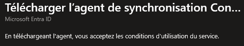
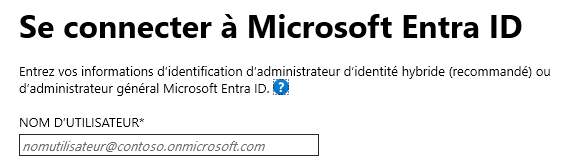
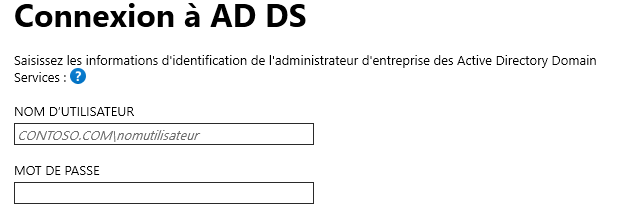
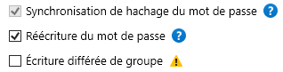
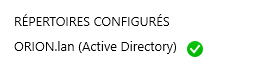
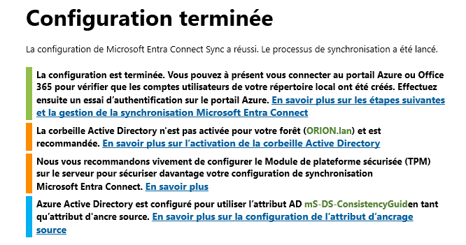
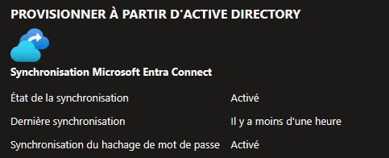
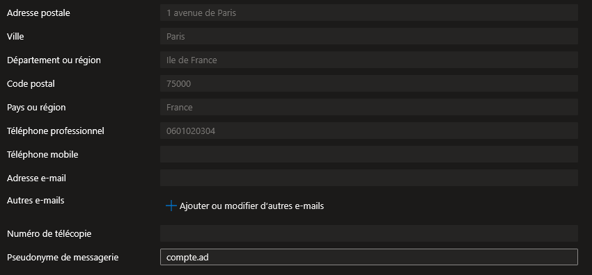

## Introduction

Cette procédure décrit comment synchroniser les identités de votre Active Directory on-premises (Windows Server AD) vers Entra ID (le cloud) grâce à Entra ID Connect. L'objectif est de permettre aux utilisateurs de se connecter aux services cloud (Azure, Microsoft 365, applications SaaS) avec le même compte et le même mot de passe que dans l'entreprise.

## Contexte et Justification

Dans la plupart des entreprises, les utilisateurs existent déjà dans un Active Directory local. Sans synchronisation, l'administrateur doit créer et maintenir chaque compte en double : une fois dans l'AD local, une fois dans Entra ID. Mot de passe oublié ? Il faut le réinitialiser aux deux endroits.

Entra ID Connect résout ce problème en créant un « pont » entre les deux mondes :

- **Un seul compte** : L'utilisateur dans l'AD local est synchronisé vers Entra ID. Il se connecte partout avec le même identifiant.
- **Un seul mot de passe** : Selon la méthode choisie (PHS, PTA, Federation), le mot de passe est soit synchronisé, soit vérifié en temps réel auprès de l'AD local.
- **Gestion centralisée** : L'administrateur gère les comptes dans l'AD local (outil qu'il connaît déjà), et les changements se propagent automatiquement vers le cloud.

## Concepts Clés

**Entra ID Connect** (anciennement Azure AD Connect) : Un logiciel installé sur un serveur Windows joint au domaine AD. Il lit les objets de l'AD local (utilisateurs, groupes, contacts) et les réplique vers Entra ID toutes les 30 minutes par défaut.

**Entra ID Connect Sync vs Cloud Sync :** Deux outils pour le même objectif. Connect Sync est l'outil historique (lourd, installé sur un serveur dédié, très configurable). Cloud Sync est la version légère (agent léger, gérée depuis le cloud, moins de fonctionnalités). Cette procédure se concentre sur Connect Sync, encore majoritaire en entreprise.

**Méthodes d'authentification :**

- **Password Hash Synchronization (PHS) :** Le hash du mot de passe AD est synchronisé vers Entra ID. L'authentification se fait entièrement dans le cloud. C'est la méthode la plus simple et la plus recommandée par Microsoft. Si l'AD local tombe en panne, les utilisateurs peuvent toujours se connecter au cloud.
- **Pass-Through Authentication (PTA) :** Le mot de passe n'est PAS synchronisé. Quand l'utilisateur se connecte au cloud, Entra ID envoie la demande d'authentification à un agent PTA installé on-premises, qui vérifie le mot de passe contre l'AD local en temps réel. Si l'AD local est indisponible, l'authentification cloud échoue.
- **Federation (AD FS) :** L'authentification est entièrement déléguée à un serveur de fédération on-premises (AD FS). C'est la méthode la plus complexe, utilisée quand des exigences spécifiques le justifient (smartcard, certificats, MFA on-prem). Microsoft la déconseille pour les nouveaux déploiements.

**Source of Authority (Source d'autorité) :** Quand un utilisateur est synchronisé depuis l'AD local, la source d'autorité est « Windows Server AD ». Cela signifie que la plupart des attributs (nom, prénom, email, appartenance aux groupes) ne peuvent être modifiés QUE dans l'AD local. Si vous essayez de les modifier dans le portail Entra ID, les champs sont grisés.

**Staging Mode (Mode intermédiaire) :** Un mode où le serveur Connect importe et traite les données mais n'exporte rien vers Entra ID. Utile pour tester une configuration ou préparer un serveur de remplacement.

**Filtrage :** Vous pouvez choisir de synchroniser uniquement certaines unités d'organisation (OU), certains domaines, ou même filtrer par attribut. Par exemple, synchroniser uniquement les utilisateurs de l'OU « Employés » et ignorer l'OU « Comptes de service ».

**Soft Match vs Hard Match :** Quand Connect trouve un utilisateur dans l'AD local et un utilisateur dans Entra ID avec le même UPN ou la même adresse email, il les « fusionne » (soft match). Le hard match utilise l'attribut ImmutableId (sourceAnchor). Les scénarios de match/mismatch sont à l'origine de la plupart des doublons lors d'une première synchronisation.

## Prérequis

- Un **domaine Active Directory** fonctionnel (Windows Server 2016+).
- Un **serveur dédié** (ou une VM) joint au domaine pour installer Entra ID Connect. Recommandé : Windows Server 2019/2022, 4 Go RAM minimum, pas un contrôleur de domaine (bien que techniquement possible en lab).
- Un **compte Global Administrator** sur le tenant Entra ID.
- Un **compte Enterprise Admin** (ou Domain Admin minimum) sur l'AD local.
- Connectivité réseau : le serveur Connect doit pouvoir joindre les URLs Microsoft sur les ports 443 (HTTPS). Liste complète : <https://learn.microsoft.com/en-us/entra/identity/hybrid/connect/tshoot-connect-connectivity>.
- Un **UPN routable** configuré dans l'AD local. Si vos utilisateurs ont un UPN en .local, il faudra ajouter un suffixe UPN routable dans l'AD avant la synchronisation, car .local n'est pas utilisable dans le cloud.
- Un domaine personnalisé vérifié dans Entra ID si vous voulez que les UPN cloud correspondent au domaine de l'entreprise.

## Méthode 1 : Configuration via Portail Azure et Wizard

### Télécharger Entra ID Connect

1. Allez dans **Entra ID \> Entra Connect** (ou cherchez « Entra Connect » dans la barre de recherche).
2. La page affiche le statut de la synchronisation (« Not enabled » si c'est la première fois).
3. Cliquez sur **« Download Connect Sync »**.



<p class="figure-caption"><b>Figure 1</b> · Télécharger Entra ID Connect</p>

4. Transférez l'installeur (AzureADConnect.msi) sur votre serveur dédié.

### Installation et Configuration Express

<div class="callout callout-note">

La configuration Express est parfaite pour un lab ou un environnement simple (un seul domaine AD, PHS, synchronisation de tous les utilisateurs).

</div>

1. Lancez l'installeur **en tant qu'administrateur** sur le serveur.
2. Acceptez les conditions de licence.
3. Sélectionnez **« Use Express Settings »** (Utiliser la configuration rapide).
4. **Connect to Entra ID :** Entrez les identifiants de votre compte Global Administrator.



<p class="figure-caption"><b>Figure 2</b> · Installation et Configuration Express</p>

5. **Connect to AD DS :** Entrez les identifiants de votre compte Enterprise Admin (ou Domain Admin).



<p class="figure-caption"><b>Figure 3</b> · Installation et Configuration Express</p>

6. **Entra ID Sign-in Configuration :** Le wizard vérifie que vos UPN sont routables. S'il affiche un avertissement sur .local, vous devez d'abord ajouter un suffixe UPN dans l'AD (voir Prérequis).
7. Cliquez sur **Install**.
8. La synchronisation initiale démarre automatiquement.

<div class="callout callout-note">

En mode Express, les choix par défaut sont : PHS activé, tous les utilisateurs et groupes synchronisés, cycle de 30 minutes.

</div>

### Configuration Personnalisée (Custom)

Si vous avez besoin de plus de contrôle (PTA, filtrage par OU, staging mode) :

1. Lancez l'installeur et sélectionnez **« Customize »**.
2. **Optional Features :** Cochez les options souhaitées :
   - « Password Hash Synchronization » (recommandé même avec PTA, comme fallback).
   - « Password Writeback » (si vous voulez le Self-Service Password Reset cloud → AD local).
   - « Group Writeback » (si vous voulez réécrire les groupes Microsoft 365 vers l'AD local).



<p class="figure-caption"><b>Figure 4</b> · Configuration Personnalisée (Custom)</p>

3. **User Sign-in :** Choisissez votre méthode d'authentification (voir « Choisir la Méthode d'Authentification »).
4. **Connect to Entra ID :** Identifiants Global Admin.
5. **Connect Directories :** Ajoutez votre forêt AD et fournissez les identifiants.



<p class="figure-caption"><b>Figure 5</b> · Configuration Personnalisée (Custom)</p>

6. **Domain and OU Filtering :** Choisissez les OU à synchroniser (voir « Filtrage par OU »).
7. **Uniquely Identifying Users :** Laissez les valeurs par défaut sauf cas particulier (multi-forêt).
8. **Filtering :** Vous pouvez filtrer par groupe (synchroniser uniquement les membres d'un groupe spécifique).
9. **Optional Features :** Confirmez vos choix.
10. **Ready to configure :** Cochez « Start synchronization when configuration completes ». Optionnel : cochez « Enable staging mode » si vous voulez valider avant d'activer.
11. **Installer**.



<p class="figure-caption"><b>Figure 6</b> · Configuration Personnalisée (Custom)</p>

### Choisir la Méthode d'Authentification

Dans l'écran « User Sign-in » du wizard :

**Password Hash Synchronization (PHS)** : Cochez cette option. C'est le choix recommandé pour la plupart des scénarios.

- Les utilisateurs s'authentifient directement auprès d'Entra ID.
- Fonctionne même si l'AD local est hors ligne.

**Pass-Through Authentication (PTA)** : Cochez cette option si l'entreprise exige que les mots de passe ne quittent jamais le réseau local.

- Un agent PTA est installé sur le serveur Connect (et sur des serveurs supplémentaires pour la HA).
- L'authentification est validée en temps réel contre l'AD local.
- Cochez aussi « Enable Password Hash Synchronization » comme filet de sécurité.

**Federation with AD FS** : Sélectionnez uniquement si vous avez une infrastructure AD FS existante. Non recommandé pour les nouveaux déploiements.

<div class="callout callout-note">

Pour votre lab, utilisez PHS. C'est le plus simple et le plus robuste.

</div>

### Filtrage par OU (Unité d'Organisation)

Dans l'écran « Domain and OU Filtering » :

1. Sélectionnez **« Sync selected domains and OUs »**.
2. Décochez tout, puis cochez uniquement les OU que vous voulez synchroniser.
3. Poursuivez le wizard.

<div class="callout callout-note">

Ne synchronisez jamais les comptes de service AD ni les comptes machine. Ils n'ont rien à faire dans Entra ID et polluent votre annuaire cloud.

</div>

### Vérifier la Synchronisation dans le Portail

1. Retournez dans **Entra ID \> Entra Connect**.
2. Le statut doit maintenant afficher **« Enabled »** avec la date de la dernière synchronisation.



<p class="figure-caption"><b>Figure 7</b> · Vérifier la Synchronisation dans le Portail</p>

3. Allez dans **Entra ID \> Utilisateurs \> Tous les utilisateurs**.
4. Les utilisateurs synchronisés apparaissent.
5. Cliquez sur un utilisateur synchronisé : vous verrez que certains champs sont grisés (non modifiables depuis le cloud).



<p class="figure-caption"><b>Figure 8</b> · Vérifier la Synchronisation dans le Portail</p>

## Méthode 2 : Forcer une Synchronisation via PowerShell

<div class="callout callout-note">

Ces commandes s'exécutent sur le serveur où Entra ID Connect est installé, pas depuis n'importe quel poste.

</div>

### Synchronisation Delta (Incrémentale)

Synchronise uniquement les changements depuis le dernier cycle :

```powershell
Start-ADSyncSyncCycle -PolicyType Delta
```

<div class="callout callout-note">

C'est la commande que vous utiliserez 90% du temps. Vous venez de créer un utilisateur dans l'AD et ne voulez pas attendre 30 minutes ? Delta.

</div>

### Synchronisation Complète (Full)

Resynchronise TOUS les objets (long, à utiliser rarement) :

```powershell
Start-ADSyncSyncCycle -PolicyType Initial
```

<div class="callout callout-note">

Utilisez uniquement après un changement de règle de filtrage ou en cas de problème de cohérence. Sur un AD de 10 000 objets, ça peut prendre plusieurs minutes.

</div>

### Vérifier le Statut du Scheduler

```powershell
Get-ADSyncScheduler
```

Les champs importants :

- `AllowedSyncCycleInterval` : intervalle minimum (par défaut 30 minutes).
- `CurrentlyEffectiveSyncCycleInterval` : intervalle actuel.
- `SyncCycleEnabled` : doit être `True`.
- `NextSyncCycleStartTimeInUTC` : prochaine synchronisation prévue.

### Vérifier les Erreurs de Synchronisation

```powershell
Get-ADSyncRunStepResult | Select-Object -Last 5 | Format-Table StepResult, StartDate, EndDate
```

Pour voir les erreurs détaillées :

```powershell
Get-ADSyncCSObject -ErrorOnly | Select-Object ObjectName, ErrorDescription
```

<div class="callout callout-note">

Les erreurs les plus courantes : « InvalidSoftMatch » (UPN en doublon), « AttributeValueMustBeUnique » (proxyAddress en conflit), et « LargeObject » (trop de membres dans un groupe).

</div>

## Vérifications

**Statut Connect :** Dans Entra ID \> Entra Connect, le statut est « Enabled » et la dernière synchronisation date de moins de 30 minutes.

**Utilisateurs visibles :** Dans Entra ID \> Utilisateurs, les comptes AD locaux apparaissent avec la source « Windows Server AD ».

**Authentification fonctionnelle :** Connectez-vous à https://portal.azure.com avec un compte synchronisé. Le mot de passe AD local doit fonctionner.

**Filtrage respecté :** Vérifiez que les comptes des OU non cochées (ex : Comptes-Service) ne sont PAS présents dans Entra ID.

**Source d'autorité :** Cliquez sur un utilisateur synchronisé dans le portail. Les champs nom, prénom, etc. doivent être grisés avec la mention « Ce champ est synchronisé depuis votre annuaire local ».

## Dépannage

**« Password Hash Synchronization heartbeat was skipped » dans le Health du portail :** Le service de synchronisation des mots de passe est bloqué. Sur le serveur Connect, relancez le service : `Restart-Service ADSync`. Puis forcez un delta : `Start-ADSyncSyncCycle -PolicyType Delta`.

**Les utilisateurs ne se synchronisent pas :** Vérifiez le filtrage par OU. Si l'utilisateur est dans une OU non cochée, il ne sera jamais synchronisé. Vérifiez aussi que l'utilisateur n'est pas dans la corbeille AD ou désactivé (les comptes désactivés sont synchronisés par défaut, mais peuvent être filtrés).

**« Unable to validate credentials » lors de l'installation :** Le serveur Connect ne peut pas joindre les endpoints Microsoft. Vérifiez la connectivité : `Test-NetConnection login.microsoftonline.com -Port 443`. Si un proxy est en place, configurez-le dans le wizard Connect.

**« Identity synchronization error: AttributeValueMustBeUnique » :** Deux utilisateurs (ou un utilisateur cloud natif et un utilisateur AD) ont le même UPN ou la même proxyAddress. Corrigez le doublon dans l'AD local, puis forcez un delta sync.

**Les attributs modifiés dans l'AD ne se propagent pas :** Attendez 30 minutes (le cycle par défaut) ou forcez un delta sync. Si ça persiste, vérifiez que l'attribut modifié fait partie des attributs synchronisés (par défaut, Connect synchronise un ensemble prédéfini d'attributs, pas tous).

## Conseils et Bonnes Pratiques

**Activez toujours PHS, même si vous utilisez PTA ou la fédération.** PHS sert de méthode de secours. Si votre infrastructure on-prem tombe, les utilisateurs pourront quand même se connecter au cloud. Microsoft appelle ça le « disaster recovery authentication ».

**Ne jamais installer Connect sur un contrôleur de domaine en production.** Techniquement ça fonctionne (et c'est acceptable en lab), mais en production, la charge et les risques de sécurité justifient un serveur dédié.

**Activez le Password Writeback si vous utilisez SSPR.** Le Self-Service Password Reset d'Entra ID permet aux utilisateurs de réinitialiser leur mot de passe cloud. Sans Password Writeback, le nouveau mot de passe cloud ne sera pas synchronisé vers l'AD local, créant un décalage entre les deux mots de passe.

**Surveillez Entra Connect Health.** C'est un service de monitoring (nécessite P1) qui vous alerte si la synchronisation échoue, si les mots de passe ne se synchronisent plus, ou si le serveur Connect est hors ligne. Configuration : installez l'agent Health sur le serveur Connect.

**Planifiez la migration vers Cloud Sync.** Microsoft pousse Cloud Sync comme le remplaçant à long terme d'Entra ID Connect. Pour les nouveaux déploiements simples, évaluez si Cloud Sync répond à vos besoins (multi-forêt, filtrage basique). Pour les configurations complexes, Connect Sync reste nécessaire.

## Procédures Liées

- [Configuration du Conditional Access et MFA](/procedures/azure/configuration-du-conditional-access-et-mfa) *(Les utilisateurs synchronisés sont soumis aux mêmes policies Conditional Access que les utilisateurs cloud)*
- [Gestion des Utilisateurs et des Rôles](/procedures/azure/gestion-des-utilisateurs-et-des-roles) *(Les utilisateurs synchronisés reçoivent des rôles RBAC de la même manière que les utilisateurs cloud natifs)*
- [Gestion des Managed Identities (System & User Assigned)](/procedures/azure/gestion-des-managed-identities-system-user-assigned) *(Les Managed Identities sont purement cloud et ne sont pas affectées par la synchronisation)*
