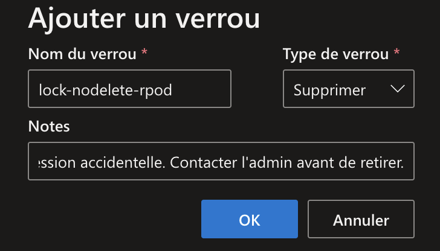
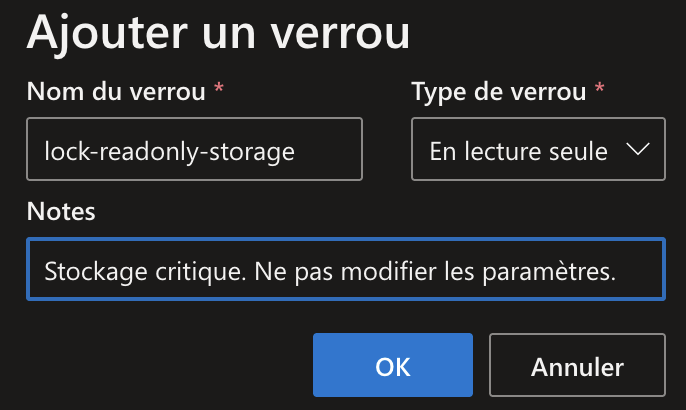
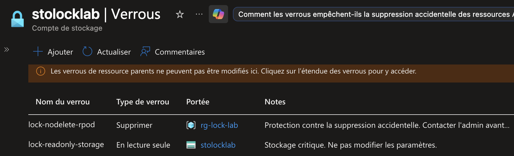
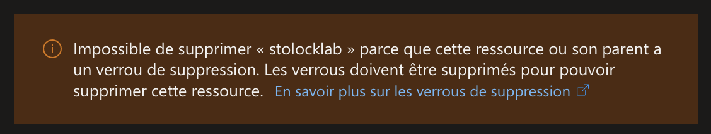
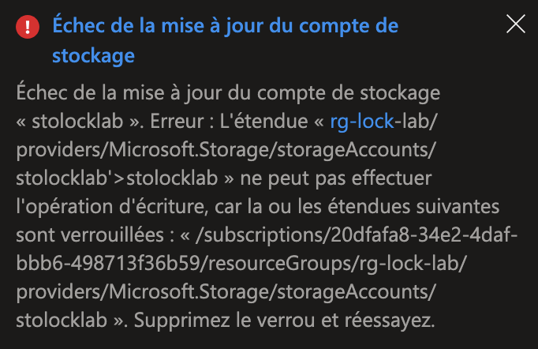

## Introduction

Cette procédure décrit comment protéger vos ressources Azure contre les suppressions accidentelles et les modifications non désirées grâce aux ResourceLocks. C'est un filet de sécurité simple mais puissant : même un Owner ne pourra pas supprimer une ressource verrouillée sans d'abord retirer le lock.

## Contexte et Justification

Scénario réel : un administrateur fait du nettoyage et supprime le Resource Group « rg-prod-db » en pensant que c'est un groupe de test. Dedans se trouvait le serveur SQL de production avec 3 ans de données. Un lock « CanNotDelete » aurait empêché cette erreur en bloquant la suppression avec un message explicite.

Les locks sont complémentaires aux policies et au RBAC :

- **RBAC** contrôle **qui** peut faire quoi.
- **Policy** contrôle **comment** les ressources doivent être configurées.
- **Lock** empêche les actions destructrices **même pour les utilisateurs autorisés**.

## Concepts Clés

**CanNotDelete (Suppression impossible) :** Les utilisateurs autorisés peuvent lire et modifier la ressource, mais personne ne peut la supprimer. C'est le type le plus courant en production.

**ReadOnly (Lecture seule) :** Les utilisateurs autorisés peuvent uniquement lire la ressource. Aucune modification ni suppression n'est possible. Cela revient fonctionnellement à donner le rôle « Reader » à tout le monde sur cette ressource, indépendamment de leurs vrais rôles RBAC.

**Héritage :** Un lock appliqué sur un Resource Group s'applique automatiquement à toutes les ressources qu'il contient (existantes et futures). Un lock appliqué sur un Abonnement s'applique à tous les Resource Group et ressources.

**Scope du lock :** Un lock peut être appliqué à trois niveaux : Abonnement, Resource Group, ou Ressource individuelle.

## Prérequis

- Un abonnement Azure actif.
- Le rôle **Owner** ou **User Access Administrator** sur le scope cible. Les rôles Contributor et Reader ne peuvent PAS gérer les locks, c'est logique car le lock est justement là pour les empêcher de supprimer.
- Un Resource Group de test : rg-lock-lab, contenant au moins une ressource (un compte de stockage par exemple).

## Méthode 1 : Configuration via Portail Azure

### Appliquer un Lock sur un Resource Group

1. Allez sur votre **Resource Group** (ex : rg-lock-lab).
2. Dans le menu de gauche, cliquez sur **Verrous** (Locks).
3. Cliquez sur **+ Ajouter**.
4. **Nom du verrou :** lock-nodelete-prod.
5. **Type de verrou :** Supprimer (CanNotDelete).
6. **Notes :** « Protection contre la suppression accidentelle. Contacter l'admin avant de retirer ».



<p class="figure-caption"><b>Figure 1</b> · Appliquer un Lock sur un Resource Group</p>

7. Cliquez sur **OK.**

<div class="callout callout-note">

Toutes les ressources dans ce Resource Group sont désormais protégées contre la suppression.

</div>

### Appliquer un Lock sur une Ressource Individuelle

1. Allez sur une **ressource spécifique** (ex : un compte de stockage).
2. Menu de gauche \> **Verrous** (Locks).
3. Cliquez sur **+ Ajouter.**
4. **Nom :** lock-readonly-storage.
5. **Type :** Lecture seule (ReadOnly).
6. **Notes :** « Stockage critique. Ne pas modifier les paramètres ».



<p class="figure-caption"><b>Figure 2</b> · Appliquer un Lock sur une Ressource Individuelle</p>

7. Cliquez sur **OK.**

<div class="callout callout-note">

Ce lock s'ajoute au lock hérité du Resource Group. La ressource est maintenant en lecture seule (le lock le plus restrictif l'emporte).

</div>

### Visualiser et Supprimer un Lock

1. Sur le Resource Group ou la ressource \> **Verrous.**
2. Vous voyez la liste de tous les locks, avec une colonne **Scope** indiquant si le lock est direct ou hérité.



<p class="figure-caption"><b>Figure 3</b> · Visualiser et Supprimer un Lock</p>

3. Pour supprimer : cliquez sur l'icône **Supprimer** (poubelle) à droite du lock.
   - Vous ne pouvez supprimer que les locks dont le scope est la ressource actuelle. Les locks hérités doivent être supprimés depuis leur scope d'origine.

## Méthode 2 : Configuration via PowerShell

### Créer un Lock CanNotDelete

Sur un Resource Group :

```powershell
New-AzResourceLock `
    -LockName "lock-nodelete-prod" `
    -LockLevel CanNotDelete `
    -ResourceGroupName "rg-lock-lab" `
    -LockNotes "Protection contre la suppression accidentelle" `
    -Force
```

Sur une ressource spécifique :

```powershell
New-AzResourceLock `
    -LockName "lock-nodelete-storage" `
    -LockLevel CanNotDelete `
    -ResourceGroupName "rg-lock-lab" `
    -ResourceName "stolocklab" `
    -ResourceType "Microsoft.Storage/storageAccounts" `
    -Force
```

### Créer un Lock ReadOnly

```powershell
New-AzResourceLock `
    -LockName "lock-readonly-storage" `
    -LockLevel ReadOnly `
    -ResourceGroupName "rg-lock-lab" `
    -ResourceName "stolocklab" `
    -ResourceType "Microsoft.Storage/storageAccounts" `
    -LockNotes "Stockage critique - Ne pas modifier" `
    -Force
```

### Lister les Locks

Tous les locks d'un Resource Group :

```powershell
Get-AzResourceLock -ResourceGroupName "rg-lock-lab" | Format-Table Name, Properties
```

Locks d'une ressource spécifique :

```powershell
Get-AzResourceLock `
    -ResourceGroupName "rg-lock-lab" `
    -ResourceName "stolocklab" `
    -ResourceType "Microsoft.Storage/storageAccounts" | Format-Table Name, @{N="Level";E={$_.Properties.Level}}
```

### Supprimer un Lock

```powershell
$lock = Get-AzResourceLock `
    -LockName "lock-readonly-storage" `
    -ResourceGroupName "rg-lock-lab" `
    -ResourceName "stolocklab" `
    -ResourceType "Microsoft.Storage/storageAccounts"
Remove-AzResourceLock -LockId $lock.LockId -Force
```

## Vérifications

**Test CanNotDelete :** Essayez de supprimer le Resource Group ou une ressource à l'intérieur -> Vous devez recevoir une erreur mentionnant « ScopeLocked ».



<p class="figure-caption"><b>Figure 4</b> · Suppression bloquée par le lock CanNotDelete</p>

**Test ReadOnly :** Essayez de modifier un paramètre du compte de stockage (ex : changer le tier d'accès de Hot à Cool) -> L'opération doit échouer.



<p class="figure-caption"><b>Figure 5</b> · Modification bloquée par le lock ReadOnly</p>

**Test héritage :** Ajoutez une nouvelle ressource dans le Resource Group verrouillé, puis essayez de la supprimer -> Le lock hérité doit la protéger immédiatement.

**Test suppression du lock :** Retirez le lock, puis réessayez la suppression -> Elle doit réussir.

## Dépannage

**« ScopeLocked – The scope '/subscriptions/…/rg-lock-lab' cannot perform delete operation because following scope(s) are locked » :** c'est le comportement normal. Identifiez quel lock bloque (le message contient le nom et l'ID du lock), supprimez-le si la suppression est intentionnelle, puis réessayez.
**« Cannot modify resource because it is locked with a ReadOnly lock » :** c'est le piège du ReadOnly sur les comptes de stockage. L'opération *listKeys* est traitée comme une action POST, donc comme une écriture : elle est bloquée par le lock. Si votre application a besoin des clés, utilisez CanNotDelete au lieu de ReadOnly, ou utilisez une Managed Identity avec un rôle RBAC data plane (« Storage Blob Data Reader ») qui n'est pas affecté par le lock.

**La suppression du Resource Group tourne indéfiniment puis échoue :** il y a un lock quelque part dans le groupe. Listez tous les locks avec `Get-AzResourceLock -ResourceGroupName rg-lock-lab` et supprimez-les tous avant de retenter.

## Conseils et Bonnes Pratiques

**CanNotDelete sur tous les Resource Group de production.** C'est la première chose à faire après la création d'un groupe de production. Ça ne gêne personne au quotidien (on peut toujours modifier les ressources) et ça évite les catastrophes.

**Évitez ReadOnly sauf pour des cas très spécifiques.** Les effets de bord sont nombreux et souvent inattendus (clés de stockage, Key Vault, diagnostics…). Utilisez-le uniquement pour des ressources qui ne doivent absolument jamais changer (ex : un VNet de production dont l'adressage est figé).

**Documentez vos locks.** Utilisez le champ Notes pour expliquer pourquoi le lock existe et qui contacter pour le retirer. Quand un collègue tombe sur un lock à 2h du matin en production, cette note peut lui éviter de paniquer.

**Automatisez avec les policies.** Vous pouvez créer une Azure Policy avec l'effet DeployIfNotExists qui ajoute automatiquement un lock CanNotDelete sur chaque Resource Group créé. Comme ça, pas de risque d'oubli.

## Procédures Liées

- [Gestion des Policy Azure](/procedures/azure/gestion-des-policy-azure) *(Les policies peuvent automatiser la création de locks via DeployIfNotExists)*
- [Gestion des Utilisateurs et des Rôles](/procedures/azure/gestion-des-utilisateurs-et-des-roles) *(Seuls les Owner et User Access Administrator peuvent gérer les locks)*
- [Création d'un Groupe de Ressources](/procedures/azure/creation-dun-groupe-de-ressources) *(Le lock se pose idéalement juste après la création du RG)*
