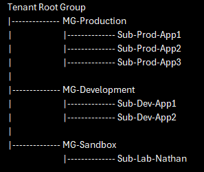
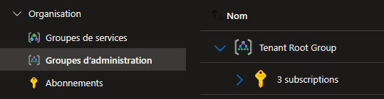
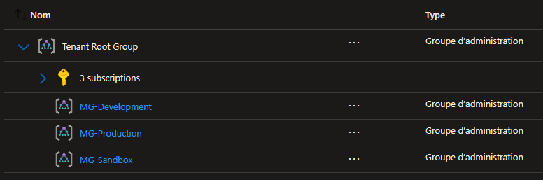
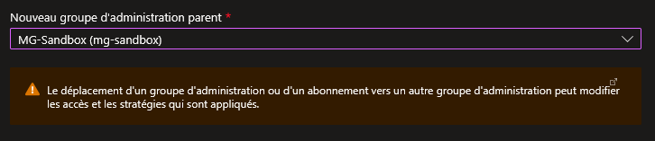
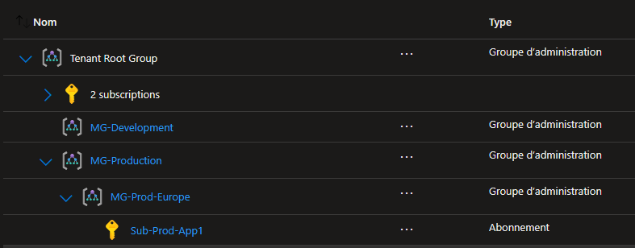

## Introduction

Cette procédure décrit comment organiser vos abonnements Azure en une hiérarchie logique grâce aux Management Groups. Au lieu de gérer chaque abonnement individuellement (policies, RBAC, budgets), vous les regroupez et appliquez les règles en cascade depuis le haut.

## Contexte et Justification

Imaginez une entreprise avec 15 abonnements Azure : 3 pour la production, 3 pour le développement, 5 pour différents projets, et 4 pour les filiales. Sans Management Groups, vous devez attribuer chaque policy et chaque rôle RBAC sur chacun des 15 abonnements — soit 15 fois le même travail.

Avec les Management Groups, vous créez une arborescence :



<p class="figure-caption"><b>Figure 1</b> · Exemple de hiérarchie de Management Groups</p>

Une policy attribuée sur « MG-Production » s'applique automatiquement aux 3 abonnements en dessous. Un rôle RBAC attribué sur « MG-Development » se propage à tous les abonnements dev. C'est l'héritage.

## Concepts Clés

**Tenant Root Group :** Le Management Group racine, créé automatiquement par Azure. Il porte l'ID de votre tenant (Entra ID). Tous les abonnements et tous les Management Groups sont obligatoirement en dessous de lui. Il ne peut pas être supprimé ni déplacé.

**Management Group :** Un conteneur logique. Il peut contenir des abonnements ET d'autres Management Groups (imbrication). Il ne contient PAS directement des ressources — les ressources vivent dans les abonnements, dans les Resource Groups.

**Héritage :** Les policies et les rôles RBAC attribués à un Management Group se propagent automatiquement vers le bas (aux sous-groupes et aux abonnements enfants). C'est cumulatif : un abonnement hérite des règles de TOUS les Management Groups au-dessus de lui dans la chaîne.

**Profondeur maximale :** La hiérarchie supporte jusqu'à 6 niveaux de profondeur (sans compter le Root Group). En pratique, 2 à 3 niveaux suffisent largement.

**Limite :** Un tenant peut contenir jusqu'à 10 000 Management Groups.

## Prérequis

- Un Abonnement Azure actif.
- Le rôle **Owner** ou **Contributor** sur le Tenant Root Group ou le rôle **Management Group Contributor** sur le groupe parent où vous voulez créer.
- Si c'est la première utilisation des Management Groups dans votre tenant, vous devrez peut-être activer l'accès dans Entra ID (voir « Accéder à la Hiérarchie des Management Groups »).

<div class="callout callout-note">

Par défaut, seul le Global Administrator d'Entra ID peut accorder l'accès initial au Tenant Root Group. Il doit d'abord « élever » ses droits dans Entra ID \> Propriétés \> « Gestion de l'accès pour les ressources Azure ».

</div>

## Méthode 1 : Configuration via Portail Azure

### Accéder à la Hiérarchie des Management Groups

1. Recherchez **« Management Groups »** (ou « Groupes d'administration ») dans la barre de recherche du portail.
2. Si c'est votre première visite, Azure vous demandera de **« Commencer à utiliser les groupes d'administration »**. Cliquez dessus.
   - Azure crée automatiquement le Tenant Root Group.
3. Vous voyez maintenant l'arborescence avec votre Tenant Root Group et vos abonnements directement en dessous.



<p class="figure-caption"><b>Figure 2</b> · Accéder à la Hiérarchie des Management Groups</p>

### Création d'un Management Group

1. Cliquez sur **+ Créer** (en haut de la hiérarchie ou depuis un groupe existant).
2. **ID du groupe d'administration :** mg-production *(cet ID est permanent et ne pourra plus être modifié)*.
3. **Nom d'affichage :** MG-Production.
4. Cliquez sur **Enregistrer**.

<div class="callout callout-note">

Répétez pour créer « mg-development » (MG-Development) et « mg-sandbox » (MG-Sandbox).

</div>



<p class="figure-caption"><b>Figure 3</b> · Création d'un Management Group</p>

### Déplacer un Abonnement dans un Management Group

1. Dans la vue hiérarchique, trouvez votre abonnement (il est sous le Root Group par défaut).
2. Cliquez sur les **« ... »** à droite de l'abonnement.
3. Sélectionnez **« Déplacer »**.
4. Choisissez le Management Group de destination (ex : « MG-Sandbox »).



<p class="figure-caption"><b>Figure 4</b> · Déplacer un Abonnement dans un Management Group</p>

5. Cliquez sur **Enregistrer**.

<div class="callout callout-note">

Votre abonnement hérite désormais de toutes les policies et rôles RBAC de « MG-Sandbox » et de ses parents.

</div>

### Créer une Hiérarchie (Imbriquer des Groupes)

Vous pouvez créer un Management Group à l'intérieur d'un autre :

1. Cliquez sur **« MG-Production »** pour entrer dedans.
2. Cliquez sur **+ Créer**.
3. **ID :** mg-prod-europe / **Nom :** MG-Prod-Europe.
4. **Enregistrer**.

Résultat :



<p class="figure-caption"><b>Figure 5</b> · Hiérarchie imbriquée obtenue</p>

## Méthode 2 : Configuration via PowerShell

### Création d'un Management Group

```powershell
New-AzManagementGroup -GroupName "mg-production" -DisplayName "MG-Production"
```

### Déplacer un Abonnement

```powershell
New-AzManagementGroupSubscription `
    -GroupName "mg-sandbox" `
    -SubscriptionId "<VOTRE_SUBSCRIPTION_ID>"
```

### Créer une Hiérarchie Imbriquée

```powershell
$parent = Get-AzManagementGroup -GroupName "mg-production"
New-AzManagementGroup `
    -GroupName "mg-prod-europe" `
    -DisplayName "MG-Prod-Europe" `
    -ParentId $parent.Id
```

### Vérifier la Structure

```powershell
Get-AzManagementGroup -GroupName "mg-production" -Expand -Recurse
```

Pour une vue globale :

```powershell
Get-AzManagementGroup | Select-Object DisplayName, Name, Id | Format-Table
```

## Vérifications

**Vue d'ensemble :** Dans le portail, vérifiez que l'arborescence reflète bien votre hiérarchie souhaitée.

**Héritage Policy :** Si vous avez déjà attribué une policy sur « MG-Production » (cf. procédure Gestion des Policy Azure), vérifiez qu'elle apparaît bien dans la section Policy de l'abonnement enfant sous « Héritée ».

**Déplacement :** Déplacez un abonnement d'un groupe à l'autre et vérifiez que les policies héritées changent en conséquence.

## Dépannage

**« You do not have access to create a management group » :** Votre compte n'a pas les droits sur le Tenant Root Group. Demandez au Global Administrator d'activer « Gestion de l'accès pour les ressources Azure » dans Entra ID \> Propriétés, puis de vous attribuer le rôle « Management Group Contributor ».

**L'abonnement ne bouge pas après le déplacement :** Le portail peut mettre quelques minutes à rafraîchir. Rechargez la page. Si ça persiste, vérifiez les droits : il faut avoir les permissions d'écriture sur le groupe source ET le groupe de destination.

**« Management Group ID already exists » :** L'ID d'un Management Group est unique au niveau du tenant et permanent. Si vous avez supprimé un groupe et que l'ID est encore « réservé », attendez quelques minutes (Azure met en cache) ou choisissez un autre ID.

## Conseils et Bonnes Pratiques

**Planifiez votre hiérarchie AVANT de créer.** L'ID d'un Management Group est immuable. Prenez 10 minutes pour dessiner votre arborescence sur papier. Les critères de découpage courants sont : environnement (Prod/Dev/Sandbox), région géographique, ou business unit.

**Ne dépassez pas 3 niveaux.** Plus la hiérarchie est profonde, plus le débogage des policies héritées devient un casse-tête. La plupart des entreprises utilisent : Root \> Environnement \> Région ou Business Unit.

**Attribuez les policies de sécurité de base au niveau le plus haut.** Par exemple, une policy Audit « toutes les ressources doivent avoir un tag Owner » au Root Group, et les policies plus restrictives (Deny) aux niveaux inférieurs.

## Procédures Liées

- [Gestion des Policy Azure](/procedures/azure/gestion-des-policy-azure) *(Les Management Groups sont le scope idéal pour attribuer des policies à grande échelle)*
- [Gestion des Utilisateurs et des Rôles](/procedures/azure/gestion-des-utilisateurs-et-des-roles) *(Les rôles RBAC attribués au niveau Management Group se propagent en cascade)*
- [Configuration des Budgets et Alertes de Coûts](/procedures/azure/configuration-des-budgets-et-alertes-de-couts) *(Les budgets peuvent être définis au niveau Management Group pour contrôler les coûts globalement)*
