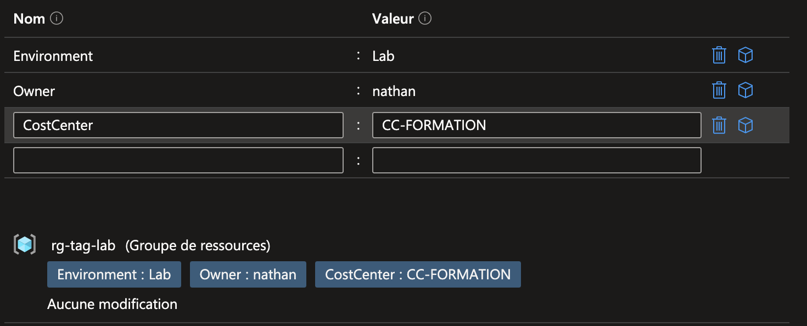
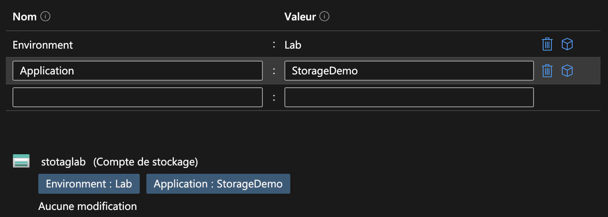
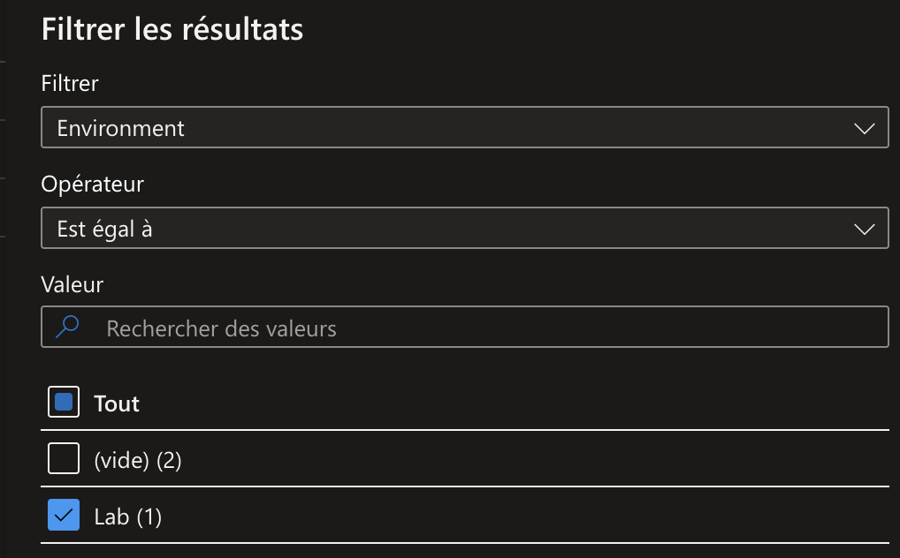

## Introduction

Cette procédure décrit comment organiser et catégoriser vos ressources Azure grâce aux tags (étiquettes). Un tag est une paire clé/valeur que vous attachez à une ressource ou à un Resource Group pour la classifier, suivre les coûts, identifier le propriétaire ou automatiser des actions.

## Contexte et Justification

Sans tags, votre portail Azure ressemble à un tiroir fourre-tout : 200 ressources avec des noms techniques, impossible de savoir à qui appartient quoi, ni combien coûte chaque projet. Les tags répondent à ces questions :

- **Qui paie ?** Tag *CostCenter : CC-1234* -> le service financier filtre la facture par centre de coût.
- **C'est quoi ?** Tag *Environment : Production* -> on distingue immédiatement les ressources de prod de celles de test.
- **C'est à qui ?** Tag *Owner : nathan* -> l'admin sait qui contacter si la ressource pose problème.
- **On peut l'éteindre ?** Tag *AutoShutdown : true* -> un script Azure Automation éteint toutes les VMs portant ce tag le soir.

## Concepts Clés

**Tag :** une paire clé/valeur (ex : *Environment : Production*). La clé et la valeur sont des chaînes de caractères libres.

**Limites :**

- Maximum **50 tags** par ressource ou Resource Group.
- Clé : 512 caractères maximum (128 pour les comptes de stockage).
- Valeur : 256 caractères maximum.
- Les clés sont insensibles à la casse pour le stockage mais sensibles à la casse pour les opérations (Microsoft recommande d'être cohérent).

**Pas d'héritage natif.** C'est le point le plus important : les tags d'un Resource Group ne se propagent PAS automatiquement aux ressources qu'il contient. Un RG tagué *Environment : Production* ne rend pas ses VMs taguées automatiquement. Pour obtenir l'héritage, il faut utiliser une Azure Policy avec l'effet « Inherit a tag from the resource group ».

**Opérations sur les tags :** Azure distingue deux comportements fondamentaux :

- **Merge :** ajoute de nouveaux tags en conservant les tags existants.
- **Replace :** remplace TOUS les tags par ceux spécifiés (les anciens sont supprimés).

<div class="callout callout-note">

C'est une source d'erreur majeure : si vous faites un Replace alors que vous vouliez un Merge, vous perdez tous les tags existants.

</div>

## Prérequis

- Un abonnement Azure actif.
- Le rôle **Contributor** (minimum) sur les ressources à taguer, ou le rôle spécialisé **Tag Contributor** si vous voulez limiter les droits au tagging uniquement.
- Un Resource Group de test : *rg-tag-lab*, contenant quelques ressources (un compte de stockage, un VNet...).

## Méthode 1 : Configuration via Portail Azure

### Ajouter des Tags sur un Resource Group

1. Allez sur votre **Resource Group** (ex : *rg-tag-lab*).
2. Dans le menu de gauche, cliquez sur **Étiquettes** (Tags).
3. Remplissez les paires clé/valeur :
   - Environment : Lab
   - Owner : nathan
   - CostCenter : CC-FORMATION
4. Cliquez sur **Appliquer**.

<div class="callout callout-note">

Ces tags sont maintenant visibles dans la vue d'ensemble du Resource Group, mais les ressources qu'il contient n'en héritent PAS.

</div>



### Ajouter des Tags sur une Ressource

1. Allez sur une ressource (ex : un compte de stockage dans *rg-tag-lab*).
2. Menu **Étiquettes** (Tags).
3. Ajoutez :
   - Environment : Lab
   - Application : StorageDemo
4. Cliquez sur **Appliquer**.

<div class="callout callout-note">

Vous devez taguer manuellement chaque ressource individuellement. C'est pour cela que les policies d'héritage et le tagging en masse via PowerShell sont indispensables en entreprise.

</div>



### Filtrer les Ressources par Tag

1. Allez dans **Toutes les ressources** (All resources).
2. Cliquez sur **Ajouter un filtre**.
3. Sélectionnez **Balise** (Tags).
4. Clé : *Environment* / Valeur : *Lab*.
5. Azure n'affiche plus que les ressources portant ce tag.

<div class="callout callout-note">

C'est extrêmement utile dans un tenant avec des centaines de ressources. Vous pouvez aussi utiliser ce filtre dans Cost Management pour voir les coûts par tag.

</div>



### Voir les Coûts par Tag

1. Recherchez **Cost Management** dans le portail.
2. Cliquez sur **Analyse des coûts** (Cost analysis).
3. Dans le menu déroulant **Grouper par** (Group by), sélectionnez **Étiquette** puis choisissez la clé (ex : *CostCenter*).
4. Le graphique se réorganise pour montrer les coûts ventilés par valeur de tag.

<div class="callout callout-note">

Les ressources sans le tag apparaissent dans la catégorie « Untagged ». C'est un bon indicateur de votre discipline de tagging.

</div>

## Méthode 2 : Configuration via PowerShell

### Ajouter des Tags (Sans Écraser les Existants)

Sur un Resource Group :

```powershell
$rg = Get-AzResourceGroup -Name "rg-tag-lab"
$newTags = @{
    "Environment" = "Lab"
    "Owner"       = "nathan"
    "CostCenter"  = "CC-FORMATION"
}
Update-AzTag -ResourceId $rg.ResourceId -Tag $newTags -Operation Merge
```

Sur une ressource :

```powershell
$storage = Get-AzResource -ResourceGroupName "rg-tag-lab" -ResourceName "stotaglab"
$newTags = @{
    "Environment" = "Lab"
    "Application" = "StorageDemo"
}
Update-AzTag -ResourceId $storage.ResourceId -Tag $newTags -Operation Merge
```

### Remplacer Tous les Tags

```powershell
$rg = Get-AzResourceGroup -Name "rg-tag-lab"
$replaceTags = @{
    "Environment" = "Production"
    "Owner"       = "admin"
}
Update-AzTag -ResourceId $rg.ResourceId -Tag $replaceTags -Operation Replace
```

### Supprimer un Tag Spécifique

```powershell
$rg = Get-AzResourceGroup -Name "rg-tag-lab"
$tagToRemove = @{
    "CostCenter" = "CC-FORMATION"
}
Update-AzTag -ResourceId $rg.ResourceId -Tag $tagToRemove -Operation Delete
```

### Supprimer Tous les Tags

```powershell
$rg = Get-AzResourceGroup -Name "rg-tag-lab"
$currentTags = (Get-AzTag -ResourceId $rg.ResourceId).Properties.TagsProperty
if ($currentTags.Count -gt 0) {
    Update-AzTag -ResourceId $rg.ResourceId -Tag $currentTags -Operation Delete
}
```

### Lister les Ressources par Tag

Trouver toutes les ressources portant un tag spécifique :

```powershell
Get-AzResource -TagName "Environment" -TagValue "Lab" | Select-Object Name, ResourceGroupName, ResourceType | Format-Table
```

Trouver toutes les ressources qui ont la clé « Owner » :

```powershell
Get-AzResource -TagName "Owner" | Select-Object Name, @{N="Owner";E={$_.Tags["Owner"]}} | Format-Table
```

Lister tous les tags utilisés dans l'abonnement (utile pour l'audit) :

```powershell
Get-AzTag | Select-Object TagName, Count | Format-Table
```

## Vérifications

**Tags visibles :** sur le Resource Group et la ressource > Étiquettes -> les tags sont affichés correctement.

**Filtrage :** dans « Toutes les ressources » > filtre par tag *Environment=Lab* -> seules les ressources taguées apparaissent.

**Non-héritage :** vérifiez qu'une ressource créée dans le Resource Group APRÈS l'ajout des tags au RG n'a PAS les tags du RG (sauf si une policy d'héritage est active).

**Merge vs Replace :** ajoutez un tag via Merge, vérifiez que les anciens sont conservés. Puis testez Replace et vérifiez que les anciens ont disparu.

## Dépannage

**« Tags are not inherited by resources in the resource group » :** c'est le comportement par défaut. Si vous avez besoin de l'héritage, attribuez la policy built-in « Inherit a tag from the resource group ». N'oubliez pas de lancer une tâche de remédiation pour les ressources existantes (cf. [procédure Gestion des Policy Azure](/procedures/azure/gestion-des-policy-azure), section « Lancer une Remédiation »).

**« AuthorizationFailed » en essayant de taguer :** votre rôle n'a pas la permission *Microsoft.Resources/tags/write*. Le rôle Contributor l'inclut. Si vous voulez donner uniquement le droit de taguer, attribuez le rôle « Tag Contributor ».

**Les tags disparaissent après un redéploiement ARM/Bicep :** si votre template Bicep/ARM ne spécifie pas les tags, un redéploiement en mode « Complete » les supprimera. Incluez toujours les tags dans vos templates IaC. En mode « Incremental » (par défaut), les tags existants sont conservés si le template ne les mentionne pas.

**Caractères spéciaux dans les valeurs de tag :** évitez les caractères *<, >, %, &, \\, ?, /* dans les clés et les valeurs. Ils peuvent causer des problèmes dans les requêtes et les exports.

## Conseils et Bonnes Pratiques

**Définissez une convention de tagging dès le départ.** Voici un ensemble de tags recommandé par Microsoft que vous pouvez adapter :

| Clé | Exemple de valeur | Objectif |
|--------------|--------------------------------|----------------------------|
| Environment  | Production / Development / Lab | Identifier l'environnement |
| Owner        | Nathan                         | Responsable technique      |
| CostCenter   | CC-1234                        | Imputation comptable       |
| Project      | Orion-Consulting               | Rattachement projet        |
| AutoShutdown | true / false                   | Automatisation extinction  |
| CreatedBy    | IaC-Bicep / Manual             | Traçabilité de création    |

: Convention de tagging recommandée

**Forcez les tags avec les policies.** Utilisez la policy « Require a tag and its value on resource groups » (effet Deny) pour empêcher la création de Resource Group sans le tag *Owner*. Combinée avec « Inherit a tag from the resource group » (effet Modify), vous obtenez un tagging automatique sur toutes les ressources.

**Utilisez le tag *CreatedBy* pour savoir comment la ressource a été créée.** En ajoutant ce tag dans vos templates Bicep, vous savez instantanément quelles ressources sont gérées par IaC et lesquelles ont été créées manuellement via le portail.

## Procédures Liées

- [Gestion des Policy Azure](/procedures/azure/gestion-des-policy-azure) *(les policies sont le meilleur moyen de forcer et d'automatiser le tagging)*
- [Configuration des Budgets et Alertes de Coûts](/procedures/azure/configuration-des-budgets-et-alertes-de-couts) *(les budgets utilisent les tags pour ventiler les coûts par projet ou département)*
- Déploiement via Templates ARM et Bicep *(incluez toujours les tags dans vos templates IaC)*
