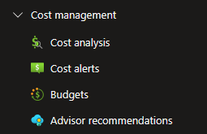
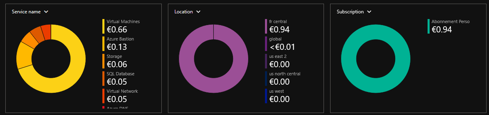
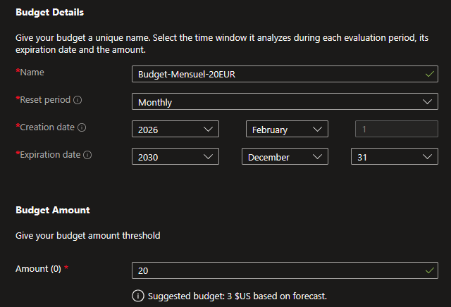
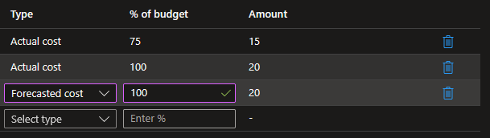

## Introduction

Cette procédure décrit comment configurer des budgets et des alertes de coûts dans Azure Cost Management. L'objectif est de surveiller les dépenses cloud et d'être prévenu automatiquement avant qu'une facture ne dérape, que ce soit à cause d'une erreur de script, d'un dimensionnement excessif ou d'une activité malveillante (crypto-minage).

## Contexte et Justification

Dans le cloud, la consommation est mesurée à la seconde. Contrairement à un serveur physique dont le coût est fixe, une erreur dans Azure peut générer des milliers d'euros en quelques heures. Exemples réels :

- Un script de déploiement qui crée 50 VMs au lieu de 5 (boucle mal configurée).
- Une VM GPU (NC-series) laissée allumée pendant un week-end : 500€ en 48h.
- Un compte compromis qui déploie des VMs de crypto-minage dans toutes les régions.

Azure Cost Management est un service gratuit qui vous permet de visualiser vos dépenses, créer des budgets et recevoir des alertes automatiques. Le budget ne bloque PAS les dépenses (Azure ne coupe pas vos services), il vous prévient par email pour que vous puissiez agir.

## Concepts Clés

**Cost Management + Billing :** Le service Azure centralisé pour la visualisation et le contrôle des coûts. Il agrège les données de consommation de toutes vos ressources et les présente sous forme de graphiques, tableaux et exports.

**Budget :** Un seuil de dépense que vous définissez pour une période donnée (mensuel, trimestriel, annuel). Le budget ne bloque rien, il déclenche des alertes quand les dépenses approchent ou dépassent le montant défini. Vous pouvez créer des budgets à différents scopes : abonnement entier, resource group spécifique, ou même filtré par tag.

**Scope (Étendue) du budget :**

- **Subscription** : Surveille toutes les dépenses de l'abonnement. Le plus courant.
- **Resource Group** : Surveille uniquement les ressources d'un RG. Utile pour suivre le coût d'un projet spécifique.
- **Management Group** : Surveille plusieurs abonnements. Pour les grandes organisations.

**Types d'alertes de coûts :**

- **Actual (Réel) :** Se déclenche quand les dépenses réelles atteignent X% du budget. « Tu as déjà dépensé 15€ sur tes 20€ de budget. »
- **Forecasted (Prévisionnel) :** Se déclenche quand Azure prédit que les dépenses atteindront X% du budget d'ici la fin de la période. « Au rythme actuel, tu vas dépasser ton budget de 20€ avant la fin du mois. » Plus utile car il vous prévient avant que le dépassement ne se produise.

**Cost Analysis :** Un outil de visualisation intégré à Cost Management. Il permet de voir où va l'argent : par service (VMs, Storage, Networking), par resource group, par tag, par région. C'est le premier outil à consulter pour comprendre une facture élevée.

**Action Group :** Une liste de contacts et d'actions (email, SMS, webhook, Azure Function) qui se déclenche quand une alerte est levée. Réutilisable entre plusieurs budgets et alertes.

## Prérequis

- Un Abonnement Azure actif avec des ressources en cours de consommation (même minime).
- Le rôle **Cost Management Reader** (minimum) pour visualiser les coûts.
- Le rôle **Cost Management Contributor** ou **Owner** pour créer des budgets.
- Une adresse email valide pour recevoir les alertes.

## Méthode 1 : Configuration via Portail Azure

### Accéder à Cost Management

1. Dans la barre de recherche du portail, tapez **"Cost Management"** et sélectionnez **"Cost Management + Billing"**.
2. Cliquez sur votre abonnement.
3. Dans le menu gauche, section **"Cost Management"**, vous voyez : **"Cost analysis"**, **"Cost alerts"**, **"Budgets"**, **"Advisor recommendations"**.

<b>Figure 1</b> · Accéder à Cost Management

### Analyser les Coûts Actuels (Cost Analysis)

Avant de créer un budget, il faut savoir combien vous dépensez actuellement.

1. Cliquez sur **"Cost analysis"**.
2. **View** : Sélectionnez **"Accumulated costs"** pour voir le cumul depuis le début du mois.
3. **Group by** : Changez pour **"Service name"** pour voir la répartition par service (Compute, Storage, Networking, etc.).

<b>Figure 2</b> · Analyser les Coûts Actuels (Cost Analysis)

4. Notez le montant total du mois en cours. C'est votre base pour calibrer le budget.

Si vous dépensez habituellement 15€/mois, un budget à 20€ avec une alerte à 75% vous préviendra à 15€. Un budget à 100€ ne vous préviendra jamais et sera inutile.

### Créer un Budget avec Alertes

1. Dans le menu gauche, cliquez sur **"Budgets"**.
2. Cliquez sur **"+ Add"**.
3. **Scope** : Votre abonnement (sélectionné par défaut).
4. **Name** : Budget-Mensuel-20EUR.
5. **Reset period** : **"Monthly"** (le budget se réinitialise chaque mois).
6. **Creation date** : Aujourd'hui (par défaut).
7. **Expiration date** : Mettez une date lointaine (ex : 2030-12-31).
8. **Amount** : 20 (en euros, votre limite mensuelle).

<b>Figure 3</b> · Créer un Budget avec Alertes

9. Cliquez sur **"Next"**.
10. Cliquez sur **"+ Add alert condition"** et configurez trois paliers :

| Type | % of budget | Montant équivalent | Usage |
|------------|-------------|--------------------|---------------------------|
| **Actual** | 75 | 15€ | Avertissement précoce |
| **Actual** | 100 | 20€ | Budget atteint |
| **Forecasted** | 100 | 20€ | Prédiction de dépassement |

<b>Figure 4</b> · Créer un Budget avec Alertes

11. **Alert recipients (email)** : Saisissez votre adresse email.
12. **Language** : French (ou English).
13. Cliquez sur **"Create"**.

La troisième alerte (Forecasted 100%) est la plus utile. Elle vous prévient avant que le dépassement ne se produise, en se basant sur la tendance de consommation actuelle.

### Configurer une Alerte d'Anomalie de Coûts

Azure peut détecter automatiquement les pics de dépenses inhabituels.

1. Dans Cost Management, cliquez sur **"Cost alerts"**.
2. Les alertes d'anomalie sont activées par défaut sur les abonnements éligibles.
3. Pour vérifier ou configurer les destinataires : cliquez sur **"Settings"** (icône engrenage en haut).
4. Ajoutez votre email dans la liste des destinataires.

Les anomaly alerts sont plus intelligentes que les budgets. Elles détectent un changement de tendance (ex : vos dépenses passent de 1€/jour à 5€/jour soudainement) même si le budget global n'est pas encore atteint.

## Note sur l'Automatisation (PowerShell)

La création de budgets est techniquement possible en PowerShell (`New-AzConsumptionBudget`). Cependant, en pratique, le module Az.Consumption présente des incompatibilités fréquentes selon les versions et les types d'abonnements (notamment Azure for Students et Free Trial). Les paramètres de notification sont particulièrement instables entre les versions.

Les budgets sont de la gouvernance financière, créés ponctuellement par des responsables ou des administrateurs. Contrairement aux déploiements d'infrastructure (VMs, Storage, Networking) qui bénéficient fortement de l'automatisation, les budgets n'ont pas de besoin d'Infrastructure as Code.

**Recommandation :** Utilisez le portail Azure pour la gestion des budgets. Réservez PowerShell aux tâches d'infrastructure où l'automatisation est réellement bénéfique.

## Vérifications

**Budget visible** : Dans Cost Management \> **"Budgets"**, le budget apparaît avec le montant, la période et les seuils d'alerte configurés.

**Barre de progression** : Le portail affiche une barre montrant les dépenses actuelles par rapport au budget. Si vous avez dépensé 10€ sur 20€, la barre est à 50%.

**Alertes configurées** : Cliquez sur le budget \> Section **"Alert conditions"** \> Les trois paliers (75% Actual, 100% Actual, 100% Forecasted) sont listés avec les emails.

**Cost Analysis cohérent** : Le montant affiché dans Cost Analysis correspond à la réalité de vos ressources en cours (VMs allumées, stockage, etc.).

**Test de réception** : Quand une alerte se déclenche (ou si vous avez déjà atteint 75%), vérifiez vos emails (y compris les spams). L'expéditeur est azure-noreply@microsoft.com.

## Dépannage

**L'alerte ne se déclenche pas alors que les dépenses ont dépassé le seuil :** Les données de coûts ont un délai de 24 à 48 heures. Attendez et revérifiez. Vérifiez aussi que le scope du budget correspond bien aux ressources qui génèrent les coûts (un budget sur un RG ne voit pas les ressources d'un autre RG).

**L'email d'alerte arrive dans les spams :** L'expéditeur est azure-noreply@microsoft.com. Ajoutez-le à votre liste blanche. Vérifiez aussi que l'adresse email saisie dans le budget est correcte.

**"Budget amount must be greater than 0" :** Le montant doit être un nombre positif. Vérifiez que vous n'avez pas mis 0 ou un caractère non numérique.

**Le budget affiche des coûts différents de Cost Analysis :** Le budget utilise les coûts amortis (amortized costs) par défaut, tandis que Cost Analysis peut afficher les coûts réels (actual costs). Les réservations et les plans d'épargne sont traités différemment entre les deux vues.

**Impossible de créer un budget sur un abonnement Student :** Certains types d'abonnements ont des limitations sur Cost Management. Vérifiez que vous accédez bien via **"Cost Management + Billing"** \> votre abonnement \> **"Budgets"**, et non via un autre chemin.

## Conseils et Bonnes Pratiques

**Créez toujours au minimum un budget au niveau Subscription.** Même si vous avez des budgets par RG, un budget global au niveau de l'abonnement est votre filet de sécurité ultime. Si quelqu'un crée des ressources dans un nouveau RG, le budget Subscription le verra.

**Utilisez les alertes Forecasted, pas uniquement Actual.** L'alerte Actual vous dit « tu as déjà dépensé 20€ ». L'alerte Forecasted vous dit « au rythme actuel, tu vas dépenser 20€ d'ici la fin du mois ». La seconde vous laisse le temps d'agir avant le dépassement.

**Combinez budgets et Azure Advisor.** Azure Advisor donne des recommandations de réduction de coûts (VMs sous-utilisées à redimensionner, disques non attachés à supprimer, réservations à acheter). Consultez-le dans Cost Management \> **"Advisor recommendations"**.

**Automatisez la réaction aux alertes.** Pour aller au-delà de la simple notification email, connectez un Action Group à une Azure Function ou à une Logic App qui désalloue automatiquement les VMs non critiques quand le budget est dépassé. C'est le seul moyen de « bloquer » réellement les dépenses.

**Taguez vos ressources pour un suivi fin.** Utilisez des tags comme Environment:Lab, Project:Storage, Owner:Nathan. Cost Analysis peut filtrer et grouper par tag, ce qui permet de savoir exactement combien coûte chaque projet.

## Procédures Liées

- [Création d'un Groupe de Ressources](/procedures/azure/creation-dun-groupe-de-ressources) *(Le scope du budget peut être un RG, les tags définis à la création facilitent le suivi des coûts)*
- Configuration des Alertes et Action Groups *(Les alertes métriques surveillent la performance technique, les budgets surveillent la performance financière)*
- [Gestion des Policy Azure](/procedures/azure/gestion-des-policy-azure) *(Les policies peuvent restreindre les SKU autorisées pour limiter les coûts, ex : interdire les VMs GPU)*
- [Gestion des Tags et Stratégie de Tagging](/procedures/azure/gestion-des-tags-et-strategie-de-tagging) *(Les tags permettent de filtrer les coûts par projet, environnement ou propriétaire dans Cost Analysis)*
