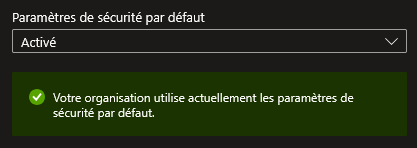
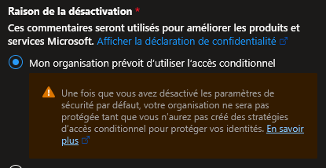
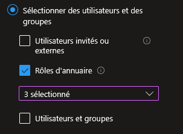
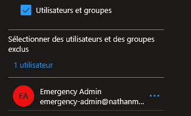
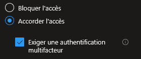
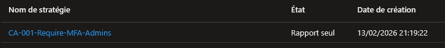
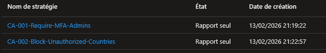
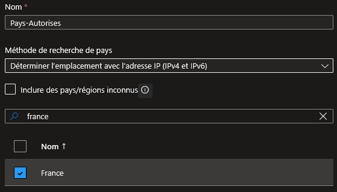
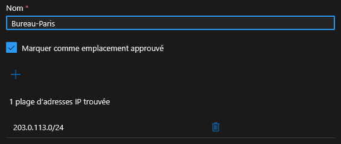
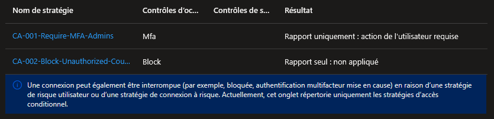

## Introduction

Cette procédure décrit comment protéger les connexions à votre tenant Azure/Entra ID en exigeant des preuves d'identité supplémentaires (MFA) et en appliquant des conditions d'accès (lieu géographique, appareil, rôle de l'utilisateur). Le Conditional Access est le moteur de décision central de la sécurité identitaire dans Azure.

## Contexte et Justification

Un mot de passe seul ne suffit plus. Si un attaquant vole les identifiants d'un Global Admin, il a un accès total au tenant. Le Conditional Access permet de créer des règles du type :

- « Si l'utilisateur est un administrateur, exiger le MFA à chaque connexion. »
- « Si la connexion vient d'un pays où l'entreprise n'opère pas, bloquer l'accès. »
- « Si l'utilisateur se connecte depuis un appareil non enregistré, autoriser uniquement l'accès en lecture au mail. »

C'est un modèle « If/Then » : **SI** (conditions) **ALORS** (contrôles d'accès).

## Concepts Clés

**Security Defaults :** Un ensemble de règles de sécurité prédéfinies par Microsoft, activé par défaut sur les nouveaux tenants. Il impose le MFA à tous les utilisateurs et bloque l'authentification legacy (protocoles anciens comme POP3/IMAP sans MFA). C'est le « pack de base ». Il est gratuit mais pas personnalisable, c'est tout ou rien.

**Conditional Access :** Le remplacement avancé des Security Defaults. Il permet de créer des règles granulaires et personnalisées. Il nécessite une licence **Entra ID P1** (incluse dans Microsoft 365 E3) ou **Entra ID P2** (incluse dans Microsoft 365 E5). Les Security Defaults doivent être désactivées pour utiliser le Conditional Access.

**Policy Conditional Access :** Une règle composée de trois parties :

- **Assignments (Qui / Quand / D'où) :** Utilisateurs/groupes ciblés, applications cloud concernées, conditions (localisations, plateforme, risque de connexion).
- **Access Controls (Quoi faire) :** Accorder avec des exigences (MFA, appareil conforme, conditions d'utilisation) ou Bloquer.
- **State (État) :** Enabled (actif), Disabled (inactif), ou Report-Only (évalue sans appliquer, idéal pour tester).

**MFA (Multi-Factor Authentication) :** Exige un deuxième facteur au-delà du mot de passe. Les méthodes supportées par Entra ID :

- **Microsoft Authenticator** (notification push ou code), recommandé.
- **Clé de sécurité FIDO2** (clé USB physique), le plus sûr.
- **SMS / Appel téléphonique**, déconseillé car vulnérable au SIM swapping.
- **TOTP** (code temporaire via une app type Google Authenticator).

**Named Location (Emplacement nommé) :** Une liste d'adresses IP ou de pays que vous définissez pour les utiliser comme condition dans vos policies. Par exemple, « Bureau-Paris » = la plage IP du bureau, ou « Pays-Autorisés » = France + Belgique + Luxembourg.

**Report-Only :** Un état de policy qui évalue les connexions et journalise ce qui SERAIT arrivé (accordé ou bloqué), sans réellement appliquer la décision. Indispensable pour tester avant de passer en production.

## Prérequis

- Un tenant Entra ID avec une licence **P1** minimum (pour le Conditional Access). Si vous utilisez un abonnement étudiant ou d'essai, vous pouvez activer un [trial P2 de 30 jours](https://admin.cloud.microsoft/?pid=FAF849AB-BD30-42B2-856C-8F1EDC230CE9&quan=1&bc=1&trac=6efb2704-c42d-44ad-a6ce-867395bbe627&sku=84a661c4-e949-4bd2-a560-ed7766fcaf2b&pname=microsoft-entra-id-p2&ru=PDP#/catalog/offer-details/microsoft-entra-id-p2/40340DD4-942B-4572-9CFD-73B382AA4830) dans Entra ID \> Licences.
- Le rôle **Security Administrator** ou **Conditional Access Administrator** (minimum).
- Au moins deux comptes utilisateurs de test dans Entra ID (un admin, un utilisateur standard).
- L'application **Microsoft Authenticator** installée sur votre téléphone (pour tester le MFA).
- Un groupe de sécurité contenant vos comptes de test (ex : « GRP-Test-CA »).

## Méthode 1 : Configuration via Portail Azure

### Activer les Security Defaults (Approche simple)

Si vous n'avez pas de licence P1, les Security Defaults sont votre seule option pour le MFA. Si vous avez P1, passez directement à « Désactiver les Security Defaults ».

1. Allez dans **Microsoft Entra ID** (anciennement Azure AD) \> **Propriétés** (Properties).
2. En bas de la page, cliquez sur **Gérer les paramètres de sécurité par défaut**.
3. Basculez sur **Activé**.

<b>Figure 1</b> · Activer les Security Defaults (Approche simple)

4. Cliquez sur **Enregistrer**.

Tous les utilisateurs devront configurer le MFA dans les 14 jours. Après ce délai, le MFA est exigé à chaque connexion.

### Désactiver les Security Defaults (Avant de Passer au Conditional Access)

1. Même chemin : **Microsoft Entra ID \> Propriétés \> Gérer les paramètres de sécurité par défaut**.
2. Basculez sur **Désactivé**.
3. Azure vous demande une raison, sélectionnez « Mon organisation prévoit d'utiliser le Conditional Access ».

<b>Figure 2</b> · Désactiver les Security Defaults (Avant de Passer au Conditional Access)

4. Cliquez sur **Enregistrer**.

### Créer une Policy Conditional Access (Exiger le MFA)

1. Allez dans **Microsoft Entra ID \> Sécurité \> Accès conditionnel** (Conditional Access).
2. Cliquez sur **+ Créer une stratégie** (New policy).
3. **Nom :** CA-001-Require-MFA-Admins.
4. **Affectations :**
   - **Utilisateurs :** Cliquez sur « Utilisateurs et groupes ».
     - Onglet **Inclure** : Sélectionnez **Rôles d'annuaire** puis cochez Global Administrator, User Administrator, Billing Administrator *(ajoutez les rôles admin pertinents)*.

<b>Figure 3</b> · Inclusion des rôles d'administration

     - Onglet **Exclure** : Ajoutez votre compte « break glass » (ex : emergency-admin@votretenant.onmicrosoft.com).

<b>Figure 4</b> · Exclusion du compte break glass

   - **Ressources cibles :** Sélectionnez **Ressources**.
   - **Conditions :** Laissez vide pour l'instant (toutes les conditions).
5. **Contrôles d'accès :**
   - **Octroyer :** Sélectionnez **Accorder l'accès** puis cochez **Exiger l'authentification multifacteur**.

<b>Figure 5</b> · Contrôle d'accès : exiger le MFA

6. **Activer la stratégie :** Sélectionnez **Report-only** (pour tester d'abord).
7. Cliquez sur **Créer**.

La policy est en mode observation. Vérifiez les journaux pendant quelques jours avant de passer en « Activé ».

<b>Figure 6</b> · Policy CA-001 créée en mode Report-only

### Créer une Policy Conditional Access (Bloquer l'Accès par Pays)

1. Cliquez sur **+ Nouvelle stratégie**.
2. **Nom :** CA-002-Block-Unauthorized-Countries.
3. **Affectations :**
   - **Utilisateurs :** Inclure → **Tous les utilisateurs**. Exclure → votre compte « break glass ».
   - **Ressources cibles :** Toutes les applications cloud.
   - **Conditions :** Cliquez sur **Emplacements** (Locations).
     - Configurer : **Oui**.
     - Inclure : **Tous les réseaux et emplacements approuvés**.
     - Exclure : Sélectionnez vos Named Locations autorisés (voir « Créer un Named Location » pour les créer d'abord).
4. **Contrôles d'accès :**
   - **Octroyer :** Sélectionnez **Bloquer l'accès**.
5. **État :** Report-only.
6. Cliquez sur **Créer**.

Cette policy dit : « Bloquer toutes les connexions SAUF celles venant des emplacements autorisés ». Attention à l'ordre logique des inclusions/exclusions.

<b>Figure 7</b> · Créer une Policy Conditional Access (Bloquer l'Accès par Pays)

### Créer un Named Location (Emplacement Nommé)

Créez vos emplacements AVANT de les utiliser dans une policy.

1. Dans **Accès conditionnel \> Named locations** (Emplacements nommés).
2. Cliquez sur **+ Emplacement de pays**.
3. **Nom :** Pays-Autorises.
4. Cochez : **France**, **Belgique**, **Luxembourg** (ou les pays pertinents).
5. Cliquez sur **Créer**.

<b>Figure 8</b> · Emplacement nommé par pays

Pour un emplacement basé sur une plage IP (ex : le réseau du bureau) :

1. Cliquez sur **+ Emplacement de plages d'adresses IP**.
2. **Nom :** Bureau-Paris.
3. Cochez **Marquer comme emplacement approuvé** (trusted location).
4. Ajoutez vos plages IP publiques (ex : 203.0.113.0/24).

<b>Figure 9</b> · Emplacement nommé par plage IP

5. Cliquez sur **Créer**.

Un emplacement marqué comme « approuvé » peut être utilisé comme condition supplémentaire : « Si la connexion vient d'un emplacement approuvé, ne pas exiger le MFA ».

### Tester une Policy en Mode Report-Only

1. Allez dans **Microsoft Entra ID \> Journaux de Connexion** (Sign-in logs).
2. Cliquez sur une connexion récente.
3. Onglet **Accès conditionnel** (Conditional Access).
4. Vous verrez chaque policy évaluée avec le résultat :
   - **Success :** La policy s'est appliquée et l'accès a été accordé.
   - **Failure :** La policy a bloqué (ou aurait bloqué en Report-only).
   - **Not applied :** Les conditions de la policy ne correspondaient pas à cette connexion.
   - **Report-only: Not applied / Would have blocked / Would have required MFA** : Ce qui se serait passé si la policy était active.

Quand vous êtes satisfait des résultats après quelques jours, revenez dans la policy et passez l'état de Report-only à Activé.

<b>Figure 10</b> · Tester une Policy en Mode Report-Only

## Vérifications

**MFA fonctionnel :** Connectez-vous avec un compte admin ciblé par la policy → si la policy est en Enabled, le MFA doit être demandé.

**Report-Only :** Connectez-vous, puis allez dans Sign-in logs \> Conditional Access → vérifiez que la policy apparaît avec le résultat « Report-only: Would have required MFA ».

**Blocage géographique :** Utilisez un VPN pour simuler une connexion depuis un pays non autorisé → vérifiez le blocage (en Enabled) ou le log « Would have blocked » (en Report-Only).

**Break glass :** Connectez-vous avec le compte d'urgence → il ne doit PAS être soumis au MFA ni bloqué.

## Dépannage

**« AADSTS53003: Access has been blocked by Conditional Access policies » :** Une policy bloque la connexion. Connectez-vous avec le compte break glass pour accéder aux logs et identifier quelle policy est en cause. Vérifiez dans Sign-in logs \> Conditional Access \> l'onglet de la connexion échouée.

**Tous les utilisateurs sont bloqués (lockout) :** Utilisez le compte break glass. Si vous ne l'avez pas créé, contactez le support Microsoft avec une preuve de propriété du tenant. C'est pourquoi le break glass est NON négociable.

**La policy ne semble pas s'appliquer :** Vérifiez que l'état est bien « Enabled » et non « Report-only » ou « Disabled ». Vérifiez aussi que l'utilisateur de test est bien dans le scope d'inclusion et pas dans les exclusions. Enfin, attendez quelques minutes, les nouvelles policies peuvent mettre jusqu'à 5 minutes à se propager.

**Le MFA n'est pas demandé malgré la policy :** L'utilisateur a peut-être déjà satisfait le MFA récemment et le token est encore valide. Par défaut, Entra ID mémorise le MFA pendant un certain temps. Essayez en navigation privée ou attendez l'expiration du token.

**« Insufficient privileges to complete the operation » en PowerShell :** Votre compte n'a pas les permissions Graph API nécessaires. Assurez-vous d'avoir consenti au scope `Policy.ReadWrite.ConditionalAccess` lors du `Connect-MgGraph`.

## Conseils et Bonnes Pratiques

**Créez toujours un compte break glass en premier.** Avant même de toucher au Conditional Access, créez un compte emergency-admin@tenant.onmicrosoft.com avec le rôle Global Admin, un mot de passe de 30+ caractères, PAS de MFA, et excluez-le de TOUTES les policies. Stockez le mot de passe dans un coffre physique. Surveillez son utilisation via les logs.

**Commencez par Report-Only, toujours.** Créez votre policy en Report-Only, observez pendant 3 à 7 jours dans les Sign-in logs, puis passez en Enabled quand vous êtes sûr qu'elle ne bloque personne par erreur.

**Convention de nommage.** Nommez vos policies avec un préfixe numéroté et une description de l'action : CA-001-Require-MFA-Admins, CA-002-Block-Unauthorized-Countries, CA-003-Require-Compliant-Device. Ça facilite la lecture quand vous en avez 20.

**Les 5 policies recommandées par Microsoft pour commencer :**

1. Exiger le MFA pour les administrateurs.
2. Exiger le MFA pour tous les utilisateurs.
3. Bloquer l'authentification legacy.
4. Exiger le MFA pour la gestion Azure (portail, CLI, PowerShell).
5. Bloquer les connexions depuis les pays non autorisés.

## Procédures Liées

- [Gestion des Managed Identities (System & User Assigned)](/procedures/azure/gestion-des-managed-identities-system-user-assigned) *(Les Managed Identities ne sont pas soumises au Conditional Access — c'est un avantage pour les automatisations)*
- [Gestion des Utilisateurs et des Rôles](/procedures/azure/gestion-des-utilisateurs-et-des-roles) *(Les rôles Entra ID sont utilisés comme condition dans les policies Conditional Access)*
- [Configuration de Entra ID Connect (Hybrid Identity)](/procedures/azure/configuration-de-entra-id-connect-hybrid-identity) *(L'identité hybride interagit avec le Conditional Access pour les utilisateurs synchronisés)*
