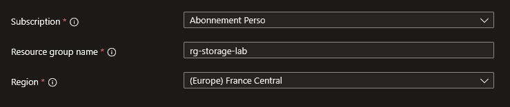
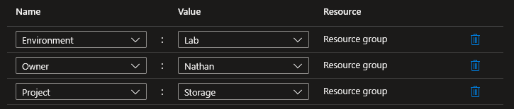
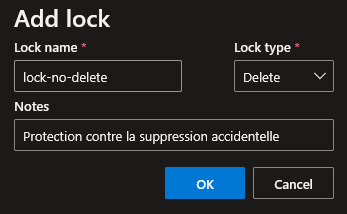

## Introduction

Cette procédure décrit la création et la configuration initiale d'un Resource Group dans Azure. Le Resource Group est le conteneur logique fondamental : toute ressource Azure (VM, compte de stockage, réseau virtuel) doit appartenir à exactement un Resource Group. C'est la première étape obligatoire avant tout déploiement.

## Contexte et Justification

Dans Azure, les ressources ne peuvent pas exister de manière isolée. Elles doivent être regroupées dans un conteneur logique qui sert trois fonctions essentielles :

- **Gestion du cycle de vie** : Supprimer un Resource Group supprime instantanément et irréversiblement toutes les ressources qu'il contient. C'est le moyen le plus rapide de nettoyer un environnement de test. À l'inverse, c'est aussi le moyen le plus rapide de tout perdre si vous supprimez le mauvais RG.
- **Périmètre de sécurité (RBAC)** : Les permissions RBAC peuvent être attribuées au niveau du RG. Un développeur avec le rôle Contributor sur rg-dev-app peut créer et modifier des VMs dans ce RG, mais n'a aucun accès à rg-prod-database. C'est la base de la séparation des environnements.
- **Suivi des coûts** : Chaque ressource est rattachée au RG auquel elle appartient. Dans Cost Management, vous pouvez filtrer les coûts par RG pour savoir exactement combien coûte chaque projet ou environnement.

## Concepts Clés

**Resource Group (RG) :** Un conteneur logique qui regroupe des ressources Azure liées. Le RG lui-même est une ressource ARM (Azure Resource Manager) avec son propre ID, sa région et ses propriétés. Il n'a pas de coût propre (seules les ressources à l'intérieur coûtent de l'argent).

**Région du RG vs Région des ressources :** La région du RG détermine où sont stockées les **métadonnées** du groupe (la liste des ressources, les tags, les locks). Les ressources à l'intérieur du RG peuvent être dans n'importe quelle région. Vous pouvez avoir un RG en France Central contenant une VM en West Europe et un stockage en East US. En pratique, on place généralement le RG et ses ressources dans la même région pour simplifier.

**Abonnement (Subscription) :** Le niveau hiérarchique au-dessus du RG. Un abonnement contient plusieurs RG. Le RG appartient à exactement un abonnement et ne peut pas être déplacé vers un autre abonnement (mais les ressources individuelles peuvent l'être).

**Tags :** Des paires clé-valeur (ex : Environment:Lab, Owner:Nathan, Project:Storage) attachées aux ressources et aux RG. Les tags du RG ne sont PAS hérités automatiquement par les ressources à l'intérieur (sauf si une Azure Policy force l'héritage). Les tags servent au suivi des coûts, à l'automatisation et à la gouvernance.

**Locks (Verrous) :** Des protections appliquées au RG ou aux ressources pour empêcher les modifications ou suppressions accidentelles :

- **CanNotDelete** : Les ressources peuvent être modifiées mais pas supprimées. Recommandé pour la production.
- **ReadOnly** : Les ressources ne peuvent être ni modifiées ni supprimées. Très restrictif, peut casser des services qui ont besoin d'écrire (ex : un compte de stockage en ReadOnly ne peut plus recevoir de données).

## Prérequis

- Un compte Azure actif avec un abonnement valide.
- Le rôle **Contributor** (minimum) sur l'abonnement pour créer un RG.
- Le rôle **Owner** ou **User Access Administrator** pour attribuer des permissions RBAC sur le RG.
- Pour appliquer un Lock : le rôle **Owner** ou un rôle disposant de la permission **Microsoft.Authorization/locks/write**.

## Méthode 1 : Configuration via Portail Azure

### Créer le Groupe de Ressources

1. Dans la barre de recherche du portail, tapez **"Resource groups"** et sélectionnez le service.
2. Cliquez sur **"+ Create"**.
3. **Subscription** : Sélectionnez votre abonnement.
4. **Resource group** : rg-storage-lab (respectez votre convention de nommage).
5. **Region** : France Central.



<p class="figure-caption"><b>Figure 1</b> · Créer le Groupe de Ressources</p>

6. Cliquez sur **"Next: Tags"**.

### Appliquer des Tags

1. Onglet **"Tags"** :
   - **Name** : Environment \| **Value** : Lab
   - **Name** : Owner \| **Value** : Nathan
   - **Name** : Project \| **Value** : Storage



<p class="figure-caption"><b>Figure 2</b> · Appliquer des Tags</p>

2. Cliquez sur **"Review + create"** puis **"Create"**.

<div class="callout callout-note">

Appliquez toujours les tags dès la création. Les ajouter après coup est fastidieux, surtout si vous avez des dizaines de RG.

</div>

### Appliquer un Lock

1. Allez dans le RG créé (rg-storage-lab).
2. Menu gauche \> **"Locks"**.
3. Cliquez sur **"+ Add"**.
4. **Lock name** : lock-no-delete.
5. **Lock type** : **"Delete"** (CanNotDelete).
6. **Notes** : Protection contre la suppression accidentelle.



<p class="figure-caption"><b>Figure 3</b> · Appliquer un Lock</p>

7. Cliquez sur **"OK"**.

<div class="callout callout-note">

Avec ce lock, personne (même un Owner) ne peut supprimer le RG ou ses ressources sans d'abord retirer le lock. C'est votre filet de sécurité en production.

</div>

## Méthode 2 : Configuration via PowerShell

### Créer le Groupe de Ressources

```powershell
New-AzResourceGroup `
    -Name "rg-storage-lab" `
    -Location "FranceCentral"
```

### Créer avec des Tags

```powershell
New-AzResourceGroup `
    -Name "rg-network-lab" `
    -Location "FranceCentral" `
    -Tag @{ Environment = "Lab" ; Owner = "Nathan"; Project = "Network" }
```

Ajouter des tags sur un RG existant sans écraser :

```powershell
$rg = Get-AzResourceGroup -Name "rg-storage-lab"
$tags = $rg.Tags
if ($null -eq $tags) {
    $tags = @{}
}
$tags["Environment"] = "Lab"
$tags["Owner"] = "Nathan"
Set-AzResourceGroup -Name "rg-storage-lab" -Tag $tags
```

### Appliquer un Lock

```powershell
New-AzResourceLock `
    -LockName "lock-no-delete" `
    -LockLevel CanNotDelete `
    -ResourceGroupName "rg-storage-lab" `
    -LockNotes "Protection contre la suppression accidentelle"
```

Lister les locks :

```powershell
Get-AzResourceLock -ResourceGroupName "rg-storage-lab" | Format-Table LockName, Properties
```

Supprimer un lock :

```powershell
Remove-AzResourceLock -LockName "lock-no-delete" -ResourceGroupName "rg-storage-lab" -Force
```

### Lister les Groupes de Ressources

1. Tous les RG :

```powershell
Get-AzResourceGroup | Select-Object ResourceGroupName, Location, Tags | Format-Table
```

2. RG d'une région spécifique :

```powershell
Get-AzResourceGroup | Where-Object { $_.Location -eq "francecentral" } | Format-Table
```

3. RG avec un tag spécifique :

```powershell
Get-AzResourceGroup -Tag @{Environment = "Lab"} | Format-Table
```

## Vérifications

**RG créé** : Dans le portail \> **"Resource groups"**, le RG apparaît avec le statut **"Succeeded"** et la bonne région.

**Tags présents** : Cliquez sur le RG \> **"Tags"** dans le menu gauche. Les tags Environment, Owner et Project sont affichés.

**Lock actif** : Cliquez sur le RG \> **"Locks"**. Le lock lock-no-delete apparaît avec le type Delete.

**Test du Lock** : Essayez de supprimer le RG (bouton **"Delete resource group"**). Azure affiche un message d'erreur mentionnant le lock. C'est le comportement attendu.

**PowerShell** : `Get-AzResourceGroup -Name rg-storage-lab` retourne les informations du RG avec le statut `ProvisioningState : Succeeded`.

## Dépannage

**"Resource group already exists" :** Un RG avec ce nom existe déjà dans cet abonnement. Les noms de RG sont uniques par abonnement (pas globalement). Choisissez un autre nom ou utilisez le RG existant.

**"AuthorizationFailed" à la création :** Votre compte n'a pas le rôle Contributor ou Owner sur l'abonnement. Vérifiez vos permissions dans l'abonnement \> **"Access control (IAM)"** \> **"View my access"**.

**Impossible de supprimer le RG ("ScopeLocked") :** Un lock est actif sur le RG ou sur une ressource à l'intérieur. Listez les locks : `Get-AzResourceLock -ResourceGroupName <nom>`. Supprimez le lock, puis retentez la suppression. Seuls les rôles Owner ou User Access Administrator peuvent supprimer un lock.

**Les tags ne s'affichent pas sur les ressources à l'intérieur du RG :** C'est normal. Les tags du RG ne sont pas hérités par les ressources. Pour forcer l'héritage, appliquez la policy built-in « Inherit a tag from the resource group » (cf. procédure Gestion des Policy Azure).

**La région choisie n'est pas disponible :** Certaines régions ne sont pas disponibles pour tous les abonnements (notamment Azure for Students). Listez les régions disponibles avec `Get-AzLocation | Format-Table Location, DisplayName` et choisissez-en une autre.

## Conseils et Bonnes Pratiques

**Adoptez une convention de nommage stricte dès le premier RG.** Le nom est définitif. Format recommandé : rg-\<projet\>-\<environnement\> (ex : rg-storage-lab, rg-webapp-prod, rg-network-dev). Évitez les noms vagues comme « test » ou « MonGroupe ».

**Un RG par environnement et par projet.** Ne mélangez jamais production et développement dans le même RG. Si un développeur supprime le RG de dev par erreur, la production n'est pas impactée. Exemples : rg-webapp-prod, rg-webapp-dev, rg-database-prod.

**Appliquez systématiquement des tags à la création.** Les trois tags minimaux sont : Environment (Lab/Dev/Staging/Prod), Owner (qui est responsable) et Project (à quel projet ça appartient). Ces tags permettent le suivi des coûts et la gouvernance.

**Verrouillez tous les RG de production avec CanNotDelete.** Le coût est nul, la protection est maximale. Un lock CanNotDelete empêche la suppression accidentelle par un script mal configuré, un collaborateur distrait ou un compte compromis.

**Ne mettez pas de ressources hors de tout RG.** Ce n'est techniquement pas possible dans Azure (toute ressource doit appartenir à un RG), mais assurez-vous que chaque RG a un propriétaire identifié. Les RG « orphelins » sans propriétaire deviennent rapidement des sources de coûts incontrôlés.

## Procédures Liées

- [Gestion des Utilisateurs et des Rôles](/procedures/azure/gestion-des-utilisateurs-et-des-roles) *(Attribuer des rôles RBAC au niveau du RG pour contrôler qui peut faire quoi)*
- [Gestion des Tags et Stratégie de Tagging](/procedures/azure/gestion-des-tags-et-strategie-de-tagging) *(Approfondir la stratégie de tagging et forcer l'héritage avec des policies)*
- [Configuration des Locks sur les Ressources](/procedures/azure/configuration-des-locks-sur-les-ressources) *(Approfondir les locks : CanNotDelete vs ReadOnly, locks au niveau ressource)*
- [Gestion des Policy Azure](/procedures/azure/gestion-des-policy-azure) *(Forcer des conventions de nommage, des tags obligatoires ou des régions autorisées sur les RG)*
- [Configuration des Management Group](/procedures/azure/configuration-des-management-group) *(Organiser plusieurs abonnements et appliquer des policies à l'échelle de l'organisation)*
