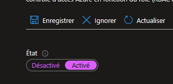
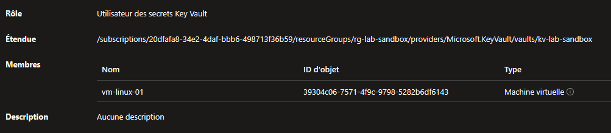
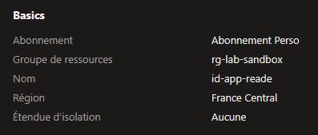
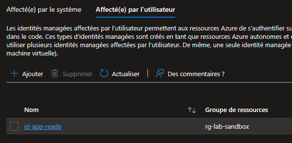

## Introduction

Cette procédure décrit comment utiliser les Managed Identities pour permettre à une ressource Azure (VM, App Service, Function...) de s'authentifier auprès d'autres services Azure sans stocker de mot de passe ni de clé dans le code. C'est Azure qui gère le cycle de vie des credentials automatiquement.

## Contexte et Justification

Scénario classique sans Managed Identity : votre application tourne sur une VM et doit lire des secrets dans un Key Vault. Vous devez créer un Service Principal dans Entra ID, générer un client secret (mot de passe), le stocker dans un fichier de config sur la VM, et le renouveler tous les 6 mois. Si quelqu'un vole ce secret, il a accès à votre Key Vault.

Scénario avec Managed Identity : vous activez l'identité managée sur la VM, vous attribuez le rôle « Key Vault Secrets User » à cette identité, et c'est terminé. Pas de mot de passe, pas de rotation, pas de fuite possible. La VM prouve son identité auprès d'Entra ID via un token interne qu'Azure renouvelle automatiquement.

## Concepts Clés

**System-Assigned Managed Identity :** Une identité liée 1:1 à une ressource. Quand vous l'activez sur une VM, Azure crée automatiquement un objet Service Principal dans Entra ID. Si vous supprimez la VM, l'identité est supprimée avec. Une ressource ne peut avoir qu'une seule System-Assigned Identity.

**User-Assigned Managed Identity :** Une identité créée en tant que ressource Azure indépendante (elle vit dans un Resource Group). Vous pouvez l'associer à plusieurs ressources. Si vous supprimez une VM qui l'utilise, l'identité reste intacte et continue de fonctionner pour les autres ressources. Une ressource peut avoir plusieurs User-Assigned Identities.

**Service Principal :** L'objet dans Entra ID qui représente l'identité. Quand vous activez une System-Assigned Identity sur une VM, Azure crée un Service Principal « caché » du même nom que la VM. C'est à ce Service Principal que vous attribuez les rôles RBAC.

**Token :** La Managed Identity obtient un token OAuth2 auprès d'Entra ID en contactant un endpoint interne accessible uniquement depuis la ressource (IMDS : Instance Metadata Service, à l'adresse 169.254.169.254). Ce token a une durée de vie limitée et est renouvelé automatiquement.

**Différence clé pour choisir :**

- Votre application tourne sur UNE seule VM et n'a pas besoin de survivre à la suppression de la VM → **System-Assigned**.
- Votre application tourne sur plusieurs VMs (ou un VMSS), ou vous voulez pré-configurer les permissions avant de créer la ressource → **User-Assigned**.

## Prérequis

- Un Abonnement Azure actif.
- Une Machine Virtuelle existante (pour les tests). Si vous n'en avez pas, référez-vous à la procédure **Déploiement d'une Machine Virtuelle Linux**.
- Un Key Vault existant (pour tester l'accès). Si vous n'en avez pas, référez-vous à la procédure [**Gestion des Secrets avec Azure Key Vault**](/procedures/azure/gestion-des-secrets-avec-azure-key-vault).
- Le rôle **Owner** ou **User Access Administrator** sur le scope où vous attribuerez les rôles RBAC.
- Un Resource Group de test : rg-lab-sandbox.

## Méthode 1 : Configuration via Portail Azure

### Activer une System-Assigned Managed Identity sur une VM

1. Allez sur votre **Machine Virtuelle** dans le portail.
2. Dans le menu de gauche, section **Sécurité**, cliquez sur **Identité**.
3. Onglet **Attribuée par le système** (System assigned).
4. Basculez le statut sur **Activé**.



<p class="figure-caption"><b>Figure 1</b> · Activer une System-Assigned Managed Identity sur une VM</p>

5. Cliquez sur **Enregistrer**.
6. Azure vous demande de confirmer, cliquez sur **Oui**.
7. Après quelques secondes, un **Object ID** apparaît. C'est l'identifiant du Service Principal créé dans Entra ID.

### Attribuer un Rôle RBAC à la Managed Identity

Nous allons donner à la VM le droit de lire les secrets du Key Vault.

1. Allez sur votre **Key Vault** (ex : kv-lab-sandbox).
2. Dans le menu de gauche, cliquez sur **Contrôle d'accès (IAM)**.
3. Cliquez sur **+ Ajouter \> Ajouter une attribution de rôle**.
4. Rôle : Cherchez et sélectionnez **« Utilisateurs des secrets Key Vault »** (Key Vault Secrets User).
5. Cliquez sur **Suivant**.
6. **Attribuer l'accès à :** Sélectionnez **« Identité managée »**.
7. Cliquez sur **+ Sélectionner des membres**.
8. Type d'identité managée : **Machine virtuelle**.
9. Sélectionnez votre VM dans la liste.
10. Cliquez sur **Sélectionner** puis **Vérifier + attribuer**.

<div class="callout callout-note">

Votre VM peut maintenant récupérer les secrets du Key Vault sans aucun mot de passe dans le code.

</div>



<p class="figure-caption"><b>Figure 2</b> · Attribuer un Rôle RBAC à la Managed Identity</p>

### Créer une User-Assigned Managed Identity

1. Recherchez **« Identités managées »** (Managed Identities) dans la barre de recherche.
2. Cliquez sur **+ Créer**.
3. **Groupe de ressources :** rg-lab-sandbox.
4. **Région :** France Central.
5. **Nom :** id-app-reader *(convention : id-<usage/projet>)*.
6. Cliquez sur **Vérifier + créer** puis **Créer**.



<p class="figure-caption"><b>Figure 3</b> · Créer une User-Assigned Managed Identity</p>

### Associer une User-Assigned Identity à une Ressource

1. Retournez sur votre **Machine Virtuelle**.
2. Menu **Identité** \> Onglet **Affecté(e) par l'utilisateur** (User assigned).
3. Cliquez sur **+ Ajouter**.
4. Sélectionnez **id-app-reader** dans la liste.
5. Cliquez sur **Ajouter**.



<p class="figure-caption"><b>Figure 4</b> · Associer une User-Assigned Identity à une Ressource</p>

<div class="callout callout-note">

La VM a maintenant deux identités : sa System-Assigned (pour le Key Vault) et la User-Assigned « id-app-reader » (que vous pouvez attribuer à d'autres VMs aussi). N'oubliez pas d'attribuer un rôle RBAC à « id-app-reader » (même méthode que « Attribuer un Rôle RBAC à la Managed Identity ») sinon elle ne pourra rien faire.

</div>

## Méthode 2 : Configuration via PowerShell

### Activer une System-Assigned Identity

```powershell
$vm = Get-AzVM -ResourceGroupName "rg-lab-sandbox" -Name "vm-linux-01"
Update-AzVM -ResourceGroupName "rg-lab-sandbox" -VM $vm -IdentityType SystemAssigned
```

Récupérer l'Object ID :

```powershell
$vm = Get-AzVM -ResourceGroupName "rg-lab-sandbox" -Name "vm-linux-01"
$vm.Identity.PrincipalId
```

### Créer une User-Assigned Identity

```powershell
New-AzUserAssignedIdentity `
    -ResourceGroupName "rg-lab-sandbox" `
    -Name "id-app-reader" `
    -Location "FranceCentral"
```

### Associer une User-Assigned Identity à une VM

```powershell
$vm = Get-AzVM -ResourceGroupName "rg-lab-sandbox" -Name "vm-linux-01"
$uai = Get-AzUserAssignedIdentity -ResourceGroupName "rg-lab-sandbox" -Name "id-app-reader"
Update-AzVM -ResourceGroupName "rg-lab-sandbox" -VM $vm `
    -IdentityType SystemAssignedUserAssigned `
    -IdentityId $uai.Id
```

<div class="callout callout-note">

`-IdentityType SystemAssignedUserAssigned` permet de garder les deux types actifs simultanément.

</div>

### Attribuer un Rôle RBAC

```powershell
$principalId = (Get-AzVM -ResourceGroupName "rg-lab-sandbox" -Name "vm-linux-01").Identity.PrincipalId
New-AzRoleAssignment `
    -ObjectId $principalId `
    -RoleDefinitionName "Key Vault Secrets User" `
    -Scope "/subscriptions/<SUB_ID>/resourceGroups/rg-lab-sandbox/providers/Microsoft.KeyVault/vaults/kv-lab-sandbox"
```

### Vérifier les Identités

```powershell
(Get-AzVM -ResourceGroupName "rg-lab-sandbox" -Name "vm-linux-01").Identity | Format-List
```

Lister les rôles :

```powershell
Get-AzRoleAssignment -ObjectId $principalId | Select-Object RoleDefinitionName, Scope | Format-Table
```

## Vérifications

**System-Assigned :** Sur la VM \> Identité \> Onglet « Attribuée par le système » → le statut est « Activé » et un Object ID est visible.

**User-Assigned :** Sur la VM \> Identité \> Onglet « Attribuée par l'utilisateur » → « id-app-reader » apparaît dans la liste.

**Rôle RBAC :** Sur le Key Vault \> IAM \> Attributions de rôles → vous voyez le nom de votre VM avec le rôle « Key Vault Secrets User ».

**Test fonctionnel (depuis la VM) :** Connectez-vous à la VM et exécutez :

```bash
curl -s -H "Metadata: true" "http://169.254.169.254/metadata/identity/oauth2/token?api-version=2018-02-01&resource=https://vault.azure.net" | python3 -m json.tool
```

Si un token JSON apparaît avec un champ `access_token`, la Managed Identity fonctionne.

## Dépannage

**« PrincipalNotFound » lors de l'attribution de rôle :** La création du Service Principal dans Entra ID peut prendre quelques secondes après l'activation de l'identité. Attendez 30 secondes et réessayez.

**« Forbidden (403) » quand l'application essaie d'accéder au Key Vault :** L'identité existe et l'authentification fonctionne, mais le rôle RBAC n'est pas attribué (ou pas sur le bon scope). Vérifiez les attributions IAM sur la ressource cible. Attention aussi au modèle d'autorisation du Key Vault : s'il est encore en mode « Access Policies » (ancien modèle), les rôles RBAC ne fonctionnent pas. Passez-le en mode « RBAC Azure » dans Configuration.

**La VM a perdu son identité après un redéploiement :** Si vous redéployez une VM (ex : changement de taille qui force une réallocation), la System-Assigned Identity est conservée. Par contre, si vous supprimez et recréez la VM, l'identité est perdue. Utilisez une User-Assigned Identity pour les scénarios où la VM peut être recréée.

## Conseils et Bonnes Pratiques

**Préférez User-Assigned pour la production.** Elles survivent à la suppression des ressources, elles sont réutilisables, et vous pouvez pré-configurer les permissions avant de déployer l'application. System-Assigned est parfaite pour les labs et les cas simples (une VM, un accès).

**Convention de nommage :** Utilisez le préfixe id- pour les User-Assigned Identities (ex : id-webapp-keyvault, id-batch-storage). Ça les distingue immédiatement des autres ressources.

**Principe du moindre privilège.** N'attribuez jamais « Contributor » ou « Owner » à une Managed Identity sauf nécessité absolue. Utilisez les rôles spécialisés : « Key Vault Secrets User » plutôt que « Key Vault Contributor », « Storage Blob Data Reader » plutôt que « Storage Account Contributor ».

## Procédures Liées

- [Gestion des Secrets avec Azure Key Vault](/procedures/azure/gestion-des-secrets-avec-azure-key-vault) *(Le cas d'usage principal des Managed Identities : accéder au Key Vault sans mot de passe)*
- [Gestion des Utilisateurs et des Rôles](/procedures/azure/gestion-des-utilisateurs-et-des-roles) *(Les Managed Identities utilisent le même système RBAC que les utilisateurs)*
- [Gestion des Policy Azure](/procedures/azure/gestion-des-policy-azure) *(Les policies avec effet DeployIfNotExists utilisent une Managed Identity pour la remédiation)*
- Déploiement d'une Machine Virtuelle (Windows et Linux) *(Prérequis pour ce lab)*
