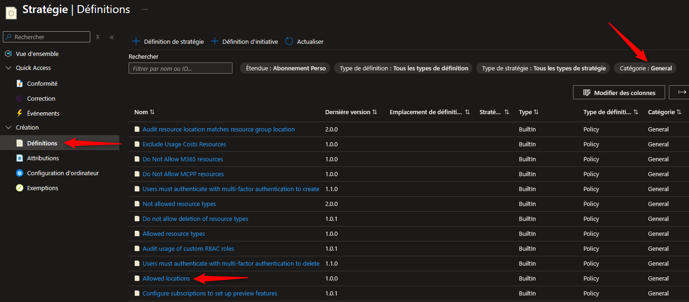
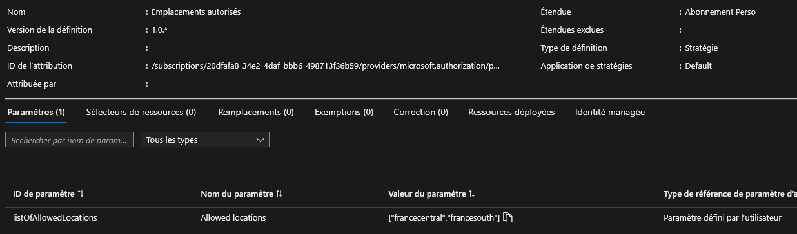
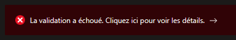
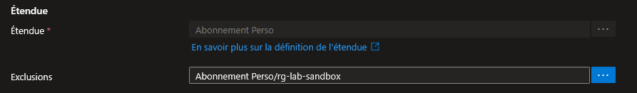

## Introduction

Cette procédure décrit comment utiliser Azure Policy pour imposer des règles sur vos ressources Azure. Au lieu de vérifier manuellement que chaque VM est dans la bonne région ou que chaque stockage est chiffré, vous définissez une règle et Azure l'applique automatiquement à grande échelle.

## Contexte et Justification

Dans une entreprise, un développeur peut créer des ressources n'importe où, n'importe comment. Azure Policy agit comme un garde-fou automatique :

- **Conformité :** Forcer toutes les ressources à être déployées uniquement en France Central et France South.
- **Sécurité :** Interdire la création de comptes de stockage accessibles publiquement.
- **Standardisation :** Exiger un tag « Environnement » sur chaque Resource Group.
- **Audit :** Repérer toutes les VMs sans Azure Backup activé, sans les bloquer pour autant.

## Concepts Clés

**Définition (Policy Definition) :** La règle elle-même. C'est un fichier JSON qui décrit « quoi vérifier » et « quoi faire ». Azure en fournit des centaines prédéfinies (Built-in). Vous pouvez aussi créer les vôtres (Custom).

**Attribution (Assignment) :** L'action de lier une définition à un scope (Management Group, Abonnement, ou Resource Group). Une définition non attribuée ne fait rien, c'est juste un modèle sur l'étagère.

**Scope :** Le périmètre d'application. Si vous attribuez au niveau de l'Abonnement, toutes les ressources de tous les Resource Groups sont couvertes. Si vous attribuez au niveau d'un seul Resource Group, seul celui-ci est concerné.

**Exclusion :** Permet d'exclure un sous-scope de l'attribution. Par exemple : « Appliquer cette policy sur tout l'abonnement SAUF le Resource Group rg-lab-tests ».

**Effet (Effect) :** Ce qui se passe quand une ressource ne respecte pas la règle. Les principaux :

- **Deny :** Bloque la création ou modification. L'utilisateur reçoit une erreur.
- **Audit :** Laisse passer mais marque la ressource comme « Non-conforme » dans le tableau de bord. Idéal pour commencer.
- **DeployIfNotExists :** Si une configuration manque (ex : Backup non activé), Azure la déploie automatiquement. Nécessite une Managed Identity.
- **Modify :** Ajoute ou modifie des propriétés (ex : ajouter un tag manquant). Nécessite aussi une Managed Identity.
- **AuditIfNotExists :** Comme Audit, mais vérifie l'existence d'une ressource liée (ex : « cette VM a-t-elle une extension antivirus installée ? »).
- **Disabled :** Désactive la policy sans la supprimer. Utile pour le debug temporaire.

**Initiative (Policy Set) :** Un regroupement de plusieurs définitions. Par exemple, l'initiative « CIS Microsoft Azure Foundations Benchmark » regroupe ~200 policies de sécurité en un seul paquet qu'on attribue en une fois.

**Remédiation (Remediate) :** Pour les effets DeployIfNotExists et Modify, une tâche qui corrige les ressources existantes qui ne sont pas conformes. Les nouvelles ressources sont corrigées automatiquement, mais les anciennes nécessitent de lancer cette tâche manuellement.

**Managed Identity :** Pour que la Policy puisse modifier des ressources (DeployIfNotExists, Modify), Azure a besoin d'une identité avec les permissions nécessaires. Elle est créée automatiquement lors de l'attribution.

## Prérequis

- Un Abonnement Azure actif.
- Le rôle **Resource Policy Contributor** (minimum) pour attribuer des policies, ou Owner / Contributor sur le scope cible.
- Un Resource Group de test : rg-policy-lab.
- Quelques ressources existantes pour tester la conformité (un compte de stockage, un RG sans tag…).

## Méthode 1 : Configuration via Portail Azure

### Exploration des Définitions Intégrées

1. Recherchez **« Policy »** (ou « Stratégie ») dans la barre de recherche du portail.
2. Dans le menu de gauche, cliquez sur **Définitions.**
3. Filtrez par **Catégorie** : sélectionnez « General » pour voir les policies les plus courantes.
4. Cherchez la définition : **« Allowed locations »** (Emplacements autorisés).



<p class="figure-caption"><b>Figure 1</b> · Exploration des Définitions Intégrées</p>

5. Cliquez dessus pour voir sa structure JSON. Notez le champ `effect` et les `parameters`.

<div class="callout callout-note">

Pour cette procédure, nous allons utiliser cette policy pour autoriser uniquement France Central et France South.

</div>

### Attribution d'une Policy (Assign)

1. Depuis la définition « Allowed locations », cliquez sur **Attribuer** (Assign).
2. **Scope :** Cliquez sur « ... » et sélectionnez votre abonnement (ou le Resource Group rg-policy-lab si vous voulez limiter le test).
3. **Nom de l'attribution :** Laissez le nom par défaut ou personnalisez (ex : « Restrict-Locations-FR »).
4. **Application de la stratégie :** Laissez sur **Activée**.
5. Onglet **Paramètres :**
   - Emplacements autorisés : Sélectionnez **France Central** et **France South**.



<p class="figure-caption"><b>Figure 2</b> · Attribution d'une Policy (Assign)</p>

6. Cliquez sur **Vérifier + créer** puis **Créer**.

<div class="callout callout-note">

Testez : essayez de créer un Resource Group en "East US". Vous devriez recevoir une erreur de validation mentionnant la policy.

</div>



<p class="figure-caption"><b>Figure 3</b> · Erreur de validation renvoyée par la policy</p>

### Exclusion d'une Ressource ou d'un Scope (Exclude)

1. Retournez dans **Policy \> Attributions**.
2. Cliquez sur votre attribution.
3. Cliquez sur **Modifier l'attribution**.
4. Dans le champ **Exclusions**, cliquez sur « ... » et sélectionnez le Resource Group que vous souhaitez exclure (ex : rg-lab-sandbox).



<p class="figure-caption"><b>Figure 4</b> · Exclusion d'une Ressource ou d'un Scope (Exclude)</p>

5. Cliquez sur **Enregistrer**.

<div class="callout callout-note">

Les ressources dans rg-lab-sandbox pourront désormais être créées dans n'importe quelle région, malgré la policy.

</div>

### Vérification de la Conformité (Compliance)

1. Dans **Policy \> Vue d'ensemble** (Overview), vous voyez un tableau de bord avec le pourcentage de conformité global.
2. Cliquez sur votre attribution pour voir le détail :
   - **Conforme (Compliant) :** Ressources qui respectent la règle.
   - **Non-conforme (Non-compliant) :** Ressources qui violent la règle.
3. Cliquez sur une ressource non-conforme pour voir les détails de la violation.

<div class="callout callout-note">

L'évaluation peut prendre jusqu'à 30 minutes. Pour forcer un scan immédiat, utilisez PowerShell (voir « Vérifier la Conformité » dans la méthode 2).

</div>

### Lancer une Remédiation (Remediate)

Cette section s'applique aux policies avec effet **DeployIfNotExists** ou **Modify**. La policy « Allowed locations » utilise l'effet Deny, donc pas de remédiation possible. Pour illustrer, imaginons que vous ayez attribué une policy "Inherit a tag from the resource group" (effet Modify).

1. Dans **Policy \> Remédiation** (Remediation).
2. Cliquez sur **+ Créer une tâche de remédiation**.
3. Sélectionnez l'attribution concernée.
4. Azure vous montre la liste des ressources non-conformes qui seront corrigées.
5. Cliquez sur **Corriger** (Remediate).
6. Suivez l'avancement dans l'onglet **Tâches de remédiation**.

<div class="callout callout-note">

La Managed Identity créée automatiquement lors de l'attribution doit avoir les permissions suffisantes sur le scope. Si la remédiation échoue avec "Authorization Failed", vérifiez le rôle attribué à cette identité.

</div>

## Méthode 2 : Configuration via PowerShell

### Lister les Définitions Disponibles

```powershell
Get-AzPolicyDefinition | Where-Object { $_.DisplayName -eq "Allowed locations" }
```

### Attribuer une Policy

```powershell
$definition = Get-AzPolicyDefinition | Where-Object { $_.DisplayName -eq "Allowed locations" }
$subId = (Get-AzContext).Subscription.Id
$params = @{
    "listOfAllowedLocations" = @("francecentral", "francesouth")
}
New-AzPolicyAssignment `
    -Name "Restrict-Locations-FR-PS" `
    -DisplayName "Restrict Locations to France PS" `
    -PolicyDefinition $definition `
    -Scope "/subscriptions/$subId" `
    -PolicyParameterObject $params
```

Avec exclusion :

```powershell
New-AzPolicyAssignment `
    -Name "Restrict-Locations-FR" `
    -DisplayName "Restrict Locations to France" `
    -PolicyDefinition $definition `
    -Scope "/subscriptions/$subId" `
    -NotScope "/subscriptions/$subId/resourceGroups/rg-lab-sandbox" `
    -PolicyParameterObject $params
```

### Vérifier la Conformité

Forcer un scan :

```powershell
Start-AzPolicyComplianceScan -ResourceGroupName rg-policy-lab
```

Lister les non-conformes :

```powershell
Get-AzPolicyState -Filter "ComplianceState eq 'NonCompliant'" | Select-Object ResourceId, PolicyAssignmentName, ComplianceState
```

### Créer une Tâche de Remédiation

```powershell
$assignment = Get-AzPolicyAssignment -Name "Inherit-Tag-Env"
Start-AzPolicyRemediation `
    -Name "remediate-tags" `
    -PolicyAssignmentId $assignment.ResourceId `
    -ResourceGroupName rg-policy-lab
```

## Vérifications

**Test Deny :** Essayez de créer un Resource Group en "East US" → vous devez recevoir une erreur mentionnant la policy.

**Test Compliance :** Allez dans Policy \> Vue d'ensemble → vos ressources existantes hors France doivent apparaître non-conformes.

**Test Exclusion :** Créez une ressource dans le RG exclu dans une région non autorisée → la création doit réussir.

## Dépannage

**« RequestDisallowedByPolicy » lors d'un déploiement :** C'est la policy qui fait son travail. Lisez le message d'erreur — il contient le nom de la policy qui bloque. Si c'est légitime, modifiez votre déploiement. Si c'est un faux positif, ajoutez une exclusion.

**Le tableau de conformité affiche « Not started » :** L'évaluation initiale peut prendre jusqu'à 30 minutes. Utilisez `Start-AzPolicyComplianceScan` pour accélérer.

**La remédiation échoue avec « AuthorizationFailed » :** La Managed Identity de l'attribution n'a pas les permissions nécessaires. Allez dans l'attribution \> Identité managée et vérifiez le rôle assigné. Pour une policy qui modifie des tags, il faut au minimum « Tag Contributor ».

**La policy ne semble pas s'appliquer :** Vérifiez que le champ « Application de la stratégie » (Enforcement Mode) est bien sur **Activée** et non sur « Désactivée ». Le mode désactivé est utile pour tester la conformité sans bloquer, mais il ne bloquera jamais rien.

## Conseils et Bonnes Pratiques

**Commencez toujours par Audit.** Avant de mettre Deny sur une policy en production, attribuez-la en mode Audit pendant une semaine. Regardez combien de ressources seraient bloquées. Passez en Deny uniquement quand vous êtes sûr de ne rien casser.

**Utilisez les Initiatives plutôt que des policies individuelles.** Si vous avez 10 policies de sécurité à appliquer, regroupez-les dans une Initiative. Une seule attribution au lieu de 10, et c'est plus facile à gérer.

**Enforcement Mode « DoNotEnforce ».** Lors de l'attribution, vous pouvez choisir ce mode. La policy évalue la conformité mais ne bloque rien (même avec un effet Deny). C'est parfait pour du « what-if » avant de passer en production.

## Procédures Liées

- [Configuration des Management Group](/procedures/azure/configuration-des-management-group) *(Les Management Groups permettent d'attribuer des policies à plusieurs abonnements en une fois)*
- [Configuration des Locks sur les Ressources](/procedures/azure/configuration-des-locks-sur-les-ressources) *(Complémentaire aux policies, les Locks empêchent la suppression, les policies empêchent la mauvaise configuration)*
- [Gestion des Tags et Stratégie de Tagging](/procedures/azure/gestion-des-tags-et-strategie-de-tagging) *(Beaucoup de policies sont basées sur les tags)*
