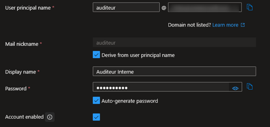
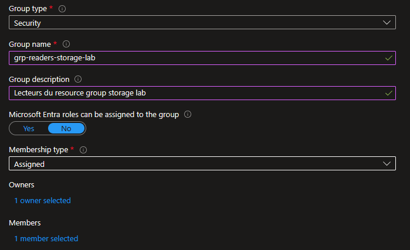
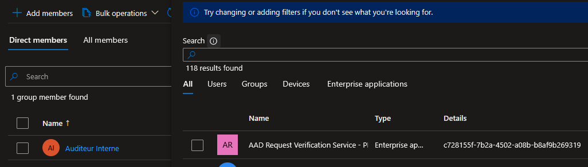
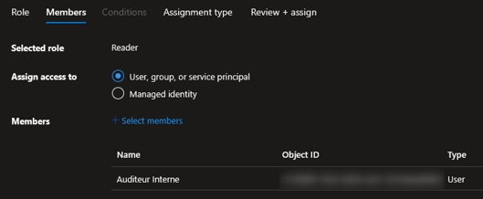
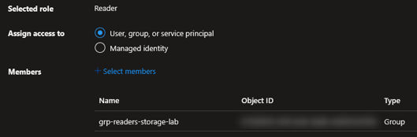
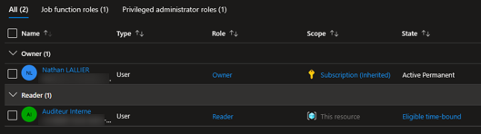

## Introduction

Cette procédure décrit comment créer des identités (utilisateurs et groupes) dans Microsoft Entra ID et leur attribuer des permissions sur les ressources Azure via le RBAC (Role-Based Access Control). L'objectif est de donner à chaque personne exactement les droits dont elle a besoin, ni plus ni moins, conformément au principe du moindre privilège.

## Contexte et Justification

Dans une organisation, chaque personne joue un rôle différent et a besoin d'accès différents :

- L'administrateur infrastructure doit pouvoir créer et gérer des VMs, des réseaux et du stockage.
- Le développeur doit pouvoir déployer son application mais pas toucher à l'infrastructure réseau.
- L'auditeur doit pouvoir voir toutes les ressources et les configurations mais ne rien modifier.
- Le stagiaire doit pouvoir consulter un environnement de test mais rien d'autre.

Sans contrôle d'accès, tout le monde utilise le même compte « admin » avec les pleins pouvoirs. Un clic malencontreux et la base de données de production est supprimée. Un compte compromis et l'attaquant a accès à tout.

Azure résout ce problème avec deux mécanismes complémentaires :

1. **Entra ID (l'annuaire)** : C'est là où vous créez les identités (qui existe). Chaque personne a un compte avec un login (UPN) et un mot de passe.

2. **RBAC Azure (les permissions)** : C'est là où vous définissez ce que chaque identité peut faire sur quelles ressources. Vous attribuez des rôles (Reader, Contributor, Owner) à des scopes (Management Group, Subscription, Resource Group, Resource).

## Concepts Clés

**Microsoft Entra ID (anciennement Azure AD) :** L'annuaire d'identités cloud de Microsoft. Il stocke les utilisateurs, les groupes, les applications et les service principals. Chaque organisation Azure a un « tenant » Entra ID (un annuaire dédié).

**User Principal Name (UPN) :** L'identifiant unique d'un utilisateur, au format email : nathan@contoso.onmicrosoft.com ou nathan@contoso.com (si un domaine personnalisé est configuré).

**Types d'utilisateurs :**

- **Member** : Un utilisateur créé directement dans votre tenant. Il a un accès complet aux fonctionnalités Entra ID selon sa licence.
- **Guest (Invité)** : Un utilisateur externe invité dans votre tenant (ex : un prestataire avec son propre compte Microsoft). Il a des permissions limitées par défaut dans Entra ID.

**Groupes Entra ID :**

- **Security Group** : Utilisé pour attribuer des permissions RBAC, des licences ou des politiques à un ensemble d'utilisateurs. C'est le type le plus courant.
- **Microsoft 365 Group** : Utilisé pour la collaboration (boîte mail partagée, site SharePoint, équipe Teams). Moins pertinent pour le RBAC Azure.
- **Membership type** :
  - **Assigned** : Les membres sont ajoutés manuellement par un administrateur.
  - **Dynamic User** : Les membres sont ajoutés automatiquement selon des règles basées sur les attributs de l'utilisateur (ex : tous les utilisateurs dont le département est « IT »). Nécessite Entra ID P1 ou P2.

**Rôles Entra ID vs Rôles Azure RBAC :**

|  | Rôles Entra ID | Rôles Azure RBAC |
|----------------|-----------------------------|--------------------------|
| **Portée** | L'annuaire Entra ID lui-même | Les ressources Azure (VMs, Storage, RGs) |
| **Exemples** | Global Administrator, User Administrator, Application Administrator | Owner, Contributor, Reader, Storage Blob Data Contributor |
| **Où les attribuer** | Entra ID \> Roles and administrators | Resource \> Access control (IAM) |
| **Usage** | Gérer les utilisateurs, les groupes, les apps, les politiques d'accès | Gérer les ressources Azure (créer, modifier, supprimer) |

Ne confondez pas les deux : être Global Administrator dans Entra ID ne donne aucun droit sur les ressources Azure, et être Owner d'un abonnement ne permet pas de créer des utilisateurs.

**Rôles Azure RBAC built-in :**

| Rôle | Permissions | Cas d'usage |
|----------------------|----------------------|--------------------------|
| **Owner** | Tout + gérer les accès (IAM) | Administrateur d'abonnement |
| **Contributor** | Tout SAUF gérer les accès | Administrateur infra sans droit de délégation |
| **Reader** | Lecture seule | Auditeur, consultation |
| **User Access Administrator** | Gérer les accès uniquement (IAM) | Déléguer les droits sans toucher aux ressources |
| **Storage Blob Data Contributor** | Lire/écrire les données blob | Développeur qui accède au stockage |
| **Storage Blob Data Reader** | Lire les données blob | Application en lecture seule |
| **Key Vault Secrets User** | Lire les secrets Key Vault | Application qui a besoin de mots de passe |
| **Virtual Machine Contributor** | Gérer les VMs | Opérateur qui gère les VMs uniquement |

**Scope (Étendue) du RBAC :** Les rôles sont attribués à un scope. Les permissions se propagent vers le bas (héritage) :

- Management Group \> Subscription \> Resource Group \> Resource

Un Contributor au niveau Subscription est Contributor sur tous les RG et toutes les ressources de cet abonnement. Un Reader au niveau d'un RG est Reader uniquement sur ce RG et ses ressources.

## Prérequis

- Un Tenant Entra ID (créé automatiquement avec votre abonnement Azure).
- Le rôle Entra ID **User Administrator** (minimum) pour créer des utilisateurs et des groupes.
- Le rôle Azure **Owner** ou **User Access Administrator** sur le scope cible pour attribuer des rôles RBAC.

## Méthode 1 : Configuration via Portail Azure

### Créer un Utilisateur dans Entra ID

1. Recherchez **"Microsoft Entra ID"** dans le portail.
2. Menu gauche \> **"Users"** \> **"All users"**.
3. Cliquez sur **"+ New user"** \> **"Create new user"**.
4. **User principal name** : auditeur (le domaine @votretenant.onmicrosoft.com est ajouté automatiquement).
5. **Display name** : Auditeur Interne.
6. **Password** : Cochez **"Auto-generate password"** et copiez le mot de passe généré (l'utilisateur devra le changer à la première connexion).



<p class="figure-caption"><b>Figure 1</b> · Créer un Utilisateur dans Entra ID</p>

7. Onglet **"Properties"** (optionnel) : Remplissez Job title, Department, etc. Ces champs sont utiles pour les Dynamic Groups et les rapports.
8. Cliquez sur **"Review + create"** puis **"Create"**.

<div class="callout callout-note">

L'utilisateur existe maintenant dans Entra ID mais n'a accès à aucune ressource Azure. Il faut lui attribuer un rôle RBAC.

</div>

### Créer un Groupe de Sécurité

1. Dans Entra ID, menu gauche \> **"Groups"** \> **"All groups"**.
2. Cliquez sur **"+ New group"**.
3. **Group type** : Security.
4. **Group name** : grp-readers-storage-lab.
5. **Group description** : Lecteurs du resource group storage lab.
6. **Membership type** : Assigned.
7. **Owners** : Cliquez sur **"No owners selected"** \> Recherchez et ajoutez votre compte admin.
8. **Members** : Cliquez sur **"No members selected"** \> Recherchez et ajoutez l'utilisateur Auditeur Interne.



<p class="figure-caption"><b>Figure 2</b> · Créer un Groupe de Sécurité</p>

9. Cliquez sur **"Create"**.

### Ajouter des Membres au Groupe

Si le groupe existe déjà et que vous voulez ajouter des membres :

1. Allez dans Entra ID \> **"Groups"** \> Cliquez sur le groupe.
2. Menu gauche \> **"Members"**.
3. Cliquez sur **"+ Add members"**.



<p class="figure-caption"><b>Figure 3</b> · Ajouter des Membres au Groupe</p>

4. Recherchez et sélectionnez les utilisateurs.
5. Cliquez sur **"Select"**.

### Attribuer un Rôle RBAC Azure à un Utilisateur

1. Allez dans le **Resource Group** cible (ex : rg-storage-lab).
2. Menu gauche \> **"Access control (IAM)"**.
3. Cliquez sur **"+ Add"** \> **"Add role assignment"**.
4. Onglet **"Role"** : Recherchez et sélectionnez **"Reader"**. Cliquez sur **"Next"**.
5. Onglet **"Members"** :
   - **Assign access to** : User, group, or service principal.
   - Cliquez sur **"+ Select members"**.
   - Recherchez **"Auditeur Interne"** et sélectionnez-le.
   - Cliquez sur **"Select"**.



<p class="figure-caption"><b>Figure 4</b> · Attribuer un Rôle RBAC Azure à un Utilisateur</p>

6. Cliquez sur **"Review + assign"** puis confirmez.

### Attribuer un Rôle RBAC Azure à un Groupe

Même procédure que « Attribuer un Rôle RBAC Azure à un Utilisateur », mais au lieu de sélectionner un utilisateur individuel, sélectionnez le groupe **grp-readers-storage-lab**. Tous les membres du groupe héritent automatiquement du rôle.



<p class="figure-caption"><b>Figure 5</b> · Attribuer un Rôle RBAC Azure à un Groupe</p>

<div class="callout callout-note">

C'est la méthode recommandée. Quand un nouvel auditeur arrive, vous l'ajoutez au groupe. Quand il part, vous le retirez. Pas besoin de toucher aux attributions RBAC.

</div>

### Vérifier les Attributions de Rôles (IAM)

1. Dans le RG \> **"Access control (IAM)"**.
2. Onglet **"Role assignments"**.
3. Vous voyez la liste complète : qui a quel rôle, attribué directement ou via un groupe, à quel scope.
4. Onglet **"Check access"** : Saisissez le nom d'un utilisateur pour voir ses permissions effectives (y compris celles héritées des scopes supérieurs).



<p class="figure-caption"><b>Figure 6</b> · Vérifier les Attributions de Rôles (IAM)</p>

## Méthode 2 : Configuration via PowerShell

### Créer un Utilisateur

```powershell
$domain = "votretenant.onmicrosoft.com"
$password = ConvertTo-SecureString "P@ssw0rd-Aud1t-2026!" -AsPlainText -Force
New-AzADUser `
    -DisplayName "Auditeur Interne" `
    -UserPrincipalName "auditeur@$domain" `
    -Password $password `
    -MailNickname "auditeur" `
    -ForceChangePasswordNextLogin
```

Lister les utilisateurs :

```powershell
Get-AzADUser | Select-Object DisplayName, UserPrincipalName, UserType | Format-Table
```

### Créer un Groupe et Ajouter des Membres

1. Créer le groupe :

```powershell
New-AzADGroup `
    -DisplayName "grp-readers-storage-lab" `
    -MailNickname "grp-readers-storage-lab" `
    -Description "Lecteurs du RG storage lab"
```

2. Récupérer les Object IDs :

```powershell
$user = Get-AzADUser -UserPrincipalName "auditeur@$domain"
$group = Get-AzADGroup -DisplayName "grp-readers-storage-lab"
```

3. Ajouter au groupe :

```powershell
Add-AzADGroupMember -TargetGroupObjectId $group.Id -MemberObjectId $user.Id
```

4. Vérifier les membres :

```powershell
Get-AzADGroupMember -GroupObjectId $group.Id |
    Select-Object DisplayName, UserPrincipalName |
    Format-Table
```

### Attribuer un Rôle RBAC

1. Attribuer Reader à un utilisateur sur un RG :

```powershell
New-AzRoleAssignment `
    -SignInName "auditeur@$domain" `
    -RoleDefinitionName "Reader" `
    -ResourceGroupName "rg-storage-lab"
```

2. Attribuer Reader à un groupe sur un RG :

```powershell
New-AzRoleAssignment `
    -ObjectId $group.Id `
    -RoleDefinitionName "Reader" `
    -ResourceGroupName "rg-storage-lab"
```

3. Attribuer à un scope Subscription :

```powershell
$subId = (Get-AzContext).Subscription.Id
New-AzRoleAssignment `
    -SignInName "auditeur@$domain" `
    -RoleDefinitionName "Reader" `
    -Scope "/subscriptions/$subId"
```

### Lister les Attributions de Rôles

1. Sur un RG :

```powershell
Get-AzRoleAssignment -ResourceGroupName "rg-storage-lab" |
    Select-Object DisplayName, RoleDefinitionName, Scope |
    Format-Table
```

2. Pour un utilisateur spécifique :

```powershell
Get-AzRoleAssignment -SignInName "auditeur@$domain" |
    Select-Object RoleDefinitionName, Scope |
    Format-Table
```

## Vérifications

**Utilisateur créé** : Dans Entra ID \> **"Users"**, l'utilisateur Auditeur Interne apparaît dans la liste avec le statut **"Enabled"**.

**Groupe créé** : Dans Entra ID \> **"Groups"**, le groupe grp-readers-storage-lab apparaît avec le bon nombre de membres.

**Rôle attribué** : Dans rg-storage-lab \> **"Access control (IAM)"** \> Onglet **"Role assignments"**, l'utilisateur ou le groupe apparaît avec le rôle Reader.

**Test de permissions** : Ouvrez une fenêtre de navigation privée, connectez-vous avec le compte auditeur@.... Allez sur rg-storage-lab. Vous devez voir les ressources. Essayez de supprimer une ressource ou de modifier un tag : vous devez obtenir une erreur **"Authorization failed"**. C'est le comportement attendu pour un Reader.

**Check access** : Dans le RG \> **"Access control (IAM)"** \> **"Check access"**, tapez le nom de l'auditeur. Le portail affiche ses permissions effectives.

## Dépannage

**"Authorization_RequestDenied" à la création d'un utilisateur :** Votre compte n'a pas le rôle Entra ID **User Administrator** (ou Global Administrator). Le rôle Azure Owner ne suffit PAS pour créer des utilisateurs dans Entra ID. Vérifiez vos rôles Entra ID dans Entra ID \> **"Roles and administrators"**.

**L'utilisateur ne voit pas le RG après l'attribution de rôle :** Attendez 1 à 5 minutes (délai de propagation RBAC). Demandez à l'utilisateur de se déconnecter puis se reconnecter. Vérifiez aussi que l'attribution est bien au bon scope (le bon RG, pas un autre).

**"PrincipalNotFound" lors de l'attribution de rôle :** L'Object ID de l'utilisateur ou du groupe est incorrect, ou l'objet a été supprimé. Vérifiez que l'utilisateur/groupe existe toujours dans Entra ID.

**L'utilisateur a plus de permissions que prévu :** Vérifiez les rôles hérités des scopes supérieurs. Un rôle Contributor au niveau Subscription donne Contributor sur TOUS les RG. Utilisez **"Check access"** dans IAM pour voir toutes les attributions, y compris celles héritées.

**Le compte Guest ne peut pas lister les utilisateurs Entra ID :** C'est le comportement par défaut. Les invités ont des permissions limitées dans Entra ID. Pour leur donner plus d'accès, modifiez Entra ID \> **"External Identities"** \> **"External collaboration settings"** \> **"Guest user access restrictions"**.

## Conseils et Bonnes Pratiques

**Toujours attribuer les rôles à des groupes, jamais à des utilisateurs individuels.** C'est la règle d'or. Même si vous n'avez qu'un seul auditeur aujourd'hui, créez un groupe « Auditors » et attribuez le rôle au groupe. Le jour où un deuxième auditeur arrive, vous l'ajoutez au groupe en 10 secondes.

**Appliquez le principe du moindre privilège.** Donnez le rôle le plus restrictif possible. Si quelqu'un a besoin de lire les blobs d'un compte de stockage, donnez-lui **Storage Blob Data Reader** sur ce compte, pas Contributor sur tout le RG. Si quelqu'un a besoin de gérer les VMs mais pas le réseau, donnez-lui **Virtual Machine Contributor**, pas Contributor.

**Préférez les rôles au niveau Resource Group plutôt qu'au niveau Subscription.** Un rôle Contributor au niveau Subscription donne les pleins pouvoirs sur toutes les ressources de l'abonnement. C'est rarement nécessaire. Attribuez les rôles au scope le plus bas possible.

**Utilisez "Check access" régulièrement pour auditer.** Dans chaque RG \> IAM \> Check access, vérifiez que les permissions sont conformes à vos attentes. Cherchez les attributions directes (qui devraient être des groupes) et les rôles trop larges (Owner là où Reader suffirait).

**Activez le MFA pour tous les utilisateurs, sans exception.** Dans Entra ID \> **"Security"** \> **"Security defaults"** ou via Conditional Access, forcez l'authentification multifacteur. Un mot de passe seul ne suffit plus en 2026.

## Procédures Liées

- [Création d'un Groupe de Ressources](/procedures/azure/creation-dun-groupe-de-ressources) *(Le RG est le scope le plus courant pour les attributions RBAC)*
- [Configuration du Conditional Access et MFA](/procedures/azure/configuration-du-conditional-access-et-mfa) *(Protéger les comptes utilisateurs avec le MFA et des politiques d'accès conditionnel)*
- [Gestion des Managed Identities (System & User Assigned)](/procedures/azure/gestion-des-managed-identities-system-user-assigned) *(Les Managed Identities remplacent les comptes de service pour l'accès programmatique aux ressources)*
- [Gestion des Policy Azure](/procedures/azure/gestion-des-policy-azure) *(Les policies peuvent imposer des restrictions en complément du RBAC, ex : interdire certaines SKU)*
- [Gestion des Secrets avec Azure Key Vault](/procedures/azure/gestion-des-secrets-avec-azure-key-vault) *(Le rôle Key Vault Secrets User est un exemple de rôle de données attribué via RBAC)*
