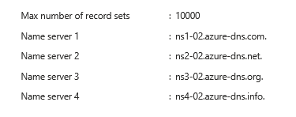
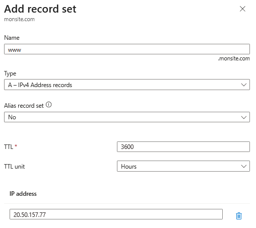
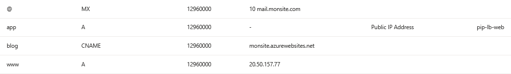
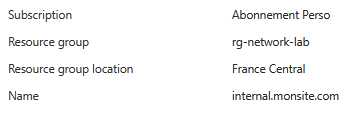
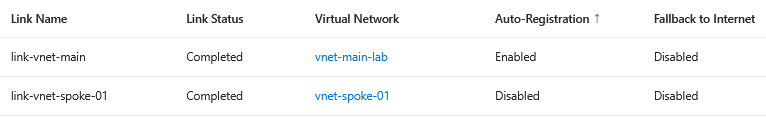
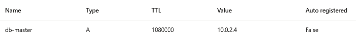

## Introduction

Cette procédure décrit la configuration d'Azure DNS, le service de résolution de noms hébergé dans Azure. Azure DNS permet de gérer deux types de zones : les zones publiques (résolution sur Internet pour vos domaines) et les zones privées (résolution interne dans vos VNets). C'est le service qui traduit les noms lisibles (ex : www.monsite.com) en adresses IP.

## Contexte et Justification

Le DNS est la fondation de toute communication réseau. Sans DNS, les utilisateurs devraient taper des adresses IP (20.50.157.77) au lieu de noms de domaine (www.monsite.com). Azure DNS remplace les serveurs DNS traditionnels (Windows DNS, BIND) par un service cloud managé.

Azure DNS sert dans deux scénarios distincts :

1. **DNS Public** : Vous avez acheté un domaine (ex : monsite.com) chez un registrar (OVH, GoDaddy, Namecheap) et vous voulez gérer ses enregistrements DNS dans Azure. Quand un utilisateur tape www.monsite.com, Azure DNS répond avec l'IP de votre Load Balancer ou de votre Web App.
2. **DNS Privé** : Vous voulez que vos VMs se trouvent par nom (ex : vm-web-01.internal.monsite.com → 10.0.1.4) au lieu d'IP, sans exposer ces noms sur Internet. C'est aussi le mécanisme utilisé par les Private Endpoints (ex : moncompte.privatelink.blob.core.windows.net → 10.0.2.5).

Azure DNS n'est PAS un registrar. Il ne vend pas de domaines. Vous achetez le domaine ailleurs et vous déléguez la résolution DNS vers Azure DNS.

## Concepts Clés

**Zone DNS :** Un conteneur qui héberge les enregistrements DNS d'un domaine. La zone monsite.com contient tous les enregistrements pour ce domaine et ses sous-domaines (www, mail, api, etc.).

**Zone DNS Publique :** Accessible depuis Internet. Quand un utilisateur résout www.monsite.com, sa requête arrive aux serveurs de noms Azure DNS qui répondent avec l'IP configurée. Les serveurs Azure DNS sont ns1-xx.azure-dns.com, ns2-xx.azure-dns.net, ns3-xx.azure-dns.org, ns4-xx.azure-dns.info.

**Zone DNS Privée :** Accessible uniquement depuis les VNets liés. Les requêtes DNS depuis Internet ne peuvent pas résoudre les noms de la zone privée. Utilisée pour la résolution interne (VM-to-VM par nom) et pour les Private Endpoints.

**Types d'enregistrements DNS :**

| Type | Usage | Exemple |
|-------|------------------------|-------------------------------|
| **A** | Nom -> IPv4 | www -> 20.50.157.77 |
| **AAAA** | Nom -> IPv6 | www -> 2001:db8::1 |
| **CNAME** | Alias vers un autre nom | blog -> monsite.azurewebsites.net |
| **MX** | Serveur de messagerie | @ -> mail.monsite.com (priorité 10) |
| **TXT** | Texte libre (SPF, vérification) | @ -> "v=spf1 include:_spf.google.com ~all" |
| **NS** | Serveurs de noms de la zone | @ -> ns1-xx.azure-dns.com |
| **SOA** | Start of Authority (métadonnées) | Créé automatiquement |
| **SRV** | Service (port, poids, priorité) | _sip._tcp -> sipserver.monsite.com |
| **PTR** | IP -> Nom (reverse DNS) | 77 -> www.monsite.com |

**Record Set :** Un groupe d'enregistrements du même type pour le même nom. Par exemple, un record set A pour www peut contenir deux IP (20.50.157.77 et 20.50.157.78) pour le round-robin DNS.

**TTL (Time To Live) :** La durée (en secondes) pendant laquelle un client DNS met en cache la réponse. Un TTL de 3600 signifie que le client ne résoudra pas à nouveau le nom pendant 1 heure. TTL bas = propagation rapide des changements mais plus de requêtes. TTL haut = moins de requêtes mais propagation lente.

**Alias Record Set :** Un enregistrement spécial Azure DNS qui pointe directement vers une ressource Azure (IP publique, Load Balancer, Traffic Manager, CDN) au lieu d'une IP statique. L'avantage : si l'IP de la ressource change, l'enregistrement se met à jour automatiquement. Disponible pour les types A, AAAA et CNAME.

**Auto-registration (Zone Privée) :** Quand vous liez une zone privée à un VNet avec l'auto-registration activée, les VMs créées dans ce VNet sont automatiquement enregistrées dans la zone DNS (un enregistrement A est créé avec le nom de la VM et son IP privée). Un VNet ne peut être lié avec auto-registration qu'à une seule zone privée.

**Virtual Network Link :** La liaison entre une zone DNS privée et un VNet. Sans ce lien, les VMs du VNet ne peuvent pas résoudre les noms de la zone. Chaque zone peut être liée à plusieurs VNets.

## Prérequis

- Pour le DNS public : un nom de domaine acheté chez un registrar (ex : OVH, GoDaddy, Namecheap).
- Pour le DNS privé : un VNet existant.
- Le rôle **DNS Zone Contributor** (minimum) pour gérer les zones et enregistrements DNS.
- Le rôle **Network Contributor** pour créer les Virtual Network Links (zone privée).

## Méthode 1 : Configuration via Portail Azure

### Créer une Zone DNS Publique

1. Recherchez **"DNS zones"** et cliquez sur **"+ Create"**.
2. **Resource group** : rg-network-lab.
3. **Name** : monsite.com (votre domaine).
4. Cliquez sur **"Review + create"** puis **"Create"**.
5. Une fois créée, notez les 4 serveurs de noms dans **"Overview"** :
   - ns1-xx.azure-dns.com
   - ns2-xx.azure-dns.net
   - ns3-xx.azure-dns.org
   - ns4-xx.azure-dns.info



<p class="figure-caption"><b>Figure 1</b> · Créer une Zone DNS Publique</p>

### Ajouter des Enregistrements DNS

Dans la zone monsite.com \> **"+ Recordsets"**.

**Enregistrement A (site web) :**

| Champ | Valeur |
|----------------------|-------------------------------------|
| **Name**             | www                                 |
| **Type**             | A                                   |
| **Alias record set** | No                                  |
| **TTL**              | 3600                                |
| **IP address**       | 20.50.157.77 (IP de votre LB ou VM) |



<p class="figure-caption"><b>Figure 2</b> · Ajouter des Enregistrements DNS</p>

**Enregistrement A Alias (pointe vers une IP publique Azure) :**

| Champ | Valeur |
|----------------------|---------------------------------------------|
| **Name**             | app                                         |
| **Type**             | A                                           |
| **Alias record set** | Yes                                         |
| **Azure resource**   | pip-lb-web (sélectionnez votre IP publique) |
| **TTL**              | 3600                                        |

<div class="callout callout-note">

L'Alias se met à jour automatiquement si l'IP de la ressource change.

</div>

**Enregistrement CNAME (alias) :**

| Champ | Valeur |
|-----------|---------------------------|
| **Name**  | blog                      |
| **Type**  | CNAME                     |
| **Alias** | monsite.azurewebsites.net |
| **TTL**   | 3600                      |

**Enregistrement MX (email) :**

| Champ | Valeur |
|-------------------|------------------|
| **Name**          | @ (racine)       |
| **Type**          | MX               |
| **Preference**    | 10               |
| **Mail exchange** | mail.monsite.com |
| **TTL**           | 3600             |



<p class="figure-caption"><b>Figure 3</b> · Liste des enregistrements de la zone publique</p>

### Déléguer le Domaine vers Azure DNS

Cette étape se fait chez votre registrar (OVH, GoDaddy, etc.), pas dans Azure :

1. Connectez-vous au panneau de gestion de votre registrar.
2. Cherchez la section **"DNS Servers"** ou **"Nameservers"** du domaine.
3. Remplacez les serveurs de noms actuels par les 4 serveurs Azure DNS notés lors de la création de la zone (« Créer une Zone DNS Publique »).
4. Sauvegardez. La propagation peut prendre de quelques minutes à 48 heures.

<div class="callout callout-note">

Tant que cette étape n'est pas faite, votre zone Azure DNS est configurée mais personne sur Internet ne la consulte.

</div>

### Créer une Zone DNS Privée

1. Recherchez **"Private DNS zones"** et cliquez sur **"+ Create"**.
2. **Resource group** : rg-network-lab.
3. **Name** : internal.monsite.com (ou tout nom que vous voulez pour la résolution interne).
4. Cliquez sur **"Review + create"** puis **"Create"**.



<p class="figure-caption"><b>Figure 4</b> · Créer une Zone DNS Privée</p>

### Lier une Zone Privée à un VNet

1. Dans la zone privée internal.monsite.com \> Menu gauche \> **"Virtual network links"**.
2. Cliquez sur **"+ Add"**.
3. **Link name** : link-vnet-main.
4. **Virtual network** : vnet-main-lab.
5. **Enable auto registration** : Yes (les VMs du VNet seront automatiquement enregistrées).
6. Cliquez sur **"Create"**.



<p class="figure-caption"><b>Figure 5</b> · Lier une Zone Privée à un VNet</p>

<div class="callout callout-note">

Répétez pour chaque VNet qui doit résoudre les noms de cette zone (ex : vnet-spoke-01 sans auto-registration).

</div>

### Ajouter des Enregistrements dans une Zone Privée

Même procédure que « Ajouter des Enregistrements DNS », mais dans la zone privée. Les enregistrements auto-registration apparaissent automatiquement quand des VMs sont créées dans le VNet lié.

Pour ajouter des enregistrements manuels (ex : un alias pour un service) :

1. Dans internal.monsite.com \> **"+ Record set"**.
2. **Name** : db-master.
3. **Type** : A.
4. **IP address** : 10.0.2.4.
5. **TTL** : 300.



<p class="figure-caption"><b>Figure 6</b> · Ajouter des Enregistrements dans une Zone Privée</p>

<div class="callout callout-note">

Les VMs du VNet peuvent maintenant résoudre db-master.internal.monsite.com → 10.0.2.4.

</div>

## Méthode 2 : Configuration via PowerShell

### Zone DNS Publique

```powershell
$rg = "rg-network-lab"
$zone = "monsite.com"
```

1. Créer la zone :

```powershell
New-AzDnsZone -ResourceGroupName $rg -Name $zone
```

2. Voir les NS records :

```powershell
(Get-AzDnsZone -ResourceGroupName $rg -Name $zone).NameServers
```

### Enregistrements DNS Publics

1. Enregistrement A :

```powershell
New-AzDnsRecordSet -ResourceGroupName $rg -ZoneName $zone -Name "www" -RecordType A -Ttl 3600 -DnsRecords (New-AzDnsRecordConfig -IPv4Address "20.50.157.77")
```

2. Enregistrement A avec plusieurs IP (round-robin) :

```powershell
$records = @()
$records += New-AzDnsRecordConfig -IPv4Address "20.50.157.77"
$records += New-AzDnsRecordConfig -IPv4Address "20.50.157.78"
New-AzDnsRecordSet -ResourceGroupName $rg -ZoneName $zone -Name "api" -RecordType A -Ttl 300 -DnsRecords $records
```

3. Enregistrement CNAME :

```powershell
New-AzDnsRecordSet -ResourceGroupName $rg -ZoneName $zone -Name "blog" -RecordType CNAME -Ttl 3600 -DnsRecords (New-AzDnsRecordConfig -Cname "monsite.azurewebsites.net")
```

4. Enregistrement MX :

```powershell
New-AzDnsRecordSet -ResourceGroupName $rg -ZoneName $zone -Name "@" -RecordType MX -Ttl 3600 -DnsRecords (New-AzDnsRecordConfig -Exchange "mail.monsite.com" -Preference 10)
```

5. Enregistrement TXT :

```powershell
New-AzDnsRecordSet -ResourceGroupName $rg -ZoneName $zone -Name "@" -RecordType TXT -Ttl 3600 -DnsRecords (New-AzDnsRecordConfig -Value "v=spf1 include:_spf.google.com ~all")
```

### Zone DNS Privée

```powershell
$privateZone = "internal.monsite.com"
New-AzPrivateDnsZone -ResourceGroupName $rg -Name $privateZone
```

### Lien VNet et Enregistrements Privés

```powershell
$vnet = Get-AzVirtualNetwork -ResourceGroupName $rg -Name "vnet-main-lab"
$vnetSpoke = Get-AzVirtualNetwork -ResourceGroupName $rg -Name "vnet-spoke-01"
```

1. Lier au VNet principal avec auto-registration :

```powershell
New-AzPrivateDnsVirtualNetworkLink -ResourceGroupName $rg -ZoneName $privateZone -Name "link-vnet-main" -VirtualNetworkId $vnet.Id -EnableRegistration
```

2. Lier au VNet spoke sans auto-registration :

```powershell
New-AzPrivateDnsVirtualNetworkLink -ResourceGroupName $rg -ZoneName $privateZone -Name "link-vnet-spoke01" -VirtualNetworkId $vnetSpoke.Id
```

3. Enregistrement A manuel :

```powershell
New-AzPrivateDnsRecordSet -ResourceGroupName $rg -ZoneName $privateZone -Name "db-master" -RecordType A -Ttl 300 -PrivateDnsRecords (New-AzPrivateDnsRecordConfig -IPv4Address "10.0.2.4")
```

### Lister et Vérifier

1. Zones publiques :

```powershell
Get-AzDnsZone -ResourceGroupName $rg | Format-Table Name, NumberOfRecordSets
```

2. Enregistrements d'une zone publique :

```powershell
Get-AzDnsRecordSet -ResourceGroupName $rg -ZoneName $zone | Select-Object Name, RecordType, Ttl, Records | Format-Table
```

3. Zones privées :

```powershell
Get-AzPrivateDnsZone -ResourceGroupName $rg | Format-Table Name
```

4. Liens VNet d'une zone privée :

```powershell
Get-AzPrivateDnsVirtualNetworkLink -ResourceGroupName $rg -ZoneName $privateZone | Select-Object Name, VirtualNetworkId, RegistrationEnabled | Format-Table
```

5. Enregistrements d'une zone privée :

```powershell
Get-AzPrivateDnsRecordSet -ResourceGroupName $rg -ZoneName $privateZone | Select-Object Name, RecordType, Records | Format-Table
```

### Supprimer

1. Supprimer un record set :

```powershell
Remove-AzDnsRecordSet -ResourceGroupName $rg -ZoneName $zone -Name "www" -RecordType A
```

2. Supprimer un lien VNet :

```powershell
Remove-AzPrivateDnsVirtualNetworkLink -ResourceGroupName $rg -ZoneName $privateZone -Name "link-vnet-main"
```

3. Supprimer les zones :

```powershell
Remove-AzDnsZone -ResourceGroupName $rg -Name $zone
Remove-AzPrivateDnsZone -ResourceGroupName $rg -Name $privateZone
```

## Vérifications

**Zone publique créée** : Dans le portail \> **"DNS zones"**, monsite.com apparaît avec les 4 NS records et le SOA.

**Enregistrements présents** : Dans la zone, les record sets www (A), blog (CNAME), @ (MX, TXT) sont listés.

**Délégation fonctionnelle** : Depuis votre PC, exécutez `nslookup www.monsite.com`. La réponse doit venir des serveurs Azure DNS (ns1-xx.azure-dns.com) et retourner l'IP configurée. Si ça ne fonctionne pas, la délégation n'est pas encore propagée chez le registrar.

**Zone privée créée** : Dans **"Private DNS zones"**, internal.monsite.com apparaît.

**Lien VNet actif** : Dans la zone privée \> **"Virtual network links"**, les liens sont listés avec le statut **"Completed"** et l'auto-registration activée/désactivée selon la config.

**Auto-registration** : Si l'auto-registration est activée, les VMs existantes dans le VNet apparaissent automatiquement comme enregistrements A dans la zone privée.

**Résolution privée** : Depuis une VM du VNet lié, `nslookup db-master.internal.monsite.com` retourne 10.0.2.4. Depuis votre PC (Internet), la même requête échoue (zone privée non accessible).

## Dépannage

**nslookup retourne "Non-authoritative answer" ou "server can't find" pour la zone publique :** La délégation NS n'est pas faite ou pas encore propagée chez le registrar. Vérifiez les NS records chez votre registrar : ils doivent correspondre exactement aux 4 serveurs Azure DNS. La propagation peut prendre jusqu'à 48 heures.

**La résolution privée ne fonctionne pas depuis une VM :** Le VNet de la VM n'est pas lié à la zone privée. Vérifiez les Virtual Network Links. Vérifiez aussi que la VM utilise le DNS Azure par défaut (168.63.129.16). Si un DNS custom est configuré dans les paramètres du VNet, il ne connaît pas la zone privée.

**"Record set already exists" :** Un record set avec ce nom et ce type existe déjà. Utilisez `Add-AzDnsRecordConfig` puis `Set-AzDnsRecordSet` pour ajouter une IP à un record set existant (round-robin), ou supprimez le record set existant.

**Impossible de créer un CNAME pour la racine (@) :** C'est une limitation du protocole DNS. Utilisez un Alias Record Set de type A pour pointer la racine vers une ressource Azure (IP publique, LB, Traffic Manager).

**"CNAME record conflicts with existing record" :** Un enregistrement A, MX ou TXT existe déjà pour le même nom. Le CNAME ne peut pas coexister avec d'autres types au même niveau. Supprimez les enregistrements existants ou utilisez un nom différent.

**L'auto-registration ne crée pas d'enregistrement pour une VM existante :** L'auto-registration crée les enregistrements au moment de la création de la VM ou du lien VNet. Pour les VMs existantes, il peut y avoir un délai. Redémarrez la VM ou attendez quelques minutes. Vérifiez aussi que le VNet est lié avec `-EnableRegistration`.

**La zone publique est facturée mais le trafic ne passe pas par Azure DNS :** La zone existe dans Azure mais les NS records du registrar pointent encore vers l'ancien hébergeur DNS. La zone Azure est facturée dès sa création, indépendamment de la délégation.

## Conseils et Bonnes Pratiques

**Baissez le TTL avant un changement prévu.** Si vous devez changer l'IP d'un enregistrement A (ex : migration de serveur), baissez le TTL à 60 secondes 24-48h avant le changement. Après le changement, attendez que la propagation soit confirmée, puis remontez le TTL à 3600.

**Utilisez les Alias Records pour les ressources Azure.** Au lieu de mettre l'IP brute d'un Load Balancer dans un enregistrement A, utilisez un Alias qui pointe vers la ressource Azure. Si l'IP change (redéploiement, migration), l'enregistrement suit automatiquement.

**Centralisez les zones DNS privées dans le Hub.** Dans une architecture Hub & Spoke, créez toutes les zones privées dans le resource group du Hub. Liez-les à tous les VNets. Activez l'auto-registration uniquement sur le VNet Hub pour éviter les conflits de noms.

**Utilisez une convention de nommage pour les zones privées.** Format : internal.monsite.com pour la résolution VM-to-VM, privatelink.blob.core.windows.net pour les Private Endpoints (ces noms sont imposés par Azure).

**Nettoyez les enregistrements orphelins.** Quand vous supprimez une VM ou une ressource, les enregistrements DNS manuels ne sont pas supprimés automatiquement (sauf auto-registration). Pensez à supprimer les enregistrements correspondants pour éviter de pointer vers des IP inexistantes.

**Attention au coût des zones publiques.** Chaque zone DNS publique coûte environ 0.50€/mois + 0.40€ par million de requêtes. Si vous avez des dizaines de zones inutilisées, supprimez-les.

## Procédures Liées

- [Déploiement d'un Réseau Virtuel](/procedures/azure/deploiement-dun-reseau-virtuel) *(Le VNet doit exister pour lier une zone DNS privée, le DNS custom du VNet affecte la résolution)*
- [Sécurisation PaaS via Private Endpoint](/procedures/azure/securisation-paas-via-private-endpoint) *(Les Private Endpoints nécessitent des zones DNS privées spécifiques comme privatelink.blob.core.windows.net)*
- [Mise en Place d'un Peering (Appairage VNet)](/procedures/azure/mise-en-place-dun-peering-appairage-vnet) *(Les zones DNS privées doivent être liées à chaque VNet peeré pour que la résolution fonctionne à travers le peering)*
- [Configuration des Adresses IP Publiques](/procedures/azure/configuration-des-adresses-ip-publiques) *(Les enregistrements A et les Alias pointent vers les IP publiques Azure)*
- [Configuration d'un Load Balancer](/procedures/azure/configuration-dun-load-balancer) *(L'IP publique du LB peut être la cible d'un Alias Record)*
- [Diagnostic Réseau avec Network Watcher](/procedures/azure/diagnostic-reseau-avec-network-watcher) *(Diagnostiquer les problèmes de résolution DNS)*
- Déploiement d'une Web App (App Service) *(Les Web Apps sont souvent la cible d'enregistrements CNAME dans les zones publiques)*
