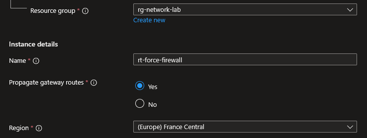
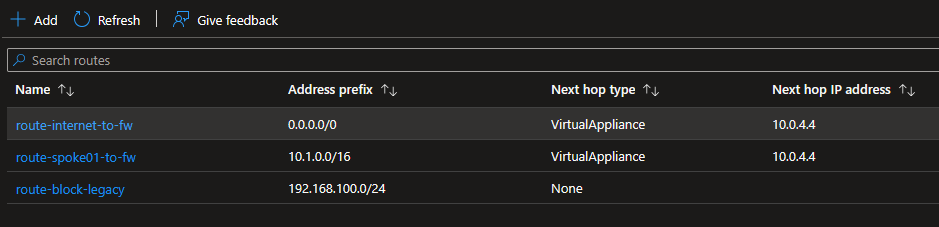
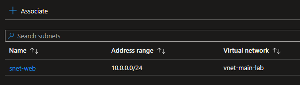
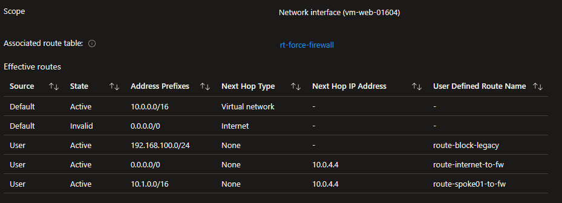

## Introduction

Cette procédure décrit la création et la configuration de User Defined Routes (UDR) dans Azure via les Route Tables. Les UDR permettent de contrôler manuellement le chemin que le trafic réseau emprunte, en surchargeant le routage automatique d'Azure. C'est l'outil qui vous permet de forcer le trafic à passer par un firewall, un Network Virtual Appliance (NVA) ou un chemin spécifique.

## Contexte et Justification

Par défaut, Azure gère le routage automatiquement. Les VMs d'un même VNet communiquent directement entre elles, le trafic vers Internet sort par la passerelle Azure, et le trafic vers un VNet peeré passe par le peering. Ce routage automatique est suffisant pour la plupart des scénarios simples.

Mais en entreprise, vous avez souvent besoin de contrôler le chemin du trafic :

1. **Inspection du trafic** : Tout le trafic sortant doit passer par un Azure Firewall ou un NVA (Network Virtual Appliance) pour être inspecté, journalisé et filtré.
2. **Forced Tunneling** : Tout le trafic Internet des VMs doit être redirigé vers le réseau on-premises (via le VPN Gateway) pour passer par le proxy de l'entreprise, au lieu de sortir directement par Internet.
3. **Architecture Hub & Spoke** : Le trafic entre deux spokes doit transiter par le hub (où se trouve le firewall), même si les spokes ne sont pas directement peerés.
4. **Isolation réseau** : Bloquer le trafic entre deux subnets en le redirigeant vers "None" (drop).

Sans UDR, vous n'avez aucun contrôle sur le chemin du trafic. Azure route tout automatiquement par le chemin le plus direct, sans inspection ni filtrage.

## Concepts Clés

**System Routes (Routes Système) :** Les routes créées et gérées automatiquement par Azure. Elles ne sont pas visibles dans la configuration mais apparaissent dans les Effective Routes d'une VM. Les principales :

| Préfixe destination | Next Hop | Description |
|------------------------------|-----------|--------------------------|
| Address space du VNet (ex : 10.0.0.0/16) | VNet | Trafic intra-VNet (entre subnets) |
| 0.0.0.0/0 | Internet | Trafic vers Internet |
| 10.0.0.0/8, 172.16.0.0/12, 192.168.0.0/16 | None | Trafic RFC 1918 non routable (drop) |
| Address space du VNet peeré | VNet peering | Trafic vers un VNet peeré |

**Route Table (Table de Routes) :** Une ressource Azure qui contient un ensemble de routes personnalisées (UDR). La Route Table est associée à un ou plusieurs subnets. Toutes les VMs du subnet utilisent les routes de la table.

**User Defined Route (UDR) :** Une route personnalisée que vous créez dans une Route Table. Chaque UDR contient :

- **Address prefix** : La destination du trafic (en notation CIDR, ex : 0.0.0.0/0 pour tout Internet, 10.1.0.0/16 pour un VNet spécifique).
- **Next hop type** : Où envoyer le trafic. Les options :
  - **Virtual appliance** : Vers une IP spécifique (un NVA ou un Azure Firewall). Vous spécifiez l'IP privée de l'appliance.
  - **Virtual network gateway** : Vers la VPN Gateway ou ExpressRoute Gateway.
  - **Virtual network** : Vers le VNet local (force le routage direct intra-VNet, utile pour surcharger une route par défaut).
  - **Internet** : Vers Internet directement.
  - **None** : Drop le trafic (équivalent à un blackhole). Le trafic est silencieusement supprimé.

**Longest Prefix Match :** Quand plusieurs routes matchent la même destination, Azure utilise la route avec le préfixe le plus long (le plus spécifique). Par exemple, si vous avez une system route pour 0.0.0.0/0 → Internet et une UDR pour 10.1.0.0/16 → Virtual appliance, le trafic vers 10.1.1.5 utilisera la UDR (/16 est plus spécifique que /0).

**Priorité des routes :** Quand deux routes ont le même préfixe, la priorité est :

1. UDR (User Defined Route) : priorité la plus haute
2. BGP routes (apprises via VPN/ExpressRoute)
3. System routes : priorité la plus basse

<div class="callout callout-note">

Les UDR surchargent toujours les system routes. C'est ainsi que vous pouvez forcer le trafic Internet à passer par un firewall au lieu de sortir directement.

</div>

**Effective Routes :** L'ensemble des routes réellement appliquées à une NIC de VM, après la combinaison des system routes, des UDR et des BGP routes. C'est l'outil de diagnostic principal pour comprendre comment le trafic est routé.

**BGP Route Propagation :** Par défaut, les routes apprises via BGP (VPN Gateway, ExpressRoute) sont propagées à tous les subnets du VNet. Vous pouvez désactiver cette propagation sur une Route Table spécifique pour empêcher les routes BGP d'être injectées dans un subnet (utile pour isoler un subnet du réseau on-premises).

## Prérequis

- Un VNet avec au moins deux subnets.
- Le rôle **Network Contributor** (minimum) pour créer et modifier des Route Tables.
- (Optionnel) Un Azure Firewall ou un NVA déployé si vous voulez rediriger le trafic vers une appliance.
- (Optionnel) Si vous redirigez vers un NVA, la VM NVA doit avoir **IP Forwarding** activé sur sa NIC (sinon elle drop le trafic qui ne lui est pas destiné).

## Méthode 1 : Configuration via Portail Azure

### Créer une Route Table

1. Recherchez **"Route tables"** et cliquez sur **"+ Create"**.
2. **Resource group** : rg-network-lab.
3. **Region** : France Central.
4. **Name** : rt-force-firewall.
5. **Propagate gateway routes** : Yes (laissez par défaut, sauf si vous voulez bloquer les routes BGP).



<p class="figure-caption"><b>Figure 1</b> · Créer une Route Table</p>

6. Cliquez sur **"Review + create"** puis **"Create"**.

### Ajouter une Route Personnalisée

Allez dans rt-force-firewall \> Menu gauche \> **"Routes"** \> **"+ Add"**.

**Route 1 : Forcer tout le trafic Internet vers le Firewall :**

| Champ | Valeur |
|--------------------------------------|--------------------------------------|
|              Route name              | route-internet-to-fw                 |
|           Destination type           | IP Addresses                         |
| Destination IP addresses/CIDR ranges | 0.0.0.0/0                            |
|            Next hop type             | Virtual appliance                    |
|           Next hop address           | 10.0.4.4 (IP privée du Firewall/NVA) |

**Route 2 : Forcer le trafic vers un VNet spoke via le Firewall :**

| Champ | Valeur |
|--------------------------------------|---------------------|
|              Route name              | route-spoke01-to-fw |
|           Destination type           | IP Addresses        |
| Destination IP addresses/CIDR ranges | 10.1.0.0/16         |
|            Next hop type             | Virtual appliance   |
|           Next hop address           | 10.0.4.4            |

**Route 3 : Bloquer le trafic vers un réseau spécifique (Blackhole) :**

| Champ | Valeur |
|--------------------------------------|--------------------|
|              Route name              | route-block-legacy |
|           Destination type           | IP Addresses       |
| Destination IP addresses/CIDR ranges | 192.168.100.0/24   |
|            Next hop type             | None               |

<div class="callout callout-note">

Le trafic vers 192.168.100.0/24 sera silencieusement supprimé.

</div>



<p class="figure-caption"><b>Figure 2</b> · Routes personnalisées de rt-force-firewall</p>

### Associer la Route Table à un Subnet

1. Dans rt-force-firewall \> Menu gauche \> **"Subnets"**.
2. Cliquez sur **"+ Associate"**.
3. **Virtual network** : vnet-main-lab.
4. **Subnet** : snet-web.
5. Cliquez sur **"OK"**.



<p class="figure-caption"><b>Figure 3</b> · Associer la Route Table à un Subnet</p>

<div class="callout callout-note">

Toutes les VMs de snet-web utilisent maintenant les routes de rt-force-firewall. Le trafic Internet passe par le firewall au lieu de sortir directement.

</div>

### Forcer le Trafic vers un Firewall (Forced Tunneling)

Le forced tunneling consiste à rediriger tout le trafic 0.0.0.0/0 vers un firewall ou un VPN Gateway. La configuration est celle de la Route 1 ci-dessus. Pour être complet :

1. Déployez un Azure Firewall (ou un NVA) dans un subnet dédié (ex : AzureFirewallSubnet).
2. Notez l'IP privée du firewall (ex : 10.0.4.4).
3. Créez une UDR : 0.0.0.0/0 → Virtual appliance → 10.0.4.4.
4. Associez la Route Table à chaque subnet dont vous voulez forcer le trafic.

<div class="callout callout-note">

Attention : le firewall doit aussi avoir une route vers Internet (sinon le trafic boucle). Ne mettez PAS la Route Table du forced tunneling sur le AzureFirewallSubnet.

</div>

### Consulter les Effective Routes d'une VM

1. Allez sur la VM \> Menu gauche \> **"Networking"** \> **"Network settings"**.
2. Cliquez sur la NIC.
3. Menu gauche \> "Help" \> **"Effective routes"**.
4. Vous voyez toutes les routes appliquées : system routes + UDR + BGP routes. La colonne **"Source"** indique l'origine (Default, User, VirtualNetworkGateway).



<p class="figure-caption"><b>Figure 4</b> · Consulter les Effective Routes d'une VM</p>

<div class="callout callout-note">

C'est l'outil de diagnostic le plus important. Si le trafic ne prend pas le chemin attendu, comparez les Effective Routes avec vos UDR.

</div>

## Méthode 2 : Configuration via PowerShell

### Créer une Route Table avec des Routes

```powershell
$rgName = "rg-network-lab"
```

1. Créer les routes en mémoire :

```powershell
$routeInternet = New-AzRouteConfig `
    -Name "route-internet-to-fw" `
    -AddressPrefix "0.0.0.0/0" `
    -NextHopType "VirtualAppliance" `
    -NextHopIpAddress "10.0.4.4"
$routeSpoke = New-AzRouteConfig `
    -Name "route-spoke01-to-fw" `
    -AddressPrefix "10.1.0.0/16" `
    -NextHopType "VirtualAppliance" `
    -NextHopIpAddress "10.0.4.4"
```

2. Créer la Route Table avec les routes :

```powershell
$rt = New-AzRouteTable `
    -ResourceGroupName $rgName `
    -Name "rt-force-firewall" `
    -Location "FranceCentral" `
    -Route $routeInternet, $routeSpoke
```

### Ajouter des Routes à une Route Table Existante

```powershell
$rt = Get-AzRouteTable -ResourceGroupName $rgName -Name "rt-force-firewall"
```

1. Blackhole :

```powershell
Add-AzRouteConfig `
    -RouteTable $rt `
    -Name "route-block-legacy" `
    -AddressPrefix "192.168.100.0/24" `
    -NextHopType "None"
$rt | Set-AzRouteTable
```

### Associer à un Subnet

```powershell
$vnet = Get-AzVirtualNetwork -ResourceGroupName $rgName -Name "vnet-main-lab"
$rt = Get-AzRouteTable -ResourceGroupName $rgName -Name "rt-force-firewall"
Set-AzVirtualNetworkSubnetConfig `
    -Name "snet-web" `
    -VirtualNetwork $vnet `
    -AddressPrefix "10.0.1.0/24" `
    -RouteTable $rt
$vnet | Set-AzVirtualNetwork
```

### Lister les Routes

1. Routes de la Route Table :

```powershell
Get-AzRouteTable -ResourceGroupName $rgName -Name "rt-force-firewall" |
    Select-Object -ExpandProperty Routes |
    Select-Object Name, AddressPrefix, NextHopType, NextHopIpAddress |
    Format-Table
```

2. Effective Routes d'une NIC :

```powershell
Get-AzEffectiveRouteTable `
    -NetworkInterfaceName "nic-vm-web-01" `
    -ResourceGroupName $rgName |
    Select-Object Source, AddressPrefix, NextHopType, NextHopIpAddress |
    Format-Table
```

### Supprimer une Route

```powershell
$rt = Get-AzRouteTable -ResourceGroupName $rgName -Name "rt-force-firewall"
Remove-AzRouteConfig -RouteTable $rt -Name "route-block-legacy"
$rt | Set-AzRouteTable
```

### Dissocier et Supprimer la Route Table

1. Dissocier de tous les subnets d'abord :

```powershell
$vnet = Get-AzVirtualNetwork -ResourceGroupName $rgName -Name "vnet-main-lab"
Set-AzVirtualNetworkSubnetConfig `
    -Name "snet-web" `
    -VirtualNetwork $vnet `
    -AddressPrefix "10.0.1.0/24" `
    -RouteTable $null
$vnet | Set-AzVirtualNetwork
```

2. Supprimer la Route Table :

```powershell
Remove-AzRouteTable `
    -ResourceGroupName $rgName `
    -Name "rt-force-firewall" `
    -Force
```

## Vérifications

**Route Table créée** : Dans le portail \> **"Route tables"**, rt-force-firewall apparaît avec la bonne région.

**Routes présentes** : Dans rt-force-firewall \> **"Routes"**, les routes personnalisées sont listées avec les bons préfixes et next hops.

**Association subnet** : Dans rt-force-firewall \> **"Subnets"**, snet-web est listé. Ou dans le VNet \> **"Subnets"**, la colonne **"Route table"** affiche rt-force-firewall pour snet-web.

**Effective Routes** : Sur la VM dans snet-web \> NIC \> **"Effective routes"**, la route 0.0.0.0/0 affiche Source = User et Next Hop = 10.0.4.4 (au lieu de Internet). Les system routes originales apparaissent comme "Invalid" (surchargées par la UDR).

**Test de trafic** : Depuis la VM, faites un `traceroute 8.8.8.8`. Le premier hop devrait être 10.0.4.4 (le firewall), pas la passerelle Internet Azure. Si le firewall n'est pas déployé, le trafic sera droppé (timeout).

**Test blackhole** : Depuis la VM, faites un `ping 192.168.100.1`. Le ping doit échouer (timeout) (trafic droppé par la route None).

## Dépannage

**Les VMs du subnet n'ont plus accès à Internet :** Vous avez probablement une UDR 0.0.0.0/0 → Virtual appliance mais l'appliance (firewall/NVA) n'est pas déployée, est éteinte, ou ne route pas le trafic. Vérifiez que l'appliance est opérationnelle. Si vous testez sans firewall, retirez temporairement la route ou dissociez la Route Table.

**Le trafic ne passe pas par le NVA malgré la UDR :** Vérifiez que l'IP Forwarding est activé sur la NIC du NVA dans Azure (NIC \> **"IP configurations"** \> **"Enable IP forwarding"**). Vérifiez aussi que le routage IP est activé dans l'OS du NVA (`net.ipv4.ip_forward=1` sous Linux, ou le rôle Routing and Remote Access sous Windows).

**Les Effective Routes ne montrent pas mon UDR :** La Route Table n'est pas associée au subnet de la VM. Vérifiez l'association dans la Route Table \> **"Subnets"**. Vérifiez aussi que vous regardez les Effective Routes de la bonne NIC.

**Le trafic intra-VNet passe par le firewall alors qu'il ne devrait pas :** Vous avez une UDR trop large (ex : 10.0.0.0/8 → Virtual appliance) qui capture aussi le trafic intra-VNet. Soyez plus spécifique dans vos préfixes de destination, ou ajoutez une route explicite pour le trafic intra-VNet vers "VirtualNetwork".

**Les VMs ne voient plus le réseau on-premises :** La propagation BGP est désactivée sur la Route Table. Vérifiez dans rt-force-firewall \> **"Configuration"** \> **"Propagate gateway routes"** = Yes. Si c'est No, les routes BGP (VPN/ExpressRoute) ne sont pas injectées dans le subnet.

**"Next hop type VirtualAppliance requires a next hop IP address" :** Le type Virtual appliance nécessite obligatoirement une IP de next hop. Vous avez oublié de spécifier l'IP du firewall/NVA. Ajoutez le paramètre `-NextHopIpAddress`.

**La Route Table est associée mais rien ne change :** Les UDR prennent effet immédiatement (pas de délai de propagation). Si rien ne change, vérifiez que les Effective Routes affichent bien vos routes avec Source = User. Si ce n'est pas le cas, il y a un problème d'association.

## Conseils et Bonnes Pratiques

**Ne mettez jamais la Route Table de forced tunneling sur le subnet du firewall.** Si vous redirigez 0.0.0.0/0 vers le firewall et que le firewall lui-même a cette route, le trafic boucle à l'infini. Le subnet du firewall (AzureFirewallSubnet ou le subnet du NVA) doit avoir sa propre route directe vers Internet.

**Utilisez les Effective Routes pour diagnostiquer.** Avant de chercher dans les NSG ou les firewalls, vérifiez les Effective Routes de la NIC de la VM. Si la route vers la destination n'est pas correcte, le trafic ne partira même pas dans la bonne direction.

**Soyez précis dans les préfixes de destination.** Évitez les préfixes trop larges (0.0.0.0/0) sauf pour le forced tunneling. Utilisez des préfixes spécifiques pour chaque destination que vous voulez contrôler. Cela évite de capturer du trafic non prévu.

**Documentez chaque UDR.** Nommez vos routes explicitement (route-internet-to-fw, route-spoke01-to-fw, route-block-legacy). Dans une architecture complexe avec 10+ routes, des noms comme "route1" ou "test" sont incompréhensibles.

**Testez les UDR dans un subnet de test avant la production.** Associez la Route Table à un subnet de test avec une VM jetable. Vérifiez les Effective Routes et testez la connectivité. Puis associez-la à la production une fois validé.

**Combinez UDR et NSG pour une défense en profondeur.** Les UDR contrôlent le chemin du trafic (où va-t-il ?). Les NSG contrôlent l'accès (est-il autorisé ?). Les deux sont complémentaires. Une UDR qui redirige vers un firewall + un NSG qui restreint les ports = sécurité maximale.

## Procédures Liées

- [Déploiement d'un Réseau Virtuel](/procedures/azure/deploiement-dun-reseau-virtuel) *(Le VNet et les subnets doivent exister avant d'associer une Route Table)*
- [Gestion de la Sécurité Réseau (NSG)](/procedures/azure/gestion-de-la-securite-reseau-nsg) *(Les NSG et les UDR sont complémentaires : le NSG filtre, la UDR route)*
- [Mise en Place d'un Peering (Appairage VNet)](/procedures/azure/mise-en-place-dun-peering-appairage-vnet) *(Les UDR sont nécessaires pour forcer le trafic inter-spoke à transiter par le hub dans une architecture Hub & Spoke)*
- [Configuration d'un Load Balancer](/procedures/azure/configuration-dun-load-balancer) *(Les UDR peuvent influencer le routage du trafic vers/depuis le LB)*
- [Configuration des Adresses IP Publiques](/procedures/azure/configuration-des-adresses-ip-publiques) *(Les UDR 0.0.0.0/0 → Virtual appliance remplacent la route par défaut vers Internet)*
- [Diagnostic Réseau avec Network Watcher](/procedures/azure/diagnostic-reseau-avec-network-watcher) *(Network Watcher permet de vérifier les Effective Routes et de diagnostiquer les problèmes de routage)*
- [Configuration d'Azure DNS](/procedures/azure/configuration-dazure-dns) *(Les UDR peuvent affecter la résolution DNS si le trafic vers le DNS est redirigé)*
