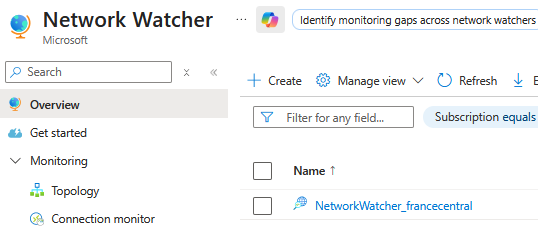
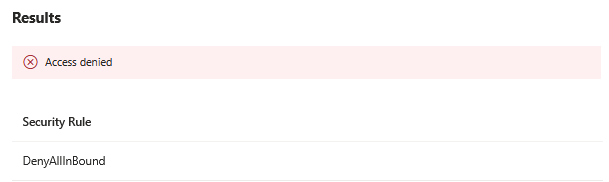
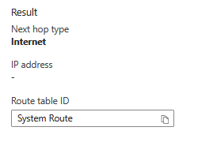
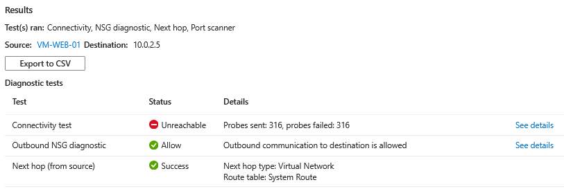
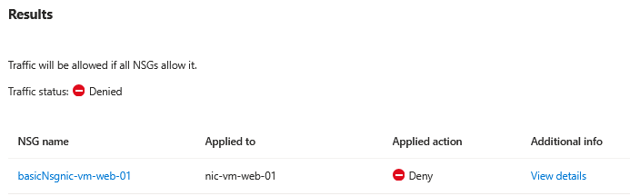
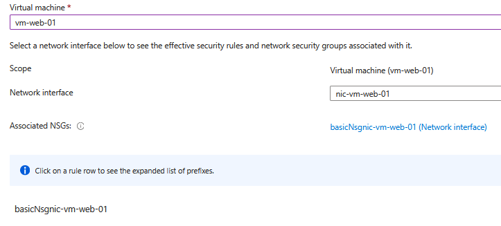
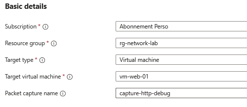
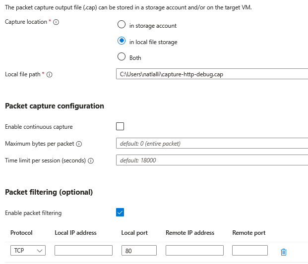
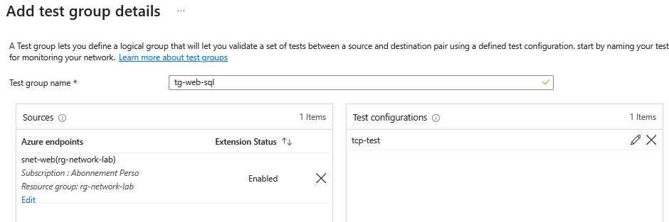

## Introduction

Cette procédure décrit l'utilisation d'Azure Network Watcher, la boîte à outils de diagnostic réseau intégrée à Azure. Network Watcher fournit un ensemble d'outils pour surveiller, diagnostiquer et visualiser le réseau Azure. Quand une VM ne communique plus, qu'un Load Balancer ne distribue pas le trafic, ou qu'un Private Endpoint ne résout pas correctement, Network Watcher est le premier outil à utiliser.

## Contexte et Justification

Le troubleshooting réseau dans le cloud est plus complexe que dans un réseau physique. Vous ne pouvez pas brancher un câble de test, consulter les LEDs d'un switch ou lancer Wireshark sur le routeur. Le trafic passe par des couches virtuelles invisibles : NSG, UDR, Load Balancer, Peering, DNS, Private Endpoints.

Quand un problème réseau survient, les questions typiques sont :

- Le NSG bloque-t-il le trafic ? (→ IP Flow Verify)
- Par quel chemin passe le trafic ? (→ Next Hop)
- La VM peut-elle atteindre la destination ? (→ Connection Troubleshoot)
- Quels paquets transitent réellement ? (→ Packet Capture)
- Quels flux sont autorisés ou refusés par les NSG ? (→ NSG Flow Logs)

Sans Network Watcher, vous êtes aveugle. Avec Network Watcher, vous pouvez diagnostiquer méthodiquement chaque couche du réseau.

## Concepts Clés

**Network Watcher :** Un service Azure régional activé automatiquement dans chaque région où vous avez des ressources réseau. Il fournit des outils de diagnostic, de monitoring et de journalisation. Un Network Watcher est créé par région dans un resource group caché nommé NetworkWatcherRG.

**IP Flow Verify :** Teste si un paquet spécifique (source IP/port, destination IP/port, protocole) serait autorisé ou refusé par les NSG associés à une VM. Il vous dit quelle règle NSG (nom et priorité) autorise ou bloque le trafic. C'est le premier outil à utiliser quand un NSG est suspecté.

**Next Hop :** Montre quel est le prochain saut (next hop) pour un paquet sortant d'une VM vers une destination donnée. Il révèle si le trafic passe par Internet, un VNet peering, un Virtual Appliance (UDR), un VPN Gateway, ou est droppé (None). C'est l'outil pour diagnostiquer les problèmes de routage (UDR).

**Connection Troubleshoot :** Test de connectivité de bout en bout entre une VM source et une destination (IP, FQDN, URI). Il vérifie toutes les couches : NSG, routage, DNS, état du service. Le résultat montre chaque saut avec le statut (reachable/unreachable) et la latence. C'est le diagnostic le plus complet.

**NSG Diagnostic :** Analyse les règles NSG effectives pour un flux spécifique et montre quelles règles s'appliquent au niveau du subnet et de la NIC. Plus détaillé que IP Flow Verify car il montre la cascade complète des règles.

**Effective Security Rules :** Affiche toutes les règles NSG effectives appliquées à une NIC, combinant les règles du NSG subnet + NSG NIC + les règles par défaut. Vue consolidée de toute la sécurité réseau d'une VM.

**Packet Capture :** Capture le trafic réseau sur une VM (comme Wireshark, mais depuis Azure). Les captures sont stockées localement sur la VM ou dans un Storage Account. Utile pour une analyse approfondie du trafic (headers, payload, retransmissions).

**NSG Flow Logs :** Journalise tout le trafic qui traverse un NSG (source, destination, port, protocole, action Allow/Deny). Les logs sont stockés dans un Storage Account et peuvent être analysés avec Traffic Analytics dans Log Analytics. Essentiels pour l'audit de sécurité et le troubleshooting a posteriori.

<div class="callout callout-note">

Depuis le 30 juin 2025, Microsoft ne permet plus de créer de nouveaux NSG Flow Logs et recommande les VNet Flow Logs, qui couvrent le même besoin au niveau du VNet. Les NSG Flow Logs existants continuent de fonctionner jusqu'à leur retrait définitif.

</div>

**Connection Monitor :** Surveille en continu la connectivité entre des sources et des destinations. Alerte quand la connectivité est perdue ou quand la latence dépasse un seuil. Utilisé pour le monitoring proactif (pas juste le diagnostic ponctuel).

**Traffic Analytics :** Couche d'analyse au-dessus des NSG Flow Logs. Fournit des visualisations, des tendances et des insights sur le trafic réseau (top talkers, flux bloqués, trafic malveillant). Nécessite un Log Analytics Workspace.

## Prérequis

- Network Watcher activé dans la région (activé automatiquement dans la plupart des cas).
- Le rôle **Network Contributor** (minimum) pour utiliser les outils de diagnostic.
- Le rôle **Reader** sur la VM cible pour IP Flow Verify, Next Hop et Connection Troubleshoot.
- Pour Packet Capture : l'extension Network Watcher Agent installée sur la VM.
- Pour NSG Flow Logs : un Storage Account dans la même région pour stocker les logs.

## Méthode 1 : Configuration via Portail Azure

### Vérifier que Network Watcher est Activé

1. Recherchez **"Network Watcher"** dans le portail.
2. Menu gauche \> **"Overview"**.
3. Vérifiez que votre région (ex : France Central) en a un.
4. Si non, cliquez sur **"Create"**.



<p class="figure-caption"><b>Figure 1</b> · Vérifier que Network Watcher est Activé</p>

### IP Flow Verify (Test de Connectivité NSG)

Scénario : Une VM ne répond pas sur le port 80. Le NSG bloque-t-il le trafic ?

1. Network Watcher \> Menu gauche \> **"IP flow verify"**.
2. **Virtual machine** : vm-web-01.
3. **Network interface** : nic-vm-web-01.
4. **Protocol** : TCP.
5. **Direction** : Inbound.
6. **Local port** : 80.
7. **Local IP address** : 10.0.0.5 (IP privée de la VM).
8. **Remote IP address** : 20.0.0.1 (IP de l'utilisateur qui tente d'accéder).
9. **Remote port** : 12345 (port source du client, n'importe quel numéro).
10. Cliquez sur **"Verify IP flow"**.

**Résultats possibles :**

- **Access allowed** – Rule: Allow-HTTP-In (Priority 1010) → le NSG autorise le trafic. Le problème est ailleurs (service web down, firewall OS, UDR).
- **Access denied** – Rule: DenyAllInBound (Priority 65500) → aucune règle Allow ne matche. Il faut ajouter une règle Allow pour le port 80.
- **Access denied** – Rule: Deny-All-Other-In (Priority 4000) → une règle Deny custom bloque le trafic.



<p class="figure-caption"><b>Figure 2</b> · IP Flow Verify (Test de Connectivité NSG)</p>

### Next Hop (Vérification du Routage)

Scénario : Le trafic d'une VM ne passe pas par le firewall malgré une UDR.

1. Network Watcher \> **"Next hop"**.
2. **Subscription** : Sélectionnez votre abonnement.
3. **Resource group** : rg-network-lab.
4. **Virtual machine** : vm-web-01.
5. **Network interface** : nic-vm-web-01.
6. **Source IP address** : 10.0.0.5.
7. **Destination IP address** : 8.8.8.8 (Google DNS, pour tester le trafic Internet).
8. Cliquez sur **"Next hop"**.

**Résultats possibles :**

- **Next hop type: Internet** → le trafic sort directement par Internet (pas de UDR active).
- **Next hop type: VirtualAppliance, Next hop IP: 10.0.4.4** → le trafic passe par le firewall (UDR active).
- **Next hop type: VNetPeering** → le trafic passe par un peering.
- **Next hop type: None** → le trafic est droppé (blackhole route).



<p class="figure-caption"><b>Figure 3</b> · Next Hop (Vérification du Routage)</p>

### Connection Troubleshoot (Diagnostic de Bout en Bout)

Scénario : Une VM ne peut pas se connecter à un SQL Server.

1. Network Watcher \> **"Connection troubleshoot"**.
2. **Source type** : Virtual machine.
3. **Virtual machine** : vm-web-01.
4. **Destination** :
   - **Select destination** : Specify manually.
   - **URI, FQDN or IP address** : 10.0.2.5 (IP du SQL Server ou du Private Endpoint).
   - **Port** : 1433.
5. Cliquez sur **"Run diagnostics tests"**.

**Résultats :** Le résultat montre chaque saut entre la source et la destination avec le statut :

- **Reachable** avec la latence → tout fonctionne.
- **Unreachable** avec l'indication du saut qui bloque → identifie précisément où ça coince (NSG, route, service down).



<p class="figure-caption"><b>Figure 4</b> · Connection Troubleshoot (Diagnostic de Bout en Bout)</p>

### NSG Diagnostic

1. Network Watcher \> **"NSG diagnostic"**.
2. **Target resource** : Virtual machine.
3. **Virtual machine** : vm-web-01.
4. **Protocol** : TCP.
5. **Direction** : Inbound.
6. **IPv4 address/CIDR** : 20.0.0.0/16.
7. **Destination IP address** : 10.0.0.5.
8. **Destination port** : 80.
9. Cliquez sur **"Run NSG diagnostic"**.

**Résultat :** Montre les règles NSG évaluées au niveau subnet ET NIC, avec l'action finale (Allow/Deny) et la règle qui s'applique.



<p class="figure-caption"><b>Figure 5</b> · NSG Diagnostic</p>

### Effective Security Rules

1. Network Watcher \> **"Effective security rules"**.
2. **Subscription** : Sélectionnez votre abonnement.
3. **Resource group** : rg-network-lab.
4. **Virtual machine** : vm-web-01.
5. **Network interface** : nic-vm-web-01.
6. Le résultat affiche toutes les règles effectives (NSG subnet + NSG NIC + default rules) triées par priorité.

<div class="callout callout-note">

Même résultat que VM \> Networking, mais accessible depuis Network Watcher pour une vue centralisée.

</div>



<p class="figure-caption"><b>Figure 6</b> · Effective Security Rules</p>

### Packet Capture

1. Network Watcher \> **"Packet capture"** \> **"+ Add"**.
2. **Subscription** : Sélectionnez votre abonnement.
3. **Resource group** : rg-network-lab.
4. **Target type** : Virtual machine.
5. **Target virtual machine** : vm-web-01.
6. **Packet capture name** : capture-http-debug.



<p class="figure-caption"><b>Figure 7</b> · Packet Capture</p>

7. **Capture location** : Storage account (sélectionnez un Storage Account existant) ou Local file (/var/captures/).
8. **Maximum bytes per packet** : 0 (tout capturer) ou 128 (headers uniquement).
9. **Time limit** : 300 (5 minutes maximum).
10. **Filtering** (optionnel) :
   - **Protocol** : TCP.
   - **Local port** : 80.
11. Cliquez sur **"Add"**.



<p class="figure-caption"><b>Figure 8</b> · Options de capture et filtres</p>

12. La capture démarre. Attendez qu'elle se termine ou cliquez sur **"Stop"**.
13. Téléchargez le fichier .cap et ouvrez-le dans Wireshark.

<div class="callout callout-note">

L'extension Network Watcher Agent est installée automatiquement si elle n'est pas présente. Sur certaines VMs, il faut l'installer manuellement.

</div>

### Connection Monitor

1. Network Watcher \> **"Connection monitor"** \> **"+ Create"**.
2. **Name** : monitor-web-to-sql.
3. **Region** : France Central.
4. Onglet **"Test groups"** \> **"+ Add test group"** :
   - **Test group name** : tg-web-sql.
   - **Sources** : vm-web-01.
   - **Destinations** : 10.0.2.5 (SQL Server) port 1433.
   - **Test configuration** : TCP, port 1433, interval 30 seconds, success threshold 96%.
5. Cliquez sur **"Create"**.



<p class="figure-caption"><b>Figure 9</b> · Connection Monitor</p>

<div class="callout callout-note">

Connection Monitor surveille en continu et vous alerte si la connectivité tombe en dessous du seuil.

</div>

## Méthode 2 : Configuration via PowerShell

### Activer Network Watcher

```powershell
$rg = "rg-network-lab"
$location = "FranceCentral"
$vm = "vm-web-01"
```

1. Vérifier :

```powershell
Get-AzNetworkWatcher | Select-Object Name, Location, ProvisioningState | Format-Table
```

2. Activer si nécessaire :

```powershell
New-AzNetworkWatcher -Name "NetworkWatcher_$location" -ResourceGroupName "NetworkWatcherRG" -Location $location
```

### IP Flow Verify

```powershell
$nw = Get-AzNetworkWatcher -Name "NetworkWatcher_$location" -ResourceGroupName "NetworkWatcherRG"
$vmObj = Get-AzVM -ResourceGroupName $rg -Name $vm
Test-AzNetworkWatcherIPFlow -NetworkWatcher $nw -TargetVirtualMachineId $vmObj.Id -Direction Inbound -Protocol TCP -LocalIPAddress 10.0.0.5 -LocalPort 80 -RemoteIPAddress 20.0.0.1 -RemotePort 12345
```

### Next Hop

```powershell
Get-AzNetworkWatcherNextHop -NetworkWatcher $nw -TargetVirtualMachineId $vmObj.Id -SourceIPAddress 10.0.0.5 -DestinationIPAddress 8.8.8.8
```

### Connection Troubleshoot

```powershell
Test-AzNetworkWatcherConnectivity -NetworkWatcher $nw -SourceId $vmObj.Id -DestinationAddress 10.0.2.5 -DestinationPort 1433 -Protocol Tcp
```

### Packet Capture

```powershell
$storageAccount = Get-AzStorageAccount -ResourceGroupName $rg -Name "stlabstorage01"
```

1. Installer l'extension :

```powershell
Set-AzVMExtension -ResourceGroupName $rg -VMName $vm -Name "NetworkWatcherAgentLinux" -Publisher "Microsoft.Azure.NetworkWatcher" -ExtensionType "NetworkWatcherAgentLinux" -TypeHandlerVersion "1.4" -Location $location
```

2. Configurer le filtre :

```powershell
$filter = New-AzPacketCaptureFilterConfig -Protocol TCP -LocalPort "80"
```

3. Démarrer la capture :

```powershell
New-AzNetworkWatcherPacketCapture -NetworkWatcher $nw -TargetVirtualMachineId $vmObj.Id -PacketCaptureName "capture-http-debug" -StorageAccountId $storageAccount.Id -TimeLimitInSeconds 300 -Filter $filter
```

4. Voir le statut :

```powershell
Get-AzNetworkWatcherPacketCapture -NetworkWatcher $nw -PacketCaptureName "capture-http-debug"
```

5. Arrêter :

```powershell
Stop-AzNetworkWatcherPacketCapture -NetworkWatcher $nw -PacketCaptureName "capture-http-debug"
```

6. Supprimer :

```powershell
Remove-AzNetworkWatcherPacketCapture -NetworkWatcher $nw -PacketCaptureName "capture-http-debug"
```

### NSG Flow Logs

```powershell
$nsg = Get-AzNetworkSecurityGroup -ResourceGroupName $rg -Name "nsg-web"
$storageAccount = Get-AzStorageAccount -ResourceGroupName $rg -Name "stlabstorage01"
```

1. Activer les Flow Logs V2 :

```powershell
New-AzNetworkWatcherFlowLog -NetworkWatcher $nw -Name "flowlog-nsg-web" -TargetResourceId $nsg.Id -StorageId $storageAccount.Id -Enabled $true -FormatVersion 2 -RetentionInDays 30
```

2. Avec Traffic Analytics :

```powershell
$workspace = Get-AzOperationalInsightsWorkspace -ResourceGroupName $rg -Name "law-network-lab"
New-AzNetworkWatcherFlowLog -NetworkWatcher $nw -Name "flowlog-nsg-web" -TargetResourceId $nsg.Id -StorageId $storageAccount.Id -Enabled $true -FormatVersion 2 -RetentionInDays 30 -EnableTrafficAnalytics -TrafficAnalyticsWorkspaceId $workspace.ResourceId
```

3. Lister les flow logs :

```powershell
Get-AzNetworkWatcherFlowLog -NetworkWatcher $nw | Format-Table Name, Enabled, RetentionInDays
```

4. Désactiver :

```powershell
Set-AzNetworkWatcherFlowLog -NetworkWatcher $nw -Name "flowlog-nsg-web" -Enabled $false
```

## Vérifications

**Network Watcher activé** : Dans Network Watcher \> **"Overview"**, la région France Central a le statut **"Enabled"**.

**IP Flow Verify fonctionnel** : Le test retourne un résultat clair (Allow/Deny) avec le nom de la règle NSG.

**Next Hop correct** : Le test retourne le next hop attendu (Internet, VirtualAppliance, VNetPeering, etc.) selon votre configuration UDR.

**Connection Troubleshoot** : Le test retourne Reachable/Unreachable avec les détails de chaque saut.

**Packet Capture** : Le fichier .cap est disponible dans le Storage Account et peut être ouvert dans Wireshark.

**NSG Flow Logs** : Les logs apparaissent dans le Storage Account \> conteneur insights-logs-networksecuritygroupflowevent après quelques minutes. Les fichiers JSON contiennent les flux Allow/Deny.

**Traffic Analytics** : Si activé, les données apparaissent dans Log Analytics \> **"Traffic Analytics"** après 10-15 minutes.

## Dépannage

**"Network Watcher extension is not installed" lors du Packet Capture :** L'extension Network Watcher Agent n'est pas installée sur la VM. Installez-la via le portail (VM \> **"Extensions"** \> **"+ Add"** \> NetworkWatcherAgentLinux/Windows) ou via PowerShell (`Set-AzVMExtension`, voir la méthode 2).

**IP Flow Verify dit "Allow" mais le trafic ne passe pas :** IP Flow Verify ne teste que les NSG. Le problème est ailleurs : firewall de l'OS (Windows Firewall, iptables), UDR qui redirige le trafic, service non démarré sur la VM, ou Azure Firewall qui bloque. Utilisez Next Hop pour vérifier le routage et Connection Troubleshoot pour un diagnostic complet.

**Next Hop retourne "None" (trafic droppé) :** Une UDR avec le next hop type "None" est active sur le subnet, ou le trafic matche une des routes par défaut qui droppe le trafic RFC 1918 non routable. Vérifiez la Route Table associée au subnet.

**Connection Troubleshoot échoue avec "Source VM is not in running state" :** La VM source est arrêtée (deallocated). Démarrez-la avant de lancer le test.

**Les NSG Flow Logs sont vides dans le Storage Account :** Les flow logs mettent quelques minutes à apparaître (5-10 minutes). Vérifiez que les flow logs sont bien activés (Enabled = true). Vérifiez que le Storage Account est dans la même région que le NSG. Vérifiez que du trafic traverse effectivement le NSG.

**"Insufficient permissions" sur les outils Network Watcher :** Vous avez besoin du rôle Network Contributor ou du rôle spécifique Network Watcher Reader/Contributor. Le rôle Reader seul ne suffit pas pour les outils de diagnostic.

**Packet Capture trop volumineux :** Utilisez les filtres (protocole, port, IP) pour cibler le trafic pertinent. Réduisez le time limit et le maximum bytes per packet. Capturez uniquement les headers (128 bytes par paquet) au lieu du payload complet.

## Conseils et Bonnes Pratiques

**Suivez une méthodologie de diagnostic systématique.** Quand une VM ne communique pas, suivez cet ordre :

1. **Next Hop** : Le trafic prend-il le bon chemin ?
2. **IP Flow Verify** : Le NSG autorise-t-il le trafic ?
3. **Connection Troubleshoot** : La connectivité de bout en bout fonctionne-t-elle ?
4. **Packet Capture** : En dernier recours, analysez les paquets.

**Activez les NSG Flow Logs sur tous les NSG de production.** C'est indispensable pour l'audit de sécurité, le troubleshooting a posteriori et la conformité. Les logs vous disent exactement quel trafic a été autorisé ou refusé, par quelle règle, et quand.

**Utilisez Traffic Analytics pour la visibilité globale.** Les Flow Logs bruts sont difficiles à lire (fichiers JSON volumineux). Traffic Analytics les agrège dans Log Analytics et fournit des dashboards visuels : top talkers, flux bloqués, trafic par région, anomalies.

**Connection Monitor pour le monitoring proactif.** Ne vous contentez pas de diagnostiquer quand ça casse. Configurez Connection Monitor pour surveiller en permanence la connectivité vers vos services critiques (base de données, API externe, DNS). Vous serez alerté avant que les utilisateurs ne remarquent le problème.

**Nettoyez les Packet Captures après utilisation.** Les fichiers .cap dans le Storage Account prennent de l'espace et sont facturés. Supprimez-les une fois l'analyse terminée.

**Combinez Network Watcher avec Azure Monitor.** Network Watcher diagnostique les problèmes réseau ponctuels. Azure Monitor surveille les métriques en continu (latence, paquets droppés, utilisation de bande passante). Les deux sont complémentaires.

## Procédures Liées

- [Gestion de la Sécurité Réseau (NSG)](/procedures/azure/gestion-de-la-securite-reseau-nsg) *(IP Flow Verify et NSG Diagnostic testent les règles NSG, les NSG Flow Logs journalisent le trafic)*
- [Configuration des Routes Définies par l'Utilisateur (UDR)](/procedures/azure/configuration-des-routes-definies-par-lutilisateur-udr) *(Next Hop vérifie le routage et permet de diagnostiquer les UDR mal configurées)*
- [Déploiement d'un Réseau Virtuel](/procedures/azure/deploiement-dun-reseau-virtuel) *(Effective Routes montre le routage complet du VNet y compris les system routes)*
- [Mise en Place d'un Peering (Appairage VNet)](/procedures/azure/mise-en-place-dun-peering-appairage-vnet) *(Connection Troubleshoot et Next Hop diagnostiquent la connectivité à travers le peering)*
- [Configuration d'un Load Balancer](/procedures/azure/configuration-dun-load-balancer) *(Connection Troubleshoot teste la connectivité de bout en bout via le LB)*
- [Sécurisation PaaS via Private Endpoint](/procedures/azure/securisation-paas-via-private-endpoint) *(Connection Troubleshoot vérifie la connectivité vers les Private Endpoints)*
- [Configuration d'Azure DNS](/procedures/azure/configuration-dazure-dns) *(Les problèmes de résolution DNS sont détectables avec Connection Troubleshoot)*
- [Configuration des Budgets et Alertes de Coûts](/procedures/azure/configuration-des-budgets-et-alertes-de-couts) *(Les NSG Flow Logs et Packet Captures stockés dans un Storage Account génèrent des coûts de stockage)*
