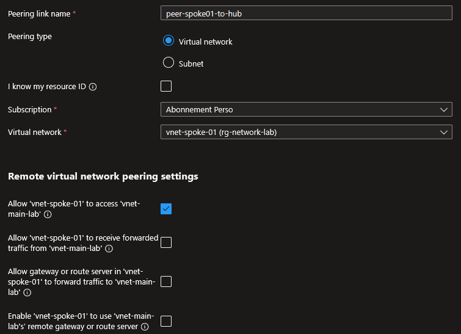
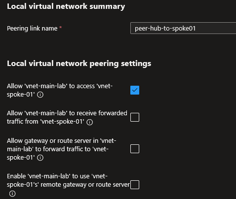

## Introduction

Cette procédure détaille la configuration du VNet Peering dans Azure. Le peering permet d'interconnecter deux réseaux virtuels pour que les ressources des deux VNets communiquent entre elles directement, via le backbone privé de Microsoft, sans passer par Internet. Le trafic reste privé, à faible latence et à haute bande passante.

## Contexte et Justification

Par défaut, deux VNets dans Azure sont totalement isolés. Une VM dans vnet-hub ne peut pas communiquer avec une VM dans vnet-spoke, même s'ils sont dans le même abonnement et la même région. Le peering crée un lien réseau entre les deux VNets.

Le peering est indispensable dans trois scénarios courants :

1. **Architecture Hub & Spoke** : Un VNet central (Hub) contient les services partagés (Bastion, Firewall, VPN Gateway, DNS). Les VNets projets (Spokes) sont peerés au Hub. Les VMs des spokes accèdent aux services du hub sans duplication.
2. **Séparation des environnements** : Le VNet de production et le VNet de développement sont séparés pour l'isolation. Le peering est activé temporairement ou avec des NSG stricts pour permettre certaines communications (ex : un pipeline de déploiement).
3. **Multi-régions** : Un VNet en France Central et un VNet en West Europe sont connectés via le Global Peering pour la réplication de données ou la haute disponibilité géographique.

Le peering est préféré au VPN Site-to-Site entre VNets car il n'a pas de goulot d'étranglement de bande passante (pas de gateway VPN à dimensionner), la latence est plus faible, et la configuration est plus simple.

## Concepts Clés

**VNet Peering :** Un lien réseau non transitif entre deux VNets. Les ressources des deux VNets communiquent via des adresses IP privées comme si elles étaient dans le même réseau. Le peering est créé au niveau du VNet.

**Réciprocité (Two-Way Link) :** Un peering est bidirectionnel mais nécessite une configuration des deux côtés. Le portail Azure crée automatiquement les deux liens (A→B et B→A) en une seule opération. En PowerShell, il faut exécuter deux commandes distinctes.

**Non-Transitivité :** Si VNet-A est peeré avec VNet-B, et VNet-B est peeré avec VNet-C, VNet-A ne peut PAS communiquer avec VNet-C automatiquement. Pour ça, il faut soit un peering direct A↔C, soit un routage via un Network Virtual Appliance (NVA) ou Azure Firewall dans VNet-B.

**Peering Types :**

- **Regional Peering** : Deux VNets dans la même région Azure. Pas de coût de transfert de données.
- **Global VNet Peering** : Deux VNets dans des régions différentes (ex : France Central ↔ West Europe). Le transfert de données est facturé au Go (tarif inter-région).

**Gateway Transit :** Permet à un VNet spoke d'utiliser la VPN Gateway du VNet hub. Au lieu de déployer une gateway dans chaque spoke (coûteux), les spokes empruntent la gateway du hub pour se connecter au réseau on-premises. Se configure avec deux options :

- Sur le hub : **"Allow gateway transit"** (je partage ma gateway).
- Sur le spoke : **"Use remote gateways"** (j'utilise la gateway du hub).

**Peering State (Statuts) :**

- **Initiated** : Un seul côté du peering est créé. La communication ne fonctionne PAS.
- **Connected** : Les deux côtés sont créés. La communication fonctionne.
- **Disconnected** : Le peering a été cassé (ex : un des VNets a été modifié ou le peering de l'autre côté a été supprimé).

## Prérequis

- Deux VNets existants avec des espaces d'adressage qui ne se chevauchent PAS :
  - Hub : vnet-main-lab (10.0.0.0/16)
  - Spoke : vnet-spoke-01 (10.1.0.0/16)
- Le rôle **Network Contributor** sur les deux VNets (ou sur les deux Resource Groups).
- Si les VNets sont dans des abonnements différents : le rôle Network Contributor dans les deux abonnements.

## Méthode 1 : Configuration via Portail Azure

### Configurer le Peering depuis le Hub

1. Allez dans vnet-main-lab \> Menu gauche \> **"Peerings"**.
2. Cliquez sur **"+ Add"**.
3. **Remote virtual network** (le lien retour depuis le spoke) :
   - **Peering link name** : peer-spoke01-to-hub
   - **Virtual network** : vnet-spoke-01
   - **Allow traffic to remote virtual network** : Enabled
   - **Allow traffic forwarded from remote virtual network** : Disabled
   - **Use remote gateways** : Cochez si vous avez coché "Allow gateway transit" côté hub.



<p class="figure-caption"><b>Figure 1</b> · Paramètres du lien distant (spoke vers hub)</p>

4. **This virtual network** (le lien sortant depuis le hub) :
   - **Peering link name** : peer-hub-to-spoke01
   - **Allow traffic to remote virtual network** : Enabled
   - **Allow traffic forwarded from remote virtual network** : Disabled (sauf si vous avez un NVA/Firewall)
   - **Allow gateway transit** : Cochez si vous avez une VPN Gateway dans le hub et voulez la partager.



<p class="figure-caption"><b>Figure 2</b> · Paramètres du lien local (hub vers spoke)</p>

5. Cliquez sur **"Add"**.

<div class="callout callout-note">

Le portail crée les deux liens en une seule opération. Le statut passe à "Connected" des deux côtés en quelques secondes.

</div>

### Vérifier le Statut du Peering

1. Dans vnet-main-lab \> **"Peerings"** : la colonne **"Peering state"** doit afficher **"Connected"**.


<p class="figure-caption"><b>Figure 3</b> · Statut du peering côté hub</p>

2. Dans vnet-spoke-01 \> **"Peerings"** : même vérification, le statut doit être **"Connected"** aussi.


<p class="figure-caption"><b>Figure 4</b> · Statut du peering côté spoke</p>

### Configurer le Gateway Transit (Optionnel)

Si le hub a une VPN Gateway et que vous voulez que le spoke l'utilise :

1. Dans vnet-main-lab \> **"Peerings"** \> Cliquez sur peer-hub-to-spoke01.
2. Cochez **"Allow gateway transit"**.
3. Cliquez sur **"Save"**.
4. Dans vnet-spoke-01 \> **"Peerings"** \> Cliquez sur peer-spoke01-to-hub.
5. Cochez **"Use remote gateways"**.
6. Cliquez sur **"Save"**.

<div class="callout callout-note">

Le spoke hérite des routes apprises par la VPN Gateway du hub (routes vers le réseau on-premises).

</div>

## Méthode 2 : Configuration via PowerShell

### Créer le Peering Bidirectionnel

1. Récupérer les objets VNet :

```powershell
$rgName = "rg-network-lab"
$vnetHub = Get-AzVirtualNetwork -ResourceGroupName $rgName -Name "vnet-main-lab"
$vnetSpoke = Get-AzVirtualNetwork -ResourceGroupName $rgName -Name "vnet-spoke-01"
```

2. Sens Hub → Spoke :

```powershell
Add-AzVirtualNetworkPeering `
    -Name "peer-hub-to-spoke01" `
    -VirtualNetwork $vnetHub `
    -RemoteVirtualNetworkId $vnetSpoke.Id
```

3. Sens Spoke → Hub :

```powershell
Add-AzVirtualNetworkPeering `
    -Name "peer-spoke01-to-hub" `
    -VirtualNetwork $vnetSpoke `
    -RemoteVirtualNetworkId $vnetHub.Id
```

### Peering Cross-Resource Group

```powershell
$vnetHub = Get-AzVirtualNetwork -ResourceGroupName "rg-network-lab" -Name "vnet-main-lab"
$vnetOther = Get-AzVirtualNetwork -ResourceGroupName "rg-other-project" -Name "vnet-other"
Add-AzVirtualNetworkPeering `
    -Name "peer-hub-to-other" `
    -VirtualNetwork $vnetHub `
    -RemoteVirtualNetworkId $vnetOther.Id
Add-AzVirtualNetworkPeering `
    -Name "peer-other-to-hub" `
    -VirtualNetwork $vnetOther `
    -RemoteVirtualNetworkId $vnetHub.Id
```

### Configurer le Gateway Transit

1. Sur le Hub : activer le partage de gateway :

```powershell
$peeringHub = Get-AzVirtualNetworkPeering `
    -ResourceGroupName $rgName `
    -VirtualNetworkName "vnet-main-lab" `
    -Name "peer-hub-to-spoke01"
$peeringHub.AllowGatewayTransit = $true
Set-AzVirtualNetworkPeering -VirtualNetworkPeering $peeringHub
```

2. Sur le Spoke : utiliser la gateway distante :

```powershell
$peeringSpoke = Get-AzVirtualNetworkPeering `
    -ResourceGroupName $rgName `
    -VirtualNetworkName "vnet-spoke-01" `
    -Name "peer-spoke01-to-hub"
$peeringSpoke.UseRemoteGateways = $true
Set-AzVirtualNetworkPeering -VirtualNetworkPeering $peeringSpoke
```

### Supprimer un Peering

1. Supprimer les deux côtés :

```powershell
Remove-AzVirtualNetworkPeering `
    -ResourceGroupName $rgName `
    -VirtualNetworkName "vnet-main-lab" `
    -Name "peer-hub-to-spoke01" `
    -Force
Remove-AzVirtualNetworkPeering `
    -ResourceGroupName $rgName `
    -VirtualNetworkName "vnet-spoke-01" `
    -Name "peer-spoke01-to-hub" `
    -Force
```

## Vérifications

**Peering Status "Connected"** : Dans les deux VNets \> **"Peerings"**, le statut doit être **"Connected"** des deux côtés. Si un côté affiche "Initiated", le lien retour manque.

**Test de connectivité** : Si vous avez une VM dans chaque VNet, testez un ping ou une connexion TCP entre elles (ex : VM-Hub 10.0.1.4 → VM-Spoke 10.1.1.4). Le ping doit réussir (à condition que les NSG et le firewall OS l'autorisent).

**Effective Routes** : Sur une VM \> **"Networking"** \> **"Effective routes"**, vous devez voir une route vers l'address space du VNet peeré avec le Next Hop type "VNet peering".

**Gateway Transit** (si activé) : Sur une VM dans le spoke \> **"Effective routes"**, vous devez voir les routes on-premises apprises via la VPN Gateway du hub.

**PowerShell** : `Get-AzVirtualNetworkPeering -ResourceGroupName rg-network-lab -VirtualNetworkName vnet-main-lab` retourne les peerings avec `PeeringState : Connected`.

## Dépannage

**Statut "Initiated" au lieu de "Connected" :** Le lien retour n'a pas été créé. En PowerShell, vous devez exécuter deux commandes (A→B et B→A). Créez le lien manquant et le statut passera à "Connected" des deux côtés.

**"Overlapping address space" :** Les deux VNets ont des plages d'adresses qui se chevauchent. Vérifiez les address spaces des deux VNets avec `(Get-AzVirtualNetwork -ResourceGroupName <rg> -Name <vnet>).AddressSpace`. Vous devez modifier l'un des deux VNets (ce qui implique de supprimer ses ressources si le subnet est occupé) ou utiliser des plages différentes.

**Statut "Disconnected" :** Un des deux côtés du peering a été supprimé ou le VNet distant a été modifié (ex : address space changé). Supprimez le peering Disconnected des deux côtés et recréez-le.

**Les VMs ne communiquent pas malgré le statut "Connected" :** Le peering est actif mais un NSG bloque le trafic. Vérifiez les règles NSG des deux côtés : la règle par défaut AllowVnetInBound autorise le trafic VirtualNetwork, mais une règle Deny custom avec un numéro de priorité plus faible (donc évaluée avant) peut la surcharger. Vérifiez aussi le pare-feu de l'OS (Windows Firewall bloque ICMP par défaut).

**"UseRemoteGateways cannot be set to true because remote VNet does not have a gateway" :** Vous essayez d'activer "Use remote gateways" sur le spoke mais le hub n'a pas de VPN Gateway déployée. Déployez d'abord la gateway dans le hub, puis activez le Gateway Transit.

**"Cannot peer a VNet with itself" :** Vous avez spécifié le même VNet comme source et destination. Vérifiez les noms des VNets dans votre commande.

**Le peering ne fonctionne pas avec un Basic Load Balancer :** Le Basic Load Balancer ne fonctionne pas à travers un Global VNet Peering (cross-region). Migrez vers un Standard Load Balancer.

## Conseils et Bonnes Pratiques

**Adoptez une architecture Hub & Spoke.** Placez les services partagés (Bastion, Firewall, VPN Gateway, DNS) dans un VNet Hub. Peerez chaque VNet projet (Spoke) au Hub. Les spokes ne sont pas peerés entre eux (isolation), le trafic inter-spoke passe par le Hub via un NVA ou Azure Firewall si nécessaire.

**Planifiez votre adressage IP pour éviter les chevauchements.** Attribuez des plages distinctes à chaque VNet dès le départ. Exemple : Hub 10.0.0.0/16, Spoke01 10.1.0.0/16, Spoke02 10.2.0.0/16, DR 10.3.0.0/16. Ne commencez jamais avec le même /16 pour deux VNets.

**Utilisez le Gateway Transit plutôt qu'une VPN Gateway par spoke.** Une VPN Gateway coûte environ 27-140€/mois. Si vous avez 5 spokes, déployer une gateway dans chacun coûterait 135-700€/mois. Avec le Gateway Transit, une seule gateway dans le hub suffit.

**Supprimez toujours les deux côtés d'un peering.** Si vous ne supprimez qu'un côté, l'autre reste en statut "Disconnected" et peut créer de la confusion. Supprimez systématiquement A→B et B→A.

**Documentez vos peerings.** Tenez un schéma réseau à jour avec tous les VNets et leurs peerings. Dans une architecture complexe (10+ VNets), il est facile de perdre la vue d'ensemble. Utilisez les tags (ex : PeeredWith:vnet-hub) pour faciliter l'audit.

**Le Global Peering est facturé au transfert de données.** Le peering régional (même région) est gratuit en termes de frais de peering (seul le transfert de données standard s'applique). Le Global Peering (cross-region) ajoute des frais de transfert inter-région. Pour de gros volumes, évaluez le coût.

## Procédures Liées

- [Déploiement d'un Réseau Virtuel](/procedures/azure/deploiement-dun-reseau-virtuel) *(Les VNets doivent exister avant de créer un peering)*
- [Gestion de la Sécurité Réseau (NSG)](/procedures/azure/gestion-de-la-securite-reseau-nsg) *(Les NSG contrôlent le trafic qui passe à travers un peering, le Service Tag VirtualNetwork inclut les VNets peerés)*
- [Déploiement d'Azure Bastion](/procedures/azure/deploiement-dazure-bastion) *(Un Bastion dans le Hub peut accéder aux VMs des Spokes via le peering)*
- [Configuration d'un Load Balancer](/procedures/azure/configuration-dun-load-balancer) *(Le Standard Load Balancer fonctionne à travers le peering, le Basic non en cross-region)*
- [Sécurisation PaaS via Private Endpoint](/procedures/azure/securisation-paas-via-private-endpoint) *(Un Private Endpoint dans le Hub est accessible depuis les Spokes via le peering)*
