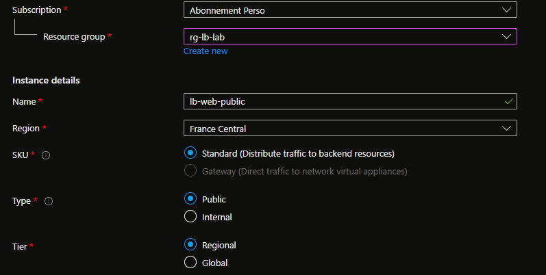
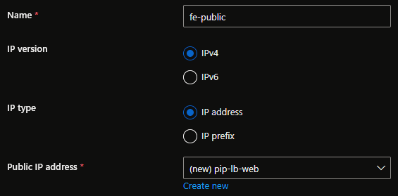
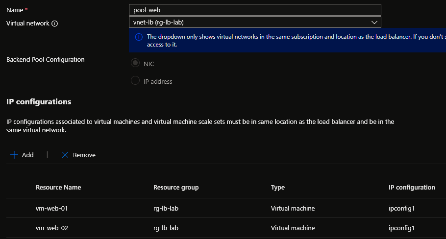
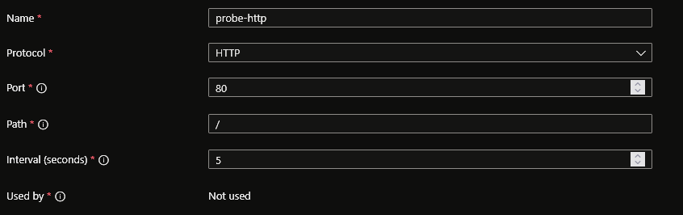
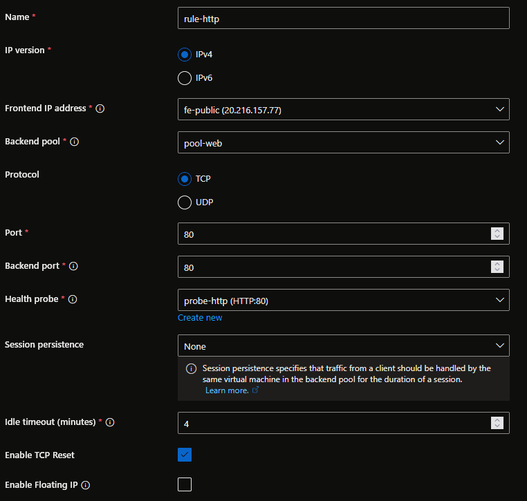
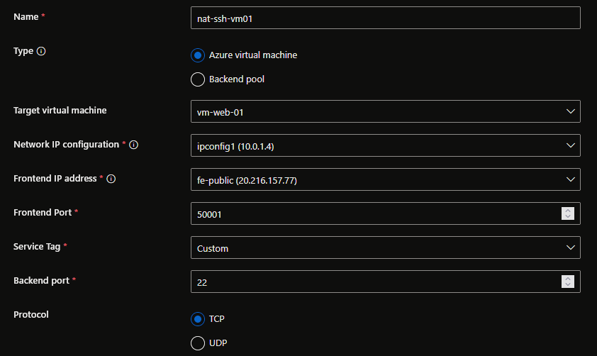
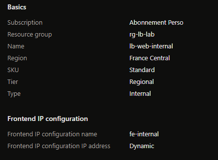

## Introduction

Cette procédure décrit le déploiement et la configuration d'un Azure Load Balancer (ALB) de couche 4 (Transport). Le Load Balancer distribue le trafic réseau entrant entre plusieurs machines virtuelles, garantissant la haute disponibilité et la résilience. Si une VM tombe en panne, le Load Balancer redirige automatiquement le trafic vers les VMs restantes sans interruption pour l'utilisateur.

## Contexte et Justification

Héberger un service sur une seule VM est un Single Point of Failure (SPOF). Si cette VM plante, le service est indisponible. En architecture haute disponibilité :

1. Vous déployez 2+ VMs identiques (ex : vm-web-01, vm-web-02) avec la même application.
2. Vous placez un Load Balancer devant.
3. L'utilisateur se connecte à l'IP unique du Load Balancer, qui distribue les requêtes entre les VMs saines.
4. Si vm-web-01 tombe, le Load Balancer détecte la panne via la health probe et envoie 100% du trafic vers vm-web-02.

Azure propose deux types de Load Balancer :

- **Public Load Balancer** : Distribue le trafic entrant depuis Internet vers les VMs. L'IP frontend est publique.
- **Internal (Private) Load Balancer** : Distribue le trafic interne au VNet. L'IP frontend est privée. Utilisé pour équilibrer le trafic entre des tiers applicatifs (ex : les serveurs web envoient leurs requêtes vers un LB interne devant les serveurs d'application).

## Concepts Clés

**Frontend IP Configuration :** L'adresse IP exposée aux clients. Pour un LB public, c'est une IP publique Azure. Pour un LB interne, c'est une IP privée du subnet. Un LB peut avoir plusieurs frontend IPs pour exposer plusieurs services.

**Backend Pool :** Le groupe de VMs (ou NICs, ou IP addresses) qui reçoivent le trafic distribué par le LB. Toutes les VMs du pool doivent être dans le même VNet. Le backend pool peut contenir des VMs individuelles, un Availability Set ou un VMSS (Virtual Machine Scale Set).

**Health Probe (Sonde de Santé) :** Le mécanisme qui vérifie si les VMs du backend pool sont saines. Le LB envoie des requêtes périodiques (toutes les 5 ou 15 secondes) vers un port spécifique de chaque VM. Si une VM ne répond pas après un nombre configurable d'échecs (seuil), elle est retirée de la distribution. Types de probes :

- **TCP** : Tente une connexion TCP sur le port spécifié. Succès = la VM accepte la connexion.
- **HTTP/HTTPS** : Envoie une requête GET vers un chemin spécifié (ex : /health). Succès = réponse HTTP 200.

**Load Balancing Rule :** La règle qui lie le frontend, le backend pool et la health probe. Elle définit : quel trafic (protocole, port frontend) est distribué vers quel backend (port backend), avec quelle probe et quel algorithme de distribution.

**Algorithmes de distribution :**

- **Five-tuple hash (par défaut)** : Distribue en fonction de l'IP source, l'IP destination, le port source, le port destination et le protocole. Une même session TCP va toujours vers la même VM.
- **Session persistence (Source IP Affinity)** : Toutes les requêtes d'une même IP source vont vers la même VM. Utile pour les applications stateful.
  - **None** : Pas de persistance, chaque requête peut aller vers une VM différente.
  - **Client IP** : Persistance basée sur l'IP source.
  - **Client IP and Protocol** : Persistance basée sur l'IP source et le protocole.

**Inbound NAT Rule :** Redirige le trafic d'un port spécifique du frontend vers un port spécifique d'une VM unique du backend. Utilisé pour l'accès direct à une VM (ex : SSH via le port 50001 du LB → port 22 de vm-web-01, port 50002 → port 22 de vm-web-02).

**Outbound Rules :** Configurent la connectivité sortante (SNAT) des VMs du backend pool vers Internet. Par défaut, avec un Standard LB, les VMs perdent l'accès Internet sortant si elles n'ont pas d'IP publique propre. Les outbound rules ou une NAT Gateway résolvent ce problème.

**SKU (Standard vs Basic) :**

| Caractéristique | Basic | Standard |
|---------------------|-----------------------|-------------------------------|
|    Backend pool     | NIC-based uniquement  | NIC ou IP-based               |
| Taille backend pool | Jusqu'à 300 instances | Jusqu'à 1000 instances        |
|    Health Probes    | TCP, HTTP             | TCP, HTTP, HTTPS              |
| Availability Zones  | Non supporté          | Zone-redundant et zonal       |
|     Diagnostics     | Non disponible        | Azure Monitor metrics et logs |
|         SLA         | Aucun                 | 99.99%                        |
|      Sécurité       | Ouvert par défaut     | Fermé par défaut (NSG requis) |
|      Outbound       | SNAT automatique      | Outbound rules configurables  |
|        Prix         | Gratuit               | Payant                        |

<div class="callout callout-note">

Le SKU Basic est retiré depuis le 30 septembre 2025. Utilisez toujours le SKU Standard.

</div>

## Prérequis

- Un VNet avec un subnet contenant au moins 2 VMs identiques (même application déployée).
- Le rôle **Network Contributor** (minimum) pour créer le Load Balancer.
- Les VMs doivent être dans le même VNet que le Load Balancer.
- Pour un LB public : une IP publique Standard SKU.

## Méthode 1 : Configuration via Portail Azure

### Créer le Load Balancer Public

1. Recherchez **"Load balancers"** et cliquez sur **"+ Create"**.
2. Onglet **"Basics"** :
   - **Resource group** : rg-lb-lab.
   - **Name** : lb-web-public.
   - **Region** : France Central.
   - **SKU** : Standard.
   - **Type** : Public.
   - **Tier** : Regional.



<p class="figure-caption"><b>Figure 1</b> · Créer le Load Balancer Public</p>

3. Onglet **"Frontend IP configuration"** :
   - Cliquez sur **"+ Add a frontend IP configuration"**.
   - **Name** : fe-public.
   - **Public IP address** : **"Create new"** \> Name : pip-lb-web, SKU : Standard, Assignment : Static.
   - Cliquez sur **"Add"**.



<p class="figure-caption"><b>Figure 2</b> · Créer le Load Balancer Public</p>

4. Cliquez sur **"Review + create"** puis **"Create"**.

### Configurer le Backend Pool

1. Ouvrez lb-web-public \> Menu gauche \> **"Backend pools"** \> **"+ Add"**.
2. **Name** : pool-web.
3. **Virtual network** : vnet-lb.
4. **Backend Pool Configuration** : NIC.
5. Cliquez sur **"+ Add"** :
   - Sélectionnez vm-web-01.
   - Sélectionnez vm-web-02.



<p class="figure-caption"><b>Figure 3</b> · Configurer le Backend Pool</p>

6. Cliquez sur **"Add"** puis **"Save"**.

### Configurer la Health Probe

1. Menu gauche \> **"Health probes"** \> **"+ Add"**.
2. **Name** : probe-http.
3. **Protocol** : HTTP.
4. **Port** : 80.
5. **Path** : / (racine).
6. **Interval** : 5 seconds.



<p class="figure-caption"><b>Figure 4</b> · Configurer la Health Probe</p>

7. Cliquez sur **"Save"**.

<div class="callout callout-note">

Une probe HTTP est préférable à TCP car elle vérifie que le service web répond réellement (code 200), pas juste que le port est ouvert.

</div>

### Créer la Load Balancing Rule

1. Menu gauche \> **"Load balancing rules"** \> **"+ Add"**.
2. **Name** : rule-http.
3. **IP Version** : IPv4.
4. **Frontend IP address** : fe-public.
5. **Backend pool** : pool-web.
6. **Protocol** : TCP.
7. **Port** : 80 (port exposé sur le LB).
8. **Backend port** : 80 (port sur les VMs).
9. **Health probe** : probe-http.
10. **Session persistence** : None.
11. **Idle timeout** : 4 minutes (défaut).
12. **Enable TCP Reset** : Yes (recommandé, envoie un RST aux connexions idle).
13. **Floating IP** : Disabled.



<p class="figure-caption"><b>Figure 5</b> · Créer la Load Balancing Rule</p>

14. Cliquez sur **"Save"**.

### Créer une NAT Rule (Accès Direct à une VM)

Pour accéder en SSH à une VM spécifique via le LB (utile si les VMs n'ont pas d'IP publique et que Bastion n'est pas déployé) :

1. Menu gauche \> **"Inbound NAT rules"** \> **"+ Add"**.
2. **Name** : nat-ssh-vm01.
3. **Type** : **Azure virtual machine**.
4. **Target virtual machine** : vm-web-01.
5. **Network IP configuration** : ipconfig1 (sélectionné automatiquement).
6. **Frontend IP address** : fe-public.
7. **Frontend Port** : 50001.
8. **Service Tag** : Custom.
9. **Backend port** : 22.
10. **Protocol** : TCP.



<p class="figure-caption"><b>Figure 6</b> · Créer une NAT Rule (Accès Direct à une VM)</p>

11. Cliquez sur **"Save"**.
12. Répétez pour vm-web-02 avec le port frontend 50002.

<div class="callout callout-note">

Vous pouvez maintenant lancer `ssh azureuser@<IP_LB> -p 50001` pour atteindre vm-web-01 et `-p 50002` pour vm-web-02.

</div>

<div class="callout callout-note">

L'autre mode **"Backend pool"** est utile quand vous avez beaucoup de VMs et voulez des NAT rules automatiques pour tout le pool, mais vous ne contrôlez pas précisément quel port va vers quelle VM.

</div>

### Créer un Load Balancer Interne

La procédure est identique sauf :

1. **Type** : Internal (au lieu de Public).
2. **Frontend IP configuration** :
   - **Name** : fe-internal.
   - **Virtual network** : vnet-lb.
   - **Subnet** : snet-app (un subnet dédié au tier applicatif).
   - **IP address assignment** : Static ou Dynamic.
   - Pas d'IP publique.



<p class="figure-caption"><b>Figure 7</b> · Créer un Load Balancer Interne</p>

3. Le reste (backend pool, probe, rule) est identique.

<div class="callout callout-note">

Le LB interne est invisible depuis Internet. Seules les ressources du VNet (ou des VNets peerés) peuvent l'atteindre via son IP privée.

</div>

## Méthode 2 : Configuration via PowerShell

### Créer l'IP Publique et le Load Balancer

```powershell
$rgName = "rg-lb-lab"
```

1. IP Publique :

```powershell
$pip = New-AzPublicIpAddress `
    -ResourceGroupName $rgName `
    -Name "pip-lb-web" `
    -Location "FranceCentral" `
    -Sku "Standard" `
    -AllocationMethod "Static"
```

2. Frontend IP Configuration :

```powershell
$feConfig = New-AzLoadBalancerFrontendIpConfig `
    -Name "fe-public" `
    -PublicIpAddress $pip
```

3. Backend Pool :

```powershell
$bePool = New-AzLoadBalancerBackendAddressPoolConfig `
    -Name "pool-web"
```

4. Créer le Load Balancer :

```powershell
$lb = New-AzLoadBalancer `
    -ResourceGroupName $rgName `
    -Name "lb-web-public" `
    -Location "FranceCentral" `
    -Sku "Standard" `
    -FrontendIpConfiguration $feConfig `
    -BackendAddressPool $bePool
```

### Créer la Health Probe et la Rule

1. Récupérer le LB :

```powershell
$lb = Get-AzLoadBalancer -ResourceGroupName $rgName -Name "lb-web-public"
```

2. Health Probe :

```powershell
Add-AzLoadBalancerProbeConfig `
    -LoadBalancer $lb `
    -Name "probe-http" `
    -Protocol Http `
    -Port 80 `
    -RequestPath "/" `
    -IntervalInSeconds 5 `
    -ProbeCount 2
$lb | Set-AzLoadBalancer
```

3. Récupérer les objets mis à jour :

```powershell
$lb = Get-AzLoadBalancer -ResourceGroupName $rgName -Name "lb-web-public"
$feConfig = $lb.FrontendIpConfigurations[0]
$bePool = $lb.BackendAddressPools[0]
$probe = $lb.Probes[0]
```

4. Load Balancing Rule :

```powershell
Add-AzLoadBalancerRuleConfig `
    -LoadBalancer $lb `
    -Name "rule-http" `
    -FrontendIpConfiguration $feConfig `
    -BackendAddressPool $bePool `
    -Probe $probe `
    -Protocol Tcp `
    -FrontendPort 80 `
    -BackendPort 80 `
    -IdleTimeoutInMinutes 4 `
    -EnableTcpReset
$lb | Set-AzLoadBalancer
```

### Attacher les VMs au Backend Pool

```powershell
$lb = Get-AzLoadBalancer -ResourceGroupName $rgName -Name "lb-web-public"
$bePool = $lb.BackendAddressPools[0]
$nic1 = Get-AzNetworkInterface -ResourceId (Get-AzVM -ResourceGroupName $rgName -Name "vm-web-01").NetworkProfile.NetworkInterfaces[0].Id
$nic1.IpConfigurations[0].LoadBalancerBackendAddressPools = $bePool
$nic1 | Set-AzNetworkInterface
$nic2 = Get-AzNetworkInterface -ResourceId (Get-AzVM -ResourceGroupName $rgName -Name "vm-web-02").NetworkProfile.NetworkInterfaces[0].Id
$nic2.IpConfigurations[0].LoadBalancerBackendAddressPools = $bePool
$nic2 | Set-AzNetworkInterface
```

### Créer une NAT Rule

```powershell
$lb = Get-AzLoadBalancer -ResourceGroupName $rgName -Name "lb-web-public"
$feConfig = $lb.FrontendIpConfigurations[0]
Add-AzLoadBalancerInboundNatRuleConfig `
    -LoadBalancer $lb `
    -Name "nat-ssh-vm01" `
    -FrontendIpConfiguration $feConfig `
    -Protocol Tcp `
    -FrontendPort 50001 `
    -BackendPort 22
$lb | Set-AzLoadBalancer
```

### Créer un Load Balancer Interne

```powershell
$vnet = Get-AzVirtualNetwork -ResourceGroupName $rgName -Name "vnet-lb"
$subnet = $vnet.Subnets | Where-Object { $_.Name -eq "snet-app" }
$feInternal = New-AzLoadBalancerFrontendIpConfig `
    -Name "fe-internal" `
    -Subnet $subnet `
    -PrivateIpAddress "10.0.2.10"
$bePoolInternal = New-AzLoadBalancerBackendAddressPoolConfig `
    -Name "pool-app"
$lbInternal = New-AzLoadBalancer `
    -ResourceGroupName $rgName `
    -Name "lb-app-internal" `
    -Location "FranceCentral" `
    -Sku "Standard" `
    -FrontendIpConfiguration $feInternal `
    -BackendAddressPool $bePoolInternal
```

## Vérifications

**LB créé** : Dans le portail \> **"Load balancers"**, lb-web-public apparaît avec le SKU Standard et le type Public.

**Frontend IP** : Dans lb-web-public \> **"Frontend IP configuration"**, l'IP publique est affichée (ex : 20.50.x.x).

**Backend Pool sain** : Dans **"Backend pools"** \> pool-web, les deux VMs sont listées avec le statut **"Running"** dans la colonne Health status.

**Health Probe** : Dans **"Health probes"**, probe-http est listée. Dans **"Insights"** (si disponible), vous voyez le statut de chaque VM (Healthy/Unhealthy).

**Test HTTP** : Ouvrez un navigateur et accédez à l'IP publique du LB (http://20.50.x.x). Vous voyez "Hello from VM 1" ou "Hello from VM 2".

**Test d'alternance** : Ouvrez plusieurs navigateurs ou utilisez curl depuis différents terminaux. Le texte doit alterner entre VM 1 et VM 2 (avec session persistence "None").

**Test de panne** : Arrêtez vm-web-01 depuis le portail. Après 10-15 secondes (le temps que la probe détecte la panne), toutes les requêtes vont vers vm-web-02. Le service n'est jamais interrompu.

**Test NAT Rule** : `ssh azureuser@<IP_LB> -p 50001` vous connecte à vm-web-01.

## Dépannage

**Rien ne s'affiche (Timeout) en accédant à l'IP du LB :** Vérifiez le NSG du subnet des VMs. Le port 80 doit être autorisé en inbound depuis Internet (ou depuis le Service Tag AzureLoadBalancer). Avec un Standard LB, le trafic est bloqué par défaut si aucun NSG n'autorise le port.

**Les deux VMs sont "Unhealthy" dans le backend pool :** La health probe échoue. Vérifiez que le service web (Nginx/Apache) est bien démarré sur les VMs (`systemctl status nginx`). Vérifiez que le port de la probe (80) est ouvert dans le NSG. Vérifiez que la probe HTTP reçoit une réponse 200 (pas une redirection 301/302).

**Le trafic va toujours vers la même VM :** Vérifiez la session persistence dans la load balancing rule. Si elle est sur "Client IP", toutes les requêtes depuis votre IP vont vers la même VM. Passez à "None" pour le test. Même avec "None", le five-tuple hash peut envoyer vers la même VM si vous testez depuis le même navigateur. Essayez depuis un smartphone en 4G ou avec curl depuis différentes machines.

**Les VMs ne peuvent pas accéder à Internet (apt-get échoue) :** Avec un Standard LB, les VMs sans IP publique perdent l'accès sortant. Solutions : créer une Outbound Rule sur le LB, déployer une NAT Gateway sur le subnet, ou attribuer une IP publique à chaque VM.

**"IP address is not compatible with the load balancer's SKU" :** Vous essayez d'utiliser une IP publique Basic avec un LB Standard (ou inversement). Les SKU doivent correspondre. Créez une nouvelle IP avec le bon SKU.

**"Backend pool cannot contain virtual machines from different virtual networks" :** Les VMs du backend pool doivent être dans le même VNet. Si vous avez des VMs dans des VNets peerés, elles ne peuvent pas être dans le même backend pool. Déployez un LB dans chaque VNet ou migrez les VMs.

**La NAT Rule ne fonctionne pas :** Vérifiez que le NSG autorise le port frontend (ex : 50001) en inbound depuis Internet. Vérifiez que la NAT rule est bien attachée à la NIC de la VM cible.

## Conseils et Bonnes Pratiques

**Utilisez toujours le SKU Standard.** Le Basic LB est retiré, n'avait pas de SLA, ne supportait pas les Availability Zones et n'offrait pas de diagnostics. Le Standard est le seul choix possible.

**Utilisez des Health Probes HTTP plutôt que TCP quand c'est possible.** Une probe TCP vérifie uniquement que le port est ouvert. Une probe HTTP vérifie que l'application répond correctement (code 200). Si Nginx est démarré mais renvoie des erreurs 500, une probe TCP la considère saine alors qu'une probe HTTP la retire du pool.

**Déployez les VMs du backend dans un Availability Set ou des Availability Zones.** Un LB distribue le trafic, mais si toutes les VMs sont sur le même serveur physique et que ce serveur tombe, tout est perdu. Les Availability Sets garantissent que les VMs sont sur des serveurs physiques différents. Les Availability Zones garantissent qu'elles sont dans des datacenters différents.

**Prévoyez la connectivité sortante dès le début.** Si vos VMs ont besoin d'accéder à Internet (mises à jour, API externes), configurez une NAT Gateway sur le subnet plutôt qu'une Outbound Rule sur le LB. La NAT Gateway est plus simple et plus performante.

**Ne mettez jamais de LB devant une seule VM.** Le LB a un coût mensuel. Si vous n'avez qu'une VM, l'IP publique directe suffit. Le LB ne prend son sens qu'avec 2+ VMs.

**Utilisez un Internal LB pour les communications inter-tiers.** Dans une architecture 3-tier (web → app → db), les serveurs web contactent les serveurs d'application via un Internal LB. Cela découple les tiers et permet de scaler le tier app indépendamment.

## Procédures Liées

- [Déploiement d'un Réseau Virtuel](/procedures/azure/deploiement-dun-reseau-virtuel) *(Le VNet et les subnets doivent exister avant de déployer le LB et les VMs)*
- [Gestion de la Sécurité Réseau (NSG)](/procedures/azure/gestion-de-la-securite-reseau-nsg) *(Le NSG doit autoriser le port du LB et le Service Tag AzureLoadBalancer pour la health probe)*
- [Déploiement d'Azure Bastion](/procedures/azure/deploiement-dazure-bastion) *(Alternative aux NAT Rules pour l'accès SSH/RDP aux VMs sans IP publique)*
- [Configuration des Adresses IP Publiques](/procedures/azure/configuration-des-adresses-ip-publiques) *(L'IP publique du LB doit être SKU Standard et Static)*
- [Configuration des Routes Définies par l'Utilisateur (UDR)](/procedures/azure/configuration-des-routes-definies-par-lutilisateur-udr) *(Les UDR peuvent influencer le routage du trafic vers/depuis le LB)*
- Déploiement d'une Machine Virtuelle (Windows et Linux) *(Les VMs du backend pool doivent être identiques avec la même application)*
- [Diagnostic Réseau avec Network Watcher](/procedures/azure/diagnostic-reseau-avec-network-watcher) *(Diagnostiquer les problèmes de connectivité au LB avec IP flow verify et Connection Troubleshoot)*
- [Configuration d'Azure DNS](/procedures/azure/configuration-dazure-dns) *(Associer un nom DNS à l'IP publique du LB)*
