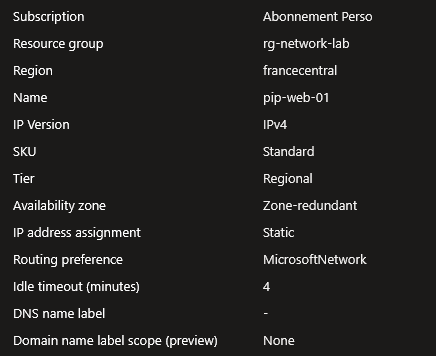
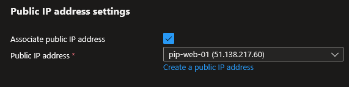
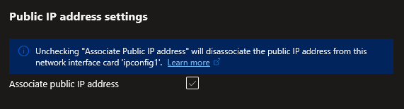
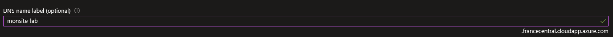

## Introduction

Cette procédure décrit la création et la gestion des adresses IP publiques dans Azure. L'IP publique est la ressource qui rend une VM, un Load Balancer ou un autre service accessible depuis Internet. C'est un objet Azure indépendant qui peut être créé, associé, dissocié et réassocié à différentes ressources.

## Contexte et Justification

Dans Azure, les ressources déployées dans un VNet ont par défaut uniquement une IP privée. Elles ne sont pas accessibles depuis Internet. Pour qu'une VM hébergeant un site web soit accessible, ou pour qu'un Load Balancer distribue le trafic entrant, il faut une IP publique.

L'IP publique Azure est une ressource à part entière, séparée de la VM ou du Load Balancer. Cela signifie que :

- Vous pouvez créer une IP publique avant même de créer la VM.
- Vous pouvez détacher l'IP d'une VM et la réattacher à une autre (si l'IP est Static).
- Vous pouvez supprimer une VM sans perdre son IP publique (utile pour conserver l'IP lors d'une migration).
- Vous pouvez associer un nom DNS à l'IP sans passer par un registre externe.

Azure propose deux SKU d'IP publique (Basic et Standard) avec des comportements très différents en termes de sécurité, disponibilité et compatibilité.

## Concepts Clés

**IP Publique Azure :** Une ressource ARM qui fournit une adresse IPv4 (ou IPv6) routable sur Internet. Elle peut être associée à une NIC de VM, un Load Balancer, une VPN Gateway, une Application Gateway, un Azure Firewall ou un Bastion.

**Standard v2 (usage restreint) :** Azure propose aussi un SKU Standard v2, qui est toujours zone-redundant par défaut. Cependant, les IP Standard v2 ne peuvent actuellement être utilisées qu'avec le produit NAT Gateway v2. Elles ne sont pas compatibles avec les VMs, les Load Balancers, Bastion ou tout autre service. Pour tous les déploiements courants (VMs, LB, Bastion, VPN Gateway), utilisez le SKU Standard (v1).

**SKU Basic vs Standard :**

| Caractéristique | Basic | Standard |
|------------------------|----------------------------|-------------------------------|
| **Allocation** | Static ou Dynamic | Static uniquement |
| **Sécurité** | Ouverte par défaut (pas de NSG requis) | Fermée par défaut (NSG obligatoire) |
| **Availability Zones** | Non supporté | Zone-redundant ou zonal |
| **Redondance** | Pas de SLA de disponibilité | SLA 99.99% |
| **Routage** | Internet routing uniquement | Internet ou Microsoft Network routing |
| **Compatible avec** | Basic Load Balancer, NICs | Standard Load Balancer, NICs, Bastion, VPN GW |
| **Prix** | Gratuit (les premières heures) | Payant (~3,50 €/mois) |
| **Statut** | Retiré depuis le 30 septembre 2025 | Recommandé |

<div class="callout callout-note">

Le SKU Basic est retiré depuis le 30 septembre 2025. Utilisez toujours le SKU Standard.

</div>

**Allocation Static vs Dynamic :**

- **Static** : L'IP est attribuée immédiatement à la création et ne change jamais, même si la ressource associée est arrêtée ou redémarrée. Indispensable pour les serveurs DNS, les certificats SSL, les règles de firewall et toute situation où l'IP doit rester stable.
- **Dynamic** : L'IP n'est attribuée que lorsque la ressource est démarrée. Si la VM est arrêtée (deallocated), l'IP est libérée et peut changer au prochain démarrage. Disponible uniquement avec le SKU Basic.

<div class="callout callout-note">

Le SKU Standard est toujours Static. Le SKU Basic peut être Static ou Dynamic.

</div>

**DNS Name Label :** Un label optionnel que vous attachez à l'IP publique. Il crée un FQDN au format : `<label>.<region>.cloudapp.azure.com` (ex : monsite.francecentral.cloudapp.azure.com). Ce FQDN pointe vers l'IP publique et se met à jour automatiquement si l'IP change (Dynamic). C'est une alternative gratuite à un nom DNS personnalisé.

**Routing Preference (Préférence de routage) :**

- **Microsoft Network** (par défaut) : Le trafic entre l'utilisateur et Azure emprunte le réseau global de Microsoft le plus longtemps possible. Meilleure performance et latence.
- **Internet** : Le trafic quitte le réseau Microsoft au plus tôt et emprunte l'Internet public. Moins performant mais légèrement moins cher.

**IPv4 vs IPv6 :** Azure supporte les IP publiques en IPv4 et IPv6. L'IPv6 est utilisé pour les déploiements dual-stack (les VMs ont une IPv4 et une IPv6).

**IP Prefix (Préfixe IP Public) :** Un bloc d'adresses IP publiques contiguës que vous pouvez réserver. Utile quand vous avez besoin de plusieurs IP prévisibles (ex : pour une allowlist de firewall chez un partenaire). Les IP d'un prefix sont garanties contiguës et dans la même région.

## Prérequis

- Le rôle **Network Contributor** (minimum) pour créer et gérer des IP publiques.
- Pour associer une IP à une NIC : le rôle Network Contributor sur la NIC et sur l'IP publique.
- Si vous associez à un Standard LB : l'IP doit être SKU Standard (compatibilité de SKU).

## Méthode 1 : Configuration via Portail Azure

### Créer une IP Publique Standard Static

1. Recherchez **"Public IP addresses"** et cliquez sur **"+ Create"**.
2. **Resource group** : rg-network-lab.
3. **Name** : pip-web-01.
4. **Region** : France Central.
5. **IP Version** : IPv4.
6. **SKU** : Standard.
7. **Tier** : Regional.
8. **Assignment** : Static (seul choix pour Standard).
9. **Routing preference** : Microsoft network (par défaut).
10. **Idle timeout** : 4 minutes (par défaut).



<p class="figure-caption"><b>Figure 1</b> · Créer une IP Publique Standard Static</p>

11. Cliquez sur **"Review + create"** puis **"Create"**.

### Associer l'IP à une VM Existante

1. Allez sur la VM (ex : vm-web-01) \> Menu gauche \> **"Networking"** \> **"Network settings"**.
2. Cliquez sur la NIC de la VM (ex : vm-web-01604).
3. Menu gauche \> **"IP configurations"**.
4. Cliquez sur l'IP configuration (ex : ipconfig1).
5. Cochez **"Associate public IP address"**.



<p class="figure-caption"><b>Figure 2</b> · Associer l'IP à une VM Existante</p>

6. Choisissez pip-web-01.
7. Cliquez sur **"Save"**.

<div class="callout callout-note">

La VM est maintenant accessible depuis Internet via l'IP publique (à condition qu'un NSG autorise le trafic).

</div>

### Dissocier une IP Publique d'une VM

1. Même chemin : VM \> **"Networking"** \> NIC \> **"IP configurations"** \> ipconfig1.
2. Décochez **"Associate public IP address"**.



<p class="figure-caption"><b>Figure 3</b> · Dissocier une IP Publique d'une VM</p>

3. Cliquez sur **"Save"**.

<div class="callout callout-note">

L'IP publique n'est plus liée à la VM mais existe toujours comme ressource. Vous pouvez la réassocier à une autre VM.

</div>

### Configurer un DNS Name Label

1. Allez dans la ressource pip-web-01 \> Menu gauche \> **"Configuration"**.
2. **DNS name label** : monsite-lab (le FQDN sera monsite-lab.francecentral.cloudapp.azure.com).



<p class="figure-caption"><b>Figure 4</b> · Configurer un DNS Name Label</p>

3. Cliquez sur **"Save"**.

<div class="callout callout-note">

Le DNS name label doit être unique dans la région. Si "monsite-lab" est déjà pris, choisissez un autre nom.

</div>

### Supprimer une IP Publique

1. L'IP doit d'abord être dissociée de toute ressource.
2. Allez dans pip-web-01 \> **"Overview"** \> Cliquez sur **"Delete"**.
3. Confirmez.

## Méthode 2 : Configuration via PowerShell

### Créer une IP Publique

```powershell
$rgName = "rg-network-lab"
$pipZR = New-AzPublicIpAddress `
    -ResourceGroupName $rgName `
    -Name "pip-web-01-zr" `
    -Location "FranceCentral" `
    -Sku "Standard" `
    -AllocationMethod "Static" `
    -Zone 1, 2, 3
```

### Créer avec un DNS Name Label

```powershell
$pip = New-AzPublicIpAddress `
    -ResourceGroupName $rgName `
    -Name "pip-web-01" `
    -Location "FranceCentral" `
    -Sku "Standard" `
    -AllocationMethod "Static" `
    -DomainNameLabel "monsite-lab"
```

### Associer à une NIC Existante

```powershell
$pip = Get-AzPublicIpAddress -ResourceGroupName $rgName -Name "pip-web-01"
$nic = Get-AzNetworkInterface -ResourceGroupName $rgName -Name "vm-web-01604"
$nic.IpConfigurations[0].PublicIpAddress = $pip
$nic | Set-AzNetworkInterface
```

### Dissocier d'une NIC

```powershell
$nic = Get-AzNetworkInterface -ResourceGroupName $rgName -Name "vm-web-01604"
$nic.IpConfigurations[0].PublicIpAddress = $null
$nic | Set-AzNetworkInterface
```

### Lister les IP Publiques

1. Toutes les IP :

```powershell
Get-AzPublicIpAddress -ResourceGroupName $rgName |
    Select-Object Name, IpAddress, Sku, PublicIpAllocationMethod,
@{N='Associated';E={if($_.IpConfiguration){'Yes'}else{'No'}}} |
    Format-Table
```

2. IP non associées uniquement :

```powershell
Get-AzPublicIpAddress -ResourceGroupName $rgName |
    Where-Object { $_.IpConfiguration -eq $null } |
    Select-Object Name, IpAddress, Sku |
    Format-Table
```

### Supprimer une IP Publique

```powershell
Remove-AzPublicIpAddress `
    -ResourceGroupName $rgName `
    -Name "pip-web-01" `
    -Force
```

## Vérifications

**IP créée** : Dans le portail \> **"Public IP addresses"**, pip-web-01 apparaît avec l'adresse IP attribuée, le SKU Standard et l'allocation Static.

**IP associée** : Dans pip-web-01 \> **"Overview"**, le champ **"Associated to"** affiche la NIC de la VM. Ou dans la VM \> **"Networking"**, l'IP publique est affichée.

**DNS Name Label** : Dans pip-web-01 \> **"Configuration"**, le FQDN complet est affiché. Testez avec `nslookup monsite-lab.francecentral.cloudapp.azure.com` → doit résoudre vers l'IP publique.

**Accessibilité** : Si la VM héberge un serveur web et que le NSG autorise le port 80, accédez à http://<IP_PUBLIQUE> dans un navigateur. La page doit s'afficher.

**Zone-redundancy** : Dans pip-web-01 \> **"Overview"**, le champ **"Availability zone"** affiche "Zone-redundant" (si créé avec les zones 1,2,3).

## Dépannage

**La VM n'est pas accessible malgré l'IP publique :** Le SKU Standard bloque tout le trafic par défaut. Vérifiez que le NSG du subnet ou de la NIC autorise le port que vous tentez d'atteindre (80, 443, 22, etc.). Sans NSG Allow, rien ne passe.

**"Public IP address cannot be associated because it is already associated" :** L'IP est déjà liée à une autre ressource. Une IP ne peut être associée qu'à une seule ressource. Dissociez-la de l'ancienne ressource avant de l'associer à la nouvelle.

**"SKU mismatch" en associant à un Load Balancer :** Le SKU de l'IP doit correspondre au SKU du LB. IP Standard + LB Standard = OK. IP Basic + LB Standard = erreur. Créez une IP avec le bon SKU.

**L'IP publique a changé après un restart de la VM :** L'IP était de type Dynamic (SKU Basic). En désallouant la VM, l'IP a été libérée. Utilisez une IP Static pour éviter ce problème. Avec le SKU Standard, l'allocation est toujours Static.

**"Cannot delete public IP address because it is still associated" :** Dissociez l'IP de la ressource avant de la supprimer. Allez dans la NIC \> IP configuration \> Disassociate, puis retentez la suppression.

**Le DNS name label est "already taken" :** Le label doit être unique dans la région Azure. Choisissez un nom différent (ex : ajoutez un suffixe unique comme monsite-lab-01).

**IP publique facturée sans utilisation :** Les IP Standard non associées coûtent environ 3.50€/mois. Listez les IP non associées avec `Get-AzPublicIpAddress | Where-Object { $_.IpConfiguration -eq $null }` et supprimez celles qui ne sont plus nécessaires.

## Conseils et Bonnes Pratiques

**Utilisez toujours le SKU Standard.** Le SKU Basic est retiré ; il n'avait pas de SLA, ne supportait pas les Availability Zones et était ouvert par défaut (un risque de sécurité). Le Standard est le seul choix possible.

**Préférez les IP Static sauf si vous avez une raison spécifique pour le Dynamic.** Les IP Static ne changent jamais, ce qui simplifie la gestion des DNS, des certificats SSL et des règles de firewall. Le surcoût est négligeable.

**Supprimez les IP publiques non utilisées.** Listez régulièrement vos IP publiques et supprimez celles qui ne sont associées à aucune ressource. Elles coûtent de l'argent sans apporter de valeur. Utilisez Azure Advisor qui signale les IP non associées.

**Utilisez un DNS name label plutôt que de communiquer l'IP brute.** Le label crée un FQDN stable (monsite.francecentral.cloudapp.azure.com) qui pointe toujours vers votre IP. C'est plus lisible et permet de changer l'IP sans mettre à jour tous les clients (si vous recréez l'IP avec le même label).

**Limitez le nombre d'IP publiques.** Chaque IP publique est un point d'entrée depuis Internet et un risque potentiel. Utilisez un Load Balancer (une seule IP pour N VMs) ou un Application Gateway plutôt que d'attribuer une IP publique à chaque VM. Pour l'administration, utilisez Bastion au lieu d'IP publiques sur les VMs.

**Activez la zone-redundancy pour la haute disponibilité.** Créez vos IP Standard avec les zones 1,2,3 pour qu'elles survivent à la panne d'une zone de disponibilité. C'est gratuit et sans inconvénient.

## Procédures Liées

- [Déploiement d'un Réseau Virtuel](/procedures/azure/deploiement-dun-reseau-virtuel) *(Le VNet et la NIC de la VM doivent exister avant d'associer une IP publique)*
- [Gestion de la Sécurité Réseau (NSG)](/procedures/azure/gestion-de-la-securite-reseau-nsg) *(Un NSG est obligatoire avec les IP Standard pour que le trafic passe)*
- [Configuration d'un Load Balancer](/procedures/azure/configuration-dun-load-balancer) *(Le LB utilise une IP publique Standard comme frontend, les SKU doivent correspondre)*
- [Déploiement d'Azure Bastion](/procedures/azure/deploiement-dazure-bastion) *(Bastion utilise une IP publique Standard et est l'alternative recommandée aux IP publiques sur les VMs)*
- [Configuration d'Azure DNS](/procedures/azure/configuration-dazure-dns) *(Configurer un domaine personnalisé pointant vers l'IP publique via un enregistrement A)*
- [Configuration des Routes Définies par l'Utilisateur (UDR)](/procedures/azure/configuration-des-routes-definies-par-lutilisateur-udr) *(Les UDR peuvent influencer le routage du trafic vers/depuis les IP publiques)*
- Déploiement d'une Machine Virtuelle (Windows et Linux) *(L'IP publique est associée à la NIC de la VM lors du déploiement ou après)*
- [Diagnostic Réseau avec Network Watcher](/procedures/azure/diagnostic-reseau-avec-network-watcher) *(Diagnostiquer les problèmes de connectivité liés aux IP publiques)*
