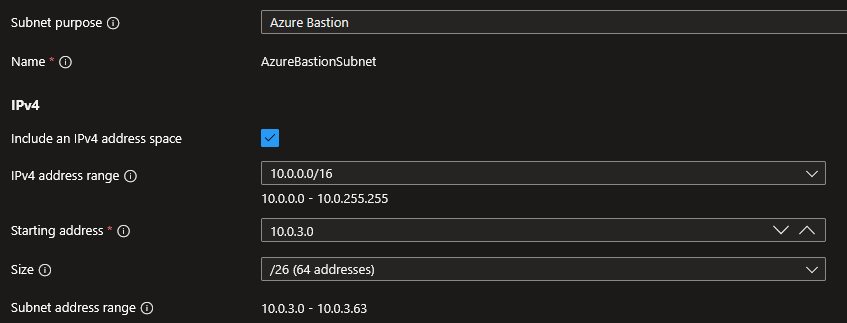
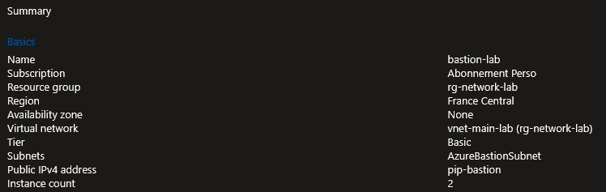
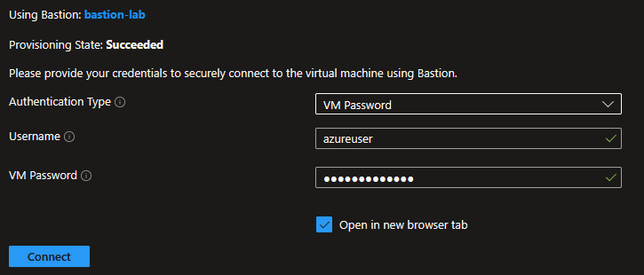
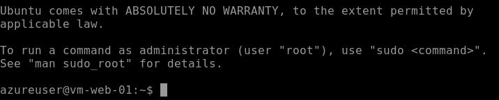
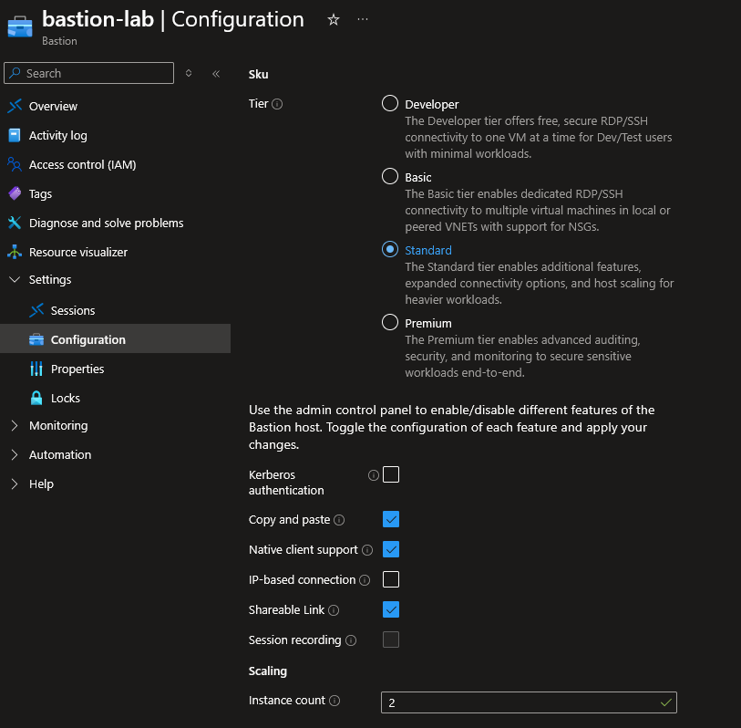

## Introduction

Cette procédure détaille le déploiement d'Azure Bastion, un service PaaS entièrement managé qui permet de se connecter aux machines virtuelles (SSH/RDP) directement depuis le portail Azure via un navigateur web, sans exposer de ports de management sur Internet. Bastion élimine la nécessité d'IP publiques sur les VMs et de règles NSG autorisant SSH/RDP depuis Internet.

## Contexte et Justification

L'exposition directe des ports SSH (22) et RDP (3389) sur Internet est la première cause d'attaques par force brute sur les VMs cloud. Même avec un mot de passe fort et un NSG restrictif (IP source limitée), le risque reste élevé : les adresses IP changent, les listes sont oubliées, et les scans automatisés touchent toutes les IP Azure en permanence.

Azure Bastion résout ce problème en agissant comme un proxy sécurisé :

1. **L'utilisateur** se connecte au portail Azure via HTTPS (port 443), authentifié par Entra ID avec MFA.
2. **Bastion** établit la connexion SSH/RDP vers la VM via le réseau privé Azure.
3. **La VM** n'a aucun port ouvert sur Internet et n'a pas besoin d'IP publique.

Le flux est : Utilisateur → HTTPS (443) → Azure Bastion → SSH/RDP (réseau privé) → VM.

Avantages par rapport à une IP publique + NSG :

- Pas d'IP publique sur les VMs (réduction de la surface d'attaque).
- Pas de règle NSG "Allow SSH from Internet" (plus aucun port de management exposé).
- Authentification centralisée via Entra ID (MFA, Conditional Access).
- Accès depuis n'importe quel navigateur (pas de client VPN ou SSH à installer).
- Traçabilité des sessions (qui s'est connecté, quand, à quelle VM).

## Concepts Clés

**AzureBastionSubnet :** Un subnet dédié à Azure Bastion dans votre VNet. Ce subnet doit porter exactement le nom AzureBastionSubnet (pas de variante). Il doit avoir une taille minimale de /26 (64 adresses, 59 utilisables). Ce subnet ne doit contenir aucune autre ressource (pas de VMs, pas de NICs).

**IP Publique Bastion :** Azure Bastion utilise une IP publique pour que les utilisateurs puissent y accéder via HTTPS. Cette IP est portée par le service Bastion, pas par les VMs. Elle doit être SKU Standard et Static.

**Comparatif des SKU :**

| Fonctionnalité | Developer | Basic | Standard | Premium |
|------------------------------------|-----------|-----------|--------------|--------------|
| Connexion via navigateur (portail) | Oui | Oui | Oui | Oui |
| Connexion SSH/RDP | Oui | Oui | Oui | Oui |
| Native Client (tunnel CLI) | Non | Non | Oui | Oui |
| Transfert de fichiers | Non | Non | Oui | Oui |
| Copier/coller fichiers | Non | Non | Oui | Oui |
| Connexion VMs des VNets peerés | Non | Non | Oui | Oui |
| Shareable link | Non | Non | Oui | Oui |
| Enregistrement graphique des sessions | Non | Non | Non | Oui |
| Déploiement Private-Only (sans IP publique) | Non | Non | Non | Oui |
| Sessions simultanées | 1 | 25 | 50 | 50 |
| Scaling des instances | Non | Non | 2 à 50 | 2 à 50 |
| AzureBastionSubnet | Non | Oui (/26) | Oui (/26) | Oui (/26) |
| Besoin d'une IP publique | Non | Oui | Oui | Oui (sauf Private-Only) |
| Prix | Gratuit | ~3,50 €/jour | ~3,50 €/jour + instances | ~3,50 €/jour + instances |

: Comparatif des SKU Azure Bastion

<div class="callout callout-note">

Un Bastion upgradé vers Standard ne peut PAS être redescendu en Basic. Le Standard est recommandé pour la production.

</div>

Les deux fonctionnalités exclusives au **Premium** sont :

- **Enregistrement graphique des sessions** : Enregistre en vidéo toutes les sessions RDP/SSH pour la conformité et l'audit. Les enregistrements sont stockés dans un compte de stockage.
- **Déploiement Private-only** : Bastion fonctionne sans IP publique, uniquement via un Private Endpoint. Élimine totalement l'exposition sur Internet.

<div class="callout callout-note">

L'écart de coût entre Standard et Premium est marginal. Microsoft recommande le Premium pour les déploiements de production.

</div>

**Le SKU Developer** : Gratuit mais limité à une seule session et à un seul VNet. Il est conçu pour le développement et le test, pas la production. Le Basic ne peut pas se connecter aux VNets peerés. Le Standard (ou le Premium) est donc le choix pour une architecture Hub & Spoke en production.

**Native Client :** Fonctionnalité du SKU Standard qui permet de se connecter aux VMs depuis votre terminal local (PuTTY, PowerShell, ssh CLI) via un tunnel sécurisé, au lieu du navigateur. Cette fonctionnalité s'appuie sur Azure CLI (`az network bastion ssh` ou `az network bastion tunnel`).

**Shareable Link :** Fonctionnalité du SKU Standard qui génère un lien unique partageable. Un utilisateur peut se connecter à une VM via ce lien sans avoir accès au portail Azure. Utile pour les prestataires externes.

## Prérequis

- Un VNet existant avec au moins un subnet contenant des VMs.
- Le rôle **Contributor** ou **Network Contributor** pour créer le subnet et déployer Bastion.
- L'espace d'adressage du VNet doit avoir une plage libre pour le AzureBastionSubnet (/26 minimum).
- Un navigateur moderne (Chrome, Edge, Firefox) pour l'accès via le portail.

## Méthode 1 : Configuration via Portail Azure

### Créer le Subnet AzureBastionSubnet

Si le subnet n'existe pas encore dans votre VNet :

1. Allez dans votre VNet (ex : vnet-main-lab) \> Menu gauche \> **"Subnets"**.
2. Cliquez sur **"+ Subnet"**.
3. **Subnet purpose** : Azure Bastion.
4. **Name** : AzureBastionSubnet (nom exact obligatoire).
5. **Subnet address range** : 10.0.3.0/26.
6. Laissez les autres options par défaut (pas de NSG, pas de route table).



<p class="figure-caption"><b>Figure 1</b> · Créer le Subnet AzureBastionSubnet</p>

7. Cliquez sur **"Add"**.

### Déployer Azure Bastion

1. Recherchez **"Bastions"** et cliquez sur **"+ Create"**.
2. Onglet **"Basics"** :
   - **Resource group** : rg-network-lab.
   - **Name** : bastion-lab.
   - **Region** : France Central (même région que le VNet).
   - **Tier** : Basic (ou Standard si besoin du Native Client et du peering).
   - **Virtual network** : vnet-main-lab.
   - **Subnet** : AzureBastionSubnet est sélectionné automatiquement.
   - **Public IP address** : **"Create new"** \> Name : pip-bastion, SKU : Standard.



<p class="figure-caption"><b>Figure 2</b> · Déployer Azure Bastion</p>

3. Cliquez sur **"Review + create"** puis **"Create"**.
4. Attendez 5 à 10 minutes. Le statut passe à **"Succeeded"**.

### Se Connecter à une VM via Bastion

1. Allez sur la VM cible (ex : vm-web-01).
2. Menu gauche \> **"Connect"** \> **"Bastion"**.
3. **Authentication type** : SSH Private Key from Local File (ou Password selon votre config).
4. **Username** : azureuser.
5. **SSH Private Key from Local File** : Parcourez vers votre fichier .pem.
   - Ou **Password** si vous avez créé la VM avec un mot de passe.



<p class="figure-caption"><b>Figure 3</b> · Paramètres de connexion Bastion</p>

6. Cliquez sur **"Connect"**.
7. Un terminal SSH s'ouvre dans un nouvel onglet du navigateur.



<p class="figure-caption"><b>Figure 4</b> · Session SSH ouverte dans le navigateur</p>

<div class="callout callout-note">

La VM n'a pas d'IP publique. Bastion utilise l'IP privée (10.0.1.4) pour se connecter en SSH via le réseau privé Azure.

</div>

### Upgrader du SKU Basic vers Standard

1. Allez dans la ressource bastion-lab \> Menu gauche \> **"Configuration"**.
2. **Tier** : Changez de Basic à Standard.
3. Cochez les fonctionnalités souhaitées :
   - **Native client support** : Enabled (pour le tunnel CLI).
   - **Copy and paste** : Enabled.
   - **Shareable link** : Enabled (optionnel).
4. **Instance count** : 2 (minimum, scalable jusqu'à 50).



<p class="figure-caption"><b>Figure 5</b> · Upgrader du SKU Basic vers Standard</p>

5. Cliquez sur **"Apply"**.

<div class="callout callout-note">

L'upgrade prend quelques minutes. Attention : le downgrade de Standard vers Basic n'est PAS possible.

</div>

## Méthode 2 : Configuration via PowerShell

### Créer le Subnet et l'IP Publique

```powershell
$rgName = "rg-network-lab"
$location = "FranceCentral"
```

1. Ajouter le AzureBastionSubnet au VNet existant :

```powershell
$vnet = Get-AzVirtualNetwork -ResourceGroupName $rgName -Name "vnet-main-lab"
Add-AzVirtualNetworkSubnetConfig `
    -Name "AzureBastionSubnet" `
    -AddressPrefix "10.0.3.0/26" `
    -VirtualNetwork $vnet
$vnet | Set-AzVirtualNetwork
```

2. Créer l'IP publique Standard :

```powershell
$pip = New-AzPublicIpAddress `
    -ResourceGroupName $rgName `
    -Name "pip-bastion" `
    -Location $location `
    -Sku "Standard" `
    -AllocationMethod "Static"
```

### Déployer Bastion

1. Récupérer les objets mis à jour :

```powershell
$vnet = Get-AzVirtualNetwork -ResourceGroupName $rgName -Name "vnet-main-lab"
$pip = Get-AzPublicIpAddress -ResourceGroupName $rgName -Name "pip-bastion"
```

2. Déployer le Bastion Standard :

```powershell
New-AzBastion `
    -ResourceGroupName $rgName `
    -Name "bastion-lab" `
    -PublicIpAddress $pip `
    -VirtualNetwork $vnet `
    -Sku "Standard" `
    -EnableTunneling $true `
    -ScaleUnit 2
```

### Vérifier le Déploiement

```powershell
Get-AzBastion -ResourceGroupName $rgName |
    Select-Object Name, ProvisioningState, Sku, DnsName |
    Format-Table
```

### Supprimer Bastion

```powershell
Remove-AzBastion -ResourceGroupName $rgName -Name "bastion-lab" -Force
Remove-AzPublicIpAddress -ResourceGroupName $rgName -Name "pip-bastion" -Force
```

## Vérifications

**Bastion déployé** : Dans le portail \> **"Bastions"**, bastion-lab apparaît avec le statut **"Succeeded"** et le SKU affiché.

**Subnet correct** : Dans vnet-main-lab \> **"Subnets"**, le AzureBastionSubnet est listé avec la plage 10.0.3.0/26 et la ressource Bastion associée.

**Connexion via navigateur** : Allez sur une VM \> **"Connect"** \> **"Connect via Bastion"**. Le terminal SSH (ou le bureau RDP) s'ouvre dans un nouvel onglet. Vous pouvez exécuter des commandes.

**Connexion via Native Client** (Standard uniquement) : `az network bastion ssh --name bastion-lab -g rg-network-lab --target-resource-id <VM_ID> --auth-type ssh-key --username azureuser --ssh-key ~/.ssh/id_rsa` ouvre une session SSH dans votre terminal local.

**Pas d'IP publique sur la VM** : Vérifiez que la VM n'a pas d'IP publique (VM \> **"Networking"** \> Public IP : None). Bastion fonctionne avec l'IP privée uniquement.

**NSG de la VM** : Vérifiez que le NSG du subnet de la VM autorise le port 22 (SSH) ou 3389 (RDP) depuis la plage du AzureBastionSubnet (10.0.3.0/26). Si cette règle manque, Bastion ne pourra pas se connecter.

## Dépannage

**"AzureBastionSubnet not found" ou "Subnet name is invalid" :** Le subnet n'existe pas ou n'est pas nommé exactement AzureBastionSubnet. Vérifiez le nom (casse exacte, pas d'espace). Créez-le s'il manque.

**"Subnet size is too small" :** Le subnet fait moins de /26. Supprimez le subnet (s'il est vide) et recréez-le avec une plage /26 minimum.

**La connexion Bastion échoue ("Connection failed") :** Vérifiez le NSG du subnet de la VM cible. Le port 22 (SSH Linux) ou 3389 (RDP Windows) doit être autorisé en inbound depuis la plage du AzureBastionSubnet. Vérifiez aussi que la VM est démarrée et que le service SSH/RDP est actif.

**"Public IP SKU is not compatible" :** L'IP publique doit être SKU Standard et allocation Static. Une IP Basic ou Dynamic ne fonctionne pas avec Bastion. Créez une nouvelle IP avec le bon SKU.

**Impossible de se connecter aux VMs d'un VNet peeré :** Le SKU Basic ne supporte pas la connexion cross-VNet via peering. Passez au SKU Standard. Vérifiez aussi que le peering est en statut "Connected" et que les NSG autorisent le trafic.

**Le copier-coller ne fonctionne pas dans le navigateur :** Le copier-coller de texte fonctionne en SKU Basic via Ctrl+C/Ctrl+V. Le copier-coller de fichiers nécessite le SKU Standard. Assurez-vous que votre navigateur autorise l'accès au presse-papiers (popup souvent bloquée).

**Le tunnel CLI ne fonctionne pas ("Tunneling is not enabled") :** Le tunneling nécessite le SKU Standard avec l'option Native Client activée. Vérifiez avec `(Get-AzBastion -ResourceGroupName <RG> -Name <NAME>).EnableTunneling`. Si la valeur est `False`, activez **Native client support** dans Bastion > **"Configuration"**.

**Bastion coûte cher même sans utilisation :** Bastion est facturé ~3,50 €/jour (Basic) tant qu'il est déployé, même si personne ne l'utilise. En environnement lab, supprimez-le après vos tests et redéployez-le quand nécessaire.

## Conseils et Bonnes Pratiques

**Supprimez toutes les IP publiques des VMs après le déploiement de Bastion.** L'objectif de Bastion est d'éliminer l'exposition des ports de management. Si vos VMs gardent leurs IP publiques avec SSH ouvert, Bastion ne sert à rien. Retirez les IP publiques et fermez les ports 22/3389 dans les NSG.

**Choisissez le SKU Standard pour la production.** Le Basic est suffisant pour un lab, mais en production, les fonctionnalités du Standard sont essentielles : connexion aux VMs des VNets peerés (Hub & Spoke), transfert de fichiers, sessions multiples, scaling et Native Client.

**Déployez Bastion dans le VNet Hub.** Dans une architecture Hub & Spoke, un seul Bastion dans le Hub (SKU Standard) peut accéder à toutes les VMs des Spokes via le peering. Pas besoin de déployer un Bastion par Spoke.

**Combinez Bastion avec Just-In-Time (JIT) Access.** Microsoft Defender for Cloud propose le JIT qui bloque l'accès aux ports de management par défaut et ne les ouvre que temporairement sur demande de l'administrateur. Bastion + JIT = double couche de sécurité.

**En lab, supprimez Bastion quand vous n'en avez pas besoin.** À ~3,50 €/jour, Bastion peut coûter plus de 100€/mois. En environnement lab ou formation, déployez-le pour vos tests et supprimez-le après. Le redéploiement prend 5-10 minutes.

**Préférez le Native Client (tunnel CLI) pour les transferts de fichiers.** Le navigateur est pratique pour les commandes rapides, mais pour transférer des fichiers volumineux, le tunnel CLI avec SCP est bien plus efficace.

## Procédures Liées

- [Déploiement d'un Réseau Virtuel](/procedures/azure/deploiement-dun-reseau-virtuel) *(Le VNet doit contenir un AzureBastionSubnet de /26 minimum)*
- [Gestion de la Sécurité Réseau (NSG)](/procedures/azure/gestion-de-la-securite-reseau-nsg) *(Le NSG du subnet VM doit autoriser SSH/RDP depuis le AzureBastionSubnet)*
- [Mise en Place d'un Peering (Appairage VNet)](/procedures/azure/mise-en-place-dun-peering-appairage-vnet) *(Bastion Standard peut accéder aux VMs des VNets peerés)*
- [Configuration d'un Load Balancer](/procedures/azure/configuration-dun-load-balancer) *(Les NAT Rules du LB sont une alternative à Bastion pour l'accès SSH, mais moins sécurisée)*
- [Configuration des Adresses IP Publiques](/procedures/azure/configuration-des-adresses-ip-publiques) *(L'IP publique de Bastion doit être SKU Standard et Static)*
- Déploiement d'une Machine Virtuelle (Windows et Linux) *(Bastion est le moyen recommandé pour se connecter aux VMs sans IP publique)*
- [Configuration du Conditional Access et MFA](/procedures/azure/configuration-du-conditional-access-et-mfa) *(Sécuriser l'accès au portail Azure et donc à Bastion avec le MFA)*
