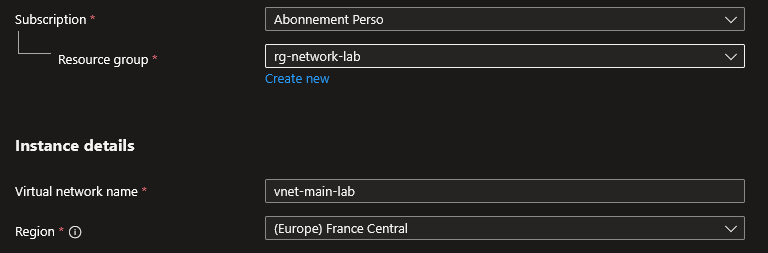
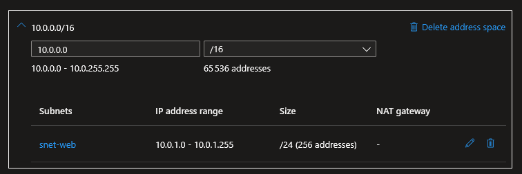
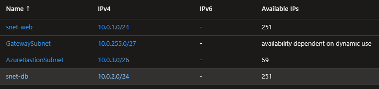
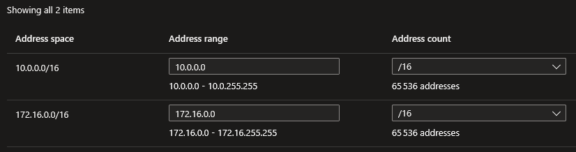

## Introduction

Cette procédure détaille la création et la configuration d'un Réseau Virtuel (VNet) et de ses sous-réseaux (Subnets) dans Azure. Le VNet est la fondation de toute architecture cloud : aucune ressource connectée au réseau (VM, Load Balancer, Private Endpoint) ne peut exister sans un VNet. C'est la première brique à poser avant tout déploiement d'infrastructure.

## Contexte et Justification

Contrairement à un réseau physique où vous tirez des câbles et branchez des switchs, le VNet Azure est un réseau privé isolé logiquement dans le cloud. Il est défini par un espace d'adressage IP (ex : 10.0.0.0/16) et découpé en sous-réseaux (subnets) qui servent à segmenter les services.

Le VNet remplit trois fonctions essentielles :

1. **Communication entre ressources** : Les VMs, bases de données et applications dans le même VNet communiquent entre elles sans configuration supplémentaire. Le routage est automatique entre les subnets d'un même VNet.
2. **Isolation et segmentation** : Chaque subnet peut avoir ses propres règles de sécurité (NSG), ses propres routes (UDR) et ses propres délégations. Le subnet snet-web peut autoriser le trafic HTTP depuis Internet tandis que le subnet snet-db n'accepte que le trafic depuis snet-web.
3. **Connectivité hybride** : Le VNet peut être connecté à votre réseau d'entreprise local via un VPN Site-to-Site, un VPN Point-to-Site ou ExpressRoute. Il peut aussi être connecté à d'autres VNets Azure via le Peering.

## Concepts Clés

**VNet (Virtual Network) :** Un réseau privé isolé dans Azure, défini par un ou plusieurs espaces d'adressage (address spaces) en notation CIDR. Un VNet est régional : il existe dans une seule région Azure. Les ressources à l'intérieur d'un VNet communiquent entre elles par défaut, y compris entre subnets différents (le routage intra-VNet est automatique).

**Subnet (Sous-réseau) :** Un segment du VNet avec sa propre plage d'adresses (qui doit être contenue dans l'address space du VNet). Chaque subnet peut avoir un NSG associé, une route table (UDR), et des service endpoints ou delegations. Une ressource réseau (VM, NIC, Private Endpoint) est déployée dans exactement un subnet.

**CIDR (Classless Inter-Domain Routing) :** La notation utilisée pour définir les plages d'adresses IP :

| CIDR | Adresses totales | Adresses utilisables | Usage typique |
|------|------------------|----------------------|---------------|
| /16 | 65 536 | 65 531 | VNet entier |
| /24 | 256 | 251 | Subnet standard |
| /26 | 64 | 59 | Petit subnet (Bastion) |
| /27 | 32 | 27 | GatewaySubnet |

<div class="callout callout-note">

Azure réserve 5 adresses IP par subnet : les 4 premières et la dernière. Un /24 (256 adresses) n'offre donc que 251 adresses utilisables. Un /26 (64 adresses) n'en offre que 59.

</div>

**Adresses réservées Azure (dans chaque subnet) :**

- x.x.x.0 : Adresse réseau
- x.x.x.1 : Passerelle par défaut Azure
- x.x.x.2, x.x.x.3 : DNS Azure
- x.x.x.255 : Broadcast (pour un /24)

**Subnets spéciaux :** Certains services Azure exigent des subnets avec des noms et tailles spécifiques :

- **GatewaySubnet** : Requis pour les VPN Gateways et ExpressRoute. Taille minimale /27 (recommandé /27). Le nom doit être exactement GatewaySubnet.
- **AzureBastionSubnet** : Requis pour Azure Bastion. Taille minimale /26. Le nom doit être exactement AzureBastionSubnet.
- **AzureFirewallSubnet** : Requis pour Azure Firewall. Taille minimale /26.

**Subnet Delegation :** Permet de dédier un subnet à un service Azure PaaS spécifique (ex : App Service, Azure SQL Managed Instance, Container Instances). Un subnet délégué ne peut contenir que des ressources du service désigné.

**Service Endpoints :** Permettent à un subnet d'accéder directement à un service PaaS (Storage, SQL, Key Vault) via le backbone Azure, sans passer par Internet. Le trafic reste privé mais le service garde son IP publique. Moins sécurisé qu'un Private Endpoint, mais plus simple et gratuit.

**DNS :** Par défaut, un VNet utilise les serveurs DNS Azure (168.63.129.16). Vous pouvez configurer des serveurs DNS personnalisés (ex : votre AD DS on-premises) dans les paramètres du VNet. Attention : le changement de DNS nécessite un redémarrage des VMs.

## Prérequis

- Un Groupe de Ressources existant (ex : rg-network-lab).
- Un plan d'adressage IP défini (nous utiliserons 10.0.0.0/16 pour cette procédure).
- Le rôle **Network Contributor** (minimum) sur le Resource Group pour créer et modifier des VNets.
- Vérifier que les plages IP choisies ne chevauchent pas celles de vos autres VNets ou de votre réseau on-premises (si une connectivité hybride est prévue).

## Méthode 1 : Configuration via Portail Azure

### Créer le Réseau Virtuel avec un Premier Subnet

1. Dans la barre de recherche du portail, tapez **"Virtual networks"** et sélectionnez le service.
2. Cliquez sur **"+ Create"**.
3. Onglet **"Basics"** :
   - **Subscription** : Sélectionnez votre abonnement.
   - **Resource group** : rg-network-lab.
   - **Virtual network name** : vnet-main-lab.
   - **Region** : France Central.



<p class="figure-caption"><b>Figure 1</b> · Créer le Réseau Virtuel avec un Premier Subnet</p>

4. Cliquez sur **"Next: Security"** (laissez les valeurs par défaut).
5. Cliquez sur **"Next: IP Addresses"**.
6. Onglet **"IP Addresses"** :
   - **IPv4 address space** : Vérifiez que 10.0.0.0/16 est présent (sinon, modifiez).
   - Supprimez le subnet default créé automatiquement (cliquez dessus \> **"Delete"**).
   - Cliquez sur **"+ Add a subnet"** :
     - **Subnet name** : snet-web
     - **Starting address** : 10.0.1.0
     - **Subnet size** : /24 (256 addresses)
     - Cliquez sur **"Add"**.



<p class="figure-caption"><b>Figure 2</b> · Créer le Réseau Virtuel avec un Premier Subnet</p>

7. Cliquez sur **"Review + create"** puis **"Create"**.

### Ajouter des Subnets Supplémentaires

1. Allez dans la ressource vnet-main-lab.
2. Menu gauche \> **"Subnets"**.
3. Cliquez sur **"+ Subnet"**.
4. Pour le subnet base de données :
   - **Name** : snet-db
   - **Subnet address range** : 10.0.2.0/24
   - **Network security group** : Aucun (on l'ajoutera plus tard).
   - Cliquez sur **"Save"**.
5. Répétez pour le subnet Bastion :
   - **Subnet purpose :** Azure Bastion
   - **Name** : AzureBastionSubnet (nom exact obligatoire)
   - **Subnet address range** : 10.0.3.0/26
   - Cliquez sur **"Save"**.
6. Répétez pour le subnet Gateway (pour un futur VPN) :
   - **Subnet purpose :** Virtual Network Gateway
   - **Name** : GatewaySubnet (nom exact obligatoire)
   - **Subnet address range** : 10.0.255.0/27
   - Cliquez sur **"Save"**.

<div class="callout callout-note">

Votre VNet 10.0.0.0/16 contient maintenant 4 subnets : snet-web (/24), snet-db (/24), AzureBastionSubnet (/26), GatewaySubnet (/27). Il reste énormément d'espace libre pour de futurs subnets.

</div>



<p class="figure-caption"><b>Figure 3</b> · Ajouter des Subnets Supplémentaires</p>

### Ajouter un Espace d'Adressage Supplémentaire

Si vous avez besoin de plus d'adresses (rare avec un /16, mais courant si vous avez commencé avec un /24) :

1. Dans vnet-main-lab \> Menu gauche \> **"Address space"**.
2. Ajoutez une nouvelle plage : 172.16.0.0/16.
3. Cliquez sur **"Save"**.



<p class="figure-caption"><b>Figure 4</b> · Ajouter un Espace d'Adressage Supplémentaire</p>

<div class="callout callout-note">

Vous pouvez maintenant créer des subnets dans la plage 172.16.x.x en plus de la plage 10.0.x.x.

</div>

## Méthode 2 : Configuration via PowerShell

### Créer le VNet avec un Subnet

1. Créer les variables :

```powershell
$rgName = "rg-network-lab"
$loc = "FranceCentral"
```

2. Préparer la configuration du subnet :

```powershell
$subnetWeb = New-AzVirtualNetworkSubnetConfig `
    -Name "snet-web" `
    -AddressPrefix "10.0.1.0/24"
```

3. Créer le VNet avec le subnet :

```powershell
$vnet = New-AzVirtualNetwork `
    -ResourceGroupName $rgName `
    -Name "vnet-main-lab" `
    -Location $loc `
    -AddressPrefix "10.0.0.0/16" `
    -Subnet $subnetWeb
```

### Ajouter des Subnets Supplémentaires

1. Récupérer le VNet existant :

```powershell
$vnet = Get-AzVirtualNetwork -ResourceGroupName $rgName -Name "vnet-main-lab"
```

2. Ajouter le subnet base de données :

```powershell
Add-AzVirtualNetworkSubnetConfig `
    -Name "snet-db" `
    -AddressPrefix "10.0.2.0/24" `
    -VirtualNetwork $vnet
```

3. Ajouter le subnet Bastion :

```powershell
Add-AzVirtualNetworkSubnetConfig `
    -Name "AzureBastionSubnet" `
    -AddressPrefix "10.0.3.0/26" `
    -VirtualNetwork $vnet
```

4. Ajouter le subnet Gateway :

```powershell
Add-AzVirtualNetworkSubnetConfig `
    -Name "GatewaySubnet" `
    -AddressPrefix "10.0.255.0/27" `
    -VirtualNetwork $vnet
```

5. **Important** : appliquer les changements (écriture vers Azure) :

```powershell
$vnet | Set-AzVirtualNetwork
```

<div class="callout callout-note">

En PowerShell, `Add-AzVirtualNetworkSubnetConfig` modifie l'objet en mémoire uniquement. Les changements ne sont effectifs qu'après `Set-AzVirtualNetwork`. C'est un piège classique.

</div>

6. Ajouter un Service Endpoint :

```powershell
$vnet = Get-AzVirtualNetwork -ResourceGroupName $rgName -Name "vnet-main-lab"
Set-AzVirtualNetworkSubnetConfig `
    -Name "snet-db" `
    -AddressPrefix "10.0.2.0/24" `
    -VirtualNetwork $vnet `
    -ServiceEndpoint "Microsoft.Storage","Microsoft.Sql"
$vnet | Set-AzVirtualNetwork
```

### Lister les Subnets

1. Tous les subnets du VNet :

```powershell
Get-AzVirtualNetwork -ResourceGroupName $rgName -Name "vnet-main-lab" |
    Select-Object -ExpandProperty Subnets |
    Select-Object Name, AddressPrefix |
    Format-Table
```

2. Détail d'un subnet spécifique :

```powershell
Get-AzVirtualNetworkSubnetConfig `
    -Name "snet-web" `
    -VirtualNetwork (Get-AzVirtualNetwork -ResourceGroupName $rgName -Name "vnet-main-lab")
```

### Modifier un Subnet

```powershell
$vnet = Get-AzVirtualNetwork -ResourceGroupName $rgName -Name "vnet-main-lab"
```

1. Modifier la plage (le subnet doit être vide) :

```powershell
Set-AzVirtualNetworkSubnetConfig `
    -Name "snet-web" `
    -AddressPrefix "10.0.1.0/25" `
    -VirtualNetwork $vnet
$vnet | Set-AzVirtualNetwork
```

2. Associer un NSG :

```powershell
$nsg = Get-AzNetworkSecurityGroup -ResourceGroupName $rgName -Name "nsg-web"
Set-AzVirtualNetworkSubnetConfig `
    -Name "snet-web" `
    -AddressPrefix "10.0.1.0/25" `
    -VirtualNetwork $vnet `
    -NetworkSecurityGroup $nsg
$vnet | Set-AzVirtualNetwork
```

### Supprimer un Subnet

```powershell
$vnet = Get-AzVirtualNetwork -ResourceGroupName $rgName -Name "vnet-main-lab"
Remove-AzVirtualNetworkSubnetConfig -Name "snet-db" -VirtualNetwork $vnet
$vnet | Set-AzVirtualNetwork
```

## Vérifications

**VNet créé** : Dans le portail \> **"Virtual networks"**, vnet-main-lab apparaît avec la région France Central et l'address space 10.0.0.0/16.

**Subnets présents** : Dans vnet-main-lab \> **"Subnets"**, les 4 subnets apparaissent avec les bonnes plages :

- snet-web : 10.0.1.0/24 (251 available)
- snet-db : 10.0.2.0/24 (251 available)
- AzureBastionSubnet : 10.0.3.0/26 (59 available)
- GatewaySubnet : 10.0.255.0/27 (27 available)

**Pas de chevauchement** : Aucun des subnets ne se chevauche. Chaque plage est distincte.

**Connectivité intra-VNet** : Si vous déployez une VM dans snet-web et une VM dans snet-db, elles peuvent se pinger entre elles sans configuration supplémentaire (à condition que le NSG/firewall le permette).

**PowerShell** : `Get-AzVirtualNetwork -ResourceGroupName rg-network-lab -Name vnet-main-lab` retourne les informations avec `ProvisioningState : Succeeded`.

## Dépannage

**"Subnet is not contained in address space" :** La plage du subnet (ex : 192.168.1.0/24) n'est pas contenue dans l'address space du VNet (ex : 10.0.0.0/16). Vérifiez que le subnet est mathématiquement dans la plage du VNet.

**"Subnet is in use and cannot be deleted" :** Le subnet contient des ressources (VMs, NICs, Private Endpoints, delegations). Supprimez toutes les ressources du subnet avant de le supprimer. Pour trouver ce qui reste : dans le portail, cliquez sur le subnet \> section **"Connected devices"**.

**"Address space overlaps with already peered VNet" :** Vous essayez d'ajouter un address space qui chevauche celui d'un VNet peered. Supprimez le peering, modifiez l'address space, et recréez le peering. Ou choisissez une plage non chevauchante.

**"InUseSubnetCannotBeUpdated" :** Vous tentez de modifier la plage d'adresses d'un subnet qui contient des ressources. Un subnet occupé ne peut pas être redimensionné. Déplacez les ressources, modifiez le subnet, puis redéployez.

**Les VMs ne communiquent pas entre subnets du même VNet :** Le routage intra-VNet est automatique, donc le problème vient du NSG ou du firewall OS. Vérifiez le NSG associé au subnet de la VM destination : autorise-t-il le trafic depuis la plage source ? Vérifiez aussi le pare-feu interne de la VM (Windows Firewall, iptables) qui peut bloquer ICMP (ping) par défaut.

**Changement de DNS custom non pris en compte :** Après avoir modifié les DNS du VNet (dans **"DNS servers"**), les VMs existantes conservent l'ancien DNS. Redémarrez les VMs ou exécutez `sudo dhclient -r && sudo dhclient` (Linux) ou `ipconfig /renew` (Windows) pour forcer le renouvellement.

**"SubnetHasDelegations" lors de la suppression :** Le subnet a une delegation active (ex : vers Microsoft.Web/serverFarms). Retirez la delegation avant de supprimer le subnet.

## Conseils et Bonnes Pratiques

**Planifiez votre adressage IP avant de créer quoi que ce soit.** Dessinez un schéma avec tous vos VNets, subnets et plages. Prévoyez la connectivité hybride (VPN vers on-premises) et le peering entre VNets. Un /16 par VNet vous donne 65 536 adresses, ce qui est largement suffisant pour la plupart des scénarios. Ne commencez jamais avec un /24 pour le VNet entier, vous manquerez d'espace.

**Réservez de l'espace pour les subnets spéciaux.** Prévoyez dès le départ des plages pour GatewaySubnet (/27), AzureBastionSubnet (/26) et AzureFirewallSubnet (/26), même si vous ne les déployez pas tout de suite. Placez-les en fin de plage (ex : 10.0.255.0/27 pour le Gateway) pour garder les plages basses contiguës pour vos subnets applicatifs.

**Un subnet = un rôle.** Ne mélangez pas les serveurs web et les bases de données dans le même subnet. Séparez-les pour pouvoir appliquer des NSG différents. Pattern typique : snet-web (front-end), snet-app (middle-tier), snet-db (back-end), snet-mgmt (administration).

**Associez un NSG à chaque subnet dès la création.** Un subnet sans NSG est ouvert par défaut (tout le trafic intra-VNet est autorisé). Même si le NSG est permissif au début, associez-le. Vous pourrez le durcir progressivement sans devoir reconfigurer l'association.

**Utilisez les Service Endpoints pour les services PaaS courants.** Activez les Service Endpoints pour Microsoft.Storage, Microsoft.Sql et Microsoft.KeyVault sur les subnets qui en ont besoin. C'est gratuit et ça sécurise le trafic sans la complexité d'un Private Endpoint. Pour les scénarios plus sécurisés, passez aux Private Endpoints.

**Évitez les plages RFC 1918 utilisées par votre réseau local.** Si vos bureaux utilisent 192.168.x.x, utilisez 10.x.x.x dans Azure. Si vos bureaux utilisent 10.0.x.x, utilisez 10.1.x.x ou 172.16.x.x dans Azure. Le chevauchement rend le VPN et le peering impossibles.

## Procédures Liées

- [Gestion de la Sécurité Réseau (NSG)](/procedures/azure/gestion-de-la-securite-reseau-nsg) *(Créer et associer des NSG aux subnets pour filtrer le trafic)*
- [Mise en Place d'un Peering (Appairage VNet)](/procedures/azure/mise-en-place-dun-peering-appairage-vnet) *(Connecter deux VNets entre eux via le backbone Azure)*
- [Déploiement d'Azure Bastion](/procedures/azure/deploiement-dazure-bastion) *(Déployer Bastion dans le AzureBastionSubnet pour l'accès sécurisé aux VMs)*
- [Sécurisation PaaS via Private Endpoint](/procedures/azure/securisation-paas-via-private-endpoint) *(Projeter un service PaaS dans un subnet via une IP privée)*
- [Configuration d'un Load Balancer](/procedures/azure/configuration-dun-load-balancer) *(Distribuer le trafic entre des VMs dans un subnet)*
- [Création d'un Groupe de Ressources](/procedures/azure/creation-dun-groupe-de-ressources) *(Le RG est créé avant le VNet)*
