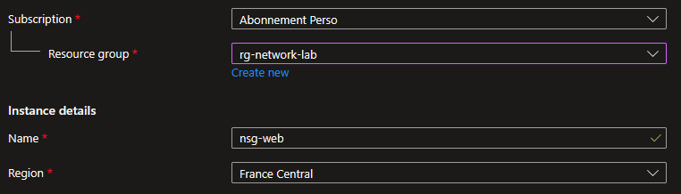
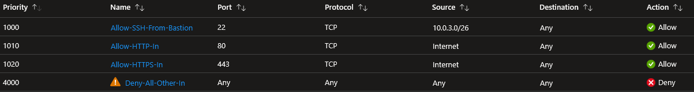
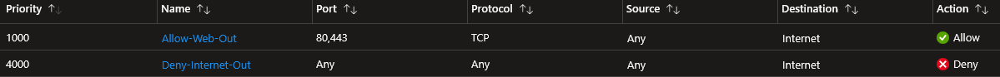
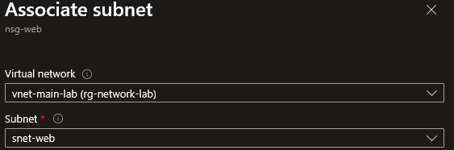
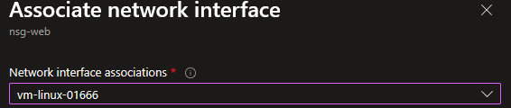
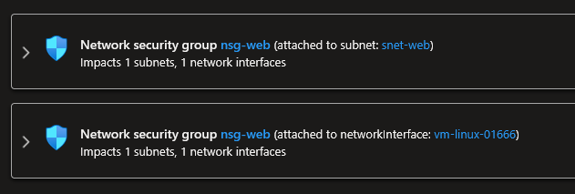

## Introduction

Cette procédure détaille la création et la configuration d'un Network Security Group (NSG) dans Azure. Le NSG est le pare-feu de niveau 4 (couche Transport) qui filtre le trafic réseau entrant et sortant vers les ressources Azure. C'est l'outil principal pour contrôler qui peut communiquer avec quoi, sur quels ports et protocoles.

## Contexte et Justification

Par défaut, les ressources déployées dans un même VNet peuvent communiquer librement entre elles. Une VM dans snet-web peut accéder à une VM dans snet-db sur n'importe quel port. C'est un problème de sécurité : si la VM web est compromise, l'attaquant a un accès direct à la base de données.

Le NSG résout ce problème en définissant des règles explicites :

- Le subnet snet-web autorise le trafic HTTP (80) et HTTPS (443) depuis Internet.
- Le subnet snet-db autorise le trafic SQL (1433) uniquement depuis snet-web, et rien d'autre.
- Le trafic SSH (22) et RDP (3389) est interdit depuis Internet (on utilise Azure Bastion à la place).

Sans NSG, votre architecture cloud est un réseau plat sans segmentation. Avec des NSG bien configurés, chaque tier (web, app, db) est isolé et ne peut communiquer qu'avec ce qui est explicitement autorisé.

## Concepts Clés

**NSG (Network Security Group) :** Un ensemble de règles de sécurité qui filtrent le trafic réseau. Chaque règle autorise ou refuse le trafic selon une combinaison de source, destination, port, protocole et direction. Un NSG est une ressource Azure régionale associable à un subnet ou à une NIC (carte réseau).

**Règle de sécurité :** Une instruction composée de :

- **Priority** : Nombre entre 100 et 4096. Plus le nombre est petit, plus la règle est prioritaire. La première règle qui matche est appliquée, les suivantes sont ignorées.
- **Source / Destination** : Une adresse IP, une plage CIDR, un Service Tag ou un ASG.
- **Port** : Un numéro de port ou une plage (ex : 80, 443, 1024-65535, \*).
- **Protocol** : TCP, UDP, ICMP ou Any.
- **Action** : Allow ou Deny.
- **Direction** : Inbound (entrant) ou Outbound (sortant).

**Règles par défaut (Default Rules) :** Chaque NSG est créé avec 3 règles inbound et 3 règles outbound par défaut. Elles ne peuvent pas être supprimées mais peuvent être surchargées par des règles ayant un numéro de priorité plus petit (donc évaluées avant) :

Inbound par défaut :

| Priorité | Nom | Source | Destination | Action |
|----------|-------------------------------|-------------------|----------------|--------|
| 65000 | AllowVnetInBound | VirtualNetwork | VirtualNetwork | Allow |
| 65001 | AllowAzureLoadBalancerInBound | AzureLoadBalancer | Any | Allow |
| 65500 | DenyAllInBound | Any | Any | Deny |

Outbound par défaut :

| Priorité | Nom | Source | Destination | Action |
|----------|-----------------------|----------------|-----------------|--------|
|    65000     | AllowVnetOutBound     | VirtualNetwork | VirtualNetwork  | Allow      |
|    65001     | AllowInternetOutBound | Any            | Internet        | Allow      |
|    65500     | DenyAllOutBound       | Any            | Any             | Deny       |

<div class="callout callout-note">

Par défaut, tout le trafic inbound depuis Internet est REFUSÉ (DenyAllInBound à 65500). Et tout le trafic outbound vers Internet est AUTORISÉ (AllowInternetOutBound à 65001).

</div>

**NSG Stateful :** Les NSG sont stateful (à état). Si vous autorisez le trafic entrant sur le port 80, la réponse sortante correspondante est automatiquement autorisée sans règle outbound explicite. Vous n'avez pas besoin de créer une règle outbound pour les réponses aux connexions entrantes autorisées.

**Service Tags :** Des alias gérés par Microsoft qui représentent des groupes d'adresses IP. Ils évitent de gérer manuellement des listes d'IP :

- **Internet** : Tout ce qui n'est pas dans un espace d'adressage privé.
- **VirtualNetwork** : L'espace d'adressage du VNet + les VNets peerés + les réseaux on-premises connectés.
- **AzureLoadBalancer** : L'IP de l'infrastructure de Load Balancing Azure.
- **AzureCloud** : Toutes les IP publiques des datacenters Azure.
- **Storage**, **Sql**, **AzureKeyVault** : Les IP des services PaaS spécifiques.

**Application Security Group (ASG) :** Un tag logique que vous appliquez aux NICs des VMs pour les regrouper par rôle (ex : ASG "WebServers", ASG "DbServers"). Vous pouvez ensuite utiliser l'ASG comme source ou destination dans une règle NSG, au lieu d'adresses IP. Utile quand les IPs changent souvent ou quand vous avez beaucoup de VMs du même rôle.

**NSG au niveau Subnet vs NIC :**

- **Subnet** : Le NSG s'applique à toutes les ressources du subnet. C'est la méthode recommandée pour la gestion centralisée.
- **NIC** : Le NSG s'applique à une seule VM. Utile pour des exceptions individuelles.
- Si un NSG est associé au subnet ET à la NIC, les deux sont évalués. Le trafic inbound passe d'abord le NSG du subnet, puis celui de la NIC. Le trafic outbound passe d'abord le NSG de la NIC, puis celui du subnet.

**Ordre d'évaluation du trafic inbound :** Internet → NSG Subnet → NSG NIC → VM

**Ordre d'évaluation du trafic outbound :** VM → NSG NIC → NSG Subnet → Internet

## Prérequis

- Un VNet avec au moins un subnet (ex : vnet-main-lab avec snet-web).
- Le rôle **Network Contributor** (minimum) pour créer et modifier des NSG.
- (Optionnel) Une VM déployée pour tester l'impact des règles.

## Méthode 1 : Configuration via Portail Azure

### Créer un NSG

1. Recherchez **"Network security groups"** et cliquez sur **"+ Create"**.
2. **Resource group** : rg-network-lab.
3. **Name** : nsg-web.
4. **Region** : France Central (même région que le VNet).



<p class="figure-caption"><b>Figure 1</b> · Créer un NSG</p>

5. Cliquez sur **"Review + create"** puis **"Create"**.

### Créer des Règles Inbound (Trafic Entrant)

1. Allez dans la ressource nsg-web \> Menu gauche \> **"Inbound security rules"** \> **"+ Add"**.
2. **Règle 1 : Autoriser HTTP depuis Internet :**

| Champ | Valeur |
|------------------|---------------|
|       Source       | Service Tag   |
| Source service tag | Internet      |
| Source port ranges | \*            |
|    Destination     | Any           |
|      Service       | HTTP          |
|       Action       | Allow         |
|      Priority      | 1010          |
|        Name        | Allow-HTTP-In |

3. **Règle 2 : Autoriser HTTPS depuis Internet :**

| Champ | Valeur |
|------------------|----------------|
|       Source       | Service Tag    |
| Source service tag | Internet       |
|    Destination     | Any            |
|      Service       | HTTPS          |
|       Action       | Allow          |
|      Priority      | 1020           |
|        Name        | Allow-HTTPS-In |

4. **Règle 3 : Autoriser SSH uniquement depuis Azure Bastion :**

| Champ | Valeur |
|-------------------|-------------------------------------------|
|       Source        | IP Addresses                              |
| Source IP addresses | 10.0.3.0/26 (plage du AzureBastionSubnet) |
|     Destination     | Any                                       |
|       Service       | SSH                                       |
|       Action        | Allow                                     |
|      Priority       | 1000                                      |
|        Name         | Allow-SSH-From-Bastion                    |

5. **Règle 4 : Deny explicite pour tout le reste (optionnel mais recommandé) :**

| Champ | Valeur |
|-----------------------|-------------------|
|         Source          | Any               |
|       Destination       | Any               |
|         Service         | Custom            |
| Destination port ranges | \*                |
|        Protocol         | Any               |
|         Action          | Deny              |
|        Priority         | 4000              |
|          Name           | Deny-All-Other-In |

<div class="callout callout-note">

Cette règle est redondante avec la règle par défaut DenyAllInBound (65500), mais elle est utile pour la lisibilité : quiconque consulte le NSG voit explicitement que tout le reste est refusé.

</div>



<p class="figure-caption"><b>Figure 2</b> · Créer des Règles Inbound (Trafic Entrant)</p>

### Créer des Règles Outbound (Trafic Sortant)

1. Menu gauche \> **"Outbound security rules"** \> **"+ Add"**.
2. **Règle 1 : Autoriser le web sortant (HTTP/HTTPS) :**

| Champ | Valeur |
|-----------------------|---------------|
|         Source          | Any           |
|       Destination       | Service Tag   |
| Destination service tag | Internet      |
|         Service         | Custom        |
| Destination port ranges | 80,443        |
|        Protocol         | TCP           |
|         Action          | Allow         |
|        Priority         | 1000          |
|          Name           | Allow-Web-Out |

3. **Règle 2 : Bloquer tout le reste vers Internet :**

| Champ | Valeur |
|-----------------------|-------------------|
|         Source          | Any               |
|       Destination       | Service Tag       |
| Destination service tag | Internet          |
|         Service         | Custom            |
| Destination port ranges | \*                |
|        Protocol         | Any               |
|         Action          | Deny              |
|        Priority         | 4000              |
|          Name           | Deny-Internet-Out |

<div class="callout callout-note">

Les VMs peuvent accéder au web (ports 80/443) pour les mises à jour, mais ne peuvent pas envoyer de trafic sur d'autres ports (ex : bloquer l'exfiltration de données, le crypto-minage sortant).

</div>



<p class="figure-caption"><b>Figure 3</b> · Créer des Règles Outbound (Trafic Sortant)</p>

### Associer le NSG à un Subnet

1. Dans nsg-web \> Menu gauche \> **"Subnets"**.
2. Cliquez sur **"+ Associate"**.
3. **Virtual network** : vnet-main-lab.
4. **Subnet** : snet-web.



<p class="figure-caption"><b>Figure 4</b> · Associer le NSG à un Subnet</p>

5. Cliquez sur **"OK"**.

<div class="callout callout-note">

Toutes les VMs actuelles et futures de snet-web sont désormais protégées par nsg-web.

</div>

### Associer le NSG à une NIC

Si vous avez besoin d'une exception pour une VM spécifique :

1. Dans nsg-web (ou un autre NSG) \> Menu gauche \> **"Network interfaces"**.
2. Cliquez sur **"+ Associate"**.
3. Sélectionnez la NIC de la VM.



<p class="figure-caption"><b>Figure 5</b> · Associer le NSG à une NIC</p>

4. Cliquez sur **"OK"**.

<div class="callout callout-note">

À utiliser avec parcimonie. Préférez toujours l'association au subnet.

</div>

### Consulter les Règles Effectives (Effective Security Rules)

Pour voir l'ensemble des règles qui s'appliquent réellement à une VM (NSG subnet + NSG NIC + règles par défaut) :

1. Allez sur la VM \> Menu gauche \> **"Networking"**.
2. Onglet **"Network settings"** \> **"Effective security rules"**.
3. Vous voyez toutes les règles triées par priorité, avec la source (NSG subnet ou NSG NIC).



<p class="figure-caption"><b>Figure 6</b> · Consulter les Règles Effectives (Effective Security Rules)</p>

## Méthode 2 : Configuration via PowerShell

### Créer un NSG avec des Règles

```powershell
$rgName = "rg-network-lab"
```

1. Préparer les règles en mémoire :

```powershell
$ruleHTTP = New-AzNetworkSecurityRuleConfig `
    -Name "Allow-HTTP-In" `
    -Description "Autoriser HTTP depuis Internet" `
    -Access Allow `
    -Protocol Tcp `
    -Direction Inbound `
    -Priority 1010 `
    -SourceAddressPrefix Internet `
    -SourcePortRange * `
    -DestinationAddressPrefix * `
    -DestinationPortRange 80
$ruleHTTPS = New-AzNetworkSecurityRuleConfig `
    -Name "Allow-HTTPS-In" `
    -Description "Autoriser HTTPS depuis Internet" `
    -Access Allow `
    -Protocol Tcp `
    -Direction Inbound `
    -Priority 1020 `
    -SourceAddressPrefix Internet `
    -SourcePortRange * `
    -DestinationAddressPrefix * `
    -DestinationPortRange 443
$ruleSSH = New-AzNetworkSecurityRuleConfig `
    -Name "Allow-SSH-From-Bastion" `
    -Description "SSH depuis Bastion uniquement" `
    -Access Allow `
    -Protocol Tcp `
    -Direction Inbound `
    -Priority 1000 `
    -SourceAddressPrefix "10.0.3.0/26" `
    -SourcePortRange * `
    -DestinationAddressPrefix * `
    -DestinationPortRange 22
```

2. Créer le NSG avec toutes les règles :

```powershell
$nsg = New-AzNetworkSecurityGroup `
    -ResourceGroupName $rgName `
    -Location "FranceCentral" `
    -Name "nsg-web" `
    -SecurityRules $ruleHTTP, $ruleHTTPS, $ruleSSH
```

### Ajouter des Règles à un NSG Existant

```powershell
$nsg = Get-AzNetworkSecurityGroup -ResourceGroupName $rgName -Name "nsg-web"
Add-AzNetworkSecurityRuleConfig `
    -NetworkSecurityGroup $nsg `
    -Name "Deny-All-Other-In" `
    -Access Deny `
    -Protocol * `
    -Direction Inbound `
    -Priority 4000 `
    -SourceAddressPrefix * `
    -SourcePortRange * `
    -DestinationAddressPrefix * `
    -DestinationPortRange *
$nsg | Set-AzNetworkSecurityGroup
```

<div class="callout callout-note">

Comme pour les subnets, la modification en PowerShell se fait en mémoire puis doit être poussée vers Azure avec `Set-AzNetworkSecurityGroup`.

</div>

### Associer à un Subnet

```powershell
$vnet = Get-AzVirtualNetwork -ResourceGroupName $rgName -Name "vnet-main-lab"
$nsg = Get-AzNetworkSecurityGroup -ResourceGroupName $rgName -Name "nsg-web"
Set-AzVirtualNetworkSubnetConfig `
    -Name "snet-web" `
    -VirtualNetwork $vnet `
    -AddressPrefix "10.0.1.0/24" `
    -NetworkSecurityGroup $nsg
$vnet | Set-AzVirtualNetwork
```

### Associer à une NIC

```powershell
$nic = Get-AzNetworkInterface -ResourceGroupName $rgName -Name "vm-linux-01666"
$nsg = Get-AzNetworkSecurityGroup -ResourceGroupName $rgName -Name "nsg-web"
$nic.NetworkSecurityGroup = $nsg
$nic | Set-AzNetworkInterface
```

### Lister les Règles

1. Règles custom uniquement :

```powershell
Get-AzNetworkSecurityGroup -ResourceGroupName $rgName -Name "nsg-web" |
    Select-Object -ExpandProperty SecurityRules |
    Select-Object Name, Priority, Direction, Access, Protocol, `
    SourceAddressPrefix, DestinationPortRange |
    Sort-Object Priority |
    Format-Table
```

2. Règles par défaut :

```powershell
Get-AzNetworkSecurityGroup -ResourceGroupName $rgName -Name "nsg-web" |
    Select-Object -ExpandProperty DefaultSecurityRules |
    Select-Object Name, Priority, Direction, Access |
    Format-Table
```

### Supprimer une Règle

```powershell
$nsg = Get-AzNetworkSecurityGroup -ResourceGroupName $rgName -Name "nsg-web"
Remove-AzNetworkSecurityRuleConfig -Name "Deny-All-Other-In" -NetworkSecurityGroup $nsg
$nsg | Set-AzNetworkSecurityGroup
```

## Vérifications

**NSG créé** : Dans le portail \> **"Network security groups"**, nsg-web apparaît dans la bonne région.

**Règles custom** : Dans nsg-web \> **"Inbound security rules"**, les 4 règles apparaissent triées par priorité : Allow-SSH-From-Bastion (1000), Allow-HTTP-In (1010), Allow-HTTPS-In (1020), Deny-All-Other-In (4000).

**Association subnet** : Dans nsg-web \> **"Subnets"**, le subnet snet-web est listé. Ou dans le VNet \> **"Subnets"**, la colonne **"Security group"** affiche nsg-web pour snet-web.

**Test HTTP** : Si une VM dans snet-web héberge un serveur web, accédez-y via son IP publique (ou le Load Balancer) sur le port 80. La page doit s'afficher.

**Test SSH bloqué depuis Internet** : Tentez un SSH depuis votre PC vers l'IP publique de la VM. La connexion doit échouer (timeout) (bloquée par le NSG, seul Bastion est autorisé).

**Effective Security Rules** : Sur la VM \> **"Networking"**, vérifiez que les règles effectives correspondent à ce que vous attendez.

## Dépannage

**La VM n'est plus accessible après association du NSG :** Le NSG bloque probablement le trafic que vous utilisez (SSH, RDP, HTTP). Vérifiez les règles inbound. Assurez-vous que vous avez une règle Allow pour le port dont vous avez besoin. Si vous utilisez Bastion, vérifiez que la règle autorise le SSH/RDP depuis la plage du AzureBastionSubnet.

**"Rule Priority Conflict" :** Vous essayez de créer une règle avec une priorité déjà utilisée par une autre règle dans le même NSG et la même direction. Changez le numéro de priorité.

**Le trafic est autorisé alors qu'il devrait être bloqué :** Vérifiez l'ordre des priorités. Une règle Allow avec un numéro de priorité plus petit (ex : 100) l'emporte sur une règle Deny avec un numéro plus grand (ex : 200). Rappelez-vous aussi que lorsqu'un NSG est associé au subnet ET à la NIC, le trafic doit être autorisé par les deux.

**Le trafic entre deux subnets du même VNet est bloqué :** La règle par défaut AllowVnetInBound (65000) autorise ce trafic. Si ça ne passe pas, vous avez probablement une règle Deny custom avec un numéro de priorité inférieur à 65000 qui bloque le trafic. Vérifiez aussi le pare-feu de l'OS (Windows Firewall / iptables).

**Les VMs ne peuvent plus faire de mises à jour (apt-get / yum) :** Vous avez probablement ajouté une règle Deny outbound vers Internet qui bloque le trafic sortant. Ajoutez une règle Allow outbound vers Internet sur les ports 80 et 443 avec un numéro de priorité plus petit que votre règle Deny.

**Le Load Balancer health probe échoue :** Le NSG bloque le trafic du Load Balancer. Vérifiez que la règle par défaut AllowAzureLoadBalancerInBound (65001) n'est pas surchargée par une règle Deny custom. Ou ajoutez une règle explicite Allow avec le Service Tag AzureLoadBalancer.

**NSG Flow Logs non visibles :** Les NSG Flow Logs doivent être activés séparément (via Network Watcher). Le NSG seul ne journalise pas le trafic par défaut.

## Conseils et Bonnes Pratiques

**Associez les NSG aux subnets, pas aux NICs.** L'association au subnet est plus simple à gérer et moins sujette aux erreurs. Toutes les VMs du subnet héritent automatiquement des mêmes règles. N'utilisez le NSG au niveau NIC que pour des exceptions ponctuelles.

**Ne laissez jamais le port 22 (SSH) ou 3389 (RDP) ouvert à Internet.** La source `*` ou Internet sur ces ports est la première cause de compromission. Utilisez Azure Bastion et autorisez SSH/RDP uniquement depuis la plage du AzureBastionSubnet. Ou utilisez un VPN et autorisez uniquement la plage VPN.

**Adoptez une convention de nommage pour les règles.** Format : `<Action>-<Service>-<Direction>` (ex : Allow-HTTP-In, Deny-SQL-In, Allow-DNS-Out). Évitez les noms génériques comme "Rule1" ou "test".

**Laissez des trous dans les priorités.** Utilisez des incréments de 10 (1000, 1010, 1020...) pour pouvoir insérer des règles entre deux existantes sans tout renuméroter.

**Utilisez les Service Tags plutôt que des adresses IP brutes.** Au lieu de lister toutes les IP du Load Balancer Azure, utilisez le tag AzureLoadBalancer. Au lieu de gérer les IP de votre réseau, utilisez VirtualNetwork. Microsoft met à jour les tags automatiquement.

**Activez les Flow Logs pour le troubleshooting et l'audit.** Via Network Watcher \> **"Flow logs"**, vous pouvez enregistrer tout le trafic (les nouveaux déploiements utilisent les VNet Flow Logs, les NSG Flow Logs ne pouvant plus être créés depuis juin 2025). Indispensable pour diagnostiquer un problème de connectivité ou auditer les accès.

**Créez un NSG dédié pour chaque tier.** nsg-web pour le subnet web (ports 80/443 ouverts), nsg-app pour le subnet application, nsg-db pour le subnet base de données (port 1433 uniquement depuis snet-app). Ne réutilisez pas le même NSG pour des rôles différents.

## Procédures Liées

- [Déploiement d'un Réseau Virtuel](/procedures/azure/deploiement-dun-reseau-virtuel) *(Le VNet et les subnets doivent exister avant de créer et associer un NSG)*
- [Déploiement d'Azure Bastion](/procedures/azure/deploiement-dazure-bastion) *(Bastion remplace l'ouverture des ports SSH/RDP sur Internet, la règle NSG autorise SSH depuis le AzureBastionSubnet)*
- [Configuration d'un Load Balancer](/procedures/azure/configuration-dun-load-balancer) *(Le NSG doit autoriser le trafic du Load Balancer via le Service Tag AzureLoadBalancer et le port de la Health Probe)*
- [Sécurisation PaaS via Private Endpoint](/procedures/azure/securisation-paas-via-private-endpoint) *(Les Private Endpoints nécessitent parfois la désactivation des network policies sur le subnet)*
- Déploiement d'une Machine Virtuelle (Windows et Linux) *(Le NSG est associé au subnet ou à la NIC de la VM pour contrôler son trafic)*
