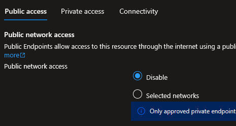
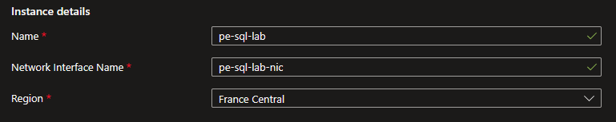
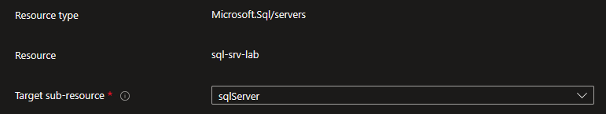
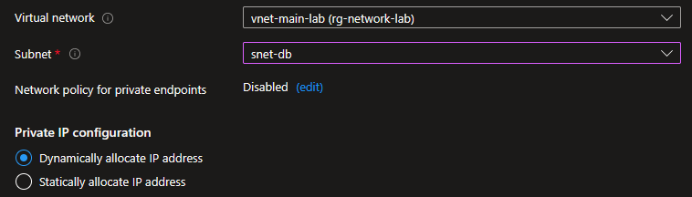
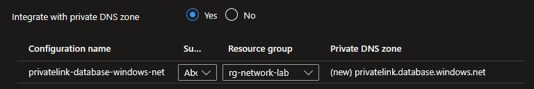
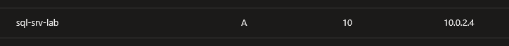
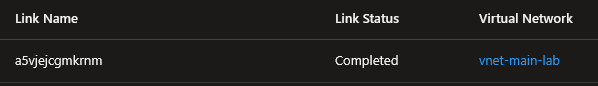
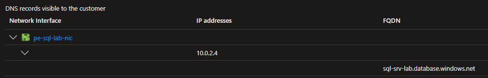

## Introduction

Cette procédure décrit comment sécuriser l'accès à un service Azure PaaS (Storage, SQL Database, Key Vault, etc.) en le rendant accessible uniquement via une adresse IP privée dans votre VNet, au lieu de son endpoint public sur Internet. Le Private Endpoint projette le service PaaS dans votre réseau privé via une interface réseau (NIC) dédiée.

## Contexte et Justification

Par défaut, les services PaaS Azure (Storage Accounts, SQL Databases, Key Vaults, etc.) sont exposés sur Internet via une URL publique (ex : moncompte.blob.core.windows.net → IP publique). Même avec des firewalls et des règles d'accès, le service reste joignable depuis Internet, ce qui expose une surface d'attaque :

- Attaques par force brute sur les credentials.
- Scans de ports et énumération de services.
- Risque DDoS sur l'endpoint public.
- Exfiltration de données si un attaquant obtient une SAS ou une clé d'accès.

Le Private Endpoint résout ce problème en créant une interface réseau privée dans votre subnet. Le service PaaS reçoit une IP privée (ex : 10.0.2.5) et devient accessible uniquement depuis votre VNet (ou les VNets peerés). Combiné avec la désactivation de l'accès public, le service devient invisible depuis Internet.

- **Sans Private Endpoint** : Application (VM) → Internet → moncompte.blob.core.windows.net (IP publique)
- **Avec Private Endpoint** : Application (VM) → Réseau privé Azure → 10.0.2.5 (IP privée dans votre subnet)

## Concepts Clés

**Private Endpoint :** Une interface réseau (NIC) placée dans votre subnet qui fournit une IP privée pour accéder à un service PaaS Azure. Le Private Endpoint est une ressource Azure à part entière avec son propre ID, sa propre IP, et son propre cycle de vie. Il crée un lien privé (Private Link) entre votre VNet et le service PaaS.

**Private Link :** La technologie sous-jacente qui permet de connecter un service PaaS à un VNet via une adresse IP privée. Private Link est le mécanisme, Private Endpoint est l'objet réseau que vous créez.

**Private Link Service Connection :** La connexion logique entre le Private Endpoint et la ressource PaaS cible. Elle peut être auto-approuvée (si vous êtes Owner du service PaaS) ou nécessiter une approbation manuelle (ex : connexion vers un service dans un autre abonnement).

**Sub-resource (Group ID) :** Chaque type de service PaaS a des sub-resources spécifiques. Vous choisissez laquelle exposer via le Private Endpoint :

| Service PaaS | Sub-resources disponibles |
|----------------------------|-----------------------------------------|
|      Storage Account       | blob, file, table, queue, dfs, web      |
|        SQL Database        | sqlServer                               |
|         Key Vault          | vault                                   |
| Azure SQL Managed Instance | managedInstance                         |
|         Cosmos DB          | Sql, MongoDB, Cassandra, Gremlin, Table |
|   App Service / Web App    | sites                                   |

<div class="callout callout-note">

Un Private Endpoint expose une seule sub-resource. Pour accéder au blob ET au file d'un même Storage Account via des IP privées, il faut deux Private Endpoints.

</div>

**Private DNS Zone :** Une zone DNS privée qui résout le nom du service PaaS vers son IP privée au lieu de l'IP publique. C'est la pièce la plus critique et la plus oubliée. Sans elle, votre application résout moncompte.blob.core.windows.net vers l'IP publique et le Private Endpoint ne sert à rien.

Zones DNS privées par service :

| Service | Zone DNS privée |
|--------------|-----------------------------------|
| Blob Storage | privatelink.blob.core.windows.net |
| File Storage | privatelink.file.core.windows.net |
| SQL Database | privatelink.database.windows.net  |
|  Key Vault   | privatelink.vaultcore.azure.net   |
|   Web App    | privatelink.azurewebsites.net     |

**Service Endpoint vs Private Endpoint :**

|  | Service Endpoint | Private Endpoint |
|--------------|------------------------------|----------------------------|
| **IP utilisée** | IP publique du service PaaS | IP privée dans votre subnet |
| **Visibilité Internet** | Le service garde son IP publique | Le service peut désactiver l'accès public |
| **Sécurité** | Filtre par VNet/subnet (le trafic passe par le backbone Azure) | Isolation complète dans le réseau privé |
| **DNS** | Pas de modification DNS | Nécessite une zone DNS privée |
| **Coût** | Gratuit | Payant (par heure + par Go traité) |
| **Complexité** | Simple (1 clic sur le subnet) | Plus complexe (PE + DNS + désactivation de l'accès public) |

<div class="callout callout-note">

Le Service Endpoint est un bon compromis quand la sécurité totale n'est pas requise (environnement de dev). Le Private Endpoint est obligatoire pour la production et les données sensibles.

</div>

## Prérequis

- Un service PaaS existant (ex : Storage Account, SQL Server, Key Vault).
- Un VNet avec un subnet dédié pour les Private Endpoints (ex : snet-pe ou snet-db).
- Le rôle **Network Contributor** pour créer le Private Endpoint.
- Le rôle **Owner** ou **Contributor** sur le service PaaS pour approuver la connexion et désactiver l'accès public.

## Méthode 1 : Configuration via Portail Azure

Exemple avec un Azure SQL Database.

<div class="callout callout-note">

En lab, l'ordre ci-dessous convient. En production, si des applications utilisent déjà l'endpoint public, créez d'abord le Private Endpoint, validez-le, puis désactivez l'accès public (voir « Conseils et Bonnes Pratiques »).

</div>

### Désactiver l'Accès Public sur le Service PaaS

1. Allez sur votre SQL Server (ex : sql-srv-lab) \> Menu gauche \> **"Networking"**.
2. Onglet **"Public access"**.
3. **Public network access** : Sélectionnez **"Disable"**.



<p class="figure-caption"><b>Figure 1</b> · Désactiver l'Accès Public sur le Service PaaS</p>

4. Cliquez sur **"Save"**.

<div class="callout callout-note">

À partir de maintenant, le SQL Server est inaccessible depuis Internet. Seul un Private Endpoint permettra d'y accéder.

</div>

### Créer le Private Endpoint

1. Restez dans le SQL Server \> **"Networking"** \> Onglet **"Private access"**.
2. Cliquez sur **"+ Create a private endpoint"**.
3. Onglet **"Basics"** :
   - **Resource group** : rg-network-lab.
   - **Name** : pe-sql-lab.
   - **Network interface name** : pe-sql-lab-nic (auto-généré).
   - **Region** : France Central.



<p class="figure-caption"><b>Figure 2</b> · Créer le Private Endpoint</p>

4. Onglet **"Resource"** :
   - **Resource type** : Microsoft.Sql/servers.
   - **Resource** : sql-srv-lab.
   - **Target sub-resource** : sqlServer.



<p class="figure-caption"><b>Figure 3</b> · Onglet Resource du Private Endpoint</p>

5. Onglet **"Virtual Network"** :
   - **Virtual network** : vnet-main-lab.
   - **Subnet** : snet-db.
   - **Private IP configuration** : Dynamically allocate IP address (ou Static si vous voulez choisir l'IP).



<p class="figure-caption"><b>Figure 4</b> · Onglet Virtual Network du Private Endpoint</p>

6. Onglet **"DNS"** :
   - **Integrate with private DNS zone** : **Yes**.
   - **Private DNS Zone** : privatelink.database.windows.net (créée automatiquement si elle n'existe pas).
   - **Resource group** : rg-network-lab.



<p class="figure-caption"><b>Figure 5</b> · Onglet DNS du Private Endpoint</p>

7. Cliquez sur **"Review + create"** puis **"Create"**.

<div class="callout callout-note">

Le portail crée automatiquement le PE, la zone DNS privée, le lien VNet et l'enregistrement DNS A. C'est la méthode la plus simple.

</div>

### Vérifier la Zone DNS Privée

1. Recherchez **"Private DNS zones"** dans le portail.
2. Cliquez sur **privatelink.database.windows.net**.
3. Onglet **"Recordsets"** : Vous voyez un enregistrement A : sql-srv-lab → 10.0.2.4 (l'IP privée du PE).



<p class="figure-caption"><b>Figure 6</b> · Vérifier la Zone DNS Privée</p>

4. Menu gauche \> **"Virtual network links"** : Le lien vers vnet-main-lab est listé avec le statut **"Completed"**.



<p class="figure-caption"><b>Figure 7</b> · Lien VNet de la zone DNS privée</p>

### Vérifier l'IP Privée Attribuée

1. Recherchez **"Private endpoints"** dans le portail.
2. Cliquez sur pe-sql-lab.
3. Onglet **"Overview"** : Le statut de connexion est **"Approved"**.
4. Menu gauche \> **"DNS configuration"** : L'IP privée est affichée (ex : 10.0.2.4) avec le FQDN complet.



<p class="figure-caption"><b>Figure 8</b> · Vérifier l'IP Privée Attribuée</p>

## Méthode 2 : Configuration via PowerShell

### Désactiver l'Accès Public

```powershell
$rgName = "rg-network-lab"
```

1. Pour un SQL Server :

```powershell
Set-AzSqlServer `
    -ResourceGroupName $rgName `
    -ServerName "sql-srv-lab" `
    -PublicNetworkAccess "Disabled"
```

2. Pour un Storage Account :

```powershell
Set-AzStorageAccount `
    -ResourceGroupName $rgName `
    -Name "stlabstorage01" `
    -PublicNetworkAccess "Disabled"
```

### Préparer le Subnet

```powershell
$vnet = Get-AzVirtualNetwork -ResourceGroupName $rgName -Name "vnet-main-lab"
$subnet = $vnet.Subnets | Where-Object { $_.Name -eq "snet-db" }
$subnet.PrivateEndpointNetworkPolicies = "Disabled"
$vnet | Set-AzVirtualNetwork
```

### Créer le Private Endpoint

1. Récupérer les objets :

```powershell
$vnet = Get-AzVirtualNetwork -ResourceGroupName $rgName -Name "vnet-main-lab"
$subnet = $vnet.Subnets | Where-Object { $_.Name -eq "snet-db" }
$sqlServer = Get-AzSqlServer -ResourceGroupName $rgName -ServerName "sql-srv-lab"
```

2. Créer la connexion Private Link :

```powershell
$plsConnection = New-AzPrivateLinkServiceConnection `
    -Name "conn-sql-lab" `
    -PrivateLinkServiceId $sqlServer.ResourceId `
    -GroupId "sqlServer"
```

3. Créer le Private Endpoint :

```powershell
$pe = New-AzPrivateEndpoint `
    -ResourceGroupName $rgName `
    -Name "pe-sql-lab" `
    -Location "FranceCentral" `
    -Subnet $subnet `
    -PrivateLinkServiceConnection $plsConnection
```

### Configurer la Zone DNS Privée (DNS Zone Group)

1. Créer la zone DNS privée :

```powershell
$dnsZone = New-AzPrivateDnsZone `
    -ResourceGroupName $rgName `
    -Name "privatelink.database.windows.net"
```

2. Lier la zone au VNet :

```powershell
$vnet = Get-AzVirtualNetwork -ResourceGroupName $rgName -Name "vnet-main-lab"
New-AzPrivateDnsVirtualNetworkLink `
    -ResourceGroupName $rgName `
    -ZoneName "privatelink.database.windows.net" `
    -Name "link-vnet-main" `
    -VirtualNetworkId $vnet.Id
```

3. Créer le DNS Zone Group (mise à jour auto des enregistrements) :

```powershell
$dnsZoneConfig = New-AzPrivateDnsZoneConfig `
    -Name "privatelink-database-windows-net" `
    -PrivateDnsZoneId $dnsZone.ResourceId
New-AzPrivateDnsZoneGroup `
    -ResourceGroupName $rgName `
    -PrivateEndpointName "pe-sql-lab" `
    -Name "dns-group-sql" `
    -PrivateDnsZoneConfig $dnsZoneConfig
```

4. Lier la zone à un VNet peeré :

```powershell
$vnetSpoke = Get-AzVirtualNetwork -ResourceGroupName $rgName -Name "vnet-spoke-01"
New-AzPrivateDnsVirtualNetworkLink `
    -ResourceGroupName $rgName `
    -ZoneName "privatelink.database.windows.net" `
    -Name "link-vnet-spoke01" `
    -VirtualNetworkId $vnetSpoke.Id
```

### Lister et Vérifier les Private Endpoints

1. Lister tous les PE :

```powershell
Get-AzPrivateEndpoint -ResourceGroupName $rgName |
    Select-Object Name, Location, @{N='Status';E={$_.PrivateLinkServiceConnections[0].PrivateLinkServiceConnectionState.Status}} |
    Format-Table
```

2. Vérifier les enregistrements DNS :

```powershell
Get-AzPrivateDnsRecordSet `
    -ResourceGroupName $rgName `
    -ZoneName "privatelink.database.windows.net" `
    -RecordType A |
    Select-Object Name, @{N='IP';E={$_.Records[0].Ipv4Address}} |
    Format-Table
```

### Supprimer un Private Endpoint

```powershell
Remove-AzPrivateEndpoint -ResourceGroupName $rgName -Name "pe-sql-lab" -Force
Remove-AzPrivateDnsVirtualNetworkLink -ResourceGroupName $rgName -ZoneName "privatelink.database.windows.net" -Name "link-vnet-main"
Remove-AzPrivateDnsZone -ResourceGroupName $rgName -Name "privatelink.database.windows.net"
```

## Vérifications

**Private Endpoint créé** : Dans le portail \> **"Private endpoints"**, pe-sql-lab apparaît avec le statut **"Approved"**.

**IP privée attribuée** : Dans pe-sql-lab \> **"DNS configuration"**, l'IP privée est affichée (ex : 10.0.2.4) avec le FQDN sql-srv-lab.privatelink.database.windows.net.

**Zone DNS privée** : Dans **"Private DNS zones"** \> privatelink.database.windows.net, un enregistrement A pointe sql-srv-lab vers l'IP privée.

**VNet Link actif** : Dans la zone DNS \> **"Virtual network links"**, le lien vers vnet-main-lab est **"Completed"**.

**Résolution DNS depuis une VM du VNet** : Connectez-vous à une VM dans vnet-main-lab via Bastion et exécutez `nslookup sql-srv-lab.database.windows.net`. Le résultat doit montrer l'IP privée (10.0.2.4), pas une IP publique.

**Résolution DNS depuis Internet (votre PC)** : `nslookup sql-srv-lab.database.windows.net` montre une IP publique (le DNS public n'est pas affecté), mais la connexion échoue car l'accès public est désactivé.

**Accès public désactivé** : Dans sql-srv-lab \> **"Networking"** \> **"Public access"**, le statut est **"Disabled"**.

## Dépannage

**Le nslookup depuis la VM renvoie toujours l'IP publique :** La zone DNS privée n'est pas liée au VNet. Vérifiez dans la zone \> **"Virtual network links"** que votre VNet est listé. Si le lien manque, créez-le. Vérifiez aussi que la VM utilise le DNS Azure par défaut (168.63.129.16) et non un DNS custom qui ne connaît pas la zone privée.

**Le statut du PE est "Pending" au lieu de "Approved" :** La connexion nécessite une approbation manuelle. Allez sur le service PaaS cible \> **"Networking"** \> **"Private access"** \> Sélectionnez la connexion en attente \> **"Approve"**. Cela arrive quand le PE est créé dans un abonnement différent de celui du service PaaS.

**"Subnet has private endpoint policies enabled" :** Vous n'avez pas désactivé les network policies sur le subnet. Désactivez-les avant de créer le PE (voir « Préparer le Subnet » dans la méthode 2 : `PrivateEndpointNetworkPolicies = "Disabled"`).

**La VM dans un VNet peeré ne peut pas résoudre le nom du service :** La zone DNS privée doit aussi être liée au VNet du spoke. Créez un Virtual Network Link entre la zone DNS et le VNet spoke.

**L'application reçoit "Connection refused" ou "Timeout" :** Vérifiez que l'accès public est bien désactivé ET que le PE est en statut Approved. Si l'accès public est encore actif, l'application peut essayer de passer par Internet (et échouer si un firewall bloque). Vérifiez aussi que le NSG du subnet snet-db ne bloque pas le trafic vers l'IP privée du PE.

**"Private endpoint already exists for this resource" :** Un seul PE par sub-resource par service. Si un PE pour sqlServer existe déjà sur ce SQL Server, vous ne pouvez pas en créer un deuxième pour la même sub-resource. Supprimez l'ancien ou utilisez-le.

**Les données transitant par le PE sont facturées :** Le PE est payant : coût horaire (~0,01 €/h) + coût par Go traité (~0,01 €/Go pour le premier PB). Pour des volumes importants (Data Warehouse, backup), le coût peut être significatif. Vérifiez le pricing avant de déployer.

## Conseils et Bonnes Pratiques

**Désactivez toujours l'accès public après avoir créé le PE.** Le PE seul ne protège rien si le service reste accessible sur Internet. Créez le PE, vérifiez qu'il fonctionne, puis désactivez l'accès public. L'ordre est important : si vous désactivez l'accès public d'abord, vous perdez l'accès tant que le PE n'est pas prêt.

**Utilisez les DNS Zone Groups plutôt que des enregistrements DNS manuels.** Le DNS Zone Group maintient automatiquement la synchronisation entre le PE et la zone DNS. Si l'IP du PE change, l'enregistrement est mis à jour automatiquement. Les enregistrements manuels deviennent obsolètes et cassent la résolution.

**Centralisez les zones DNS privées dans le Hub.** Dans une architecture Hub & Spoke, créez toutes les zones DNS privées dans le resource group du Hub et liez-les à tous les VNets (Hub + Spokes). Chaque spoke bénéficie de la résolution sans dupliquer les zones.

**Créez un subnet dédié pour les Private Endpoints.** Regroupez tous vos PE dans un subnet nommé snet-pe ou snet-private-endpoints. Cela simplifie la gestion et le troubleshooting. Vous pouvez aussi les mettre dans le subnet du tier correspondant (ex : PE SQL dans snet-db).

**Préférez le Private Endpoint au Service Endpoint pour la production.** Le Service Endpoint est plus simple et gratuit, mais le service PaaS garde son IP publique. Le Private Endpoint offre une isolation complète. Pour un environnement de dev/test, le Service Endpoint peut suffire. Pour la production avec des données sensibles, utilisez toujours le Private Endpoint.

**Pensez à tous les services PaaS qui ont besoin d'un PE.** Si votre application utilise un Storage Account, un SQL Database et un Key Vault, chacun a besoin de son propre PE avec sa propre zone DNS. Planifiez-les tous dès le début pour éviter des trous de sécurité.

## Procédures Liées

- [Déploiement d'un Réseau Virtuel](/procedures/azure/deploiement-dun-reseau-virtuel) *(Le VNet et le subnet doivent exister, les Service Endpoints sont une alternative plus simple au PE)*
- [Gestion de la Sécurité Réseau (NSG)](/procedures/azure/gestion-de-la-securite-reseau-nsg) *(Les network policies doivent être désactivées sur le subnet du PE)*
- [Mise en Place d'un Peering (Appairage VNet)](/procedures/azure/mise-en-place-dun-peering-appairage-vnet) *(Les VMs des VNets peerés peuvent accéder au PE, mais la zone DNS doit être liée à chaque VNet)*
- [Configuration d'Azure DNS](/procedures/azure/configuration-dazure-dns) *(Les zones DNS privées sont essentielles pour la résolution des PE)*
- [Déploiement d'Azure Bastion](/procedures/azure/deploiement-dazure-bastion) *(Bastion est nécessaire pour se connecter aux VMs qui testent les PE, car les VMs n'ont souvent pas d'IP publique)*
- [Déploiement d'un Compte de Stockage](/procedures/azure/deploiement-dun-compte-de-stockage) *(Le Storage Account est un des services PaaS les plus courants à sécuriser via PE)*
- [Gestion des Secrets avec Azure Key Vault](/procedures/azure/gestion-des-secrets-avec-azure-key-vault) *(Key Vault peut être sécurisé via PE avec la sub-resource "vault")*
- [Diagnostic Réseau avec Network Watcher](/procedures/azure/diagnostic-reseau-avec-network-watcher) *(Diagnostiquer les problèmes de résolution DNS et de connectivité aux PE)*
