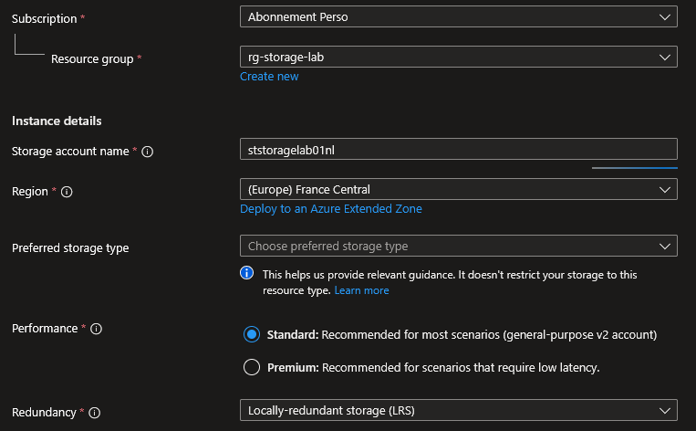
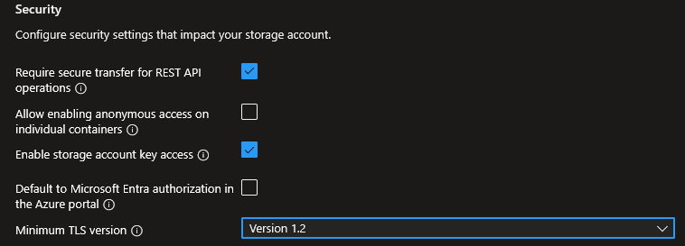
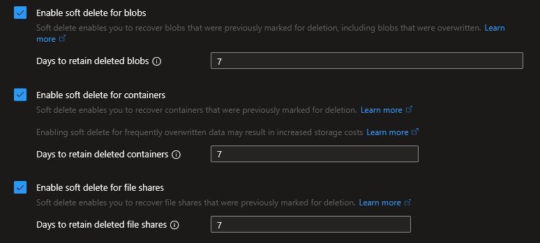
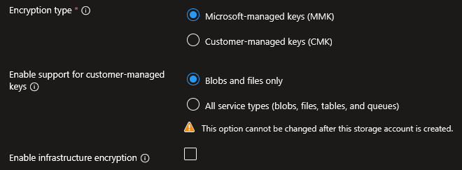
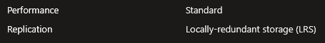
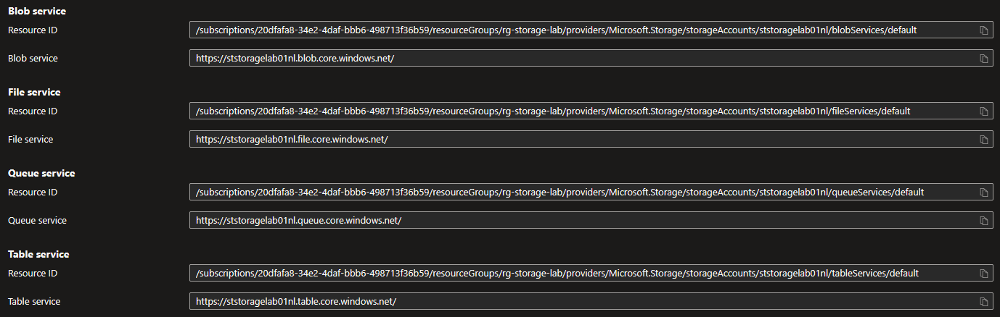

## Introduction

Cette procédure décrit le déploiement d'un Compte de Stockage (Storage Account) Azure. C'est la ressource fondamentale du stockage cloud Azure : un conteneur PaaS qui héberge les quatre services de données (Blobs, Files, Queues, Tables). Toutes les procédures stockage qui suivent dépendent de cette ressource.

## Contexte et Justification

Contrairement au disque dur d'une VM (lié à son cycle de vie), le Storage Account est un espace durable, hautement disponible et découplé du calcul. Il sert de brique de base pour :

- **Blob Storage** : Stocker des fichiers non structurés (images, vidéos, backups, logs). C'est le service le plus utilisé.
- **Azure Files** : Créer des partages de fichiers SMB/NFS accessibles par plusieurs VMs simultanément (remplace un serveur de fichiers classique).
- **Queue Storage** : File d'attente de messages pour découpler les composants d'une application (le producteur envoie des messages, le consommateur les traite à son rythme).
- **Table Storage** : Base de données NoSQL simple (clé/valeur) pour stocker des données structurées sans schéma fixe. Remplacé progressivement par Cosmos DB.

## Concepts Clés

**Unicité du nom :** Le nom d'un compte de stockage doit être unique au monde (pas seulement dans votre abonnement), entre 3 et 24 caractères, en minuscules et chiffres uniquement (pas de tirets, pas d'underscores). Il forme l'URL publique d'accès aux services :

- Blobs : `https://<nom>.blob.core.windows.net`
- Files : `https://<nom>.file.core.windows.net`
- Queues : `https://<nom>.queue.core.windows.net`
- Tables : `https://<nom>.table.core.windows.net`

**Performance :**

- **Standard** : Utilise des disques HDD. Convient à la majorité des usages (backups, logs, partages de fichiers, sites web statiques). C'est le moins cher.
- **Premium** : Utilise des disques SSD. Trois sous-types : Premium Block Blobs (applications haute performance), Premium File Shares (partages nécessitant une faible latence), Premium Page Blobs (disques de VM non managés). Plus cher, et le choix est irréversible après création.

**Kind (Type de compte) :**

- **StorageV2 (General Purpose v2) :** Le type recommandé. Supporte tous les services et toutes les fonctionnalités (tiers d'accès, lifecycle policies, etc.).
- **BlobStorage :** Ancien type, limité aux blobs. Ne le choisissez plus.
- **StorageV1 (General Purpose v1) :** Ancien type sans support des tiers d'accès. Migrable vers V2.

**Redondance (SKU) :**

- **LRS (Locally Redundant Storage)** : 3 copies dans le même datacenter. Le moins cher. Protège contre une panne de disque/rack, pas contre une panne du datacenter entier.
- **ZRS (Zone-Redundant Storage)** : 3 copies réparties dans 3 zones de disponibilité différentes de la même région. Protège contre la panne d'un datacenter entier.
- **GRS (Geo-Redundant Storage)** : LRS localement + 3 copies asynchrones dans une région secondaire (pairée). Protège contre une catastrophe régionale. Les données secondaires ne sont PAS lisibles par défaut.
- **RA-GRS (Read-Access GRS)** : Comme GRS, mais les données secondaires sont lisibles en lecture seule. URL séparée : `https://<nom>-secondary.blob.core.windows.net`.
- **GZRS / RA-GZRS** : Combinaison de ZRS localement + GRS vers la région secondaire. Le niveau le plus résilient (et le plus cher).

**Niveau d'accès par défaut (Default Access Tier)** : S'applique aux blobs qui n'ont pas de tier explicitement défini.

- **Hot** : Données accédées fréquemment. Coût de stockage plus élevé, coût d'accès plus bas.
- **Cool** : Données accédées rarement (minimum 30 jours recommandé). Coût de stockage plus bas, coût d'accès plus élevé.
- **Cold** : Données accédées très rarement (minimum 90 jours recommandé). Encore moins cher en stockage, encore plus cher en accès.

<div class="callout callout-note">

Le tier **Archive** existe aussi mais ne peut pas être défini comme tier par défaut du compte. Il se configure blob par blob (cf. procédure Access Tiers et Lifecycle Policies).

</div>

## Prérequis

- Un Abonnement Azure actif.
- Un Groupe de Ressources (ex : rg-storage-lab).
- Le rôle **Contributor** (minimum) sur le Resource Group.

## Points de Vigilance

**Standard vs Premium est irréversible.** Si vous créez un compte en Standard, vous ne pouvez pas le passer en Premium (et inversement). Il faut recréer un nouveau compte et migrer les données. Ce choix doit être validé avant tout déploiement de production : une erreur engage une migration complète.

**Le nom est définitif et global.** Si vous supprimez un compte stmonlab01, le nom redevient disponible mais pas immédiatement. Et si quelqu'un d'autre le prend entre-temps, vous ne pourrez plus l'utiliser.

**LRS ne protège PAS contre la panne d'un datacenter.** Pour survivre à la perte d'un datacenter, la redondance minimum est ZRS (ou GRS pour une panne régionale). LRS ne couvre que la panne disque ou rack, pas l'incident datacenter.

**GRS ne permet PAS la lecture de la copie secondaire par défaut.** Si un besoin d'accès en lecture aux données répliquées dans la région secondaire s'impose, il faut RA-GRS (ou RA-GZRS), pas juste GRS.

**Le tier par défaut s'applique uniquement aux blobs sans tier explicite.** Changer le tier par défaut du compte de Hot à Cool ne déplace PAS rétroactivement les blobs existants. Seuls les nouveaux blobs uploadés sans tier explicite seront en Cool.

**Allow Blob Public Access ≠ les données sont publiques.** Ce paramètre autorise la POSSIBILITÉ de rendre des conteneurs individuels publics. Le désactiver empêche totalement l'accès anonyme, même si quelqu'un configure un conteneur en « public ». En production, désactivez-le toujours.

## Choix Architecturaux & Alternatives

### Quand choisir un Storage Account

Le Storage Account est la brique de stockage polyvalente par défaut pour tout workload Azure ne nécessitant pas un service de données spécialisé. À privilégier pour l'hébergement de données non structurées (images, backups, logs), les partages de fichiers SMB/NFS, la file de messages simple entre composants applicatifs, et les sites web statiques. C'est également le réceptacle obligatoire de nombreux services Azure (diagnostics VM, Function Apps, Azure Backup). Pour des usages spécialisés (analytics massif, base NoSQL scalable, stockage bloc haute performance), des services dédiés offrent une meilleure adéquation et sont traités ci-dessous.

### Alternatives et comparatif

| Option | Cas d'usage typique | Force principale | Faiblesse principale | Coût relatif |
|------------|------------------|---------------|------------------|----------|
| **Storage Account (Blob)** | Données non structurées, backups, logs, sites statiques | Polyvalent, 4 services unifiés, tiers et lifecycle | Pas optimisé pour analytics hiérarchiques | Base |
| **Azure Data Lake Storage Gen2** | Analytics Big Data, data lakes, HDFS-compatible | Namespace hiérarchique, performance analytics | Surcoût par rapport au Blob plat | Environ 1,1x Blob |
| **Azure Files** | Partages SMB/NFS multi-VM, lift-and-shift de serveurs de fichiers | Protocoles fichier natifs, AD intégration | Coût supérieur au Blob, moins scalable | Supérieur à Blob |
| **Azure NetApp Files** | Workloads fichier haute performance (SAP, HPC, EDA) | Latence sub-ms, SLA enterprise | Coût élevé, provisionnement capacitaire | Très élevé |
| **Azure Managed Disks** | Stockage bloc attaché à une VM (OS, données applicatives) | Performance locale, snapshots natifs | Lié au cycle de vie de la VM, pas de partage multi-VM natif | Variable selon SKU |
| **Cosmos DB** | Base NoSQL distribuée, multi-région, faible latence | Scalabilité globale, SLA latence | Complexité, coût RU/s | Élevé |
| **Service Bus / Event Grid** | Messaging transactionnel, événements pub/sub | Sessions, DLQ, ordering, filtres avancés | Surcouche par rapport à Queue Storage | Moyen |

### Impact des choix

- **Coût.** Le Storage Account Standard est l'option la moins chère pour du stockage généraliste. Le choix irréversible Standard vs Premium impacte directement le coût : Premium est 2 à 5 fois plus cher selon le sous-type, à ne retenir que pour des exigences de latence validées par un benchmark. La redondance est l'autre levier majeur (cf. procédure dédiée).
- **Complexité opérationnelle.** Un Storage Account regroupe 4 services (Blob, Files, Queues, Tables) sous une seule ressource, un seul jeu de clés, une seule configuration réseau. C'est un avantage pour la simplicité mais un risque de couplage : un durcissement réseau s'applique aux 4 services simultanément. Pour isoler, il faut créer plusieurs Storage Accounts.
- **Sécurité.** Désactiver l'accès public anonyme et imposer TLS 1.2 sont des baselines non négociables en production. Les Private Endpoints et les Managed Identities remplacent respectivement l'exposition Internet et les Access Keys. Le chiffrement au repos (AES-256) est systématique et non désactivable ; le choix porte uniquement sur la gestion des clés (MMK vs CMK dans Key Vault).
- **Scalabilité et limites de service.** Un Storage Account unique supporte jusqu'à 5 PiB de données et 20 000 requêtes par seconde. Au-delà, il faut partitionner sur plusieurs comptes. Certains services (Azure Files Premium, ADLS Gen2) imposent des configurations spécifiques dès la création.
- **Verrouillage technologique.** Les APIs Blob et Files sont largement compatibles avec les standards du marché (S3 compatibility via outils tiers, SMB/NFS natifs). Queue et Table Storage sont propriétaires Azure ; Cosmos DB Table API offre une porte de sortie sans réécriture. Pour un design multi-cloud, une couche d'abstraction (rclone, Terraform modules) est recommandée.

## Méthode 1 : Configuration via Portail Azure

### Onglet Basics

1. Recherchez **"Storage accounts"** et cliquez sur **"+ Create"**.
2. **Subscription** : Votre abonnement.
3. **Resource group** : rg-storage-lab.
4. **Storage account name** : ststoragelab01nl.
5. **Region** : (Europe) France Central.
6. **Performance** : Standard.
7. **Redundancy** : Locally-redundant storage (LRS).

<div class="callout callout-note">

La section affiche un résumé visuel de la redondance choisie avec le nombre de copies et leur localisation.

</div>



<p class="figure-caption"><b>Figure 1</b> · Onglet Basics</p>

### Onglet Advanced

1. **Require secure transfer for REST API operations** : Coché (force HTTPS, ne jamais désactiver).
2. **Allow enabling anonymous access on individual containers** : Décoché (sécurité).
3. **Enable storage account key access** : Coché (nécessaire pour la plupart des outils, mais en production on privilégie Entra ID).
4. **Default to Microsoft Entra authorization in the Azure portal** : Décoché (optionnel, vous pouvez l'activer si vous préférez l'auth Entra par défaut dans le portail).
5. **Minimum TLS version** : Version 1.2.



<p class="figure-caption"><b>Figure 2</b> · Onglet Advanced</p>

6. **Access tier** : Hot.

### Onglet Networking

1. **Network access** : Sélectionnez **"Enable public access from all networks"** pour le lab.
   - En production, vous sélectionneriez « Enable public access from selected virtual networks and IP addresses » ou « Disable public access and use private access ».
2. **Routing preference** : Microsoft network routing (par défaut, le trafic reste sur le backbone Microsoft le plus longtemps possible).

<div class="callout callout-note">

Pour un lab, l'accès public depuis toutes les sources est acceptable. En production, utilisez des Private Endpoints (cf. [procédure Sécurisation PaaS via Private Endpoint](/procedures/azure/securisation-paas-via-private-endpoint)).

</div>

### Onglet Data Protection

1. **Enable soft delete for blobs** : Coché, 7 days (permet de récupérer un blob supprimé accidentellement pendant 7 jours).
2. **Enable soft delete for containers** : Coché, 7 days.
3. **Enable soft delete for file shares** : Coché, 7 days.



<p class="figure-caption"><b>Figure 3</b> · Onglet Data Protection</p>

4. **Enable versioning for blobs** : Décoché pour le lab (chaque modification crée une nouvelle version, ça consomme de l'espace).
5. **Enable blob change feed** : Décoché pour le lab.

<div class="callout callout-note">

Pour un lab, 7 jours de soft delete est un bon compromis. En production, montez à 14 ou 30 jours.

</div>

### Onglet Encryption

1. **Encryption type** : Microsoft-managed keys (MMK) (par défaut, Azure gère les clés de chiffrement pour vous).
2. **Enable support for customer-managed keys** : Blobs and files only (par défaut).
3. **Enable infrastructure encryption** : Décoché pour le lab (ajoute une deuxième couche de chiffrement, utile pour les données hautement sensibles).



<p class="figure-caption"><b>Figure 4</b> · Onglet Encryption</p>

<div class="callout callout-note">

Toutes les données dans Azure Storage sont chiffrées au repos par défaut (AES-256). Ce n'est pas optionnel. L'onglet Encryption permet de choisir QUI gère les clés, pas d'activer/désactiver le chiffrement.

</div>

### Validation et Création

1. Passez à l'onglet **Tags** (ajoutez Environment: Lab et Owner: <votre nom> si vous suivez la convention de tagging).
2. Cliquez sur **"Review + create"**.
3. Vérifiez le résumé, notamment la redondance et la performance.



<p class="figure-caption"><b>Figure 5</b> · Validation et Création</p>

4. Cliquez sur **"Create"**.
5. Attendez le déploiement (quelques secondes en général).

## Méthode 2 : Configuration via PowerShell

### Création du Compte de Stockage

```powershell
$rgName = "rg-storage-lab"
$location = "FranceCentral"
$storageName = "ststoragelab01nl"
New-AzStorageAccount `
    -ResourceGroupName $rgName `
    -Name $storageName `
    -Location $location `
    -SkuName "Standard_LRS" `
    -Kind "StorageV2" `
    -MinimumTlsVersion "TLS1_2" `
    -AllowBlobPublicAccess $false `
    -EnableHttpsTrafficOnly $true `
    -AccessTier "Hot" `
    -Tag @{ Environment = "Lab"; Owner = "nathan.lallier" }
```

### Vérifier la Configuration

```powershell
Get-AzStorageAccount -ResourceGroupName $rgName -Name $storageName | Select-Object StorageAccountName, @{N="SKU";E={$_.Sku.Name}}, Kind, MinimumTlsVersion, AllowBlobPublicAccess, AccessTier | Format-List
```

## Vérifications

**Portail** : Allez sur la ressource \> **"Overview"**. Vérifiez que **"Primary status"** affiche **"Available"**.

**Endpoints** : Dans le menu gauche \> **"Endpoints"**. Vous devez voir les 4 URLs (blob, file, queue, table) avec votre nom de compte.



<p class="figure-caption"><b>Figure 6</b> · Endpoints du compte de stockage</p>

**Security** : Dans **"Configuration"** (menu gauche), vérifiez que « Secure transfer required » est « Enabled » et « Allow Blob anonymous access » est « Disabled ».

**Redundancy** : Dans **"Redundancy"** (menu gauche), vérifiez le type (LRS) et le statut de réplication.

## Dépannage

**"StorageAccountNameTaken" / "AlreadyExists" :** Le nom est déjà pris par quelqu'un d'autre dans le monde. Modifiez le nom en ajoutant des chiffres ou vos initiales. Astuce : testez la disponibilité avant de créer avec `Get-AzStorageAccountNameAvailability -Name monnom`.

**"Name is invalid" :** Vous avez utilisé des majuscules, des tirets ou des underscores. Seuls les caractères a-z et 0-9 sont autorisés, entre 3 et 24 caractères.

**"SkuNotAvailable" :** Certaines redondances (ZRS, GZRS) ne sont pas disponibles dans toutes les régions. France Central supporte toutes les options, mais d'autres régions peuvent être limitées.

**"Subscription is not registered for Microsoft.Storage" :** Le fournisseur de ressources n'est pas encore enregistré sur cet abonnement (première création de compte de stockage). Solution : `Register-AzResourceProvider -ProviderNamespace Microsoft.Storage`.

## Conseils et Bonnes Pratiques

**Convention de nommage.** Microsoft recommande le préfixe st pour les comptes de stockage. Comme les tirets sont interdits, utilisez un format compact : `st<projet><env><initiales>` (ex : storionlabnl, stapiprodnl). Restez cohérent.

**Private Endpoints en production.** Ne laissez jamais un compte de stockage accessible depuis tout Internet en production. Configurez un Private Endpoint pour que le stockage ait une IP privée dans votre VNet, et désactivez l'accès réseau public.

**Rotation des clés.** Le compte possède deux clés d'accès (key1 / key2). Le principe : vos applications utilisent key1. Quand vous devez la renouveler, basculez d'abord les applications sur key2, puis régénérez key1, puis rebasculez sur key1. Comme ça, pas de coupure de service. En production, préférez les Managed Identities plutôt que les clés.

**Chiffrement.** Toutes les données sont chiffrées au repos par défaut (AES-256, Microsoft-managed keys). Vous n'avez rien à faire. Pour des exigences de conformité (finance, santé), passez aux Customer-Managed Keys (CMK) stockées dans un Key Vault.

## Procédures Liées

- [Configuration de la Réplication (LRS, GRS, RA-GRS)](/procedures/azure/configuration-de-la-replication-lrs-grs-ra-grs) *(Changer la redondance après la création du compte)*
- [Configuration des Access Tiers et Lifecycle Policies](/procedures/azure/configuration-des-access-tiers-et-lifecycle-policies) *(Gérer les tiers Hot/Cool/Cold/Archive et automatiser les transitions)*
- [Gestion des SAS Tokens et Access Keys](/procedures/azure/gestion-des-sas-tokens-et-access-keys) *(Sécuriser l'accès aux données du compte)*
- [Configuration du Soft Delete et Versioning](/procedures/azure/configuration-du-soft-delete-et-versioning) *(Approfondir les options de Data Protection configurées à la création)*
- [Déploiement et Montage d'un Partage Azure Files](/procedures/azure/deploiement-et-montage-dun-partage-azure-files) *(Créer un partage de fichiers dans ce compte)*
- [Sécurisation PaaS via Private Endpoint](/procedures/azure/securisation-paas-via-private-endpoint) *(Sécuriser l'accès réseau au compte de stockage)*
