## Introduction

Cette procédure décrit le déploiement d'un partage de fichiers Azure Files et son montage sur des machines Linux, Windows et macOS. Azure Files fournit des partages de fichiers cloud accessibles via les protocoles SMB (Server Message Block) et NFS (Network File System), permettant de remplacer un serveur de fichiers traditionnel par un service PaaS entièrement géré.

## Contexte et Justification

Dans une infrastructure classique, le serveur de fichiers est une VM Windows avec un disque attaché, des partages SMB configurés manuellement, des ACL à maintenir, des backups à planifier, et un OS à patcher. Si la VM tombe, les fichiers sont inaccessibles.

Azure Files élimine cette complexité :

- **Pas de VM à gérer** : Le partage est hébergé directement dans le compte de stockage. Pas de patching, pas de maintenance OS.
- **Accès concurrent** : Plusieurs VMs (ou postes) peuvent lire et écrire simultanément sur le même partage.
- **Protocole standard** : SMB 3.x, le même protocole que les partages Windows classiques. Les applications existantes fonctionnent sans modification.
- **Snapshots et Backup intégrés** : Sauvegarde native via Azure Backup, snapshots manuels ou automatisés.
- **Accès depuis n'importe où** : Depuis une VM Azure, depuis un poste on-premises (si le port 445 est ouvert), ou via Azure File Sync pour un cache local.

## Concepts Clés

**File Share (Partage de fichiers) :** Un répertoire racine accessible via le réseau. Chaque compte de stockage peut contenir plusieurs file shares, chacun avec son propre quota de taille.

**Protocoles :**

- **SMB 3.x** : Le protocole par défaut. Supporté par Windows, Linux (via cifs-utils) et macOS. Chiffré en transit (SMB 3.0+). Authentification par clé de compte de stockage ou par identité Entra ID / AD DS.
- **NFS 4.1** : Disponible uniquement sur les comptes Premium File Shares. Protocole natif Linux. Pas d'authentification par clé (uniquement par réseau via Private Endpoint ou VNet). Non supporté sur Windows.

**Tiers de performance :**

| Tier | Stockage | Usage | Facturation |
|--------------|--------------|-----------------------|----------------------|
| **Transaction Optimized** | Standard (HDD) | Usage général, migration de serveurs de fichiers | Stockage + transactions |
| **Hot** | Standard (HDD) | Partages accédés fréquemment | Stockage (moins cher) + transactions (plus cher) |
| **Cool** | Standard (HDD) | Données peu accédées (Archives) | Stockage (encore moins cher) + transactions (encore plus cher) |
| **Premium** | Premium (SSD) | Applications exigeantes en IOPS et latence | Provisioned capacity (vous payez la taille allouée, pas la taille utilisée) |

**Quota :** La taille maximale du partage. Pour les partages Standard, le maximum est 100 TiB (si le « large file share » est activé sur le compte). Pour les partages Premium, le quota détermine aussi les IOPS provisionnées.

**Authentification :**

- **Storage Account Key :** La clé maître du compte. Donne un accès total. C'est la méthode utilisée pour le montage basique (lab, dev).
- **Identity-based authentication :** Entra ID DS (Azure), AD DS (on-premises), ou Entra ID Kerberos. Permet un contrôle d'accès par utilisateur avec des ACL NTFS. C'est la méthode recommandée en production.

## Prérequis

- Un Compte de Stockage existant en StorageV2 (cf. [procédure Déploiement d'un Compte de Stockage](/procedures/azure/deploiement-dun-compte-de-stockage)).
- **Port 445 (TCP) ouvert en sortie.** C'est le port SMB. Depuis une VM Azure, il est ouvert par défaut. Depuis un poste personnel ou un réseau d'entreprise, le FAI ou le firewall bloque souvent ce port. Testez : `Test-NetConnection -ComputerName ststoragelab01nl.file.core.windows.net -Port 445` (PowerShell) ou `nc -zv ststoragelab01nl.file.core.windows.net 445` (Linux).
- Le rôle **Contributor** (minimum) sur le compte de stockage pour créer le partage.
- La clé d'accès du compte (ou un SAS) pour le montage.

## Points de Vigilance

**Le port 445 est souvent bloqué par les FAI résidentiels.** Si vous testez le montage depuis votre PC personnel et obtenez une erreur « System error 53 » (Windows) ou « Connection timed out » (Linux), c'est presque certainement un blocage du port 445 par votre FAI. La solution est de tester depuis une VM Azure (le port 445 est ouvert sur le réseau Azure) ou d'utiliser un VPN Point-to-Site.

**SMB et NFS ne coexistent PAS sur le même partage.** Un partage est soit SMB, soit NFS. Vous ne pouvez pas monter le même partage en SMB depuis Windows et en NFS depuis Linux. Si vous avez besoin des deux, créez deux partages séparés.

**NFS nécessite un compte Premium et un Private Endpoint.** Le protocole NFS n'est pas disponible sur les comptes Standard. Et il ne fonctionne PAS via l'internet public, uniquement via un Private Endpoint ou un Service Endpoint dans un VNet. Toute conception NFS impose donc simultanément un choix de SKU Premium et une topologie réseau privée, avec un impact coût et complexité non négligeable.

**Le quota n'est PAS une limite dure sur Standard.** Sur un partage Standard, le quota est une limite souple. Les écritures ne sont pas bloquées si le quota est atteint (sauf si vous configurez une alerte). Sur Premium, le quota détermine les IOPS et le throughput provisionnés.

**La clé de compte de stockage donne accès à TOUS les partages du compte.** Si votre compte a 5 partages et que vous donnez la clé à un prestataire, il a accès aux 5. Pour un accès granulaire, utilisez l'authentification par identité (Entra ID/AD DS) ou un SAS.

**Les snapshots de file share sont au niveau du partage entier.** Vous ne pouvez pas prendre un snapshot d'un seul fichier ou d'un seul dossier. C'est tout le partage ou rien. Mais vous pouvez restaurer des fichiers individuels depuis un snapshot.

## Choix Architecturaux & Alternatives

### Quand choisir Azure Files

Azure Files est la solution de référence pour remplacer un serveur de fichiers Windows traditionnel par un service PaaS managé accessible en SMB ou NFS. À privilégier pour les partages d'équipe (bureautique, projets), les répertoires home des utilisateurs, le stockage de configurations partagées entre VMs, la migration lift-and-shift d'applications legacy qui attendent un chemin UNC, et les scénarios multi-écriture concurrents. À éviter pour le stockage de données non structurées à grande échelle (Blob est plus adapté), les workloads haute performance IOPS-intensifs (NetApp Files ou Managed Disks), et les accès mono-utilisateur à très faible latence depuis un site distant sans cache local (Azure File Sync).

### Alternatives et comparatif

| Option | Cas d'usage typique | Force principale | Faiblesse principale | Coût relatif |
|-----------|-----------------|--------------------|--------------|----------|
| **Azure Files Standard** | Partages bureautiques, file servers migrés | SMB/NFS natif, managé, snapshots intégrés | Latence variable (10-100ms) | Base |
| **Azure Files Premium** | Workloads sensibles à la latence, applications IOPS-intensifs | Latence prévisible sub-10ms, IOPS provisionnés | Capacité pré-allouée facturée | 3 à 5x Standard |
| **Azure NetApp Files** | SAP, HPC, EDA, workloads enterprise critiques | SLA entreprise, latence sub-ms, multi-protocoles | Coût très élevé, réservation capacitaire | Très élevé |
| **Azure File Sync (sur Azure Files)** | Hybride, cache local multi-sites | Accès LAN rapide, Cloud Tiering | Impose un serveur Windows intermédiaire | Moyen (Files + Sync) |
| **Blob Storage** | Données non structurées, pas de sémantique fichier | Moins cher, tiers Hot/Cool/Cold/Archive | Pas de SMB/NFS natif, pas de POSIX | Inférieur à Files |
| **VM Windows + file server** | Contraintes DFS-R, ACL AD complexes, legacy | Contrôle total, fonctions Windows Server complètes | Patching, HA à concevoir, coûteux à l'échelle | Moyen à élevé |
| **AVD avec FSLogix** | Profils utilisateurs VDI, environnements Citrix/AVD | Profils persistants scalables | Usage spécifique VDI uniquement | Moyen |

### Impact des choix

- **Coût.** Standard facture le stockage utilisé plus les transactions : économique pour les partages peu actifs. Premium facture la capacité provisionnée même inutilisée : économique uniquement si les IOPS justifient le surcoût. NetApp Files se réserve aux cas métier où le SLA et la performance justifient le prix. Azure File Sync ajoute un service Storage Sync et un agent par serveur au coût du partage Files sous-jacent.
- **Performance et latence.** Standard offre 10 à 100 ms de latence variable selon la charge. Premium garantit sub-10 ms avec IOPS et throughput déterministes. NetApp Files descend sous la milliseconde avec multi-protocoles simultanés. Le choix dépend entièrement du profil applicatif : une mauvaise évaluation entraîne soit une surfacturation (Premium inutile), soit des timeouts applicatifs (Standard sous-dimensionné).
- **Complexité opérationnelle.** Azure Files est l'option la plus simple à exploiter : aucun patching, pas de HA à concevoir. Un file server VM Windows impose la gestion complète du cycle de vie de l'OS. NetApp Files introduit des concepts propres (capacity pools, volumes) et un support éditeur distinct.
- **Sécurité et conformité.** L'authentification par clé reste un risque : toute fuite expose l'intégralité du compte. L'identity-based auth (Entra ID Kerberos, AD DS, Entra ID DS) est la cible de production ; elle permet des ACL NTFS standards et un contrôle par utilisateur. Les Private Endpoints éliminent l'exposition Internet, obligatoire pour NFS et fortement recommandé pour SMB en production.
- **Limites de service.** Un partage Standard plafonne à 100 TiB avec large file share activé, à 5 TiB sinon. Premium propose jusqu'à 100 TiB par partage avec IOPS linéaires au quota. NFS est exclusif Premium. SMB 2.x n'est pas supporté : seuls les clients SMB 3.x fonctionnent. Un compte de stockage ne supporte pas simultanément SMB et NFS sur le même file share.
- **Verrouillage technologique.** Le protocole SMB 3.x reste un standard multi-fournisseur ; une migration vers AWS FSx ou GCP Filestore reste possible moyennant des outils de réplication tiers (rclone, robocopy, rsync). L'intégration avec Azure Backup, Azure File Sync et l'authentification Entra ID crée en revanche un couplage fort à l'écosystème Microsoft.

## Méthode 1 : Configuration via Portail Azure

### Créer un File Share

1. Allez dans votre compte de stockage (ststoragelab01nl).
2. Menu gauche, section **"Data storage"**, cliquez sur **"File shares"**.
3. Cliquez sur **"+ File share"**.
4. **Name** : partage-equipe.
5. **Access tier** : Transaction optimized.
6. Cliquez sur **"Next: Backup"**. Désactivez le backup pour le lab (ou laissez activé si vous voulez tester Azure Backup).
7. Cliquez sur **"Review + create"** puis **"Create"**.

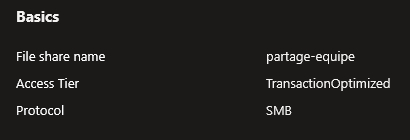

<p class="figure-caption"><b>Figure 1</b> · Créer un File Share</p>

### Uploader des Fichiers et Créer des Répertoires

1. Cliquez sur le partage **partage-equipe**.
2. Cliquez sur **"+ Add directory"** pour créer un dossier (ex : Infrastructure).
3. Cliquez sur **"Upload"** pour envoyer un fichier depuis votre poste.

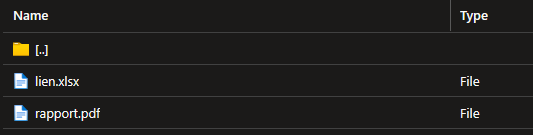

<p class="figure-caption"><b>Figure 2</b> · Uploader des Fichiers et Créer des Répertoires</p>

### Récupérer le Script de Connexion

1. Sur la page du partage, cliquez sur le bouton **"Connect"** en haut.
2. Sélectionnez l'onglet de votre OS (**Windows**, **Linux**, ou **macOS**).
3. **Drive letter** (Windows) : Z (ou une autre lettre disponible).
4. **Authentication method** : Storage account key.
5. Cliquez sur **"Show script"**.

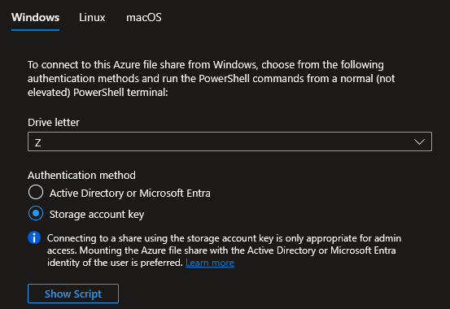

<p class="figure-caption"><b>Figure 3</b> · Récupérer le Script de Connexion</p>

6. Azure génère un script complet. Copiez-le et exécutez-le sur votre machine cliente.

<div class="callout callout-note">

Ce script contient la clé du compte de stockage. Ne le partagez pas et ne le commitez pas dans un dépôt Git.

</div>

## Méthode 2 : Configuration via PowerShell

### Créer le Contexte et le File Share

```powershell
$rgName = "rg-storage-lab"
$storageName = "ststoragelab01nl"
$shareName = "partage-equipe"
$key = (Get-AzStorageAccountKey -ResourceGroupName $rgName -Name $storageName)[0].Value
$ctx = New-AzStorageContext -StorageAccountName $storageName -StorageAccountKey $key
New-AzRmStorageShare -StorageAccountName $storageName -ResourceGroupName $rgName -Name $shareName -AccessTier "TransactionOptimized" -QuotaGiB 50
```

### Créer un Répertoire et Uploader un Fichier

1. Créer un répertoire :

```powershell
New-AzStorageDirectory -Context $ctx -ShareName $shareName -Path "Infrastructure"
```

2. Uploader un fichier :

```powershell
Set-AzStorageFileContent -Context $ctx -ShareName $shareName -Source "\chemin\local\config.txt" -Path "Infrastructure\config.txt"
```

### Lister le Contenu

```powershell
Get-AzStorageFile -Context $ctx -ShareName $shareName -Path "Infrastructure" | Get-AzStorageFile | Select-Object Name, @{N="Size";E={$_.Length}} | Format-Table
```

## Montage sur Linux

### Installer les Dépendances

```bash
sudo apt update && sudo apt install cifs-utils -y
```

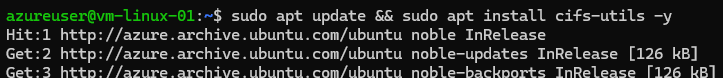

<p class="figure-caption"><b>Figure 4</b> · Installer les Dépendances</p>

<div class="callout callout-note">

Linux ne sait pas « parler SMB » nativement. `cifs-utils` est le paquet qui lui donne cette capacité. C'est comme installer un pilote.

</div>

### Créer le Fichier de Credentials

1. Créer le fichier qui contient le « mot de passe » :

```bash
sudo mkdir -p /etc/smbcredentials
sudo nano /etc/smbcredentials/ststoragelab01nl.cred
```

2. Dans le fichier :

```text
username=ststoragelab01nl
password=CLE_DACCES_ICI
```

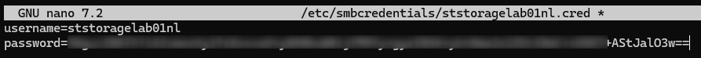

<p class="figure-caption"><b>Figure 5</b> · Créer le Fichier de Credentials</p>

<div class="callout callout-note">

Le username est le nom du compte de stockage. Le password est la clé d'accès (key1), disponible dans le portail : Storage account \> **"Access keys"** \> valeur de key1.

</div>

Protéger le fichier :

```bash
sudo chmod 600 /etc/smbcredentials/ststoragelab01nl.cred
```

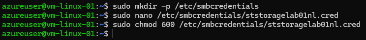

<p class="figure-caption"><b>Figure 6</b> · Protection du fichier de credentials</p>

### Créer le Point de Montage

```bash
sudo mkdir -p /mnt/azfiles
```

<div class="callout callout-note">

C'est un dossier vide. Quand le montage sera fait, ce dossier deviendra une « fenêtre » vers le partage Azure. Tout ce que vous mettez dedans va dans Azure, tout ce qui est dans Azure apparaît dedans.

</div>

### Monter le Partage (Test Rapide)

```bash
sudo mount -t cifs //ststoragelab01nl.file.core.windows.net/partage-equipe /mnt/azfiles -o credentials=/etc/smbcredentials/ststoragelab01nl.cred,serverino,nosharesock,actimeo=30
```

Traduction en français de cette commande :

- `mount -t cifs` : « Monte un partage réseau de type SMB »
- `//ststoragelab01nl.file.core.windows.net/partage-equipe` : « Le partage se trouve à cette adresse »
- `/mnt/azfiles` : « Fais-le apparaître dans ce dossier »
- `-o credentials=...` : « Utilise ce fichier pour le mot de passe »

Si ça fonctionne, vous pouvez vérifier :

```bash
ls /mnt/azfiles
```

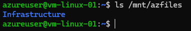

<p class="figure-caption"><b>Figure 7</b> · Monter le Partage (Test Rapide)</p>

### Rendre le Montage Permanent (fstab)

Le problème du test rapide, c'est que si vous redémarrez la VM, le montage disparaît. Le fichier `/etc/fstab` est la liste de tout ce que Linux doit monter automatiquement au démarrage.

```bash
sudo nano /etc/fstab
```

Ajoutez cette ligne tout à la fin (une seule ligne, pas de retour à la ligne au milieu) :

```text
//ststoragelab01nl.file.core.windows.net/partage-equipe /mnt/azfiles cifs nofail,credentials=/etc/smbcredentials/ststoragelab01nl.cred,serverino,nosharesock,actimeo=30 0 0
```

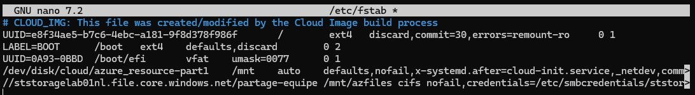

<p class="figure-caption"><b>Figure 8</b> · Rendre le Montage Permanent (fstab)</p>

Testez sans redémarrer :

```bash
sudo mount -a
```

<div class="callout callout-note">

Si aucune erreur, c'est bon. Le partage survivra aux redémarrages.

</div>

## Montage sur Windows

### Méthode Automatique (Script Azure)

1. Dans le portail, sur le partage \> **"Connect"** \> Onglet **Windows**.
2. Copiez le script PowerShell généré.

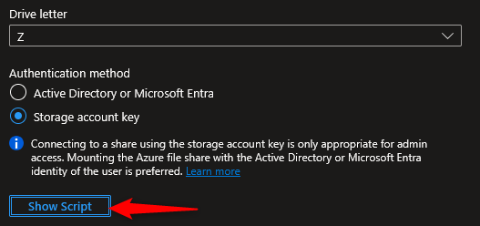

<p class="figure-caption"><b>Figure 9</b> · Méthode Automatique (Script Azure)</p>

3. Exécutez-le dans PowerShell sur votre poste client.

<div class="callout callout-note">

Le script fait trois choses : teste la connectivité sur le port 445, enregistre les credentials via `cmdkey`, et monte le lecteur réseau avec `New-PSDrive`.

</div>

### Méthode Manuelle (cmdkey + net use)

1. Enregistrer les credentials (persistant après redémarrage) :

```powershell
cmdkey /add:ststoragelab01nl.file.core.windows.net /user:AZURE\ststoragelab01nl /pass:<VOTRE_CLE>
```

2. Monter le lecteur :

```powershell
net use Z: \\ststoragelab01nl.file.core.windows.net\partage-equipe
```

3. Vérifier : `dir Z:\`

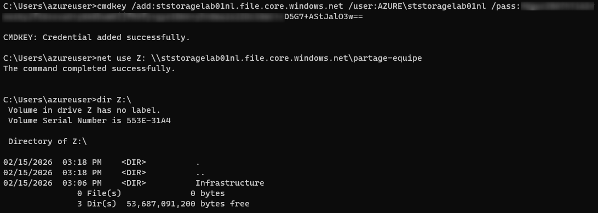

<p class="figure-caption"><b>Figure 10</b> · Méthode Manuelle (cmdkey + net use)</p>

### Méthode PowerShell

```powershell
# Tester la connectivité
$connectResult = Test-NetConnection -ComputerName ststoragelab01nl.file.core.windows.net -Port 445
if ($connectResult.TcpTestSucceeded) {
    # Enregistrer les credentials
    cmd.exe /C "cmdkey /add:`"ststoragelab01nl.file.core.windows.net`" /user:`"AZURE\ststoragelab01nl`" /pass:`"<VOTRE_CLE>`""
    # Monter le lecteur Z:
    New-PSDrive -Name Z -PSProvider FileSystem -Root "\\ststoragelab01nl.file.core.windows.net\partage-equipe" -Persist
} else {
    Write-Error "Port 445 bloqué. Testez depuis une VM Azure ou utilisez un VPN."
}
```

## Montage sur macOS

### Connexion via le Finder

1. Dans le Finder, menu **Go** \> **Connect to Server** (ou raccourci **Cmd + K**).
2. Saisissez : `smb://ststoragelab01nl.file.core.windows.net/partage-equipe`.
3. Cliquez sur **Connect**.

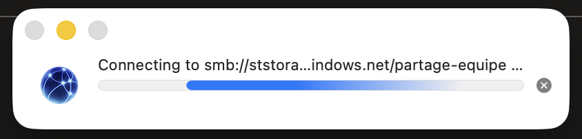

<p class="figure-caption"><b>Figure 11</b> · Connexion via le Finder</p>

4. **Name** : ststoragelab01nl (le nom du compte de stockage).
5. **Password** : Collez la clé d'accès.

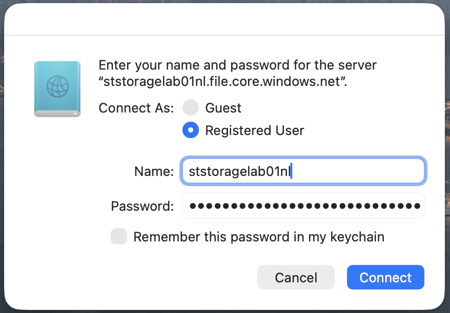

<p class="figure-caption"><b>Figure 12</b> · Saisie des identifiants</p>

6. Cochez **"Remember this password in my keychain"**.

### Montage en Ligne de Commande

1. Créez le point de montage :

```bash
sudo mkdir -p /Volumes/azfiles
```

2. Montez :

```bash
mount_smbfs //ststoragelab01nl:<VOTRE_CLE>@ststoragelab01nl.file.core.windows.net/partage-equipe /Volumes/azfiles
```

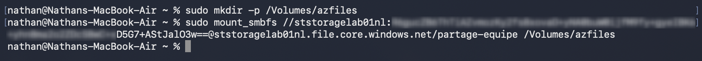

<p class="figure-caption"><b>Figure 13</b> · Montage en Ligne de Commande</p>

<div class="callout callout-note">

Pour automatiser au démarrage, ajoutez le volume monté dans **System Settings** \> **General** \> **Login Items**.

</div>

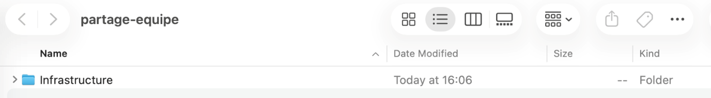

<p class="figure-caption"><b>Figure 14</b> · Partage monté dans le Finder</p>

<div class="callout callout-note">

Astuce macOS : désactivez la création des fichiers .DS_Store sur les partages réseau pour éviter les lenteurs : `defaults write com.apple.desktopservices DSDontWriteNetworkStores -bool TRUE`.

</div>

## Vérifications

**Partage créé** : Dans le portail \> **"File shares"**, le partage apparaît avec son quota et son tier.

**Contenu visible** : Cliquez sur le partage \> **"Browse"**. Les répertoires et fichiers uploadés sont présents.

**Montage Linux** : `df -h | grep azfiles` affiche le partage avec la taille correcte. `ls /mnt/azfiles` affiche le contenu.

**Montage Windows** : `dir Z:\` affiche le contenu. Le lecteur Z: apparaît dans l'Explorateur de fichiers.

**Test d'écriture :** Créez un fichier depuis le poste monté (`touch /mnt/azfiles/test.txt` ou `echo test > Z:\test.txt`). Vérifiez qu'il apparaît dans le portail \> "Browse".

**Persistance** : Redémarrez la VM/le poste. Le partage doit se remonter automatiquement (fstab sur Linux, cmdkey sur Windows).

## Dépannage

**"mount error(13): Permission denied" (Linux) :** Le nom du compte ou la clé dans le fichier credentials est incorrect. Vérifiez qu'il n'y a pas d'espace après le mot de passe dans le fichier. La clé change si vous l'avez régénérée.

**"mount error(115): Operation now in progress" (Linux) :** Le port 445 est bloqué. Vérifiez : `nc -zv ststoragelab01nl.file.core.windows.net 445`. Si c'est bloqué, testez depuis une VM Azure ou configurez un VPN.

**"System error 53" (Windows) :** Le port 445 est bloqué par votre FAI ou un firewall. Testez : `Test-NetConnection -ComputerName ststoragelab01nl.file.core.windows.net -Port 445`. Solution : VM Azure, VPN Point-to-Site, ou Azure File Sync.

**"System error 86 - The specified network password is not correct" (Windows) :** La clé a changé ou a été mal copiée. Supprimez les anciennes credentials : `cmdkey /delete:ststoragelab01nl.file.core.windows.net` puis réenregistrez avec la bonne clé.

**Le partage est en lecture seule (Linux) :** Ajoutez `file_mode=0777,dir_mode=0777` aux options de montage dans fstab si vous voulez un accès complet pour tous les utilisateurs locaux. Ou utilisez `uid=<votre_uid>,gid=<votre_gid>` pour limiter l'accès à votre compte.

**VM bloquée au démarrage après une erreur de montage (Linux) :** Vous n'avez pas mis `nofail` dans la ligne fstab. Démarrez la VM en mode rescue (via le portail Azure \> **"Serial console"** ou **"Reset password"**), corrigez le fstab, et redémarrez.

## Conseils et Bonnes Pratiques

**Toujours utiliser `nofail` dans fstab.** C'est une règle absolue. Sans `nofail`, si le réseau n'est pas disponible au démarrage ou si le compte de stockage est inaccessible, la VM reste bloquée et vous devez intervenir manuellement.

**Utilisez l'authentification par identité en production.** Les clés de compte donnent un accès total. En production, configurez l'authentification Entra ID DS ou AD DS pour contrôler l'accès par utilisateur avec des ACL NTFS, exactement comme un serveur de fichiers Windows traditionnel.

**Activez les Snapshots et Azure Backup.** Les snapshots de file share sont incrémentiels et permettent de restaurer des fichiers individuels. Azure Backup automatise les snapshots et gère la rétention. C'est le remplacement direct de Windows Server Backup.

**Préférez Premium pour les workloads sensibles à la latence.** Les partages Standard ont des latences variables (10-100ms). Les partages Premium offrent des latences prévisibles (quelques millisecondes). Pour des applications qui ouvrent beaucoup de petits fichiers (IDE, compilation), Premium fait une vraie différence.

**Envisagez Azure File Sync pour les scénarios hybrides.** Si vos utilisateurs on-premises ont besoin d'un accès LAN rapide aux fichiers tout en gardant Azure comme stockage principal, Azure File Sync cache les fichiers les plus accédés localement et tiere les fichiers peu utilisés vers le cloud (cf. [procédure Déploiement d'un Azure File Sync](/procedures/azure/deploiement-dun-azure-file-sync)).

## Procédures Liées

- [Déploiement d'un Compte de Stockage](/procedures/azure/deploiement-dun-compte-de-stockage) *(Le compte de stockage héberge le partage, il doit exister avant la création du file share)*
- [Gestion des SAS Tokens et Access Keys](/procedures/azure/gestion-des-sas-tokens-et-access-keys) *(Les clés d'accès sont utilisées pour le montage, la rotation des clés impacte les montages existants)*
- [Configuration du Soft Delete et Versioning](/procedures/azure/configuration-du-soft-delete-et-versioning) *(Le soft delete pour file shares protège contre la suppression accidentelle d'un partage entier)*
- [Déploiement d'un Azure File Sync](/procedures/azure/deploiement-dun-azure-file-sync) *(Cache local des fichiers Azure Files pour un accès LAN rapide)*
- [Sécurisation PaaS via Private Endpoint](/procedures/azure/securisation-paas-via-private-endpoint) *(Sécuriser l'accès réseau au partage via un Private Endpoint)*
