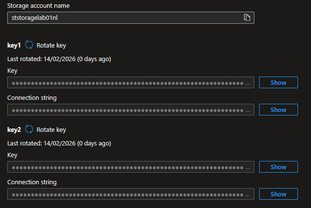
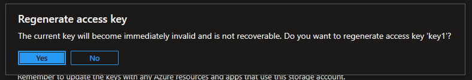
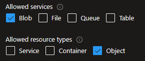
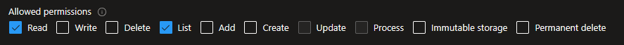
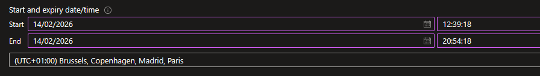
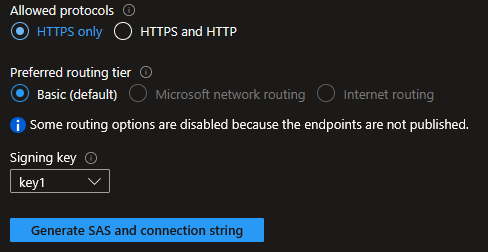
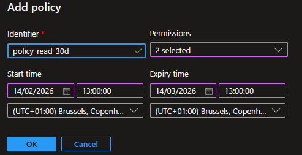

## Introduction

Cette procédure décrit les mécanismes d'authentification et de délégation d'accès aux données d'un compte de stockage Azure. Elle couvre les Access Keys (clés d'accès complètes), les SAS Tokens (jetons d'accès temporaires et granulaires) et les Stored Access Policies (politiques d'accès réutilisables et révocables).

## Contexte et Justification

Un compte de stockage contient des données sensibles (backups, fichiers d'entreprise, logs). Qui peut y accéder et comment ?

Azure propose trois niveaux d'authentification, du moins sécurisé au plus sécurisé :

1. **Access Keys** : Deux clés maîtresses qui donnent un accès TOTAL au compte de stockage (lecture, écriture, suppression, gestion). C'est l'équivalent du mot de passe root. Si quelqu'un obtient une clé, il peut tout faire.
2. **SAS Tokens** : Des jetons temporaires et granulaires. Vous définissez exactement quelles permissions (lecture seule ? écriture ?), sur quelles ressources (un conteneur ? un seul blob ?), pendant combien de temps (1 heure ? 1 semaine ?). C'est l'équivalent d'un badge visiteur avec des restrictions.
3. **Entra ID (RBAC)** : L'authentification par identité. Pas de clé ni de token à gérer, l'utilisateur ou le service s'authentifie avec son identité Entra ID et Azure vérifie ses permissions RBAC. C'est la méthode recommandée par Microsoft.

En pratique, les Access Keys servent à la configuration initiale et aux outils legacy. Les SAS Tokens servent à donner un accès temporaire à des tiers (un partenaire externe, un script de migration, un client qui doit télécharger un fichier). Entra ID est la cible pour tout le reste.

## Concepts Clés

**Access Keys :**

- Chaque compte de stockage a exactement **deux clés** (key1 et key2).
- Chaque clé donne un accès complet et illimité à toutes les données et configurations du compte.
- Les deux clés sont équivalentes (aucune n'est « principale »). La raison d'en avoir deux est la rotation sans coupure (voir Bonnes Pratiques).
- Les clés ne sont pas liées à un utilisateur. Quiconque possède la clé a un accès total, sans traçabilité nominative.

**SAS Token (Shared Access Signature) :** Un SAS est une URL signée cryptographiquement qui accorde un accès limité aux ressources du compte de stockage. Il existe trois types :

- **Account SAS** : S'applique à un ou plusieurs services du compte (Blob, File, Queue, Table). Vous choisissez les services, les types de ressources et les permissions. Signé avec une Access Key.
- **Service SAS** : S'applique à un seul service (ex : Blob Service uniquement) et peut cibler un conteneur ou un blob spécifique. Signé avec une Access Key ou une Stored Access Policy.
- **User Delegation SAS** : Comme un Service SAS, mais signé avec les identifiants Entra ID de l'utilisateur (pas avec une Access Key). C'est le type le plus sécurisé car il ne dépend pas des clés du compte. Nécessite que l'utilisateur ait le rôle RBAC « Storage Blob Delegator ».

**Anatomie d'une URL SAS :**

```text
https://ststoragelab01nl.blob.core.windows.net/mycontainer/rapport.pdf?sp=r&st=2026-02-14T10:00:00Z&se=2026-02-15T10:00:00Z&spr=https&sv=2022-11-02&sr=b&sig=abc123...
```

- `sp=r` : Permissions (r = read, w = write, d = delete, l = list, a = add, c = create).
- `st` / `se` : Start time / Expiry time.
- `spr=https` : Protocole autorisé.
- `sr=b` : Scope (b = blob, c = container, s = service).
- `sig` : La signature cryptographique (le « sceau » qui prouve que le SAS a été généré par quelqu'un qui possède la clé).

**Stored Access Policy :** Une politique nommée, stockée au niveau d'un conteneur, qui définit des paramètres de SAS réutilisables (permissions, date de début, date d'expiration). Un SAS peut référencer une Stored Access Policy au lieu de contenir directement ces paramètres. L'avantage majeur : vous pouvez **révoquer** un SAS en supprimant ou modifiant la policy associée. Sans Stored Access Policy, un SAS émis ne peut PAS être révoqué avant son expiration (à moins de régénérer la clé du compte, ce qui invalide TOUS les SAS).

**Limite :** maximum **5 Stored Access Policies** par conteneur.

## Prérequis

- Un Compte de Stockage existant avec au moins un conteneur et un blob de test.
- Le rôle **Contributor** (minimum) pour gérer les clés et créer des SAS.
- Pour les User Delegation SAS : le rôle **Storage Blob Delegator** sur le compte + un rôle de données (ex : Storage Blob Data Reader).

## Points de Vigilance

**Un SAS émis ne peut PAS être révoqué individuellement.** Si vous générez un SAS valide 30 jours et que vous réalisez qu'il a fuité, vos seules options sont : (1) régénérer la clé du compte utilisée pour signer le SAS, ce qui invalide TOUS les SAS signés avec cette clé, ou (2) si le SAS est basé sur une Stored Access Policy, modifier ou supprimer la policy. Pour pouvoir révoquer un SAS compromis sans affecter les autres, il faut donc s'appuyer sur une Stored Access Policy.

**Les Access Keys donnent un accès complet.** Si un développeur a besoin d'accéder en lecture seule à un conteneur pendant 2 heures, la réponse n'est JAMAIS une Access Key (trop de permissions). C'est un SAS restreint ou un rôle RBAC via Entra ID.

**Le SAS n'est pas chiffré, il est dans l'URL.** Quiconque intercepte l'URL a les permissions du SAS. Il faut toujours utiliser `spr=https` et donner les permissions les plus restrictives possibles. Piège classique : un SAS collé dans un ticket ou un email non chiffré devient un secret diffusé.

**Account SAS vs Service SAS.** La distinction est opérationnelle. Un Account SAS peut couvrir plusieurs services (Blob, File, Queue, Table). Un Service SAS ne couvre qu'un seul service. Si le besoin est un accès uniquement aux blobs d'un conteneur spécifique, la bonne réponse est un Service SAS (ou un User Delegation SAS), pas un Account SAS qui donne un scope trop large.

**User Delegation SAS est le plus sécurisé.** Il est signé avec des identifiants Entra ID, pas avec une clé du compte. Sa révocation ne passe pas par la régénération d'une Access Key, elle passe par la révocation de la delegation key de l'utilisateur. Il est tracé dans les logs avec l'identité du créateur. Limitation à connaître : il ne fonctionne que pour le Blob Service et nécessite le rôle Storage Blob Delegator.

**Régénérer une clé invalide immédiatement tous les SAS signés avec cette clé.** Si des applications utilisent des SAS signés avec key1 et que key1 est régénérée, tous ces SAS cessent de fonctionner instantanément. La rotation doit être planifiée : bascule de key1 vers key2 puis régénération de key1, puis bascule inverse pour régénérer key2.

**Désactiver l'accès par clé invalide la génération de SAS signés par clé.** Si l'option « Allow storage account key access » est passée à Disabled sur le compte, seuls les User Delegation SAS restent possibles. À vérifier avant d'activer cette option en production si des applications legacy signent encore leurs SAS avec une Access Key.

## Choix Architecturaux & Alternatives

### Quand choisir un SAS Token ou une Access Key

Les Access Keys ne sont jamais un choix de conception : c'est un reliquat technique utile uniquement pour la configuration initiale du compte, les outils legacy incompatibles avec Entra ID, et la signature des SAS classiques. À ne jamais distribuer, ni à une application, ni à un utilisateur. Les SAS Tokens sont le bon choix pour tout accès temporaire, granulaire et ciblé à des données de stockage, typiquement un partenaire externe qui doit récupérer un fichier pendant 48 heures, un script de migration one-shot, ou un client qui télécharge un livrable. Dès qu'un accès est récurrent, interne à l'organisation, ou dispose d'une identité Entra ID, la bonne réponse n'est plus un SAS mais un rôle RBAC ou une Managed Identity.

### Alternatives et comparatif

**Choix de haut niveau : mécanisme d'authentification au compte de stockage.**

| Option | Cas d'usage typique | Force principale | Faiblesse principale |
|-------------|-------------------|--------------------|---------------------|
| **Access Keys** | Configuration initiale, outils legacy | Universel, compatible tout SDK | Accès total, non traçable, fuite catastrophique |
| **SAS Tokens (signés par clé)** | Accès temporaire à un tiers externe | Granulaire, temporaire, sans identité requise | Non révocable individuellement, dépend d'une Access Key |
| **User Delegation SAS** | Accès temporaire tracé par identité | Signé par Entra ID, traçable, révocable sans toucher aux clés | Limité au Blob Service, rôle Storage Blob Delegator requis |
| **Entra ID RBAC** | Accès permanent d'utilisateurs ou applications internes | Traçabilité nominative, révocation instantanée, zéro secret à gérer | Nécessite une identité Entra ID côté consommateur |
| **Managed Identity** | Application Azure accédant au stockage | Aucun secret à stocker, rotation transparente | Limité aux ressources Azure qui supportent les MI |

**Choix de second niveau : si un SAS a été retenu, quel type de SAS générer.**

| Type de SAS | Scope couvert | Mode de signature | Révocation possible | Recommandation |
|-----------|--------------|------------|----------------|--------------------|
| **Account SAS** | Plusieurs services (Blob, File, Queue, Table) | Access Key | Régénération de la clé uniquement | À éviter sauf besoin multi-services |
| **Service SAS** | Un seul service, ciblable sur conteneur ou blob | Access Key ou Stored Access Policy | Via Stored Access Policy si utilisée, sinon régénération de clé | Standard pour un accès ciblé sur un conteneur ou blob |
| **User Delegation SAS** | Blob Service uniquement | Identifiants Entra ID | Révocation de la delegation key de l'utilisateur | À privilégier systématiquement quand le Blob Service est ciblé |

### Impact des choix

- **Traçabilité.** Access Keys et SAS signés par clé sont anonymes : aucune corrélation possible entre un accès et un utilisateur. User Delegation SAS et RBAC permettent un audit nominatif via les logs Entra ID et les Storage Analytics.
- **Révocabilité.** Un SAS ad hoc signé par Access Key est quasi irrévocable, la seule option étant la régénération de la clé qui casse toutes les applications consommatrices. Une Stored Access Policy offre un point de révocation maîtrisé, dans la limite de 5 policies par conteneur. Un User Delegation SAS se révoque proprement via `Revoke-AzStorageAccountUserDelegationKeys`.
- **Sécurité des secrets.** Les Access Keys stockées en dur dans du code ou dans des fichiers de configuration sont le premier vecteur de fuite identifié dans les audits. Stocker les clés dans Azure Key Vault et référencer via Managed Identity supprime ce risque. Désactiver complètement l'accès par clé via « Allow storage account key access : Disabled » est la cible finale en environnement mature.
- **Coût.** Les trois mécanismes sont gratuits ; le coût est opérationnel. Un modèle basé sur SAS signés par clé coûte cher en incidents potentiels (fuite, rotation cassante). Un modèle Entra ID RBAC coûte cher en ingénierie initiale (configuration des rôles, des Managed Identities) mais rentabilise sur la durée.
- **Verrouillage technologique.** SAS et User Delegation SAS sont des mécanismes spécifiques à Azure Storage. AWS S3 utilise des Presigned URLs (équivalent fonctionnel du SAS), GCP utilise des Signed URLs. Les concepts sont transposables, les implémentations ne le sont pas.

## Méthode 1 : Configuration via Portail Azure

### Visualiser les Access Keys

1. Allez sur votre compte de stockage (ststoragelab01nl).
2. Menu gauche, section **"Security + networking"**, cliquez sur **"Access keys"**.
3. Vous voyez **key1** et **key2**, chacune avec :
   - **Key** : La clé elle-même (masquée par défaut, cliquez sur l'icône œil pour la révéler).
   - **Connection string** : Une chaîne de connexion complète prête à copier-coller dans une application.



<p class="figure-caption"><b>Figure 1</b> · Visualiser les Access Keys</p>

<div class="callout callout-note">

Ne partagez JAMAIS ces clés. Elles donnent un accès total au compte.

</div>

### Régénérer une Access Key

1. Sur la même page **"Access keys"**.
2. À côté de **key1** (ou key2), cliquez sur **"Rotate key"** (icône de rotation).
3. Azure vous demande confirmation. Cliquez sur **"Yes"**.



<p class="figure-caption"><b>Figure 2</b> · Régénérer une Access Key</p>

4. La nouvelle clé est générée immédiatement. L'ancienne clé cesse de fonctionner instantanément.

<div class="callout callout-note">

Protocole de rotation sûr : vos applications utilisent key1. Basculez-les sur key2. Régénérez key1. Rebasculez sur key1. Régénérez key2. Aucune coupure.

</div>

### Générer un Account SAS

1. Menu gauche, section **"Security + networking"**, cliquez sur **"Shared access signature"**.
2. **Allowed services** : Cochez les services souhaités (ex : Blob uniquement).
3. **Allowed resource types** : Cochez ce qui est nécessaire :
   - **Service** : Opérations au niveau du service (lister les conteneurs).
   - **Container** : Opérations au niveau conteneur (lister les blobs).
   - **Object** : Opérations au niveau blob (lire, écrire un blob).



<p class="figure-caption"><b>Figure 3</b> · Générer un Account SAS</p>

4. **Allowed permissions** : Cochez uniquement les permissions nécessaires (ex : Read, List).



<p class="figure-caption"><b>Figure 4</b> · Permissions autorisées</p>

5. **Start and expiry date/time** : Définissez une fenêtre temporelle courte.



<p class="figure-caption"><b>Figure 5</b> · Fenêtre de validité du SAS</p>

6. **Allowed protocols** : HTTPS only.
7. **Signing key** : key1 ou key2.



<p class="figure-caption"><b>Figure 6</b> · Protocole et clé de signature</p>

8. Cliquez sur **"Generate SAS and connection string"**.
9. Copiez le **SAS token** (commence par `?sv=...`) ou la **Blob service SAS URL** complète.

### Générer un Service SAS sur un Conteneur

1. Allez dans **"Containers"** \> Cliquez sur le conteneur souhaité.
2. Menu gauche \> **"Shared access tokens"**.
3. **Permissions** : Cochez les permissions souhaitées (Read, List, etc.).
4. **Start and expiry date/time** : Définissez la fenêtre.
5. **Allowed protocols** : HTTPS only.
6. **Signing key** : key1 ou key2.
7. Cliquez sur **"Generate SAS token and URL"**.
8. Copiez le **Blob SAS URL** pour accéder au conteneur.

### Générer un SAS sur un Blob Individuel

1. Dans un conteneur, cliquez sur le nom d'un blob.
2. Menu gauche \> **"Generate SAS"**.
3. Configurez les permissions, la fenêtre temporelle et le protocole.
4. Cliquez sur **"Generate SAS token and URL"**.
5. Copiez le **Blob SAS URL**. Ce lien permet à quiconque le possède d'accéder au blob avec les permissions définies.

<div class="callout callout-note">

Testez en collant l'URL dans un navigateur en navigation privée. Si le SAS est en lecture, le fichier se télécharge. Si vous testez après l'expiration, vous obtenez une erreur 403.

</div>

### Créer une Stored Access Policy

1. Allez dans **"Containers"** \> Cliquez sur le conteneur.
2. Menu gauche \> **"Access policy"**.
3. Section **"Stored access policies"**, cliquez sur **"+ Add policy"**.
4. **Identifier** : policy-read-30d (un nom unique).
5. **Permissions** : Read, List.
6. **Start time** : Maintenant.
7. **Expiry time** : Dans 30 jours.
8. Cliquez sur **"OK"** puis **"Save"**.



<p class="figure-caption"><b>Figure 7</b> · Créer une Stored Access Policy</p>

<div class="callout callout-note">

Vous pouvez maintenant générer des SAS qui référencent cette policy. Pour révoquer tous les SAS basés sur cette policy, supprimez-la ou changez ses permissions/dates. C'est le seul moyen de révoquer un SAS sans régénérer la clé du compte.

</div>

## Méthode 2 : Configuration via PowerShell

### Lister les Access Keys

```powershell
$keys = Get-AzStorageAccountKey -ResourceGroupName "rg-storage-lab" -Name "ststoragelab01nl"
$keys | Format-Table KeyName, Value, Permissions
```

Récupérer key1 et créer le contexte :

```powershell
$key = $keys[0].Value
$ctx = New-AzStorageContext -StorageAccountName "ststoragelab01nl" -StorageAccountKey $key
```

### Régénérer une Access Key

```powershell
New-AzStorageAccountKey -ResourceGroupName "rg-storage-lab" -Name "ststoragelab01nl" -KeyName "key1"
```

### Générer un Account SAS

```powershell
$sasToken = New-AzStorageAccountSASToken -Context $ctx -Service Blob -ResourceType Service,Container,Object -Permission "rl" -ExpiryTime (Get-Date).AddDays(1) -Protocol HttpsOnly
Write-Host "Account SAS Token : $sasToken"
```

### Générer un Service SAS sur un Conteneur

```powershell
$sasToken = New-AzStorageContainerSASToken -Context $ctx -Name "mycontainer" -Permission "rl" -ExpiryTime (Get-Date).AddHours(2) -Protocol HttpsOnly
$fullUrl = "https://ststoragelab01nl.blob.core.windows.net/mycontainer$sasToken"
Write-Host "Container SAS URL : $fullUrl"
```

Pour un blob individuel :

```powershell
$sasToken = New-AzStorageBlobSASToken -Context $ctx -Container "mycontainer" -Blob "rapport.pdf" -Permission "r" -ExpiryTime (Get-Date).AddHours(1) -Protocol HttpsOnly -FullUri
Write-Host "Blob SAS URL : $sasToken"
```

### Créer une Stored Access Policy

```powershell
New-AzStorageContainerStoredAccessPolicy -Context $ctx -Container "mycontainer" -Policy "policy-read-30d" -Permission "rl" -ExpiryTime (Get-Date).AddDays(30)
```

Lister les policies :

```powershell
Get-AzStorageContainerStoredAccessPolicy -Context $ctx -Container "mycontainer" | Format-Table Policy, Permission, StartTime, ExpiryTime
```

### Générer un SAS basé sur une Stored Access Policy

```powershell
$sasToken = New-AzStorageBlobSASToken -Context $ctx -Container "mycontainer" -Blob "rapport.pdf" -Policy "policy-read-30d" -Protocol HttpsOnly -FullUri
Write-Host "Blob SAS URL (policy-based) : $sasToken"
```

Révoquer (supprimer la policy) :

```powershell
Remove-AzStorageContainerStoredAccessPolicy -Context $ctx -Container "mycontainer" -Policy "policy-read-30d"
```

## Vérifications

**Access Keys visibles** : Dans **"Access keys"**, les deux clés sont affichées et la connection string est copiable.

**SAS fonctionnel** : Collez l'URL SAS d'un blob dans un navigateur en navigation privée. Le fichier doit se télécharger (si permission Read).

**SAS expiré** : Attendez l'expiration (ou créez un SAS de 1 minute) et retestez l'URL. Vous devez obtenir une erreur AuthenticationFailed (403).

**Stored Access Policy** : Dans le conteneur \> **"Access policy"**, la policy apparaît dans la liste.

**Révocation** : Supprimez la Stored Access Policy, puis retestez un SAS basé sur cette policy. Il doit retourner une erreur 403.

## Dépannage

**"AuthenticationFailed" (403) en utilisant un SAS :** Causes fréquentes : le SAS a expiré (vérifiez `se`), les permissions sont insuffisantes (vérifiez `sp`), le protocole ne correspond pas (HTTP au lieu de HTTPS si `spr=https`), ou la clé utilisée pour signer a été régénérée.

**"AuthorizationPermissionMismatch" en utilisant un SAS :** Le SAS n'a pas les permissions requises pour l'opération tentée. Par exemple, vous tentez d'écrire (PUT) avec un SAS en lecture seule (`sp=r`). Régénérez un SAS avec les bonnes permissions.

**Le SAS a fuité, comment le révoquer ? :** Si le SAS est basé sur une Stored Access Policy : supprimez ou modifiez la policy. Si le SAS est un SAS ad-hoc (sans policy) : la seule option est de régénérer la clé du compte utilisée pour le signer. Attention, cela invalide TOUS les SAS signés avec cette clé.

**"Server failed to authenticate the request" après rotation de clé :** Vous avez régénéré la clé qui a signé vos SAS actifs. Tous les SAS signés avec l'ancienne clé sont désormais invalides. Générez de nouveaux SAS avec la nouvelle clé et mettez à jour vos applications.

**Impossible de créer une nouvelle Stored Access Policy :** La limite est de 5 policies par conteneur. Si vous en avez déjà 5, supprimez-en une avant d'en créer une nouvelle.

## Conseils et Bonnes Pratiques

**Préférez toujours le User Delegation SAS quand c'est possible.** Il est signé avec des identifiants Entra ID, pas avec une Access Key. Si le SAS fuit, vous pouvez le révoquer en révoquant la delegation key de l'utilisateur, sans toucher aux clés du compte. Il est tracé dans les logs avec l'identité de l'utilisateur qui l'a créé.

**Donnez les permissions minimales et la durée minimale.** Un SAS pour télécharger un rapport doit être en lecture seule (`r`), sur le blob uniquement (`sr=b`), valable 1 heure. Pas en lecture-écriture-suppression sur tout le conteneur pendant 30 jours.

**Utilisez des Stored Access Policies pour les SAS à longue durée.** Si vous devez donner un accès de 30 jours à un partenaire, créez une Stored Access Policy. Si le partenaire perd le lien ou que vous devez couper l'accès, vous supprimez la policy au lieu de régénérer la clé du compte.

**Planifiez la rotation des clés tous les 90 jours.** Automatisez avec Azure Key Vault : Key Vault peut stocker les clés du compte de stockage et les faire tourner automatiquement. Configurez une alerte si une clé n'a pas été régénérée depuis plus de 90 jours.

**Désactivez les Access Keys si possible.** Si toutes vos applications utilisent Entra ID (RBAC) pour accéder au stockage, vous pouvez désactiver complètement les Access Keys dans **"Configuration"** \> **"Allow storage account key access"** : Disabled. Cela bloque aussi la génération de SAS basés sur les clés (seuls les User Delegation SAS restent possibles).

## Procédures Liées

- [Déploiement d'un Compte de Stockage](/procedures/azure/deploiement-dun-compte-de-stockage) *(Les Access Keys sont créées automatiquement avec le compte)*
- [Gestion des Secrets avec Azure Key Vault](/procedures/azure/gestion-des-secrets-avec-azure-key-vault) *(Stocker les Access Keys et les SAS Tokens dans Key Vault plutôt qu'en dur dans le code)*
- [Gestion des Managed Identities (System & User Assigned)](/procedures/azure/gestion-des-managed-identities-system-user-assigned) *(Utiliser une Managed Identity pour accéder au stockage sans clé ni SAS)*
- [Configuration du Soft Delete et Versioning](/procedures/azure/configuration-du-soft-delete-et-versioning) *(Le soft delete protège contre les suppressions même si quelqu'un a un SAS avec permission Delete)*
- [Configuration d'AzCopy pour Transfert de Données](/procedures/azure/configuration-dazcopy-pour-transfert-de-donnees) *(AzCopy utilise des SAS Tokens ou Entra ID pour s'authentifier)*
