## Introduction

Cette procédure décrit l'utilisation d'AzCopy, l'outil en ligne de commande de Microsoft pour transférer des données vers, depuis et entre les comptes de stockage Azure. AzCopy est optimisé pour les transferts massifs (des Go aux To) avec parallélisme, reprise automatique et performance réseau maximale.

## Contexte et Justification

Le portail Azure permet d'uploader des fichiers un par un, mais c'est inutilisable pour des migrations réelles. Azure CLI (`az storage blob upload-batch`) ou PowerShell (`Set-AzStorageBlobContent`) fonctionnent mais sont plus lents qu'AzCopy pour les gros volumes.

AzCopy est l'outil de choix pour :

- **Migration initiale** : Transférer 500 Go de données depuis un serveur on-premises vers Azure Blob Storage.
- **Copie inter-comptes** : Copier des données d'un compte de stockage à un autre (même région ou inter-régions) sans télécharger les données localement (server-side copy).
- **Synchronisation** : Garder un dossier local synchronisé avec un conteneur blob (comme rsync mais pour Azure).
- **Backup** : Copier régulièrement les données d'un conteneur de production vers un conteneur d'archive dans un autre abonnement.

AzCopy utilise le parallélisme (plusieurs connexions simultanées) et la reprise automatique (si le transfert échoue, il reprend là où il s'était arrêté au lieu de recommencer depuis zéro).

## Concepts Clés

**AzCopy** : Un exécutable standalone (pas besoin de Python, Node.js ou .NET). Disponible pour Windows, Linux et macOS. Ce n'est PAS un module PowerShell ni une extension Azure CLI. C'est un binaire indépendant que vous téléchargez et exécutez directement.

**Authentification :** AzCopy supporte deux méthodes :

- **Entra ID (OAuth)** : Vous vous connectez avec `azcopy login`. AzCopy utilise votre identité Entra ID. Vous devez avoir un rôle RBAC de données sur le compte de stockage cible (ex : Storage Blob Data Contributor). C'est la méthode recommandée.
- **SAS Token** : Vous ajoutez le SAS token directement dans l'URL. Pas besoin de login. Utile pour les scripts automatisés ou quand vous n'avez pas de compte Entra ID sur le tenant cible.

**azcopy copy vs azcopy sync :**

- **copy** : Copie les fichiers spécifiés. Si un fichier existe déjà à la destination, il est écrasé (sauf si vous utilisez `--overwrite=false`). C'est un transfert « brut ».
- **sync** : Compare la source et la destination, puis ne transfère que les fichiers manquants ou modifiés (basé sur le timestamp et la taille). C'est un transfert « intelligent », équivalent de rsync.

**Server-Side Copy** : Quand vous copiez des données entre deux comptes de stockage Azure, AzCopy peut demander à Azure de faire la copie côté serveur. Les données ne transitent PAS par votre poste local. C'est beaucoup plus rapide et ne consomme pas votre bande passante.

**Job et Journal** : Chaque opération AzCopy crée un « job » avec un identifiant unique. AzCopy conserve un journal de chaque job dans `~/.azcopy/` (Linux/macOS) ou `%USERPROFILE%\.azcopy\` (Windows). Si un transfert échoue, vous pouvez le reprendre avec `azcopy jobs resume <job-id>`.

## Prérequis

- Un Compte de Stockage existant avec au moins un conteneur.
- AzCopy v10 installé sur votre poste (voir « Installer AzCopy »).
- Pour l'authentification Entra ID : le rôle **Storage Blob Data Contributor** (minimum pour upload) ou **Storage Blob Data Reader** (pour download uniquement) sur le compte de stockage.
- Pour l'authentification SAS : un SAS token avec les permissions appropriées (cf. [procédure Gestion des SAS Tokens](/procedures/azure/gestion-des-sas-tokens-et-access-keys)).
- Connectivité HTTPS (port 443) vers `*.blob.core.windows.net`.

## Points de Vigilance

**Le rôle Contributor ne suffit PAS pour AzCopy avec Entra ID.** Le rôle Contributor donne accès au plan de gestion (créer, supprimer le compte), pas au plan de données (lire, écrire les blobs). Pour AzCopy avec Entra ID, il faut un rôle de données : Storage Blob Data Contributor, Storage Blob Data Reader ou Storage Blob Data Owner. C'est une erreur de RBAC récurrente lors des premiers déploiements.

**azcopy sync ne supprime PAS les fichiers à la destination par défaut.** Si un fichier existe à la destination mais pas à la source, sync ne le supprime pas. Pour obtenir un miroir exact, ajoutez `--delete-destination=true`. Scénario typique : un backup sync qui conserve indéfiniment les fichiers supprimés côté source, avec une dérive progressive entre la source et la destination.

**Server-side copy nécessite un SAS sur la source ET la destination (ou Entra ID sur les deux).** Si vous copiez entre deux comptes avec des SAS, les deux URLs doivent contenir un SAS valide. Avec Entra ID, votre compte doit avoir les rôles de données sur les deux comptes.

**AzCopy n'est PAS Azure CLI.** En production, on observe fréquemment des confusions entre `azcopy copy` et `az storage blob copy`. Ce sont deux outils différents. AzCopy est un binaire standalone optimisé pour les transferts massifs. Azure CLI est un outil de gestion généraliste, plus lent sur les gros volumes.

**La copie entre conteneurs dans le même compte est server-side.** Les données ne quittent pas le datacenter Azure. Mais la copie entre deux régions différentes transite par le réseau Azure (pas par votre poste) et peut prendre du temps pour de gros volumes.

## Choix Architecturaux & Alternatives

### Quand choisir AzCopy

AzCopy est l'outil de référence pour les transferts massifs (des Go aux To) vers, depuis ou entre comptes de stockage Azure. À privilégier pour les migrations initiales on-premises vers Azure Blob, les copies inter-comptes en server-side, les backups incrémentaux via `azcopy sync`, et toute opération nécessitant parallélisme, reprise automatique, ou filtrage par pattern. En revanche, AzCopy n'est pas adapté à l'exploration interactive de conteneurs, aux opérations de gestion du compte (création, configuration RBAC), ni aux transferts réseau restreints supérieurs à plusieurs dizaines de To où Azure Data Box devient économiquement plus pertinent.

### Alternatives et comparatif

| Option | Cas d'usage typique | Force principale | Faiblesse principale | Coût relatif |
|-------------|------------------|-------------------|---------------|--------|
| **AzCopy** | Migrations, sync, copies inter-comptes massives | Parallélisme natif, reprise auto, server-side copy | CLI uniquement, pas d'interface graphique | Gratuit (outil) |
| **Azure Storage Explorer** | Exploration interactive, petits transferts ponctuels | GUI multiplateforme, confort d'usage | Performances limitées sur gros volumes | Gratuit |
| **Azure CLI** | Scripts de gestion intégrés, automatisation légère | Unifié avec le reste de la gestion Azure | Plus lent qu'AzCopy sur les gros volumes | Gratuit |
| **PowerShell** | Scripts Windows, intégration avec l'écosystème PS | Cohérent avec les pipelines PowerShell existants | Débit inférieur à AzCopy, verbosité | Gratuit |
| **Azure Data Factory** | Pipelines de données récurrents, transformations ETL | Orchestration, connecteurs multi-sources, monitoring intégré | Complexité, coût d'exécution par pipeline | Moyen à élevé |
| **Azure Data Box** | Migrations physiques supérieures à 40 To, liens réseau saturés | Contournement des limites de bande passante | Délai logistique de plusieurs semaines | Élevé (forfait) |

### Impact des choix

- **Coût.** AzCopy en tant qu'outil est gratuit, seul le trafic sortant hors région est facturé (egress standard Azure). Data Factory facture par activité et par runtime. Data Box est forfaitaire, à réserver aux volumes où le transfert réseau deviendrait lui-même le goulot d'étranglement critique.
- **Complexité opérationnelle.** AzCopy s'opère en CLI, adapté aux scripts et à l'automatisation mais moins accessible aux profils non-techniques. Storage Explorer couvre ce besoin au prix du débit. Data Factory impose de concevoir des pipelines, pertinent dès lors que le transfert est récurrent ou nécessite une transformation.
- **Sécurité.** L'authentification Entra ID d'AzCopy est traçable et recommandée pour les transferts interactifs. Les SAS tokens restent utiles pour les scripts automatisés et les scénarios inter-tenants, mais doivent être stockés en coffre-fort (Key Vault) et renouvelés régulièrement. Sur VM Azure, la Managed Identity (`azcopy login --identity`) élimine tout secret en clair.
- **Scalabilité et performance.** AzCopy exploite le parallélisme CPU via `AZCOPY_CONCURRENCY_VALUE` et la reprise automatique des transferts via son journal. Pour un transfert unique inférieur à quelques Go, Storage Explorer ou Azure CLI suffisent. Au-delà, AzCopy devient l'outil obligatoire jusqu'à la frontière où Data Box prend le relais.
- **Verrouillage technologique.** AzCopy est spécifique Azure. Pour une stratégie multi-cloud, rclone est une alternative open source couvrant Azure Blob, AWS S3 et GCS avec une syntaxe unifiée, au prix d'une optimisation moindre sur chaque provider.

## Méthode 1 : Authentification et Transfert avec Entra ID

### Installer AzCopy

**Windows :**

```powershell
Invoke-WebRequest -Uri "https://aka.ms/downloadazcopy-v10-windows" -OutFile AzCopy.zip
Expand-Archive AzCopy.zip -DestinationPath C:\Tools\AzCopy -Force
$env:PATH += ";C:\Tools\AzCopy\azcopy_windows_amd64_*"
cd C:\Tools\AzCopy\azcopy_windows_amd64_*
.\azcopy.exe --version
```

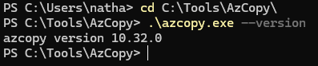

<p class="figure-caption"><b>Figure 1</b> · Installation sous Windows</p>

**Linux :**

```bash
curl -L https://aka.ms/downloadazcopy-v10-linux -o azcopy.tar.gz
tar -xzf azcopy.tar.gz
sudo mv azcopy_linux_amd64_*/azcopy /usr/local/bin/
sudo chmod +x /usr/local/bin/azcopy
azcopy --version
```

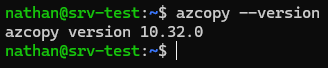

<p class="figure-caption"><b>Figure 2</b> · Installation sous Linux</p>

**macOS :**

```bash
brew install azcopy
azcopy --version
```

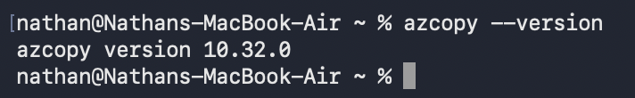

<p class="figure-caption"><b>Figure 3</b> · Installation sous macOS</p>

### Se Connecter avec Entra ID

```bash
azcopy login
```

AzCopy affiche un code et une URL. Ouvrez https://microsoft.com/devicelogin dans un navigateur, entrez le code, et authentifiez-vous avec votre compte Entra ID.

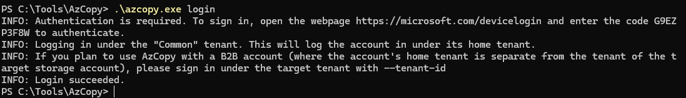

<p class="figure-caption"><b>Figure 4</b> · Se Connecter avec Entra ID</p>

<div class="callout callout-note">

La session reste active jusqu'à l'expiration du token (quelques heures). Vous n'avez pas besoin de vous reconnecter à chaque commande.

</div>

Pour se connecter avec un tenant spécifique :

```bash
azcopy login --tenant-id <TENANT_ID>
```

### Uploader un Fichier vers un Conteneur Blob

```bash
azcopy copy "/chemin/local/rapport.pdf" "https://ststolab01nl.blob.core.windows.net/mycontainer/rapport.pdf"
```

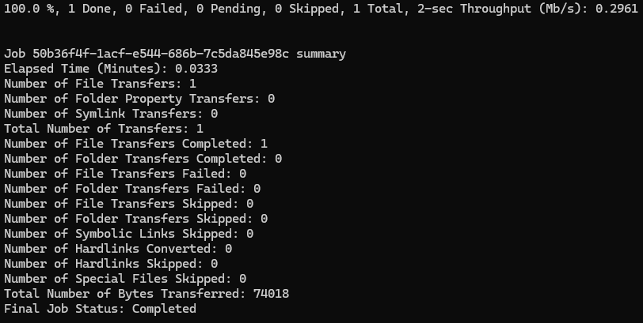

<p class="figure-caption"><b>Figure 5</b> · Uploader un Fichier vers un Conteneur Blob</p>

### Uploader un Dossier Entier (Récursif)

```bash
azcopy copy "/chemin/local/dossier-backup/" "https://ststolab01nl.blob.core.windows.net/mycontainer/backups/" --recursive
```

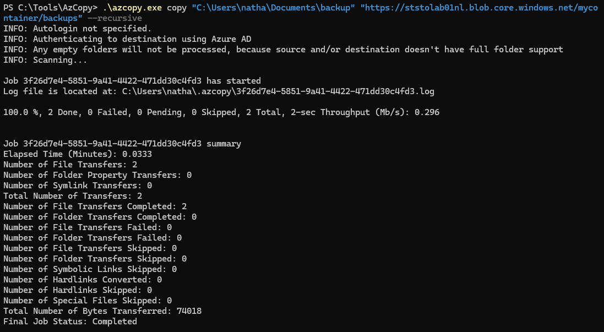

<p class="figure-caption"><b>Figure 6</b> · Uploader un Dossier Entier (Récursif)</p>

<div class="callout callout-note">

`--recursive` inclut tous les sous-dossiers. Sans ce flag, seuls les fichiers à la racine du dossier sont copiés.

</div>

Avec un filtre par extension :

```bash
azcopy copy "/chemin/local/logs/" "https://ststolab01nl.blob.core.windows.net/mycontainer/logs/" --recursive --include-pattern "*.log"
```

Exclure certains fichiers :

```bash
azcopy copy "/chemin/local/data/" "https://ststolab01nl.blob.core.windows.net/mycontainer/data/" --recursive --exclude-pattern "*.tmp;*.bak"
```

### Télécharger un Blob vers le Poste Local

```bash
azcopy copy "https://ststolab01nl.blob.core.windows.net/mycontainer/rapport.pdf" "/chemin/local/rapport.pdf"
```

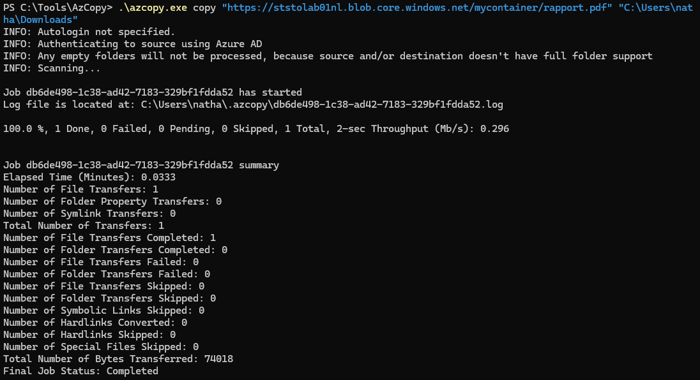

<p class="figure-caption"><b>Figure 7</b> · Télécharger un Blob vers le Poste Local</p>

### Télécharger un Conteneur Entier

```bash
azcopy copy "https://ststolab01nl.blob.core.windows.net/mycontainer/" "/chemin/local/download/" --recursive
```

### Se Déconnecter

```bash
azcopy logout
```

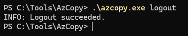

<p class="figure-caption"><b>Figure 8</b> · Se Déconnecter</p>

## Méthode 2 : Transfert avec un SAS Token

Avec un SAS, pas besoin de `azcopy login`. Le token est directement dans l'URL.

### Uploader avec un SAS

```bash
azcopy copy "/chemin/local/rapport.pdf" "https://ststolab01nl.blob.core.windows.net/mycontainer/rapport.pdf?sv=2022-11-02&ss=b&srt=sco&sp=rwdlacx&se=2026-02-15T00:00:00Z&sig=..."
```

<div class="callout callout-note">

L'URL complète avec le SAS token doit être entre guillemets. Le SAS doit avoir au minimum les permissions Write et Create pour un upload.

</div>

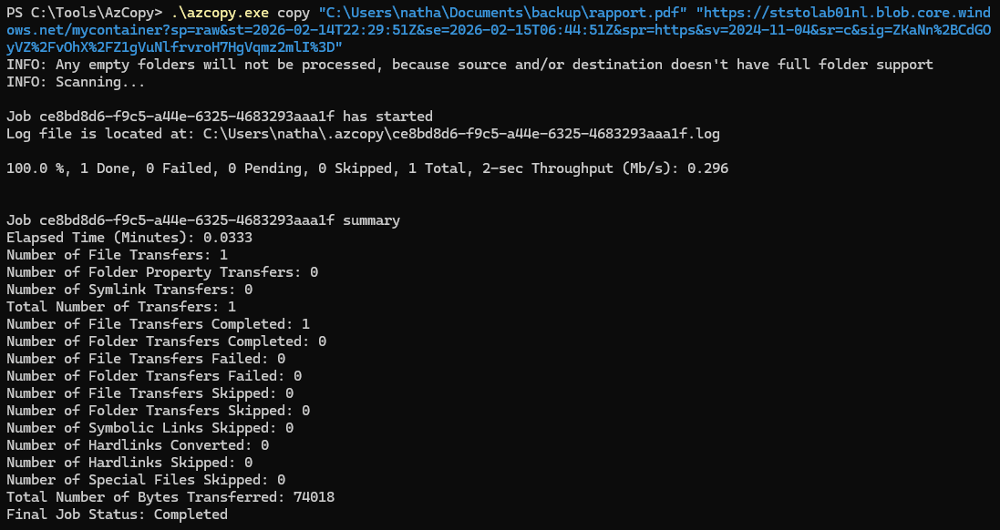

<p class="figure-caption"><b>Figure 9</b> · Uploader avec un SAS</p>

### Télécharger avec un SAS

```bash
azcopy copy "https://ststolab01nl.blob.core.windows.net/mycontainer/rapport.pdf?sv=...&sig=..." "/chemin/local/rapport.pdf"
```

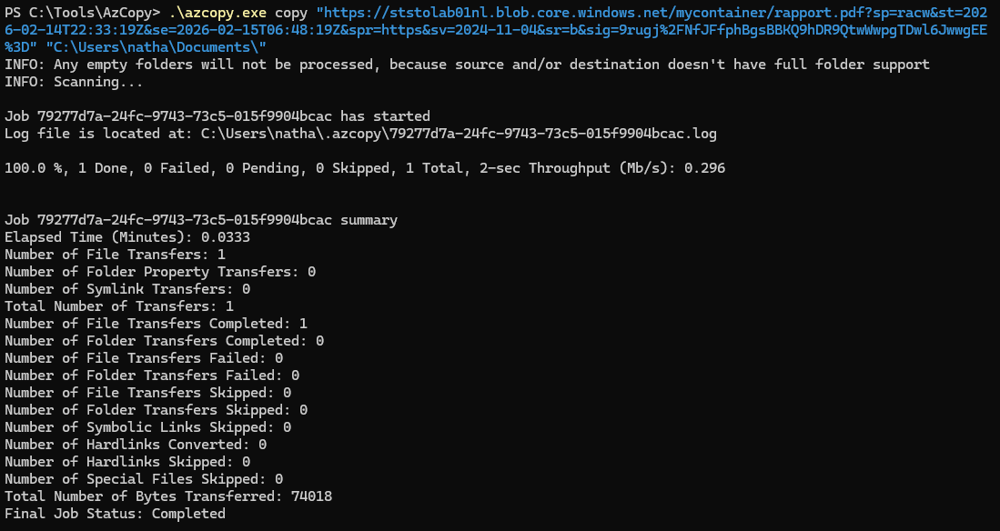

<p class="figure-caption"><b>Figure 10</b> · Télécharger avec un SAS</p>

### Copier entre Deux Comptes de Stockage (Server-Side Copy)

```bash
azcopy copy \
"https://source-account.blob.core.windows.net/source-container/?<SAS_SOURCE>" \
"https://dest-account.blob.core.windows.net/dest-container/?<SAS_DEST>" \
--recursive
```

<div class="callout callout-note">

Les données transitent directement entre les deux comptes Azure, sans passer par votre poste. C'est extrêmement rapide pour les gros volumes. Les deux SAS doivent avoir les permissions appropriées (Read/List sur la source, Write/Create/List sur la destination).

</div>

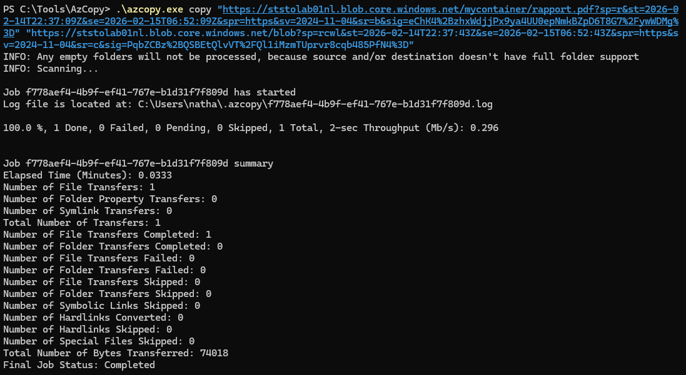

<p class="figure-caption"><b>Figure 11</b> · Copier entre Deux Comptes de Stockage (Server-Side Copy)</p>

## Méthode 3 : Synchronisation (azcopy sync)

### Synchroniser un Dossier Local vers un Conteneur

```bash
azcopy sync "/chemin/local/data/" "https://ststolab01nl.blob.core.windows.net/mycontainer/data/" --recursive
```

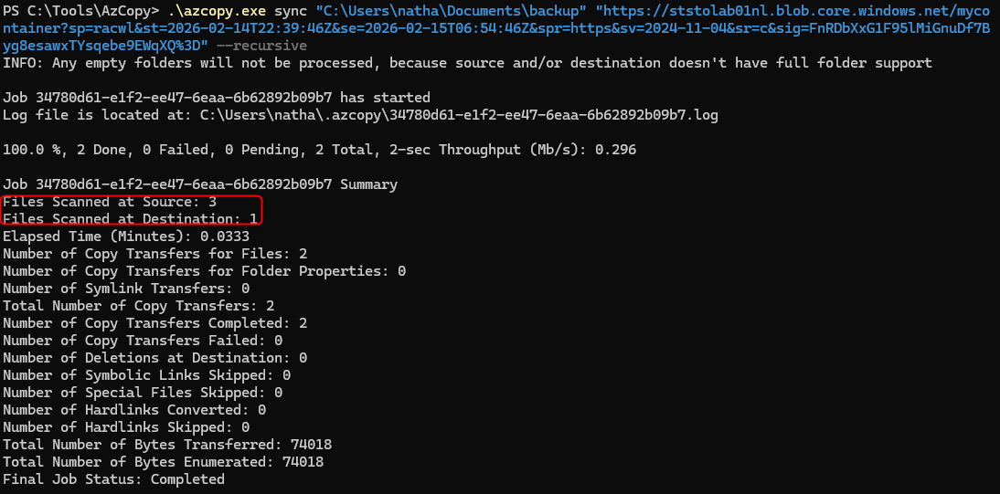

<p class="figure-caption"><b>Figure 12</b> · Synchroniser un Dossier Local vers un Conteneur</p>

### Synchroniser un Conteneur vers un Dossier Local

```bash
azcopy sync "https://ststolab01nl.blob.core.windows.net/mycontainer/data/" "/chemin/local/data/" --recursive
```

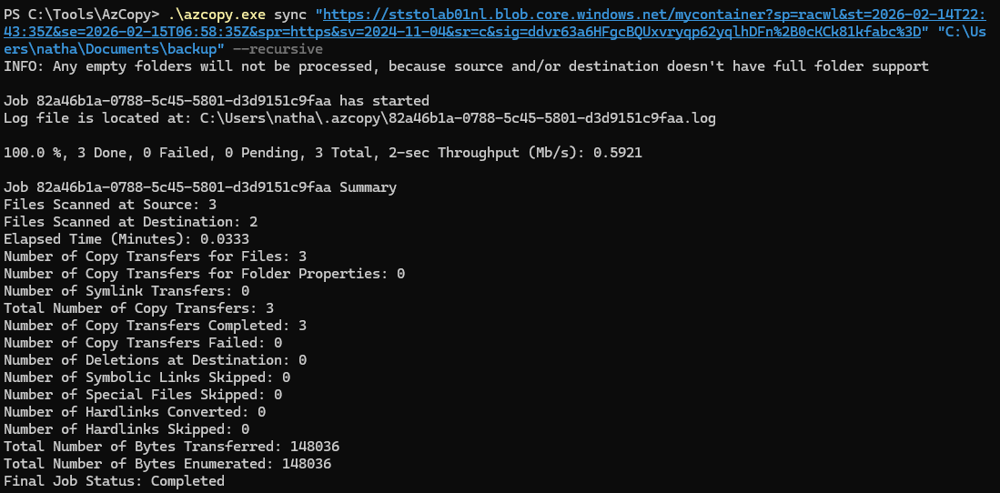

<p class="figure-caption"><b>Figure 13</b> · Synchroniser un Conteneur vers un Dossier Local</p>

### Synchroniser entre Deux Conteneurs

```bash
azcopy sync \
"https://source-account.blob.core.windows.net/container/?<SAS>" \
"https://dest-account.blob.core.windows.net/container/?<SAS>" \
--recursive
```

## Commandes Utilitaires

### Lister le Contenu d'un Conteneur

```bash
azcopy list "https://ststolab01nl.blob.core.windows.net/mycontainer/" --properties "LastModifiedTime;BlobType;ContentType"
```

### Supprimer des Blobs

```bash
# Supprimer un blob
azcopy remove "https://ststolab01nl.blob.core.windows.net/mycontainer/old-file.pdf"
# Supprimer tout un dossier virtuel
azcopy remove "https://ststolab01nl.blob.core.windows.net/mycontainer/logs/" --recursive
# Supprimer avec un filtre
azcopy remove "https://ststolab01nl.blob.core.windows.net/mycontainer/" --recursive --include-pattern "*.tmp"
```

### Vérifier les Jobs en Cours

```bash
# Lister tous les jobs
azcopy jobs list
# Voir le détail d'un job
azcopy jobs show <JOB_ID>
```

### Reprendre un Transfert Échoué

```bash
azcopy jobs resume <JOB_ID>
```

<div class="callout callout-note">

AzCopy conserve un journal de chaque transfert. Si votre connexion réseau tombe au milieu d'un transfert de 100 Go, reprenez là où ça s'était arrêté au lieu de recommencer.

</div>

## Vérifications

**Version installée** : `azcopy --version` retourne la version 10.x.

**Login Entra ID** : `azcopy login` suivi de `azcopy list "https://ststolab01nl.blob.core.windows.net/mycontainer/"` retourne la liste des blobs sans erreur.

**Upload réussi** : Après un `azcopy copy`, le terminal affiche un résumé avec « Number of File Transfers: X, Transfer successfully: X, Transfer failed: 0 ».

**Vérification dans le portail** : Dans le conteneur, les fichiers uploadés apparaissent avec la bonne taille et le bon timestamp.

**Server-side copy** : Lors d'une copie inter-comptes, le transfert est beaucoup plus rapide que votre bande passante locale (signe que les données ne passent pas par votre poste).

## Dépannage

**"AuthorizationPermissionMismatch" avec Entra ID :** Votre compte a le rôle Contributor mais pas de rôle de données. Attribuez-vous le rôle **Storage Blob Data Contributor** sur le compte de stockage (pas sur le resource group, sur le compte lui-même). Attendez 5 minutes pour la propagation RBAC.

**"AuthenticationFailed" avec un SAS :** Le SAS a expiré, les permissions sont insuffisantes, ou la clé qui a signé le SAS a été régénérée. Générez un nouveau SAS avec les permissions appropriées.

**Le transfert est très lent :** Vérifiez la variable d'environnement `AZCOPY_CONCURRENCY_VALUE`. Par défaut, AzCopy dimensionne le parallélisme selon le nombre de cœurs CPU. Sur une machine à 2 cœurs, augmentez-la : `export AZCOPY_CONCURRENCY_VALUE=16` (Linux) ou `$env:AZCOPY_CONCURRENCY_VALUE=16` (PowerShell).

**"Failed to perform login" (erreur de device code) :** Votre navigateur n'a pas pu compléter l'authentification. Essayez `azcopy login --tenant-id <TENANT_ID>` en spécifiant le tenant. Si vous êtes sur un serveur sans navigateur, utilisez un SAS token à la place.

**"The specified container does not exist" :** AzCopy ne crée PAS les conteneurs automatiquement. Créez le conteneur avant le transfert, par exemple en PowerShell : `New-AzStorageContainer -Name mycontainer -Context (Get-AzStorageAccount -ResourceGroupName <rg> -Name ststolab01nl).Context`.

**Le fichier journal AzCopy prend trop de place :** Les journaux sont dans `~/.azcopy/`. Nettoyez les anciens jobs : `azcopy jobs clean --with-status=completed`.

## Conseils et Bonnes Pratiques

**Utilisez Entra ID plutôt que les SAS pour les transferts interactifs.** `azcopy login` est plus sécurisé (pas de token dans l'historique de commandes) et traçable (les accès sont logués avec votre identité). Réservez les SAS pour les scripts automatisés et les accès inter-tenants.

**Utilisez `azcopy sync` pour les backups récurrents.** Au lieu de copier 100 Go à chaque fois, sync ne transfère que les fichiers modifiés. Combiné avec un cron job (Linux) ou un Task Scheduler (Windows), c'est un backup incrémental simple et efficace.

**Définissez le tier à l'upload pour économiser.** Si vous uploadez des archives qui ne seront pas relues souvent, définissez le tier directement :

```bash
azcopy copy "/chemin/local/archives/" "https://ststolab01nl.blob.core.windows.net/archives/" --recursive --blob-type BlockBlob --block-blob-tier Cool
```

**Utilisez `--dry-run` pour vérifier avant d'agir.** Avant un sync avec `--delete-destination=true`, faites un dry run pour voir ce qui serait supprimé :

```bash
azcopy sync "/local/" "https://account.blob.core.windows.net/container/" --recursive --delete-destination=true --dry-run
```

**Automatisez avec une Managed Identity sur une VM Azure.** Si AzCopy tourne sur une VM Azure, utilisez la Managed Identity de la VM au lieu de `azcopy login` interactif :

```bash
azcopy login --identity
azcopy copy "/data/" "https://account.blob.core.windows.net/container/" --recursive
```

## Procédures Liées

- [Gestion des SAS Tokens et Access Keys](/procedures/azure/gestion-des-sas-tokens-et-access-keys) *(Générer les SAS tokens utilisés par AzCopy)*
- [Déploiement d'un Compte de Stockage](/procedures/azure/deploiement-dun-compte-de-stockage) *(Le compte de stockage cible doit exister avant le transfert)*
- [Configuration des Access Tiers et Lifecycle Policies](/procedures/azure/configuration-des-access-tiers-et-lifecycle-policies) *(AzCopy peut définir le tier à l'upload avec `--block-blob-tier`)*
- [Gestion des Managed Identities (System & User Assigned)](/procedures/azure/gestion-des-managed-identities-system-user-assigned) *(Utiliser `azcopy login --identity` sur une VM Azure)*
- [Déploiement et Montage d'un Partage Azure Files](/procedures/azure/deploiement-et-montage-dun-partage-azure-files) *(AzCopy supporte aussi les transferts vers Azure Files avec `azcopy copy` vers une URL `.file.core.windows.net`)*
