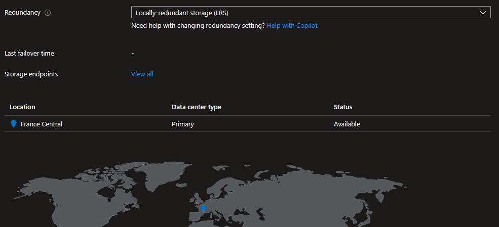
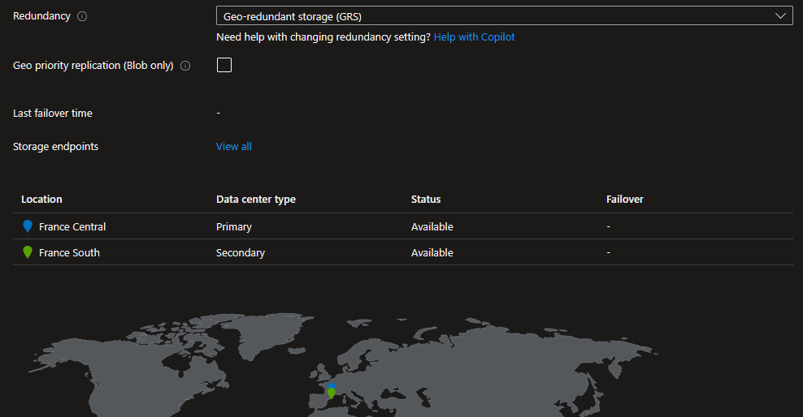

## Introduction

Cette procédure décrit comment configurer et modifier la réplication d'un compte de stockage Azure. La réplication détermine combien de copies de vos données existent, où elles sont stockées, et si elles sont lisibles en cas de panne de la région principale.

## Contexte et Justification

Vos données dans Azure Storage sont toujours répliquées pour les protéger contre les pannes matérielles. La question n'est pas « est-ce que mes données sont répliquées ? » (elles le sont toujours), mais « de quel niveau de résilience ai-je besoin ? ».

Un site e-commerce dont les images produit sont dans un Blob Storage peut se contenter de LRS en dev (3 copies dans le même datacenter, pas cher). Mais en production, si le datacenter tombe, les images disparaissent et le site est cassé. Il faut au minimum du ZRS (3 copies réparties sur 3 datacenters dans la même région) ou du GRS (réplication vers une autre région à des centaines de kilomètres).

Le choix de la réplication est un compromis entre coût, résilience et accès aux données :

| Scénario | Redondance recommandée |
|-----------------------------------------------|----------------------------|
|               Lab / Dev / Test                | LRS                        |
|       Production standard (une région)        | ZRS                        |
|    Production critique (survie régionale)     | GRS ou GZRS                |
| Production critique + lecture en cas de panne | RA-GRS ou RA-GZRS          |

## Concepts Clés

**Réplication locale (même région) :**

- **LRS (Locally Redundant Storage)** : 3 copies synchrones dans un seul datacenter. Le moins cher. Durabilité : 99.999999999% (11 neufs). Protège contre : panne de disque, panne de rack. Ne protège PAS contre : panne du datacenter, catastrophe régionale.
- **ZRS (Zone-Redundant Storage)** : 3 copies synchrones réparties dans 3 zones de disponibilité (datacenters physiquement séparés dans la même région). Durabilité : 99.9999999999% (12 neufs). Protège contre : panne d'un datacenter entier. Ne protège PAS contre : catastrophe régionale affectant toutes les zones.

**Réplication géographique (inter-régions) :**

- **GRS (Geo-Redundant Storage)** : LRS dans la région primaire + 3 copies asynchrones dans la région pairée (ex : France Central → France South). Durabilité : 99.99999999999999% (16 neufs). La réplication est asynchrone, ce qui signifie qu'en cas de panne soudaine de la région primaire, les toutes dernières écritures (quelques secondes) peuvent être perdues. Les données secondaires ne sont PAS accessibles tant que Microsoft ne déclenche pas un failover, ou tant que vous ne le déclenchez pas vous-même.
- **RA-GRS (Read-Access Geo-Redundant Storage)** : Comme GRS, mais les données secondaires sont lisibles en permanence via une URL dédiée : `https://<nom>-secondary.blob.core.windows.net`. Utile pour les applications qui peuvent basculer automatiquement en lecture seule sur la région secondaire en cas de panne.
- **GZRS (Geo-Zone-Redundant Storage)** : ZRS dans la région primaire + 3 copies asynchrones (LRS) dans la région pairée. Combine la protection zonale locale avec la protection géographique.
- **RA-GZRS (Read-Access GZRS)** : GZRS avec lecture sur la région secondaire. Le niveau de résilience maximum disponible.

**Région pairée (Paired Region) :** Chaque région Azure est associée à une autre région dans la même géographie. France Central est pairée avec France South. En cas de panne régionale, Microsoft priorise la restauration d'une région de chaque paire. Vous ne pouvez PAS choisir la région secondaire, elle est déterminée par le pairing.

**RPO (Recovery Point Objective) :** Pour la réplication géographique, le RPO est généralement inférieur à 15 minutes. Cela signifie qu'en cas de panne catastrophique de la région primaire, vous pourriez perdre jusqu'à 15 minutes de données. Azure ne fournit pas de SLA garanti sur le RPO.

**Last Sync Time :** Un horodatage que vous pouvez consulter pour savoir à quand remonte la dernière réplication réussie vers la région secondaire. C'est le seul moyen de savoir « à quel point mes données secondaires sont à jour ».

## Prérequis

- Un Compte de Stockage existant (ex : ststoragelab01nl) créé en LRS (cf. [procédure Déploiement d'un Compte de Stockage](/procedures/azure/deploiement-dun-compte-de-stockage)).
- Le rôle **Contributor** (minimum) sur le compte de stockage.
- Pour tester RA-GRS : une application ou un script capable de lire depuis l'URL secondaire.

## Points de Vigilance

**Toutes les transitions ne sont pas possibles directement.** Vous pouvez passer de LRS à GRS directement, mais vous ne pouvez PAS passer de LRS à ZRS directement si le compte a été créé avant que ZRS soit disponible dans la région. Dans ce cas, il faut soit faire une migration en direct (demande au support), soit passer par LRS → GRS → GZRS → ZRS. Les chemins de migration sont contraints par une matrice de conversion Microsoft qu'il faut vérifier avant toute bascule.

**GRS ≠ les données secondaires sont lisibles.** C'est le piège classique. Avec GRS simple, vos données sont bien répliquées dans la région secondaire, mais vous ne pouvez PAS les lire tant qu'il n'y a pas de failover. Pour la lecture permanente, il faut RA-GRS. Si une application doit pouvoir lire les données depuis la région secondaire en cas de dégradation, la réponse est RA-GRS ou RA-GZRS, jamais GRS seul.

**La réplication géographique est asynchrone.** Les écritures dans la région primaire sont confirmées AVANT d'être répliquées vers la région secondaire. En cas de panne soudaine, les dernières écritures peuvent être perdues. GRS ne garantit donc pas zéro perte de données : le RPO est généralement inférieur à 15 minutes mais n'est pas couvert par un SLA contractuel.

**Le failover vers la région secondaire dégrade la redondance.** Si vous déclenchez un failover (account failover), votre compte passe en LRS dans l'ancienne région secondaire (qui devient la primaire). Vous perdez la réplication géographique jusqu'à ce que vous la reconfiguriez manuellement.

**Le changement de redondance peut prendre du temps.** Passer de LRS à GRS ne copie pas instantanément les données. La réplication initiale peut prendre des heures en fonction du volume de données. Pendant ce temps, le statut de réplication secondaire affiche « Bootstrapping ».

**Premium ne supporte que LRS et ZRS.** Si votre compte est en Premium, vous ne pouvez pas utiliser GRS, RA-GRS, GZRS ou RA-GZRS. La réplication géographique n'est disponible que pour les comptes Standard.

## Choix Architecturaux & Alternatives

### Quand choisir une option de réplication

Le choix de la redondance est systématique à la création d'un compte de stockage, il n'y a pas d'option par défaut neutre. LRS convient aux environnements de développement, aux données reconstructibles (caches, logs éphémères), et aux comptes où le coût prime sur la résilience. ZRS est la cible pour la production standard d'une région, il protège contre la perte d'un datacenter sans surcoût géographique. GRS et GZRS s'imposent pour les données métier critiques dont la perte régionale serait inacceptable. RA-GRS et RA-GZRS se distinguent en offrant une continuité de lecture pendant un incident régional, à condition que l'application soit capable de basculer vers l'endpoint secondaire.

### Alternatives et comparatif

| Option | Cas d'usage typique | Force principale | Faiblesse principale | Coût relatif |
|---------------|---------------|---------------|---------------|---------------|
| **LRS** | Dev, test, données reconstructibles | Le moins cher, 11 neufs de durabilité | Aucune protection datacenter ni régionale | Base (1x) |
| **ZRS** | Production standard une région | Protège contre la perte d'un datacenter | Pas de protection régionale | Environ 1,25x LRS |
| **GRS** | Production critique, survie régionale | Copie asynchrone dans la région pairée | Données secondaires non lisibles sans failover | Environ 2x LRS |
| **RA-GRS** | Production critique, lecture en dégradé | Endpoint secondaire lisible en permanence | Coût supérieur, logique de retry applicative à prévoir | Environ 2,5x LRS |
| **GZRS** | Production critique, tolérance zonale + régionale | Combine résilience zonale et géographique | Disponible sur un sous-ensemble de régions | Environ 2,3x LRS |
| **RA-GZRS** | Production critique maximale | Niveau de résilience le plus élevé disponible | Le plus cher, disponibilité régionale limitée | Environ 2,9x LRS |

### Impact des choix

- **Coût.** La réplication est le levier de coût principal sur un compte de stockage, avant même le tier (Hot/Cool/Archive). Passer de LRS à RA-GZRS multiplie le coût de stockage par environ 3. À dimensionner en fonction du volume de données et de la criticité métier, pas par principe.
- **RPO et RTO.** LRS et ZRS offrent un RPO de zéro (réplication synchrone) mais un RTO indéfini en cas de panne régionale (pas de secours). GRS et dérivés ont un RPO typique inférieur à 15 minutes (non contractuel) et un RTO dépendant de la décision de failover, manuelle ou Microsoft.
- **Complexité opérationnelle.** LRS et ZRS sont transparents. GRS impose de surveiller le Last Sync Time via Azure Monitor. RA-GRS et RA-GZRS exigent en plus une logique applicative de retry sur l'endpoint secondaire, sans quoi l'option de lecture reste théorique.
- **Sécurité et conformité.** Certains cadres réglementaires (HDS, souveraineté) imposent de connaître et maîtriser la localisation des copies secondaires. La région pairée est imposée par Azure et ne se choisit pas, ce qui peut être un point bloquant pour les données soumises à résidence stricte.
- **Limites de service.** Premium ne supporte que LRS et ZRS, excluant toute stratégie géographique native. Certaines transitions directes entre SKU ne sont pas autorisées et nécessitent un chemin intermédiaire. Le failover de compte remet le compte en LRS post-bascule, ce qui impose une reconfiguration manuelle de la redondance.

## Méthode 1 : Configuration via Portail Azure

### Vérifier la Réplication Actuelle

1. Allez sur votre compte de stockage (ststoragelab01nl).
2. Dans le menu gauche, section **"Data management"**, cliquez sur **"Redundancy"**.
3. La page affiche le type de réplication actuel (ex : « Locally-redundant storage (LRS) ») avec un schéma visuel montrant la localisation des copies.



<p class="figure-caption"><b>Figure 1</b> · Vérifier la Réplication Actuelle</p>

### Changer la Redondance

1. Sur la même page **"Redundancy"**, dans le menu déroulant **"Redundancy"**, sélectionnez la nouvelle option (ex : **"Geo-redundant storage (GRS)"**).
2. Une info-bulle peut s'afficher pour vous prévenir des implications (coût, temps de migration).
3. Cliquez sur **"Save"** en haut.
4. La migration commence. Le statut de la réplication secondaire passe à « Bootstrapping » (synchronisation en cours).

<div class="callout callout-note">

Si vous voulez RA-GRS (lecture sur la secondaire), sélectionnez « Geo-redundant storage (GRS) » puis cochez la case **"Make read access to data available in the event of regional unavailability"** qui apparaît en dessous.

</div>

### Vérifier le Statut de Réplication GRS

1. Toujours sur la page **"Redundancy"**.
2. Vous voyez la région pairée (ex : France South).
3. **"Status"** :
   - **Available** : La réplication est terminée, les données secondaires sont à jour.
   - **Unavailable / Bootstrapping** : La synchronisation initiale est en cours.



<p class="figure-caption"><b>Figure 2</b> · Vérifier le Statut de Réplication GRS</p>

4. **"Last Sync Time"** : L'horodatage de la dernière réplication réussie (visible uniquement en RA-GRS/RA-GZRS).

### Accéder aux Données de la Région Secondaire (RA-GRS)

1. Allez dans le menu **"Endpoints"** du compte de stockage.
2. Vous verrez deux sections :
   - **Primary endpoints** : https://ststoragelab01nl.blob.core.windows.net
   - **Secondary endpoints** : https://ststoragelab01nl-secondary.blob.core.windows.net
3. L'URL secondaire est en lecture seule. Vous pouvez la tester avec un navigateur ou un outil comme Azure Storage Explorer.

<div class="callout callout-note">

Les secondary endpoints n'apparaissent QUE si vous avez configuré RA-GRS ou RA-GZRS. Avec GRS simple, ils n'existent pas.

</div>

## Méthode 2 : Configuration via PowerShell

### Vérifier la Redondance Actuelle

```powershell
$storage = Get-AzStorageAccount -ResourceGroupName "rg-storage-lab" -Name "ststoragelab01nl"
$storage | Select-Object StorageAccountName, @{N="SKU";E={$_.Sku.Name}}, PrimaryLocation, SecondaryLocation | Format-List
```

### Changer la Redondance

Passer de LRS à GRS :

```powershell
Set-AzStorageAccount -ResourceGroupName "rg-storage-lab" -Name "ststoragelab01nl" -SkuName "Standard_GRS"
```

### Vérifier le Statut de la Réplication Secondaire

```powershell
$storage = Get-AzStorageAccount -ResourceGroupName "rg-storage-lab" -Name "ststoragelab01nl"
$storage | Select-Object StorageAccountName, @{N="SKU";E={$_.Sku.Name}}, SecondaryLocation, StatusOfSecondary | Format-List
```

### Lister les Endpoints

```powershell
$ctx = $storage.Context
Write-Host "Primary Blob : $($ctx.BlobEndPoint)"
Write-Host "Primary File : $($ctx.FileEndPoint)"
if ($storage.Sku.Name -match "RAGRS|RAGZRS") {
    Write-Host "Secondary Blob : $($storage.SecondaryEndpoints.Blob)"
}
```

## Vérifications

**Redondance modifiée** : Dans le portail \> **"Redundancy"**, le type affiché correspond à votre choix (ex : GRS).

**Région secondaire** : Pour GRS/RA-GRS, la section « Secondary region » affiche la région pairée (ex : France South) et le statut « Available ».

**Endpoints secondaires** : Pour RA-GRS, dans **"Endpoints"**, les URLs `-secondary` sont présentes.

**Last Sync Time** : Pour RA-GRS/RA-GZRS, l'horodatage de la dernière synchronisation est visible et récent (quelques minutes maximum).

**Lecture secondaire** : Testez avec `curl https://ststoragelab01nl-secondary.blob.core.windows.net/<container>/<blob>` (doit retourner les données ou un 404 si le blob n'existe pas, mais PAS un 403 « endpoint not found »).

## Dépannage

**"Changing the storage account replication type from X to Y is not supported" :** Certaines transitions directes ne sont pas autorisées. Par exemple, passer de GRS à ZRS directement peut ne pas être possible. La solution est de passer par un chemin intermédiaire : GRS → LRS → ZRS. Vérifiez la matrice de conversion dans la documentation Microsoft.

**Le statut secondaire reste "Bootstrapping" depuis longtemps :** La réplication initiale dépend du volume de données. Pour un compte avec des To de données, ça peut prendre des heures. Vérifiez le Last Sync Time pour suivre la progression. Il n'y a pas de moyen d'accélérer ce processus.

**"secondaryEndpoints" est vide malgré GRS :** Vous êtes en GRS, pas en RA-GRS. Les endpoints secondaires n'existent qu'avec le préfixe RA- (Read-Access). Changez la redondance vers RA-GRS si vous avez besoin de lire les données secondaires.

**Le failover ne fonctionne pas :** Le failover de compte (account failover) n'est pas pris en charge pour tous les types de comptes (ex : comptes avec namespace hiérarchique selon les régions). Vérifiez que votre compte est compatible et que la réplication secondaire est dans l'état « Available » avant de déclencher le failover.

## Conseils et Bonnes Pratiques

**Choisissez la réplication en fonction du RPO et du RTO, pas du coût seul.** Un calcul simple : combien coûte une heure d'indisponibilité de vos données ? Si c'est plus que la différence de coût annuelle entre LRS et GRS, prenez GRS.

**Utilisez RA-GRS avec une logique de retry dans vos applications.** Les SDK Azure Storage (Blob Client) supportent nativement le « secondary retry ». Si une lecture échoue sur le primary endpoint, le SDK retente automatiquement sur le secondary. Configurez ça dans vos applications pour un basculement transparent.

**Surveillez le Last Sync Time.** Si l'écart entre maintenant et le Last Sync Time dépasse 15 minutes, il y a potentiellement un problème de réplication. Configurez une alerte Azure Monitor sur cette métrique.

**Downgrade avec précaution.** Passer de GRS à LRS supprime la copie secondaire. Si la région primaire tombe ensuite, vos données n'ont plus de filet de sécurité géographique. Ne faites ce downgrade que si vous avez une autre stratégie de backup (Azure Backup, AzCopy vers un autre compte).

## Procédures Liées

- [Déploiement d'un Compte de Stockage](/procedures/azure/deploiement-dun-compte-de-stockage) *(La réplication est définie lors de la création, cette procédure explique comment la modifier ensuite)*
- [Configuration des Access Tiers et Lifecycle Policies](/procedures/azure/configuration-des-access-tiers-et-lifecycle-policies) *(Les lifecycle policies fonctionnent de la même manière quelle que soit la redondance)*
- [Configuration du Soft Delete et Versioning](/procedures/azure/configuration-du-soft-delete-et-versioning) *(Le soft delete protège contre les suppressions accidentelles, la réplication protège contre les pannes d'infrastructure, ce sont deux protections complémentaires)*
- Configuration des Alertes et Action Groups *(Surveiller le Last Sync Time et le statut de la réplication secondaire)*
