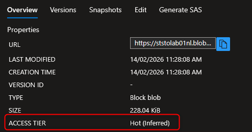
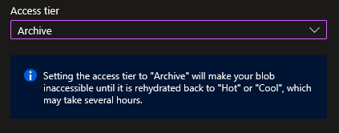
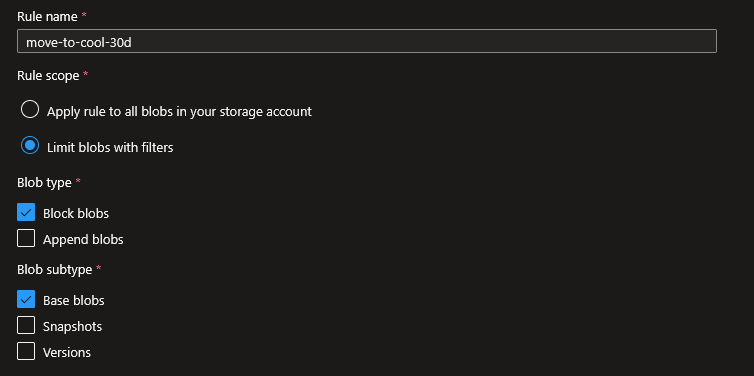
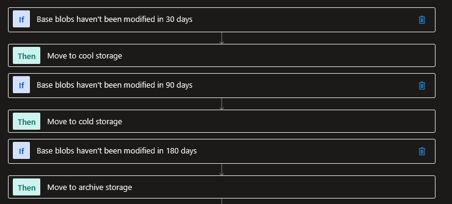
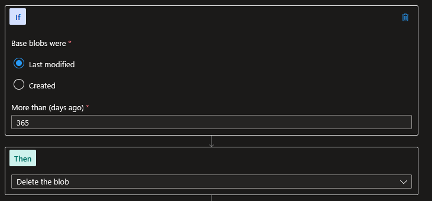
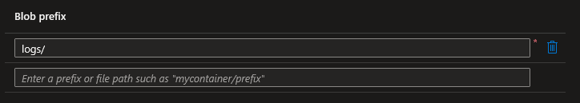

## Introduction

Cette procédure décrit comment optimiser les coûts de stockage Azure en utilisant les tiers d'accès (Access Tiers) et les politiques de cycle de vie (Lifecycle Management Policies). Le principe : les données auxquelles vous accédez rarement coûtent moins cher si vous les stockez sur un tier adapté, et les lifecycle policies automatisent cette transition.

## Contexte et Justification

Dans un compte de stockage typique, 80% des données n'ont pas été lues depuis plus de 30 jours (logs, anciens rapports, archives de projets terminés). Pourtant, elles sont stockées sur le tier Hot, le plus cher en stockage.

Prenons un exemple concret. Une entreprise stocke 10 To de données :

- 2 To accédés quotidiennement (Hot).
- 3 To accédés une fois par mois (Cool).
- 3 To accédés une fois par trimestre (Cold).
- 2 To jamais accédés mais conservés pour la conformité (Archive).

En stockant tout en Hot, le coût mensuel de stockage est d'environ 200 €. En répartissant les données par tier adapté, le coût tombe à environ 60 €. Sur un an, c'est 1 680 € d'économies pour aucune différence fonctionnelle.

Les lifecycle policies automatisent cette optimisation : au lieu de déplacer manuellement les blobs vers les bons tiers, une règle dit « tout blob non modifié depuis 30 jours passe en Cool, depuis 90 jours en Cold, depuis 180 jours en Archive, depuis 365 jours il est supprimé ».

## Concepts Clés

**Access Tiers :**

| Tier | Usage | Coût stockage (par Go) | Coût accès (par 10 000 ops) | Durée minimum recommandée |
|---------|------------------|--------------|-----------------|---------------|
| **Hot** | Données fréquentes | Le plus cher | Le moins cher | Aucune |
| **Cool** | Données peu fréquentes | ~50% moins cher | ~2x plus cher | 30 jours |
| **Cold** | Données rarement accédées | ~70% moins cher | ~3x plus cher | 90 jours |
| **Archive** | Données d'archivage | ~90% moins cher | Le plus cher + délai de réhydratation | 180 jours |

**Tier de compte vs Tier de blob :** Le tier par défaut du compte (Hot ou Cool) s'applique aux blobs uploadés sans tier explicite. Mais chaque blob peut avoir son propre tier, indépendamment du tier du compte. Les tiers Cold et Archive ne peuvent être définis qu'au niveau du blob, pas du compte.

**Archive : un tier spécial.** Les blobs en Archive ne sont PAS lisibles directement. Ils sont « offline ». Pour les lire, il faut d'abord les « réhydrater » (les ramener vers Hot ou Cool). La réhydratation prend du temps :

- **Standard priority** : Jusqu'à 15 heures.
- **High priority** : Généralement moins d'une heure, mais plus cher.

**Lifecycle Management Policy :** Un ensemble de règles JSON qui s'exécutent automatiquement une fois par jour. Chaque règle peut :

- **Transition (tierToHot, tierToCool, tierToCold, tierToArchive)** : Déplacer un blob vers un tier moins cher après X jours depuis la dernière modification ou le dernier accès.
- **Delete** : Supprimer un blob après X jours.
- **Filtrer** : S'appliquer uniquement aux blobs dont le nom commence par un préfixe donné (ex : logs/, backups/).

**Date de référence :** Les lifecycle policies se basent sur trois dates possibles :

- `daysAfterModificationGreaterThan` : Nombre de jours depuis la dernière modification du blob.
- `daysAfterLastAccessTimeGreaterThan` : Nombre de jours depuis le dernier accès (lecture ou écriture). Nécessite d'activer le « Last Access Time Tracking » sur le compte.
- `daysAfterCreationGreaterThan` : Nombre de jours depuis la création (disponible uniquement pour les snapshots et les versions).

**Early Deletion Fee (Frais de suppression anticipée) :** Si vous déplacez un blob vers Cool et que vous le supprimez ou le déplacez avant 30 jours, Azure vous facture les jours restants comme si le blob était resté 30 jours. Même chose pour Cold (90 jours) et Archive (180 jours). Ce n'est pas un blocage technique (le déplacement fonctionne), c'est une pénalité financière.

## Prérequis

- Un Compte de Stockage existant en **StorageV2** (General Purpose v2). Les tiers d'accès ne sont PAS disponibles sur les comptes StorageV1.
- Au moins un conteneur avec quelques blobs de test pour valider les transitions.
- Le rôle **Contributor** (minimum) sur le compte de stockage.
- Pour le tracking du dernier accès : activer le « Last Access Time Tracking » (voir « Conseils et Bonnes Pratiques »).

## Points de Vigilance

**Archive n'est pas un tier « en ligne ».** Contrairement à Hot, Cool et Cold (qui sont tous accessibles instantanément), Archive est offline. Un blob en Archive ne peut pas être lu, téléchargé ou copié sans réhydratation préalable. Si une application obtient une erreur 409 en essayant de lire un blob, vérifiez son tier : un blob en Archive doit d'abord être réhydraté.

**Le tier du compte n'est PAS le tier des blobs existants.** Changer le tier par défaut du compte de Hot à Cool ne modifie PAS le tier des blobs déjà présents. Seuls les nouveaux blobs uploadés sans tier explicite seront en Cool. Pour changer le tier des blobs existants, il faut le faire individuellement ou via une lifecycle policy.

**La transition vers Archive est irréversible sans coût.** Déplacer un blob vers Archive est quasi gratuit. Mais le réhydrater coûte cher (frais de lecture Archive plus frais d'écriture sur le tier destination). Archive est le tier avec le coût d'accès le plus élevé, ce qui en fait un piège financier si les données y sont placées trop tôt.

**Les lifecycle policies s'exécutent une fois par jour, pas en temps réel.** Si vous créez une règle « move to Cool after 30 days », un blob de 31 jours ne sera pas déplacé instantanément. Il sera traité lors du prochain cycle d'exécution (dans les 24h). En production, ce délai doit être pris en compte dans toute stratégie de bascule rapide.

**Cool, Cold et Archive ont des frais de suppression anticipée.** Erreur fréquente : déplacer un blob vers Cool puis le supprimer après 10 jours entraîne une facturation des 20 jours restants (30 moins 10) en frais de stockage Cool. Même logique pour Cold (90 jours) et Archive (180 jours).

**Les lifecycle policies ne fonctionnent que sur les Block Blobs.** Les Page Blobs (utilisés pour les disques de VM non managés) et les Append Blobs ne supportent PAS les transitions de tier ni les lifecycle policies.

## Choix Architecturaux & Alternatives

### Quand choisir les Access Tiers et Lifecycle Policies

Les Access Tiers sont la réponse native d'Azure Blob Storage pour aligner le coût de stockage sur le profil d'accès réel des données. À déployer systématiquement dès qu'un compte de stockage contient des catégories de données hétérogènes (logs, backups, archives réglementaires, médias chauds). Les Lifecycle Policies sont le complément obligatoire : elles automatisent les transitions que personne ne fera manuellement à l'échelle. En pratique, tout Storage Account de production sans policy lifecycle active dérive vers un coût Hot inutile sous 6 à 12 mois.

### Alternatives et comparatif

| Option | Cas d'usage typique | Force principale | Faiblesse principale | Coût relatif |
|-------------|---------------|---------------------|----------------|---------|
| **Blob Hot** | Données chaudes, accès fréquent | Latence minimale, coût d'accès plus bas | Coût de stockage élevé | Base (1x) |
| **Blob Cool** | Données peu fréquentes, rétention 30 jours min | Stockage environ 50% moins cher | Coût d'accès doublé, pénalité suppression anticipée | Environ 0,5x |
| **Blob Cold** | Données rares, rétention 90 jours min | Stockage environ 70% moins cher | Coût d'accès triplé, pénalité suppression anticipée | Environ 0,3x |
| **Blob Archive** | Archivage conformité, rétention 180 jours min | Stockage environ 90% moins cher | Offline, réhydratation coûteuse jusqu'à 15h | Environ 0,1x |
| **Azure Files (tiers propres)** | Partages SMB/NFS avec hiérarchie de tiers | Accès fichier natif, tiers Hot/Cool/Transaction | Pas de Cold ni Archive, moins granulaire | Variable |
| **Azure NetApp Files** | Workloads haute performance persistants | Latence sub-milliseconde, SLA élevé | Pas de tier froid, coût élevé | Très élevé |
| **Stockage objet externe (S3 Glacier, tape)** | Archivage souverain ou multi-cloud | Indépendance Azure, coûts d'archivage concurrentiels | Intégration non native, egress Azure facturé | Variable |

### Impact des choix

- **Coût.** Le levier le plus direct sur la facture Storage : une bascule Hot vers Cool divise le stockage par deux, Hot vers Archive par dix. Mais les frais d'accès et de suppression anticipée peuvent annuler l'économie si le profil d'accès réel ne correspond pas au tier choisi. Le gain net se calcule toujours sur le coût total (stockage plus opérations plus réhydratation éventuelle), pas sur le coût stockage seul.
- **Complexité opérationnelle.** Les Lifecycle Policies ajoutent une surface de configuration JSON à maintenir et à versionner. Un mauvais préfixe ou une condition trop large peut archiver massivement des données actives. L'activation du Last Access Time Tracking est presque toujours nécessaire pour des policies fiables ; elle a un coût d'écriture additionnel sur les métadonnées.
- **Performance et RTO.** Hot, Cool et Cold offrent un accès instantané avec des différences de latence négligeables. Archive rompt ce modèle : son RTO de lecture varie de moins d'une heure (High priority) à 15 heures (Standard). Toute donnée dont le RTO critique est inférieur à 15h ne doit pas résider en Archive.
- **Limites de service.** Les Access Tiers ne sont disponibles que sur StorageV2. Les Page Blobs et Append Blobs sont exclus des transitions de tier. Les tiers Cold et Archive ne peuvent être définis qu'au niveau blob, pas au niveau compte. Les Lifecycle Policies s'exécutent une fois par jour, ce qui introduit une latence de 24 à 48h sur toute bascule.
- **Verrouillage technologique.** La hiérarchie Hot/Cool/Cold/Archive et la syntaxe des Lifecycle Policies sont spécifiques Azure. Un design portable multi-cloud (S3 Intelligent Tiering, GCS Nearline/Coldline/Archive) nécessite une couche d'abstraction applicative ou un outil tiers type rclone.

## Méthode 1 : Configuration via Portail Azure

### Vérifier et Changer le Tier par Défaut du Compte

1. Allez sur votre compte de stockage (ststolab01nl).
2. Menu gauche \> **"Configuration"**.
3. La section **"Blob access tier (default)"** affiche le tier actuel (Hot ou Cool).
4. Changez-le si nécessaire et cliquez sur **"Save"**.

<div class="callout callout-note">

Ce changement n'affecte que les futurs blobs uploadés sans tier explicite. Les blobs existants gardent leur tier actuel.

</div>

### Changer le Tier d'un Blob Individuel

1. Allez dans **"Containers"** \> Sélectionnez un conteneur \> Cliquez sur un blob.
2. En haut de la page du blob, vous voyez le tier actuel (ex : « Access tier: Hot »).



<p class="figure-caption"><b>Figure 1</b> · Changer le Tier d'un Blob Individuel</p>

3. Cliquez sur **"Change tier"**.
4. Sélectionnez le nouveau tier (Hot, Cool, Cold, ou Archive).
5. Si vous sélectionnez Archive, un avertissement vous rappelle que le blob deviendra offline.



<p class="figure-caption"><b>Figure 2</b> · Sélection du nouveau tier</p>

6. Cliquez sur **"Save"**.

### Créer une Lifecycle Management Policy

1. Dans le menu gauche du compte de stockage, section **"Data management"**, cliquez sur **"Lifecycle management"**.
2. Cliquez sur **"+ Add a rule"**.
3. **Rule name** : move-to-cool-30d.
4. **Rule scope** : Apply rule to all blobs in your storage account (ou « Limit blobs with filters » pour cibler des préfixes).
5. **Blob type** : Block blobs (coché par défaut).
6. **Blob subtype** : Base blobs (les blobs principaux, pas les snapshots ni les versions).



<p class="figure-caption"><b>Figure 3</b> · Créer une Lifecycle Management Policy</p>

7. Cliquez sur **"Next"**.

### Ajouter une Règle de Transition

Sur l'onglet **"Base blobs"** :

1. Cochez **"Last modified"** comme condition (ou « Last accessed » si le tracking est activé).
2. **"More than (days ago)"** : 30.
3. **"Then"** : Move to Cool storage.
4. Vous pouvez empiler plusieurs transitions en cliquant **"+ Add condition"** :
   - Last modified \> 90 days → Move to Cold storage.
   - Last modified \> 180 days → Move to Archive storage.



<p class="figure-caption"><b>Figure 4</b> · Ajouter une Règle de Transition</p>

5. Cliquez sur **"Next"** pour configurer les filtres (ou **"Add"** pour valider la règle).

### Ajouter une Règle de Suppression

Créez une nouvelle règle (ou ajoutez une condition à la règle existante) :

1. **"+ Add a rule"** \> **Rule name** : delete-old-blobs-365d.
2. Sur l'onglet des conditions :
   - **"Last modified"** \> **More than (days ago)** : 365.
   - **"Then"** : Delete the blob.



<p class="figure-caption"><b>Figure 5</b> · Ajouter une Règle de Suppression</p>

3. Cliquez sur **"Add"**.

### Filtrer par Préfixe de Blob

Pour appliquer une règle uniquement à certains blobs (ex : les logs) :

1. Lors de la création de la règle, à l'étape **"Rule scope"**, sélectionnez **"Limit blobs with filters"**.
2. Sur l'onglet **"Filter set"** :
   - **Blob prefix** : logs/ (tous les blobs dans le « dossier » logs).
   - Vous pouvez ajouter plusieurs préfixes.



<p class="figure-caption"><b>Figure 6</b> · Filtrer par Préfixe de Blob</p>

3. La règle ne s'appliquera qu'aux blobs dont le nom commence par ce préfixe.

<div class="callout callout-note">

C'est très utile pour avoir des politiques différentes : les logs sont archivés après 30 jours et supprimés après 90, tandis que les documents métier sont archivés après 180 jours et conservés 7 ans.

</div>

## Méthode 2 : Configuration via PowerShell

### Changer le Tier par Défaut du Compte

```powershell
Set-AzStorageAccount -ResourceGroupName "rg-storage-lab" -Name "ststolab01nl" -AccessTier Cool
```

### Changer le Tier d'un Blob Individuel

```powershell
$ctx = (Get-AzStorageAccount -ResourceGroupName "rg-storage-lab" -Name "ststolab01nl").Context
# Passer un blob en Archive
$blob = Get-AzStorageBlob -Container "mycontainer" -Blob "rapports/rapport-2024.pdf" -Context $ctx
$blob.BlobClient.SetAccessTier("Archive")
# Réhydrater un blob depuis Archive (priorité haute)
$blob.BlobClient.SetAccessTier("Hot", $null, "High")
```

### Créer une Lifecycle Policy

```powershell
$ctx = (Get-AzStorageAccount -ResourceGroupName "rg-storage-lab" -Name "ststolab01nl").Context
# Règle 1 : Transition progressive pour tous les blobs
$action1 = Add-AzStorageAccountManagementPolicyAction -BaseBlobAction TierToCool -DaysAfterModificationGreaterThan 30
$action1 = Add-AzStorageAccountManagementPolicyAction -InputObject $action1 -BaseBlobAction TierToCold -DaysAfterModificationGreaterThan 90
$action1 = Add-AzStorageAccountManagementPolicyAction -InputObject $action1 -BaseBlobAction TierToArchive -DaysAfterModificationGreaterThan 180
$action1 = Add-AzStorageAccountManagementPolicyAction -InputObject $action1 -BaseBlobAction Delete -DaysAfterModificationGreaterThan 365
$filter1 = New-AzStorageAccountManagementPolicyFilter -BlobType blockBlob
$rule1 = New-AzStorageAccountManagementPolicyRule `
    -Name "move-to-cool-30d" `
    -Action $action1 `
    -Filter $filter1
# Règle 2 : Archive rapide pour les logs
$action2 = Add-AzStorageAccountManagementPolicyAction -BaseBlobAction TierToArchive -DaysAfterModificationGreaterThan 30
$action2 = Add-AzStorageAccountManagementPolicyAction -InputObject $action2 -BaseBlobAction Delete -DaysAfterModificationGreaterThan 90
$filter2 = New-AzStorageAccountManagementPolicyFilter -BlobType blockBlob -PrefixMatch "logs/"
$rule2 = New-AzStorageAccountManagementPolicyRule -Name "archive-logs-fast" -Action $action2 -Filter $filter2
# Appliquer les deux règles
Set-AzStorageAccountManagementPolicy -ResourceGroupName "rg-storage-lab" -StorageAccountName "ststolab01nl" -Rule $rule1, $rule2
```

### Vérifier la Policy Active

```powershell
Get-AzStorageAccountManagementPolicy -ResourceGroupName "rg-storage-lab" -StorageAccountName "ststolab01nl" | Select-Object -ExpandProperty Rules | Format-Table Name, Enabled, Definition
```

Pour supprimer :

```powershell
Remove-AzStorageAccountManagementPolicy -ResourceGroupName "rg-storage-lab" -StorageAccountName "ststolab01nl"
```

## Vérifications

**Tier du compte** : Dans **"Configuration"**, le tier par défaut affiche la valeur choisie.

**Tier d'un blob** : Dans le conteneur, cliquez sur un blob \> Le champ **"Access tier"** affiche le tier correct (ex : Cool).

**Lifecycle policy active** : Dans **"Lifecycle management"**, vos règles apparaissent dans la liste avec le statut « Enabled ».

**Réhydratation** : Pour un blob en Archive, après avoir lancé la réhydratation, le statut passe à **"Rehydrate pending"**. Une fois terminé, le tier affiché est Hot ou Cool.

**Exécution de la policy** : Les lifecycle policies s'exécutent une fois par jour. Après 24-48h, vérifiez que les blobs éligibles ont bien changé de tier dans le portail.

## Dépannage

**"This operation is not permitted on an archived blob" (erreur 409) :** Vous tentez de lire ou télécharger un blob en Archive. Réhydratez-le d'abord en changeant son tier vers Hot ou Cool (`SetAccessTier`, voir la méthode 2), puis attendez la fin de la réhydratation (Standard : jusqu'à 15h, High : moins d'1h).

**La lifecycle policy ne semble pas s'exécuter :** Les policies s'exécutent une fois par jour. Après la création, attendez 24 à 48 heures avant de voir les premiers effets. Vérifiez aussi que la règle est bien « Enabled » et que les filtres (préfixes, blob types) correspondent à vos blobs.

**Le tier du blob ne change pas malgré la policy :** Vérifiez la condition de la règle. Si vous utilisez `daysAfterModificationGreaterThan: 30` mais que le blob a été modifié il y a 25 jours, il ne sera pas traité. Vérifiez la date de « Last Modified » du blob dans ses propriétés.

**Coûts inattendus après une transition vers Archive :** Vous avez probablement réhydraté des blobs fréquemment. La réhydratation depuis Archive est l'opération la plus coûteuse. Vérifiez vos factures dans Cost Management et identifiez les opérations de réhydratation.

**"Access tier is not supported for this account kind" :** Votre compte est de type StorageV1 ou BlobStorage. Les tiers d'accès complets (Hot/Cool/Cold/Archive) nécessitent un compte StorageV2. Migrez votre compte : `Set-AzStorageAccount -ResourceGroupName <rg> -Name <nom> -UpgradeToStorageV2`.

## Conseils et Bonnes Pratiques

**Activez le Last Access Time Tracking.** Par défaut, les lifecycle policies se basent sur la date de dernière modification. Mais un blob modifié il y a 6 mois qui est lu tous les jours ne devrait PAS être archivé. Activez le tracking du dernier accès pour utiliser `daysAfterLastAccessTimeGreaterThan` à la place :

```powershell
Enable-AzStorageBlobLastAccessTimeTracking -ResourceGroupName "rg-storage-lab" -StorageAccountName "ststolab01nl"
```

**Commencez par une policy d'observation avant d'archiver.** Créez d'abord une règle qui déplace vers Cool après 30 jours (pas vers Archive). Observez l'impact sur les coûts pendant un mois. Si personne ne se plaint d'un accès lent, ajoutez ensuite la transition vers Archive.

**Utilisez les préfixes pour des politiques différenciées.** Structurez vos conteneurs avec des préfixes logiques (logs/, backups/, documents/, media/). Chaque préfixe peut avoir sa propre politique de rétention et d'archivage.

**Ne mettez pas de données fréquemment accédées en Archive pour économiser.** Les frais de réhydratation annuleront vos économies. Archive est réservé aux données que vous ne relirez quasiment jamais (conformité légale, archives réglementaires).

## Procédures Liées

- [Déploiement d'un Compte de Stockage](/procedures/azure/deploiement-dun-compte-de-stockage) *(Le tier par défaut est défini lors de la création, le type StorageV2 est requis pour les tiers)*
- [Configuration de la Réplication (LRS, GRS, RA-GRS)](/procedures/azure/configuration-de-la-replication-lrs-grs-ra-grs) *(La réplication et les tiers sont indépendants, mais le coût total combine les deux)*
- [Configuration du Soft Delete et Versioning](/procedures/azure/configuration-du-soft-delete-et-versioning) *(Le soft delete conserve les blobs supprimés pendant X jours, les lifecycle policies peuvent aussi supprimer les anciennes versions et les snapshots)*
- [Configuration d'AzCopy pour Transfert de Données](/procedures/azure/configuration-dazcopy-pour-transfert-de-donnees) *(AzCopy peut être utilisé pour changer le tier de blobs en masse lors d'une migration)*
