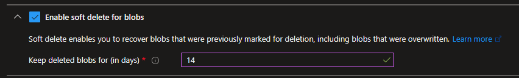
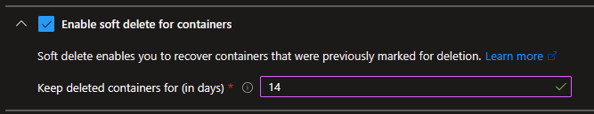
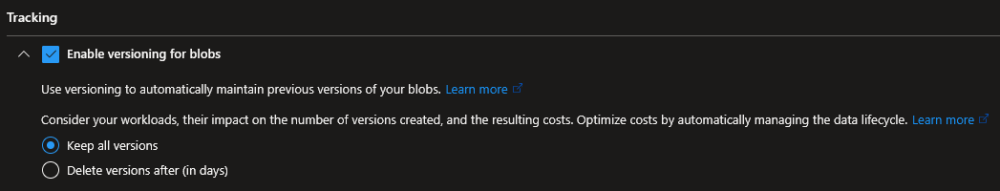
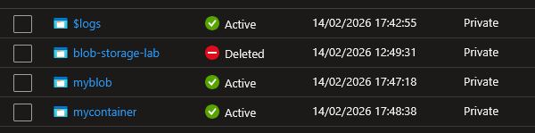
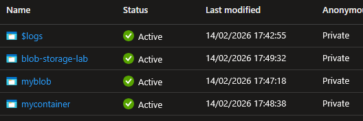
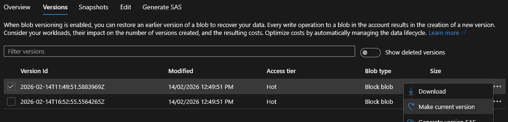

## Introduction

Cette procédure décrit comment protéger vos données Azure Storage contre les suppressions accidentelles et les écrasements involontaires. Le Soft Delete conserve les données supprimées dans une « corbeille » pendant une durée configurable. Le Versioning crée automatiquement une nouvelle version à chaque modification d'un blob, permettant de revenir à n'importe quel état précédent.

## Contexte et Justification

Un administrateur supprime par erreur un conteneur avec 500 fichiers de production. Un script mal configuré écrase un fichier de configuration critique avec un contenu vide. Un développeur fait un DELETE au lieu d'un GET sur un blob.

Sans protection, ces données sont perdues définitivement. Azure Storage ne dispose pas de corbeille native par défaut (au sens Windows). C'est à vous d'activer les mécanismes de protection :

- **Soft Delete** : Quand vous supprimez un blob, un conteneur ou un file share, il n'est pas réellement supprimé. Il passe dans un état « soft deleted » pendant X jours (que vous définissez). Pendant cette période, vous pouvez le restaurer. Après, il est supprimé définitivement.
- **Versioning** : Chaque fois qu'un blob est modifié (écriture, écrasement), Azure conserve automatiquement l'ancienne version. Vous pouvez lister toutes les versions et revenir à n'importe laquelle. Les versions ne s'effacent pas automatiquement (sauf via une lifecycle policy).

Ces deux mécanismes sont complémentaires : le soft delete protège contre la suppression, le versioning protège contre l'écrasement.

## Concepts Clés

**Soft Delete pour les Blobs :**

- Quand un blob est supprimé, il passe en état « soft deleted ».
- Il est invisible dans les listings normaux mais visible avec le filtre « Show deleted blobs ».
- Pendant la période de rétention (1 à 365 jours), il peut être restauré (undelete).
- Après la période de rétention, il est purgé automatiquement et définitivement.
- S'applique aussi aux snapshots supprimés et aux versions écrasées (si le versioning est actif).

**Soft Delete pour les Conteneurs :**

- Même principe mais au niveau du conteneur entier.
- Un conteneur supprimé est conservé pendant la période de rétention.
- Vous ne pouvez PAS créer un nouveau conteneur avec le même nom tant que l'ancien est en soft delete (le nom est « réservé »).
- Période configurable : 1 à 365 jours.

**Soft Delete pour les File Shares :**

- Protège les partages Azure Files supprimés.
- Même principe : le partage supprimé est conservé et restaurable.
- Période configurable : 1 à 365 jours.

**Blob Versioning :**

- Chaque opération d'écriture (PUT, PutBlock, SetBlobProperties, SetBlobMetadata) crée une nouvelle version du blob.
- La version la plus récente est la « current version ». Les précédentes sont des « previous versions ».
- Chaque version a un identifiant unique (timestamp).
- Les previous versions ne sont pas modifiables (immutables).
- Les versions consomment de l'espace de stockage. 100 modifications = 100 versions = 100x la taille si le blob entier est réécrit à chaque fois.
- Pour limiter les coûts, utilisez des lifecycle policies pour supprimer automatiquement les anciennes versions (ex : supprimer les versions de plus de 90 jours).

**Blob Snapshots vs Versioning :**

- **Snapshot** : Une copie manuelle à un instant T. Vous décidez quand créer un snapshot. Il est en lecture seule.
- **Versioning** : Automatique à chaque modification. Vous ne décidez pas quand, c'est Azure qui crée la version.
- Le versioning remplace largement les snapshots manuels pour la plupart des cas d'usage.

**Change Feed :**

- Un journal immuable de toutes les modifications (création, modification, suppression) sur les blobs du compte.
- Utile pour l'audit et le déclenchement d'actions automatiques.
- Indépendant du soft delete et du versioning, mais souvent activé en complément.

## Prérequis

- Un Compte de Stockage existant en **StorageV2** (General Purpose v2).
- Au moins un conteneur avec quelques blobs pour tester la suppression et la restauration.
- Le rôle **Contributor** (minimum) sur le compte de stockage.
- Le blob versioning nécessite un compte de type StorageV2 ou BlobStorage, et ne fonctionne PAS si le compte a un namespace hiérarchique activé (Data Lake Storage Gen2).

## Points de Vigilance

**Le soft delete est désactivé par défaut pour les comptes créés en ligne de commande.** Si vous créez un compte via le portail, le soft delete est activé par défaut (7 jours). Mais via PowerShell (ou toute autre ligne de commande), il faut l'activer explicitement. En production, toute procédure de déploiement de compte de stockage doit donc vérifier l'état du soft delete après création : la récupération des données dépend entièrement de cette activation.

**Le soft delete pour les blobs, les conteneurs et les file shares sont trois configurations séparées.** Activer le soft delete pour les blobs ne protège PAS les conteneurs. Si vous supprimez un conteneur, même si le blob soft delete est actif, le conteneur et tout son contenu sont perdus (sauf si le container soft delete est aussi activé).

**Le versioning consomme de l'espace et coûte de l'argent.** Si un blob de 1 Go est modifié 100 fois, vous avez potentiellement 100 Go de versions stockées. En production, des hausses de coût de stockage inexpliquées viennent fréquemment de l'accumulation d'anciennes versions. Solution : une lifecycle policy pour supprimer automatiquement les anciennes versions.

**Le soft delete ne protège PAS contre l'écrasement.** Si vous uploadez un fichier avec le même nom qu'un blob existant, l'ancien contenu est écrasé. Le soft delete ne le sauvegarde PAS (il ne se déclenche que sur les suppressions). Pour protéger contre l'écrasement, il faut le versioning.

**On ne peut pas restaurer un blob soft deleted si la période de rétention est dépassée.** Après l'expiration, le blob est purgé et irrécupérable. La purge est automatique et irréversible.

**Le soft delete des conteneurs empêche la réutilisation du nom.** Tant qu'un conteneur supprimé est en période de rétention, vous ne pouvez PAS créer un nouveau conteneur avec le même nom.

## Choix Architecturaux & Alternatives

### Quand choisir Soft Delete et Versioning

Soft Delete et Versioning sont les deux mécanismes de protection des données natifs et gratuits (hors stockage des données retenues) à activer systématiquement sur tout compte de stockage Azure. Soft Delete est la première ligne de défense contre les suppressions accidentelles, Versioning la première ligne contre les écrasements. À activer dès la création du compte, sans exception, avec une rétention de 7 à 14 jours pour un lab et 30 à 90 jours pour la production. Ces mécanismes ne remplacent pas une stratégie de backup, ils constituent un filet de sécurité court terme pour limiter le blast radius des erreurs humaines ou applicatives courantes.

### Alternatives et comparatif

| Option | Cas d'usage typique | Force principale | Faiblesse principale | Coût relatif |
|---------------|---------------|----------------|---------------|-------------|
| **Soft Delete** | Suppressions accidentelles (blob, conteneur, share) | Activation en un clic, rétention configurable | Ne protège pas contre l'écrasement, fenêtre de rétention courte | Quasi nul (stockage retenu uniquement) |
| **Blob Versioning** | Écrasements accidentels, historique des modifications | Versions immutables, restauration granulaire | Coût de stockage cumulatif, à maîtriser via lifecycle policy | Variable selon la fréquence d'écriture |
| **Snapshots manuels** | Points de reprise contrôlés avant opération critique | Décision explicite, format immutable | Geste manuel, oublié en pratique | Très faible |
| **Azure Backup pour Blob/Files** | Backup entreprise, rétention longue (mois, années) | Rétention jusqu'à 10 ans, restauration au niveau item, point-in-time | Payant, configuration initiale, RPO plus long | Moyen |
| **Immutable Storage (WORM)** | Conformité réglementaire (SEC 17a-4, HDS, RGPD) | Impossible à supprimer même par Owner, certifié compliance | Rigidité totale, rétention minimale imposée | Faible surcoût Storage |
| **Object Replication** | Redondance applicative inter-comptes | Copie asynchrone vers un autre compte/région | Ne protège pas si la source est corrompue et répliquée | Coût du second compte plus egress |
| **Resource Locks (CanNotDelete)** | Protection de la ressource parente (compte, RG) | Empêche toute suppression du compte entier | Ne protège pas les données dans le compte | Nul |

### Impact des choix

- **Coût.** Soft Delete ne facture que le stockage des données retenues pendant la période de rétention : c'est marginal. Versioning peut exploser les coûts si des blobs volumineux sont écrasés fréquemment sans lifecycle policy en aval. Azure Backup a un coût par instance protégée plus le stockage des snapshots. Immutable Storage n'ajoute quasi rien au prix du stockage mais verrouille la ressource.
- **RPO et RTO.** Soft Delete et Versioning offrent un RPO quasi nul (protection au moment de l'opération) mais un RTO limité à la fenêtre de rétention (typiquement 7 à 90 jours). Azure Backup étend la fenêtre à plusieurs années au prix d'un RPO plus long (point-in-time par jour ou par heure). Immutable Storage a un RPO nul et un RTO infini tant que la politique de rétention est active.
- **Complexité opérationnelle.** Soft Delete et Versioning sont activables en un clic. Azure Backup impose la création d'un Recovery Services Vault et la définition de policies. Immutable Storage demande une réflexion réglementaire en amont, une fois appliqué, il est irréversible sur la durée de rétention définie.
- **Couverture des risques.** Aucune option seule ne couvre tous les scénarios. Soft Delete couvre la suppression, Versioning couvre l'écrasement, Azure Backup couvre la corruption longue durée et les ransomwares, Immutable Storage couvre la compliance, Locks couvrent la suppression de la ressource parente. Une stratégie de protection des données robuste combine plusieurs de ces couches.
- **Sécurité contre les ransomwares.** Soft Delete seul ne protège pas contre un attaquant qui a les droits de purge. Immutable Storage est la seule option qui bloque même un compte Owner compromis. Azure Backup dans un vault avec Multi-user authorization (MUA) ajoute une couche humaine de validation.
- **Verrouillage technologique.** Soft Delete, Versioning et Snapshots sont des primitives Azure spécifiques mais conceptuellement transposables à AWS S3 (Versioning et Object Lock) et GCS (Object Versioning et Bucket Lock). Azure Backup est un service managé Azure, sa logique de policies ne migre pas nativement vers un autre cloud.

## Méthode 1 : Configuration via Portail Azure

### Activer le Soft Delete pour les Blobs

1. Allez sur votre compte de stockage (ststoragelab01nl).
2. Menu gauche, section **"Data management"**, cliquez sur **"Data protection"**.
3. Section **"Recovery"** :
   - Cochez **"Enable soft delete for blobs"**.
   - **"Days to retain deleted blobs"** : 14 (recommandé pour la production, 7 pour un lab).



<p class="figure-caption"><b>Figure 1</b> · Activer le Soft Delete pour les Blobs</p>

4. Cliquez sur **"Save"**.

### Activer le Soft Delete pour les Conteneurs

1. Sur la même page **"Data protection"**.
2. Cochez **"Enable soft delete for containers"**.
3. **"Days to retain deleted containers"** : 14.



<p class="figure-caption"><b>Figure 2</b> · Activer le Soft Delete pour les Conteneurs</p>

4. Cliquez sur **"Save"**.

### Activer le Blob Versioning

1. Toujours sur la page **"Data protection"**.
2. Section **"Tracking"** :
   - Cochez **"Enable versioning for blobs"**.



<p class="figure-caption"><b>Figure 3</b> · Activer le Blob Versioning</p>

3. Cliquez sur **"Save"**.

<div class="callout callout-note">

À partir de maintenant, chaque modification d'un blob crée automatiquement une version. Vous verrez les versions dans l'onglet **"Versions"** de chaque blob.

</div>

### Restaurer un Blob Supprimé (Soft Delete)

1. Allez dans le conteneur où se trouvait le blob supprimé.
2. En haut à droite, dans le filtre déroulant, sélectionnez **"Show deleted blobs"** (au lieu de « Only show active blobs »).
3. Les blobs supprimés apparaissent grisés avec le statut « Deleted ».



<p class="figure-caption"><b>Figure 4</b> · Restaurer un Blob Supprimé (Soft Delete)</p>

4. Cliquez sur le blob supprimé (ou cochez-le).
5. Cliquez sur le bouton **"Undelete"**.
6. Le blob retrouve son état actif.



<p class="figure-caption"><b>Figure 5</b> · Blob restauré</p>

### Restaurer une Version Précédente (Versioning)

1. Dans le conteneur, cliquez sur le nom du blob.
2. Cliquez sur l'onglet **"Versions"**.
3. Vous voyez la liste de toutes les versions avec leur date et leur taille.
4. À côté de la version que vous voulez restaurer, cliquez sur les **"..."** (menu contextuel).
5. Cliquez sur **"Make current version"**.



<p class="figure-caption"><b>Figure 6</b> · Restaurer une Version Précédente (Versioning)</p>

6. La version sélectionnée devient la version active. L'ancienne version courante est conservée comme version précédente.

## Méthode 2 : Configuration via PowerShell

### Activer le Soft Delete pour les Blobs

```powershell
Enable-AzStorageBlobDeleteRetentionPolicy -ResourceGroupName "rg-storage-lab" -StorageAccountName "ststoragelab01nl" -RetentionDays 14
```

### Activer le Soft Delete pour les Conteneurs

```powershell
Enable-AzStorageContainerDeleteRetentionPolicy -ResourceGroupName "rg-storage-lab" -StorageAccountName "ststoragelab01nl" -RetentionDays 14
```

### Activer le Soft Delete pour les File Shares

```powershell
Update-AzStorageFileServiceProperty -ResourceGroupName "rg-storage-lab" -StorageAccountName "ststoragelab01nl" -EnableShareDeleteRetentionPolicy $true -ShareRetentionDays 14
```

### Activer le Blob Versioning

```powershell
Update-AzStorageBlobServiceProperty -ResourceGroupName "rg-storage-lab" -StorageAccountName "ststoragelab01nl" -IsVersioningEnabled $true
```

### Vérifier la Configuration

```powershell
$blobProps = Get-AzStorageBlobServiceProperty -ResourceGroupName "rg-storage-lab" -StorageAccountName "ststoragelab01nl"
Write-Host "Blob Soft Delete : $($blobProps.DeleteRetentionPolicy.Enabled) - $($blobProps.DeleteRetentionPolicy.Days) jours"
Write-Host "Container Soft Delete : $($blobProps.ContainerDeleteRetentionPolicy.Enabled) - $($blobProps.ContainerDeleteRetentionPolicy.Days) jours"
Write-Host "Versioning : $($blobProps.IsVersioningEnabled)"
```

### Lister et Restaurer les Blobs Supprimés

```powershell
$ctx = (Get-AzStorageAccount -ResourceGroupName "rg-storage-lab" -Name "ststoragelab01nl").Context
# Lister les blobs supprimés
Get-AzStorageBlob -Container "mycontainer" -Context $ctx -IncludeDeleted |
    Where-Object { $_.IsDeleted } | Select-Object Name, IsDeleted, @{N="DeletedTime";E={$_.BlobProperties.DeletedOn}} | Format-Table
# Restaurer un blob supprimé
$deletedBlob = Get-AzStorageBlob -Container "mycontainer" -Blob "rapport.pdf" -Context $ctx -IncludeDeleted
$deletedBlob | Restore-AzStorageBlob
```

### Lister et Restaurer une Version Précédente

```powershell
Get-AzStorageBlob -Container "mycontainer" -Blob "rapport.pdf" -Context $ctx -IncludeVersion | Select-Object Name, VersionId, IsLatestVersion, @{N="Size";E={$_.Length}} | Format-Table
$versionId = "2026-02-14T10:30:00.0000000Z" # Remplacez par le VersionId souhaité
$sourceBlob = "https://ststoragelab01nl.blob.core.windows.net/mycontainer/rapport.pdf?versionid=$versionId"
Start-AzStorageBlobCopy -AbsoluteUri $sourceBlob -DestContainer "mycontainer" -DestBlob "rapport.pdf" -Context $ctx -Force
```

## Vérifications

**Soft Delete actif** : Dans **"Data protection"**, les trois cases soft delete sont cochées avec la période de rétention.

**Versioning actif** : La case « Enable versioning for blobs » est cochée.

**Test de suppression** : Supprimez un blob de test. Passez le filtre sur **"Show deleted blobs"**. Le blob apparaît grisé. Cliquez sur **"Undelete"**. Le blob est restauré.

**Test de versioning** : Uploadez un fichier, puis ré-uploadez le même fichier avec un contenu différent. Dans l'onglet **"Versions"** du blob, vous voyez deux versions.

**Test de restauration de version** : Faites **"Make current version"** sur l'ancienne version. Le contenu du blob revient à l'état précédent.

## Dépannage

**Le blob supprimé n'apparaît pas dans le listing :** Vérifiez que le filtre est bien sur **"Show deleted blobs"** dans le portail, ou que vous utilisez `-IncludeDeleted` en PowerShell. Si le blob a été supprimé avant l'activation du soft delete, il n'est pas récupérable.

**"This blob has been deleted and cannot be restored" :** La période de rétention est dépassée. Le blob a été purgé définitivement. Augmentez la période de rétention pour les prochaines suppressions.

**Impossible de créer un conteneur avec le même nom qu'un conteneur supprimé :** Le conteneur est en soft delete. Attendez l'expiration de la période de rétention, ou restaurez l'ancien conteneur puis renommez-le (en pratique, vous ne pouvez pas renommer un conteneur, vous devez copier le contenu vers un nouveau conteneur avec un nom différent).

**Les coûts de stockage augmentent alors que vous n'ajoutez rien :** Le versioning conserve toutes les anciennes versions. Vérifiez le nombre de versions : dans le portail, cliquez sur un blob \> **"Versions"**. Si des dizaines de versions existent, créez une lifecycle policy pour supprimer les versions de plus de X jours (cf. procédure Access Tiers et Lifecycle Policies).

**Le versioning ne fonctionne pas sur mon compte :** Vérifiez que le compte est de type StorageV2. Vérifiez aussi que le namespace hiérarchique (HNS) n'est PAS activé. Le versioning n'est pas compatible avec Data Lake Storage Gen2 (HNS).

## Conseils et Bonnes Pratiques

**Activez les trois soft delete sur tous vos comptes de stockage, sans exception.** C'est un filet de sécurité quasi gratuit (vous ne payez que le stockage des données soft deleted pendant la période de rétention). Le coût est négligeable comparé au risque de perdre des données de production.

**Combinez versioning et lifecycle policies.** Activez le versioning pour ne jamais perdre une modification, puis créez une lifecycle policy qui supprime les versions de plus de 90 jours pour maîtriser les coûts :

```json
{
  "rules": [{
    "name": "delete-old-versions",
    "type": "Lifecycle",
    "definition": {
      "actions": {
        "version": {
          "delete": {
            "daysAfterCreationGreaterThan": 90
          }
        }
      },
      "filters": {
        "blobTypes": ["blockBlob"]
      }
    }
  }]
}
```

**Le soft delete ne remplace PAS un vrai backup.** Le soft delete protège contre les suppressions accidentelles pendant quelques jours. Mais si quelqu'un supprime un blob et que vous ne le remarquez qu'après la période de rétention, c'est trop tard. Pour les données critiques, utilisez Azure Backup en complément.

**Utilisez des Locks sur les Resource Groups critiques.** Un lock CanNotDelete empêche la suppression du compte de stockage entier, même par un Owner. C'est une protection supplémentaire en amont du soft delete (cf. procédure Configuration des Locks).

## Procédures Liées

- [Déploiement d'un Compte de Stockage](/procedures/azure/deploiement-dun-compte-de-stockage) *(Le soft delete est configurable lors de la création, onglet Data Protection)*
- [Configuration des Access Tiers et Lifecycle Policies](/procedures/azure/configuration-des-access-tiers-et-lifecycle-policies) *(Les lifecycle policies peuvent supprimer automatiquement les anciennes versions et les blobs soft deleted expirés)*
- [Gestion des SAS Tokens et Access Keys](/procedures/azure/gestion-des-sas-tokens-et-access-keys) *(Le soft delete protège même si quelqu'un avec un SAS Delete supprime un blob)*
- [Configuration des Locks sur les Ressources](/procedures/azure/configuration-des-locks-sur-les-ressources) *(Les locks protègent le compte de stockage lui-même contre la suppression)*
