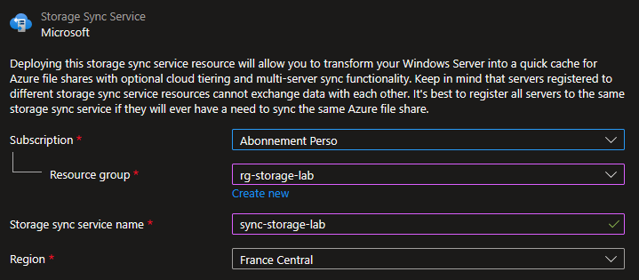
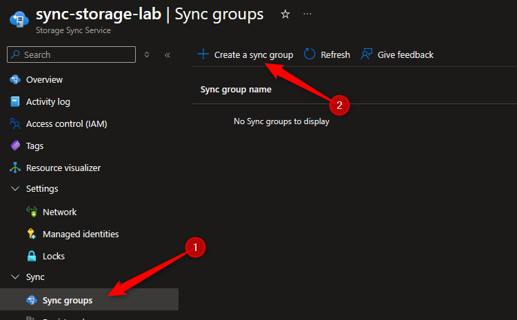
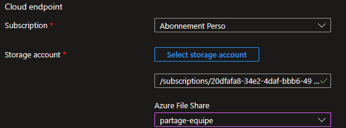
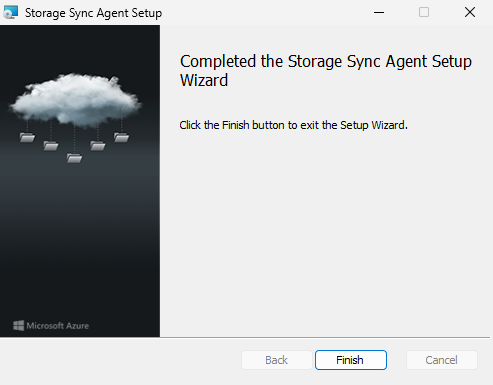
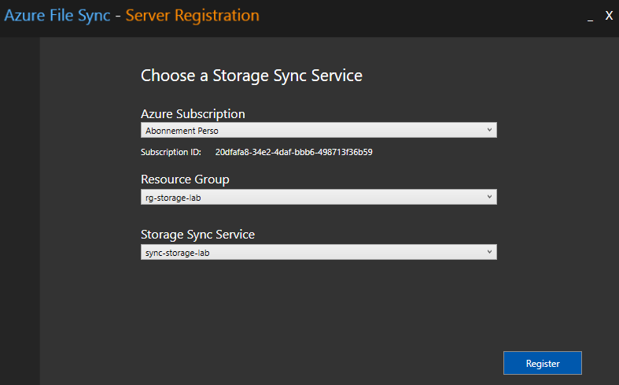
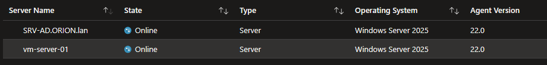
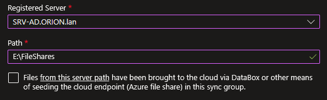
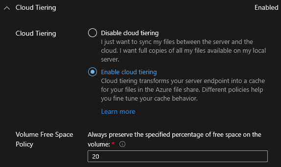
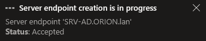

## Introduction

Cette procédure décrit le déploiement d'Azure File Sync, un service qui permet de synchroniser un ou plusieurs serveurs Windows on-premises avec un partage Azure Files. Le serveur Windows conserve un cache local des fichiers les plus utilisés (accès LAN rapide), tandis qu'Azure Files sert de stockage central dans le cloud (capacité quasi illimitée, backup, accès multi-sites).

## Contexte et Justification

Imaginons une entreprise avec deux bureaux (Paris et Lyon) qui partagent les mêmes fichiers. Sans Azure File Sync :

- Soit un seul serveur de fichiers à Paris, et Lyon accède aux fichiers via un VPN lent.
- Soit deux serveurs avec une réplication DFS complexe à maintenir et des conflits de fichiers.

Avec Azure File Sync :

- Chaque bureau a un serveur Windows avec un cache local des fichiers. L'accès est à vitesse LAN.
- Azure Files est le « maître » central. Les modifications se synchronisent automatiquement entre les bureaux via le cloud.
- Le Cloud Tiering libère de l'espace sur les serveurs locaux : les fichiers rarement accédés sont remplacés par des « pointeurs » de quelques Ko. Quand un utilisateur ouvre un fichier tieré, il est téléchargé transparentement depuis Azure.
- Si un serveur local tombe, les données sont en sécurité dans Azure. Un nouveau serveur peut resynchroniser en quelques heures.

## Concepts Clés

**Storage Sync Service :** La ressource Azure parente qui orchestre la synchronisation. C'est le « chef d'orchestre » qui relie les serveurs Windows aux partages Azure Files. Un Storage Sync Service par région.

**Sync Group :** Un groupe de synchronisation qui définit la topologie. Il contient exactement un Cloud Endpoint et un ou plusieurs Server Endpoints. Tous les endpoints d'un sync group sont synchronisés entre eux.

**Cloud Endpoint :** Le lien vers le partage Azure Files. Un sync group a exactement un cloud endpoint. Le partage Azure Files référencé ne peut PAS être utilisé dans un autre sync group.

**Server Endpoint :** Un dossier spécifique sur un serveur Windows enregistré (ex : `D:\FileShare`). Chaque serveur peut avoir plusieurs server endpoints (dans des sync groups différents), mais un dossier donné ne peut appartenir qu'à un seul server endpoint.

**Registered Server :** Un serveur Windows sur lequel l'agent Azure File Sync est installé et qui est enregistré auprès du Storage Sync Service. L'enregistrement crée une relation de confiance entre le serveur et Azure.

**Cloud Tiering :** Une fonctionnalité optionnelle (mais très utile) qui remplace les fichiers rarement accédés sur le serveur local par des « stubs » (pointeurs). Le fichier complet reste dans Azure Files. Quand un utilisateur ouvre un stub, le contenu est téléchargé automatiquement depuis Azure (transparent pour l'utilisateur). Deux politiques contrôlent le tiering :

- **Volume free space policy** : « Garde toujours X% d'espace libre sur le volume ». Si le volume se remplit, les fichiers les moins récemment accédés sont tierés.
- **Date policy** : « Tiere tous les fichiers non accédés depuis X jours ».

**Agent Azure File Sync :** Un logiciel installé sur chaque serveur Windows. Il gère la synchronisation, le cloud tiering, et la communication avec le Storage Sync Service. Mis à jour régulièrement par Microsoft (mises à jour automatiques recommandées).

## Prérequis

- Un **partage Azure Files** existant dans un compte de stockage StorageV2 (cf. procédure Déploiement et Montage d'un Partage Azure Files).
- Un **serveur Windows Server 2016 ou plus récent** (2019, 2022 ou 2025 recommandé). Il peut s'agir d'une VM Azure (pour le lab) ou un serveur physique on-premises (en production).
- Le volume où se trouve le dossier à synchroniser doit être formaté en **NTFS**. ReFS n'est pas supporté.
- **.NET Framework 4.7.2+** installé sur le serveur Windows.
- Le rôle **Contributor** sur le resource group pour créer le Storage Sync Service.
- Connectivité HTTPS (port 443) depuis le serveur Windows vers Azure. Pas besoin du port 445 (File Sync utilise son propre protocole sur 443).

## Points de Vigilance

**Un partage Azure Files ne peut être que dans un seul sync group.** Si votre partage « partage-equipe » est déjà cloud endpoint dans le sync group « SG-Paris », vous ne pouvez PAS l'ajouter comme cloud endpoint dans un autre sync group. Cette contrainte impose de concevoir la topologie de sync groups en amont : un partage ne peut pas être mutualisé entre plusieurs groupes de serveurs.

**Cloud Tiering ne fonctionne PAS sur le volume système (C:).** Le server endpoint ne peut pas être sur `C:\` si le cloud tiering est activé. Utilisez un volume dédié (D:, E:, etc.). Sans cloud tiering, `C:\` est techniquement possible mais déconseillé.

**Les fichiers tierés sont transparents pour l'utilisateur.** Ils apparaissent normalement dans l'explorateur. L'utilisateur ne voit aucune différence. La seule indication est l'attribut « Offline » sur le fichier (une petite icône de nuage dans l'explorateur Windows). Si l'utilisateur ouvre le fichier, il est rappelé depuis Azure automatiquement. Pour savoir si un fichier est tieré ou présent localement, consultez l'attribut Offline visible dans les propriétés ou via la taille sur disque (quelques Ko pour un stub).

**La synchronisation initiale peut prendre du temps.** Si le partage Azure Files contient déjà 100 Go de données, le serveur Windows doit tout télécharger lors de la première synchronisation. Inversement, si le serveur local contient beaucoup de données, tout doit être uploadé vers Azure. Planifiez la synchronisation initiale en dehors des heures de pointe.

**File Sync ne supporte PAS les caractères interdits par Azure Files.** Azure Files interdit certains caractères dans les noms de fichiers que NTFS autorise. Si vos fichiers locaux contiennent ces caractères, la synchronisation échoue pour ces fichiers. Vérifiez la compatibilité avant de déployer.

**Un serveur ne peut être enregistré que dans un seul Storage Sync Service.** Si le serveur est déjà enregistré dans un autre Storage Sync Service, vous devez d'abord le désenregistrer.

## Choix Architecturaux & Alternatives

### Quand choisir Azure File Sync

Azure File Sync est la solution de référence pour moderniser un serveur de fichiers Windows existant sans forcer les utilisateurs à changer leurs habitudes d'accès SMB. À privilégier dans trois scénarios. D'abord, les organisations multi-sites qui ont besoin d'un cache local performant sur chaque site avec un référentiel cloud unique, en remplacement d'une architecture DFS-R complexe. Ensuite, les entreprises souhaitant réduire le stockage local via le Cloud Tiering tout en conservant un point d'accès Windows classique. Enfin, les stratégies de disaster recovery et de backup centralisé d'un parc de file servers distribués. À éviter si les utilisateurs accèdent déjà nativement à Azure Files via SMB direct, car File Sync n'apporte alors que de la complexité.

### Alternatives et comparatif

| Option | Cas d'usage typique | Force principale | Faiblesse principale | Coût relatif |
|-------------|-----------------|-----------------|-----------------|----------|
| **Azure File Sync** | Modernisation file server Windows, multi-sites avec cache local | Cloud Tiering, multi-serveurs, intégration AD transparente | Serveur Windows requis, latence sur fichiers tierés | Moyen (Storage Sync + Files) |
| **Azure Files SMB direct** | Accès cloud natif, pas de serveur local | Simplicité, pas d'infrastructure à maintenir | Pas de cache local, latence WAN pour sites distants | Faible (Files seul) |
| **DFS-R (Windows Server)** | Réplication multi-sites full on-premises | Mature, gratuit avec licences Windows | Pas de tiering cloud, complexité à grande échelle, pas de backup centralisé | Nul (inclus) |
| **FSLogix avec Azure Files** | Profils utilisateurs AVD/Citrix | Profils persistants scalables | Usage spécifique VDI uniquement | Moyen |
| **NetApp Global File Cache** | Enterprise multi-sites haute performance | Cache intelligent, SLA NetApp, support multi-protocoles | Coût élevé, dépendance éditeur tiers | Très élevé |
| **Storage Gateway tiers (AWS File Gateway, etc.)** | Architectures multi-cloud ou hybrides non-Azure | Portabilité multi-providers | Intégration Azure non native | Variable |

### Impact des choix

- **Coût.** File Sync facture le Storage Sync Service (par serveur synchronisé, quelques euros par mois), plus le stockage Azure Files, plus les transactions SMB et File Sync. Le Cloud Tiering réduit le coût du stockage local au prix d'une facturation légèrement plus élevée des recalls fréquents. Pour un partage peu actif, File Sync reste compétitif face à un file server pur on-premises qui consomme bande passante et matériel.
- **Complexité opérationnelle.** File Sync ajoute trois ressources (Storage Sync Service, Sync Group, Cloud Endpoint) et un agent par serveur à maintenir. Comparé à DFS-R, le gain vient du pilotage centralisé depuis Azure et de la résilience native. L'inconvénient est la dépendance à la connectivité sortante 443 vers Azure : une panne réseau entraîne une désynchronisation silencieuse.
- **RPO et RTO.** La synchronisation est asynchrone et peut prendre plusieurs minutes à 24h selon le sens (serveur vers cloud est quasi temps réel, cloud vers serveur s'appuie sur un scan quotidien). Un RPO serré impose de ne pas modifier les fichiers directement côté cloud. Le RTO en cas de perte d'un serveur local est bon : un nouveau serveur resynchronise depuis Azure en quelques heures selon le volume et la bande passante.
- **Sécurité.** L'agent utilise HTTPS 443 sortant : pas besoin d'ouvrir SMB 445. Les identités sont gérées par l'AD local pour l'accès SMB des utilisateurs, Entra ID pour le Storage Sync Service. Attention : les fichiers tierés sont accessibles à tout utilisateur ayant les permissions NTFS locales ; le contrôle d'accès reste au niveau NTFS, pas au niveau Azure Files.
- **Limites de service.** Un serveur ne peut appartenir qu'à un seul Storage Sync Service. Un partage Azure Files ne peut appartenir qu'à un seul Sync Group. Cloud Tiering impose un volume dédié non-système formaté en NTFS. Les fichiers avec caractères interdits par Azure Files restent désynchronisés indéfiniment.
- **Verrouillage technologique.** Solution spécifique Azure et Windows Server. Sortir de File Sync impose une resynchronisation manuelle des données vers une autre cible (NAS, autre cloud). La dépendance à l'agent Microsoft avec expiration des versions oblige à maintenir une politique de mise à jour active.

## Méthode 1 : Configuration via Portail Azure

### Créer le Storage Sync Service

1. Recherchez **"Azure File Sync"** dans le portail et cliquez sur **"+ Create"**.
2. **Subscription** : Votre abonnement.
3. **Resource group** : rg-storage-lab.
4. **Storage Sync Service name** : sync-storage-lab.
5. **Region** : France Central (même région que votre compte de stockage).



<p class="figure-caption"><b>Figure 1</b> · Créer le Storage Sync Service</p>

6. Cliquez sur **"Review + create"** puis **"Create"**.

### Créer un Sync Group

1. Allez dans la ressource **sync-storage-lab**.
2. Cliquez sur **"+ Create a Sync group"**.



<p class="figure-caption"><b>Figure 2</b> · Créer un Sync Group</p>

3. **Sync group name** : sg-partage-equipe.
4. **Cloud Endpoint** : Configurez-le directement (voir « Ajouter le Cloud Endpoint »).

### Ajouter le Cloud Endpoint

Dans le même formulaire de création du sync group :

1. **Subscription** : Votre abonnement.
2. **Storage Account** : ststoragelab01nl.
3. **Azure File Share** : partage-equipe.



<p class="figure-caption"><b>Figure 3</b> · Ajouter le Cloud Endpoint</p>

4. Cliquez sur **"Create"**.

<div class="callout callout-note">

Le sync group est créé avec son cloud endpoint. Il n'a pas encore de server endpoint (pas de serveur enregistré).

</div>

### Installer l'Agent File Sync sur le Serveur Windows

1. Connectez-vous à votre VM Windows Server (RDP ou Bastion).
2. Téléchargez l'agent depuis le portail : dans le Storage Sync Service \> **"Registered servers"** \> **"Azure File Sync Agent"** (lien de téléchargement).
   - Ou directement : https://www.microsoft.com/en-us/download/details.aspx?id=57159
3. Lancez l'installeur **StorageSyncAgent.msi**.
4. Acceptez les valeurs par défaut. L'installation prend 1-2 minutes.
5. À la fin de l'installation, l'assistant d'enregistrement se lance automatiquement.



<p class="figure-caption"><b>Figure 4</b> · Installer l'Agent File Sync sur le Serveur Windows</p>

### Enregistrer le Serveur auprès du Storage Sync Service

L'assistant d'enregistrement s'ouvre après l'installation de l'agent :

1. Cliquez sur **"Sign in"** et connectez-vous avec votre compte Azure (le même qui a créé le Storage Sync Service).
2. Sélectionnez votre **Subscription**.
3. Sélectionnez le **Resource Group** : rg-storage-lab.
4. Sélectionnez le **Storage Sync Service** : sync-storage-lab.



<p class="figure-caption"><b>Figure 5</b> · Enregistrer le Serveur auprès du Storage Sync Service</p>

5. Cliquez sur **"Register"**.
6. Attendez la confirmation « Server registration succeeded ».

<div class="callout callout-note">

De retour dans le portail Azure, allez dans sync-storage-lab \> **"Registered servers"**. Votre serveur apparaît dans la liste avec le statut « Online ».

</div>



<p class="figure-caption"><b>Figure 6</b> · Serveur enregistré dans le Storage Sync Service</p>

### Ajouter le Server Endpoint

1. Dans le portail, allez dans sync-storage-lab \> **"Sync groups"** \> **sg-partage-equipe**.
2. Cliquez sur **"+ Add server endpoint"**.
3. **Registered server** : Sélectionnez votre serveur Windows.
4. **Path** : `D:\FileShare` (le dossier local à synchroniser). Créez-le sur le serveur s'il n'existe pas encore.



<p class="figure-caption"><b>Figure 7</b> · Ajouter le Server Endpoint</p>

5. **Cloud Tiering** : Enabled (recommandé).
6. **Volume Free Space Policy** : 20% (garde 20% du volume libre).



<p class="figure-caption"><b>Figure 8</b> · Paramètres de Cloud Tiering</p>

7. **Date Policy** : Optionnel (ex : tiere les fichiers non accédés depuis 30 jours).
8. **Initial Sync** : Sélectionnez le mode approprié :
   - Si le partage Azure contient déjà des données et le serveur est vide : les données seront téléchargées.
   - Si le serveur contient déjà des données et Azure est vide : les données seront uploadées.
   - Si les deux contiennent des données : File Sync fusionne (les fichiers identiques sont dédupliqués, les conflits génèrent des copies).
9. Cliquez sur **"Create"**.



<p class="figure-caption"><b>Figure 9</b> · Mode de synchronisation initiale</p>

<div class="callout callout-note">

La synchronisation initiale commence. Selon le volume de données, cela peut prendre de quelques minutes à plusieurs heures.

</div>

### Configurer le Cloud Tiering

Si vous n'avez pas activé le cloud tiering lors de la création du server endpoint, ou si vous voulez modifier les paramètres :

1. Dans le sync group, cliquez sur votre server endpoint.
2. Section **"Cloud Tiering"** :
   - **Status** : Enabled / Disabled.
   - **Volume free space policy** : Ajustez le pourcentage (ex : 20%).
   - **Date policy** : Activez et définissez le nombre de jours (ex : 30).
3. Cliquez sur **"Save"**.

<div class="callout callout-note">

Le cloud tiering ne tiere pas immédiatement. Il s'exécute en arrière-plan et tiere les fichiers progressivement selon les politiques configurées.

</div>

## Méthode 2 : Configuration via PowerShell

### Créer le Storage Sync Service

```powershell
New-AzStorageSyncService -ResourceGroupName "rg-storage-lab" -Name "sync-storage-lab" -Location "FranceCentral"
```

### Créer un Sync Group

```powershell
New-AzStorageSyncGroup -ResourceGroupName "rg-storage-lab" -StorageSyncServiceName "sync-storage-lab" -Name "sg-partage-equipe"
```

### Ajouter le Cloud Endpoint

```powershell
$storageAccount = Get-AzStorageAccount -ResourceGroupName "rg-storage-lab" -Name "ststoragelab01nl"
New-AzStorageSyncCloudEndpoint -ResourceGroupName "rg-storage-lab" -StorageSyncServiceName "sync-storage-lab" -SyncGroupName "sg-partage-equipe" -Name "ce-partage-equipe" -StorageAccountResourceId $storageAccount.Id -AzureFileShareName "partage-equipe"
```

### Enregistrer le Serveur (Depuis le Serveur Windows)

Sur le serveur Windows, après installation de l'agent :

```powershell
Install-Module -Name Az.StorageSync -AllowClobber -Force
Connect-AzAccount
Register-AzStorageSyncServer -ResourceGroupName "rg-storage-lab" -StorageSyncServiceName "sync-storage-lab"
```

### Ajouter le Server Endpoint avec Cloud Tiering

```powershell
$registeredServer = Get-AzStorageSyncServer -ResourceGroupName "rg-storage-lab" -StorageSyncServiceName "sync-storage-lab"
New-AzStorageSyncServerEndpoint -ResourceGroupName "rg-storage-lab" -StorageSyncServiceName "sync-storage-lab" -SyncGroupName "sg-partage-equipe" -Name "se-fileshare" -ServerResourceId $registeredServer[0].ResourceId -ServerLocalPath "D:\FileShare" -CloudTiering -VolumeFreeSpacePercent 20
```

## Vérifications

**Storage Sync Service créé** : Dans le portail, la ressource sync-storage-lab est active.

**Serveur enregistré** : Dans sync-storage-lab \> **"Registered servers"**, le serveur apparaît avec le statut **"Online"** et la version de l'agent.

**Sync group fonctionnel** : Dans sg-partage-equipe, vous voyez le cloud endpoint (partage-equipe) et le server endpoint (`D:\FileShare`) avec le statut **"Healthy"**.

**Synchronisation active** : Créez un fichier sur le serveur Windows dans `D:\FileShare\test-sync.txt`. Après quelques minutes, vérifiez dans le portail Azure \> partage-equipe \> **"Browse"** : le fichier doit apparaître.

**Sync inverse** : Uploadez un fichier dans le portail Azure sur le partage. Après quelques minutes, vérifiez sur le serveur Windows : le fichier doit apparaître dans `D:\FileShare\`.

**Cloud Tiering** : Sur le serveur, faites un clic droit sur un fichier \> **"Properties"** \> Onglet **"Attributes"**. Les fichiers tierés ont l'attribut **"Offline"** et une taille sur disque de quelques Ko.

## Dépannage

**Le serveur ne s'enregistre pas ("Registration failed") :** Vérifiez que le serveur a accès à Internet sur le port 443. Testez par exemple : `Test-NetConnection -ComputerName management.azure.com -Port 443`. Vérifiez aussi que l'horloge du serveur est synchronisée (décalage maximum de 5 minutes). Si le serveur est déjà enregistré dans un autre Storage Sync Service, désenregistrez-le d'abord.

**La synchronisation reste bloquée à "Sync pending" :** La synchronisation initiale peut prendre du temps selon le volume de données. Vérifiez la progression dans le portail : sync group \> server endpoint \> **"Sync Activity"**. Si des erreurs apparaissent, cliquez dessus pour voir les détails (souvent des fichiers avec des caractères non supportés).

**Des fichiers ne se synchronisent pas (per-item errors) :** Certains fichiers ont des noms ou des attributs incompatibles. Dans le portail, cliquez sur le server endpoint \> **"Files not syncing"**. Vous verrez la liste des fichiers en erreur avec la raison. Renommez les fichiers problématiques sur le serveur.

**Le Cloud Tiering ne libère pas d'espace :** Le tiering s'exécute en arrière-plan et ne tiere que quand c'est nécessaire (volume free space policy atteint). Si votre volume a 80% d'espace libre et la policy est à 20%, rien ne sera tieré. Forcez un tiering pour tester : `Invoke-StorageSyncCloudTiering -Path "D:\FileShare"`.

**Les fichiers tierés sont inaccessibles ("Recall failed") :** Le serveur n'arrive pas à télécharger le fichier depuis Azure. Vérifiez la connectivité réseau (port 443). Vérifiez aussi que le partage Azure Files existe toujours et que les données n'ont pas été supprimées côté cloud.

## Conseils et Bonnes Pratiques

**Ne modifiez JAMAIS les fichiers directement dans le partage Azure Files si File Sync est actif.** Les modifications côté cloud sont détectées par File Sync, mais la détection peut prendre jusqu'à 24 heures (le scan du cloud endpoint s'exécute une fois par jour). Modifiez toujours les fichiers depuis les serveurs enregistrés pour une synchronisation quasi temps réel.

**Utilisez un volume dédié pour le server endpoint.** Ne mettez pas le server endpoint sur `C:\` avec l'OS. Utilisez `D:\` ou un autre volume dédié. Le cloud tiering fonctionne mieux quand il a le contrôle total du volume.

**Dimensionnez le cache local en fonction de vos utilisateurs.** Si votre dataset total fait 1 To mais que vos utilisateurs accèdent activement à 200 Go, un serveur avec un disque de 300 Go et le cloud tiering à 20% de free space est suffisant. Le reste sera tieré dans Azure.

**Activez les mises à jour automatiques de l'agent.** L'agent File Sync est mis à jour régulièrement. Les anciennes versions expirent après quelques mois et arrêtent de fonctionner. Dans le portail \> Registered servers \> Vérifiez que l'auto-update est activé.

**Testez le disaster recovery.** Simulez la perte du serveur : supprimez le server endpoint, désenregistrez le serveur, puis enregistrez un nouveau serveur et recréez le server endpoint. Les données se retéléchargent depuis Azure. Mesurez le temps de récupération.

## Procédures Liées

- [Déploiement et Montage d'un Partage Azure Files](/procedures/azure/deploiement-et-montage-dun-partage-azure-files) *(Le partage Azure Files doit exister avant de le configurer comme cloud endpoint)*
- [Déploiement d'un Compte de Stockage](/procedures/azure/deploiement-dun-compte-de-stockage) *(Le compte de stockage héberge le partage utilisé par File Sync)*
- [Configuration du Soft Delete et Versioning](/procedures/azure/configuration-du-soft-delete-et-versioning) *(Activez le soft delete sur le partage pour protéger contre les suppressions accidentelles)*
