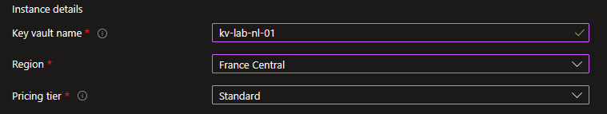
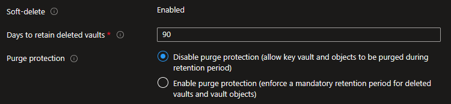
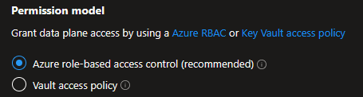
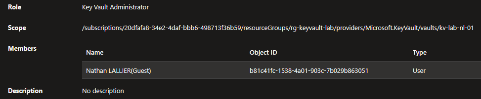
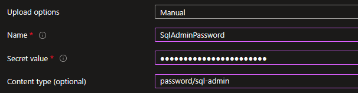
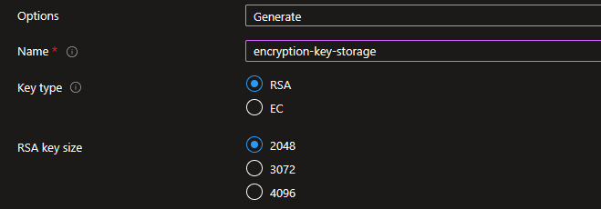
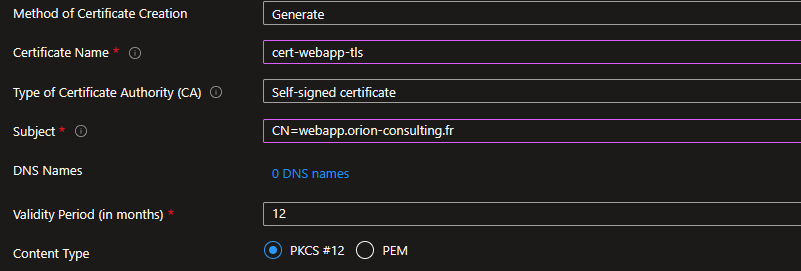

## Introduction

Cette procédure décrit le déploiement et l'utilisation d'Azure Key Vault, le coffre-fort numérique centralisé d'Azure. Key Vault stocke trois types d'objets sensibles : les secrets (mots de passe, chaînes de connexion), les clés cryptographiques (chiffrement, signature) et les certificats (TLS/SSL). L'objectif est de ne jamais avoir de mot de passe en clair dans un script, un code source ou un fichier de configuration.

## Contexte et Justification

Le problème numéro 1 de la sécurité applicative est le « hardcoded secret » : un mot de passe de base de données écrit en dur dans un script PowerShell, une chaîne de connexion stockée dans un fichier appsettings.json poussé sur Git, une clé de compte de stockage copiée dans un email.

Si ce secret fuit (via un dépôt Git public, un ordinateur volé, un email transféré), l'attaquant a un accès direct au service. Et vous ne savez pas que le secret a fuité tant que les dégâts ne sont pas visibles.

Key Vault résout ce problème en centralisant tous les secrets dans un coffre sécurisé :

1. L'administrateur stocke le mot de passe SQL dans Key Vault.
2. L'application (VM, App Service, Function) s'authentifie auprès de Key Vault via sa Managed Identity (pas de mot de passe pour accéder au coffre).
3. L'application demande le secret : « donne-moi le mot de passe SQL ».
4. Key Vault vérifie les permissions RBAC et retourne le secret.
5. Le mot de passe n'est jamais écrit dans le code, jamais stocké sur disque, jamais visible dans les logs.

## Concepts Clés

**Key Vault :** Une ressource Azure qui sert de coffre-fort. Chaque vault a un nom unique au monde et une URL : `https://<nom>.vault.azure.net`. Un vault est lié à une région, mais les données peuvent être répliquées (Microsoft gère la réplication interne pour la haute disponibilité).

**Les trois types d'objets :**

- **Secrets** : N'importe quelle chaîne de caractères que vous voulez protéger. Mots de passe, chaînes de connexion SQL, clés API, tokens d'accès, licences logicielles. Limite : 25 Ko par secret.
- **Keys** : Clés cryptographiques (RSA, EC) utilisées pour le chiffrement et la signature. Le vault peut effectuer les opérations cryptographiques (encrypt, decrypt, sign, verify) sans jamais exposer la clé privée. Utilisé pour le Customer-Managed Key (CMK) du chiffrement de stockage, de SQL Database, etc.
- **Certificates** : Certificats X.509 (TLS/SSL). Key Vault peut générer des certificats auto-signés, intégrer avec des autorités de certification (DigiCert, GlobalSign), et gérer le renouvellement automatique.

**Modèles d'autorisation :**

- **RBAC Azure (recommandé)** : Les permissions sur le vault et son contenu sont gérées via les rôles IAM Azure standard. Granulaire : vous pouvez donner l'accès aux secrets sans donner l'accès aux clés. Les rôles clés :
  - **Key Vault Administrator** : Gestion complète du vault et de son contenu.
  - **Key Vault Secrets Officer** : Créer, lire, modifier, supprimer des secrets.
  - **Key Vault Secrets User** : Lire des secrets (lecture seule).
  - **Key Vault Crypto Officer** : Gérer les clés cryptographiques.
  - **Key Vault Certificates Officer** : Gérer les certificats.
- **Access Policies (ancienne méthode)** : Une liste de contrôle d'accès interne au vault. Chaque entrée donne des permissions (Get, List, Set, Delete) à un utilisateur ou un service principal. Moins granulaire que RBAC et non compatible avec les outils de gouvernance Azure (Conditional Access, PIM). Microsoft recommande de migrer vers RBAC.

**Soft Delete et Purge Protection :**

- **Soft Delete** : Activé par défaut et obligatoire. Quand vous supprimez un vault ou un objet, il passe en état « soft deleted » pendant 7 à 90 jours (configurable à la création, 90 par défaut). Pendant cette période, il est récupérable.
- **Purge Protection** : Si activé, personne ne peut purger (supprimer définitivement) un objet ou un vault en soft delete avant l'expiration de la période de rétention. Même un Global Admin ne peut pas. C'est irréversible une fois activé. Recommandé en production.

**Versioning des secrets :** Chaque fois que vous modifiez la valeur d'un secret (même nom, nouvelle valeur), Key Vault crée une nouvelle version. L'ancienne version reste accessible via son identifiant de version. Utile pour la rotation : l'application utilise toujours la « version la plus récente » par défaut, mais vous pouvez référencer une version spécifique si nécessaire.

## Prérequis

- Un Abonnement Azure actif.
- Un Resource Group (ex : rg-keyvault-lab).
- Le rôle **Contributor** (minimum) pour créer le vault.
- Le rôle **Key Vault Administrator** ou **Key Vault Secrets Officer** pour gérer le contenu (le rôle Contributor ne suffit PAS pour lire les secrets).

## Points de Vigilance

**Owner/Contributor sur le vault n'égale pas accès aux secrets.** C'est le piège le plus fréquent. Vous pouvez créer un Key Vault, configurer ses paramètres réseau, le supprimer, mais vous ne pouvez PAS lire un secret à l'intérieur sans un rôle de données (Key Vault Secrets User/Officer). La séparation entre le plan de gestion (management plane) et le plan de données (data plane) est stricte et s'applique à toutes les ressources Azure manipulant des données sensibles (Storage, SQL, Key Vault).

**Soft Delete est obligatoire et ne peut pas être désactivé.** Depuis février 2025, tous les Key Vaults ont le soft delete activé et vous ne pouvez pas le désactiver. Si vous supprimez un vault et essayez d'en recréer un avec le même nom, l'opération échoue tant que l'ancien est en soft delete. En cas d'erreur « vault already exists » sans vault visible dans le resource group, la cause est presque toujours un vault fantôme en soft delete.

**Purge Protection est irréversible.** Une fois activée, vous ne pouvez PAS la désactiver, et vous ne pouvez pas purger un objet manuellement avant l'expiration de la rétention. Piège classique : un secret créé par erreur avec une valeur sensible ne peut pas être purgé immédiatement si la purge protection est active sur le vault ; la rétention doit s'écouler. À prendre en compte avant d'activer la protection.

**Un Key Vault supprimé (soft deleted) bloque le nom.** Vous ne pouvez pas créer un nouveau vault avec le même nom dans la même région tant que l'ancien est en soft delete. Solutions : récupérer l'ancien vault, le purger (si pas de purge protection), ou utiliser un nom différent. En IaC, prévoir des noms incrémentaux ou des suffixes aléatoires pour éviter les blocages de redéploiement.

**Le Key Vault doit être dans la même région que les ressources qui l'utilisent.** Si votre VM est en France Central et votre Key Vault en West Europe, ça fonctionne mais avec une latence accrue et une dépendance inter-régions. Microsoft recommande la co-localisation ; en architecture distribuée, prévoyez un vault par région avec réplication applicative des secrets via des pipelines de déploiement.

**Limite de débit par vault.** Un vault a une limite globale de 2 000 transactions par 10 secondes pour les opérations sur les secrets (plus basse pour les opérations cryptographiques sur les clés HSM). Pour une application fortement chargée qui relit le secret à chaque requête, implémentez un cache local avec TTL court, ou utilisez App Configuration avec Key Vault References.

## Choix Architecturaux & Alternatives

### Quand choisir Azure Key Vault

Key Vault est la solution par défaut pour toute gestion centralisée de secrets, clés cryptographiques et certificats dans un écosystème Azure. Cas d'usage typiques : stockage des mots de passe de bases de données, chaînes de connexion, clés API de services tiers, certificats TLS des App Services, Customer-Managed Keys pour le chiffrement du stockage et de SQL. L'accès applicatif passe systématiquement par une Managed Identity, jamais par une Access Key ou un SAS du vault. À déployer dès le premier environnement, y compris en développement, pour ancrer la pratique « zero hardcoded secret » dans les équipes.

### Alternatives et comparatif

| Option | Cas d'usage typique | Force principale | Faiblesse principale | Coût relatif |
|----------------|--------------|----------------|---------------|------------|
| **Azure Key Vault** | Secrets, clés, certificats dans Azure | Intégration native Azure, RBAC, Managed Identity, audit | Limite de débit par vault, latence régionale | Faible (0,03 USD pour 10 000 opérations) |
| **Azure Key Vault Premium** | CMK réglementées, HSM matériel FIPS 140-2 Level 3 | HSM dédié, conformité PCI-DSS/HDS stricte | Coût élevé, overkill pour usage courant | Élevé |
| **Azure App Configuration (avec Key Vault References)** | Feature flags, configuration applicative, secrets référencés | Gestion centralisée config + secrets, versioning de config | Ne remplace pas Key Vault, s'y ajoute | Faible |
| **HashiCorp Vault** | Multi-cloud, secrets dynamiques, PKI interne | Portabilité AWS/Azure/GCP, rotation automatique avancée | Complexité opérationnelle, équipe dédiée requise | Variable (self-hosted ou HCP) |
| **GitHub Actions Secrets / Azure DevOps Variables** | Secrets CI/CD uniquement | Intégration native pipeline, gratuit | Accès limité au pipeline, pas de rotation, pas d'audit fin | Nul |
| **Variables d'environnement chiffrées** | Valeurs non critiques d'application | Simple, natif App Service | Pas d'audit, pas de rotation, pas de versioning | Nul |

Le tier Standard couvre 95 % des besoins. Passer au tier Premium uniquement si une exigence de conformité impose un HSM matériel dédié (HDS, PCI-DSS niveau stratégique, certaines normes bancaires). GitHub Actions Secrets et les variables d'environnement sont acceptables pour des secrets de CI/CD peu critiques, jamais pour des secrets de production applicative.

### Impact des choix

- **Sécurité.** Key Vault avec RBAC et Managed Identity supprime totalement la notion de secret en clair côté application. C'est la cible à atteindre : tout autre modèle (secrets dans App Service Configuration, dans Git via .env chiffré, dans un fichier appsettings.json) est un compromis à justifier.
- **Traçabilité.** L'activation des Diagnostic Logs vers Log Analytics est indissociable du déploiement d'un Key Vault en production. Sans logs, l'intérêt d'un coffre-fort centralisé est largement perdu, car un secret lu par un compte compromis passe inaperçu. Le coût des logs est négligeable face au coût d'un incident.
- **Coût.** Key Vault Standard coûte 0,03 USD pour 10 000 opérations, soit un montant négligeable pour la majorité des usages. Key Vault Premium facture en plus les opérations HSM à un tarif supérieur (environ 1 USD pour 10 000 opérations HSM), et environ 5 USD par mois par clé HSM protégée. À ne déclencher que sur exigence réglementaire explicite.
- **Complexité opérationnelle.** Ajouter Key Vault implique de gérer les Managed Identities côté applications consommatrices, les attributions RBAC, la rotation des secrets, et les Private Endpoints si le vault est verrouillé côté réseau. Cette complexité est absorbée par l'outillage IaC (Bicep, Terraform) dès qu'elle est industrialisée.
- **RPO/RTO.** Key Vault réplique les données dans la région pairée (ex : France Central vers France South). En cas de défaillance régionale majeure, le vault bascule automatiquement en lecture sur la région pairée. Pour une architecture multi-région active, prévoir un vault par région avec synchronisation applicative des secrets.
- **Verrouillage technologique.** Key Vault est spécifique à Azure. Une architecture multi-cloud ou une stratégie de réversibilité impose HashiCorp Vault, au prix d'une complexité opérationnelle nettement supérieure et d'une perte d'intégration native avec les Managed Identities Azure.

## Méthode 1 : Configuration via Portail Azure

### Création du Key Vault

1. Recherchez **"Key vaults"** et cliquez sur **"+ Create"**.
2. **Subscription** : Votre abonnement.
3. **Resource group** : rg-keyvault-lab.
4. **Key vault name** : kv-lab-nl-01 (doit être unique au monde).
5. **Region** : France Central.
6. **Pricing tier** : Standard (le tier Premium ajoute le support des clés HSM matérielles, pas nécessaire pour un lab).



<p class="figure-caption"><b>Figure 1</b> · Création du Key Vault</p>

7. **Days to retain deleted vaults** : 90 (par défaut).
8. **Purge protection** : Décoché pour le lab (en production, activez-le).



<p class="figure-caption"><b>Figure 2</b> · Paramètres de rétention et de purge protection</p>

### Choisir le Modèle d'Autorisation (RBAC vs Access Policy)

1. Onglet **"Access configuration"**.
2. **Permission model** : Sélectionnez **"Azure role-based access control (recommended)"**.



<p class="figure-caption"><b>Figure 3</b> · Choisir le Modèle d'Autorisation (RBAC vs Access Policy)</p>

<div class="callout callout-note">

Si vous choisissez « Vault access policy », vous gérerez les permissions dans le vault lui-même au lieu d'utiliser IAM. C'est l'ancienne méthode. Pour respecter les bonnes pratiques, choisissez RBAC.

</div>

3. Passez les onglets **"Networking"** (laissez « Allow public access from all networks » pour le lab) et **"Tags"**.
4. Cliquez sur **"Review + create"** puis **"Create"**.

### S'attribuer les Droits RBAC

Même si vous avez créé le vault, vous n'avez pas encore accès à son contenu.

1. Allez dans le vault kv-lab-nl-01.
2. Menu gauche \> **"Access control (IAM)"** \> **"+ Add"** \> **"Add role assignment"**.
3. Onglet **"Role"** : Recherchez et sélectionnez **"Key Vault Administrator"**.
4. Onglet **"Members"** : Cliquez sur **"+ Select members"**, recherchez votre compte utilisateur, sélectionnez-le.
5. Cliquez sur **"Review + assign"**.



<p class="figure-caption"><b>Figure 4</b> · S'attribuer les Droits RBAC</p>

6. Attendez 1 à 2 minutes que la propagation RBAC se fasse.

### Créer un Secret

1. Dans le menu du vault, section **"Objects"**, cliquez sur **"Secrets"**.
2. Cliquez sur **"+ Generate/Import"**.
3. **Upload options** : Manual.
4. **Name** : SqlAdminPassword.
5. **Secret value** : P@ssw0rd-Sql-Pr0d-2026!
6. **Content type** (optionnel) : password/sql-admin (un label libre pour identifier le type).



<p class="figure-caption"><b>Figure 5</b> · Créer un Secret</p>

7. **Set activation date / Set expiration date** : Optionnel. Si vous définissez une date d'expiration, le secret ne sera plus utilisable après cette date (les applications recevront une erreur).
8. Cliquez sur **"Create"**.

<div class="callout callout-note">

Le secret est maintenant stocké. Sa valeur est masquée par défaut. Pour la voir : cliquez sur le secret \> cliquez sur la version (la ligne hexadécimale) \> **"Show Secret Value"**.

</div>

### Créer une Clé (Key)

1. Section **"Objects"** \> **"Keys"**.
2. Cliquez sur **"+ Generate/Import"**.
3. **Options** : Generate.
4. **Name** : encryption-key-storage.
5. **Key type** : RSA.
6. **RSA key size** : 2048.



<p class="figure-caption"><b>Figure 6</b> · Créer une Clé (Key)</p>

7. Cliquez sur **"Create"**.

<div class="callout callout-note">

Cette clé peut ensuite être utilisée comme Customer-Managed Key pour chiffrer un compte de stockage, une base SQL, etc.

</div>

### Importer un Certificat

1. Section **"Objects"** \> **"Certificates"**.
2. Cliquez sur **"+ Generate/Import"**.
3. **Method** : Generate (auto-signé) ou Import (fichier .pfx/.pem existant).
4. Pour un certificat auto-signé :
   - **Certificate name** : cert-webapp-tls.
   - **Subject** : CN=webapp.orion-consulting.fr.
   - **Validity period** : 12 months.
   - **Content type** : PKCS #12.



<p class="figure-caption"><b>Figure 7</b> · Importer un Certificat</p>

5. Cliquez sur **"Create"**.

## Méthode 2 : Configuration via PowerShell

### Créer le Key Vault

```powershell
New-AzKeyVault -Name "kv-lab-nl-01" -ResourceGroupName "rg-keyvault-lab" -Location "FranceCentral" -SoftDeleteRetentionInDays 90
```

### S'attribuer les Droits RBAC

```powershell
$myId = (Get-AzADUser -SignedIn).Id
$kvId = (Get-AzKeyVault -VaultName "kv-lab-nl-01" -ResourceGroupName "rg-keyvault-lab").ResourceId
New-AzRoleAssignment -ObjectId $myId -RoleDefinitionName "Key Vault Administrator" -Scope $kvId
```

### Créer et Lire un Secret (SecureString)

```powershell
# Créer un secret (PowerShell exige un SecureString)
$secretValue = ConvertTo-SecureString "P@ssw0rd-Sql-Pr0d-2026!" -AsPlainText -Force
Set-AzKeyVaultSecret -VaultName "kv-lab-nl-01" -Name "SqlAdminPassword" -SecretValue $secretValue -ContentType "password/sql-admin"
# Lire la valeur du secret
$secret = Get-AzKeyVaultSecret -VaultName "kv-lab-nl-01" -Name "SqlAdminPassword" -AsPlainText
Write-Host "Secret value : $secret"
# Lire sans -AsPlainText (retourne un SecureString)
$secretObj = Get-AzKeyVaultSecret -VaultName "kv-lab-nl-01" -Name "SqlAdminPassword"
Write-Host "Secret ID : $($secretObj.Id)"
Write-Host "Version : $($secretObj.Version)"
Write-Host "Enabled : $($secretObj.Enabled)"
```

### Créer une Clé

```powershell
Add-AzKeyVaultKey -VaultName "kv-lab-nl-01" -Name "encryption-key-storage" -Destination Software -KeyType RSA -Size 2048
```

### Lister les Objets du Vault

```powershell
# Secrets
Get-AzKeyVaultSecret -VaultName "kv-lab-nl-01" | Select-Object Name, Enabled, Created | Format-Table
# Clés
Get-AzKeyVaultKey -VaultName "kv-lab-nl-01" | Select-Object Name, KeyType, Enabled | Format-Table
# Certificats
Get-AzKeyVaultCertificate -VaultName "kv-lab-nl-01" | Select-Object Name, Enabled | Format-Table
# Versions d'un secret
Get-AzKeyVaultSecret -VaultName "kv-lab-nl-01" -Name "SqlAdminPassword" -IncludeVersions | Select-Object Name, Version, Created | Format-Table
```

### Supprimer et Purger un Secret

```powershell
# Supprimer (soft delete)
Remove-AzKeyVaultSecret -VaultName "kv-lab-nl-01" -Name "SqlAdminPassword" -Force
# Lister les secrets supprimés
Get-AzKeyVaultSecret -VaultName "kv-lab-nl-01" -InRemovedState |
    Select-Object Name, DeletedDate, ScheduledPurgeDate | Format-Table
# Récupérer
Undo-AzKeyVaultSecretRemoval -VaultName "kv-lab-nl-01" -Name "SqlAdminPassword"
# Purger (si la purge protection est désactivée)
Remove-AzKeyVaultSecret -VaultName "kv-lab-nl-01" -Name "SqlAdminPassword" -InRemovedState -Force
```

### Supprimer et Purger le Vault

```powershell
# Supprimer le vault
Remove-AzKeyVault -VaultName "kv-lab-nl-01" -ResourceGroupName "rg-keyvault-lab" -Force
# Purger
Remove-AzKeyVault -VaultName "kv-lab-nl-01" -Location "FranceCentral" -InRemovedState -Force
```

## Vérifications

**Vault créé** : Dans le portail, le vault apparaît dans le resource group avec le statut actif.

**RBAC fonctionnel** : Allez dans **"Secrets"** \> Vous pouvez voir la liste des secrets (pas d'erreur 403).

**Secret lisible** : Cliquez sur le secret \> Version \> **"Show Secret Value"** \> La valeur s'affiche.

**Versioning** : Mettez à jour le secret avec une nouvelle valeur. Deux versions apparaissent dans la liste des versions.

**Soft Delete** : Supprimez un secret. Allez dans **"Manage deleted secrets"** (en haut de la page Secrets). Le secret supprimé apparaît avec sa date de purge prévue.

**Récupération** : Sélectionnez le secret supprimé et cliquez sur **"Recover"**. Il revient dans la liste active.

## Dépannage

**Erreur 403 "does not have secrets list permission" :** Vous n'avez pas de rôle de données sur le vault. Le rôle Owner ou Contributor ne donne PAS accès au contenu. Attribuez-vous le rôle **Key Vault Administrator** (ou Secrets Officer pour les secrets uniquement) via **"Access control (IAM)"**.

**Erreur "Vault already exists" à la création :** Un vault avec ce nom existe en soft delete. Listez les vaults supprimés : `Get-AzKeyVault -InRemovedState`. Soit purgez l'ancien vault, soit récupérez-le, soit utilisez un nom différent.

**Erreur "Purge protection is enabled, cannot purge" :** Le vault ou le secret a la purge protection activée. Vous devez attendre l'expiration de la période de rétention. Il n'y a aucun moyen de contourner cette protection.

**Le secret retourne "SecretDisabled" :** Le secret a été désactivé (attribut `Enabled = false`) ou sa date d'expiration est dépassée. Réactivez-le dans les propriétés du secret ou créez une nouvelle version.

**Latence élevée lors de l'accès au secret depuis une VM :** Le vault est probablement dans une autre région que la VM. Créez un vault dans la même région, ou configurez un Private Endpoint pour le vault dans le VNet de la VM.

## Conseils et Bonnes Pratiques

**Un vault par environnement.** Ne mélangez pas les secrets de production et de développement dans le même vault. Créez kv-prod-app-01, kv-dev-app-01, kv-staging-app-01. Les permissions RBAC sont au niveau du vault, pas au niveau du secret individuel.

**Utilisez les Managed Identities pour l'accès applicatif.** N'utilisez jamais une Access Key ou un SAS pour qu'une application accède au vault. Activez la System-Assigned Managed Identity sur votre VM ou App Service, attribuez-lui le rôle « Key Vault Secrets User » sur le vault, et l'application s'authentifie automatiquement sans aucun secret (cf. procédure Gestion des Managed Identities).

**Activez la Purge Protection en production.** C'est la seule garantie qu'un administrateur malveillant ou un script mal configuré ne peut pas supprimer définitivement vos secrets. Le coût est nul, la protection est maximale.

**Surveillez les accès avec les Diagnostic Logs.** Activez les diagnostics du vault vers un Log Analytics Workspace. Vous pourrez voir qui a lu quel secret, quand, et depuis quelle adresse IP. Configurez des alertes sur les accès inhabituels (lecture de secrets en dehors des heures de bureau, depuis un pays inattendu).

**Convention de nommage des secrets.** Utilisez des noms descriptifs et cohérents. Key Vault n'accepte que les caractères alphanumériques et les tirets. Exemples : SqlAdmin-Password, StorageAccount-Key1, Api-ExternalPartner-Token. Utilisez le champ Content Type pour ajouter du contexte (ex : password/sql, connection-string/redis).

## Procédures Liées

- [Gestion des Managed Identities (System & User Assigned)](/procedures/azure/gestion-des-managed-identities-system-user-assigned) *(Le meilleur moyen d'accéder au vault depuis une application sans secret)*
- [Gestion des SAS Tokens et Access Keys](/procedures/azure/gestion-des-sas-tokens-et-access-keys) *(Stocker les Access Keys du stockage dans Key Vault au lieu de les mettre en dur)*
- [Configuration du Conditional Access et MFA](/procedures/azure/configuration-du-conditional-access-et-mfa) *(Protéger l'accès humain au vault avec le MFA via Conditional Access)*
- [Configuration des Locks sur les Ressources](/procedures/azure/configuration-des-locks-sur-les-ressources) *(Un lock CanNotDelete sur le vault empêche sa suppression accidentelle)*
- Configuration d'un Log Analytics Workspace et des Diagnostic Settings *(Activer l'audit des accès au vault)*
