## Objectif

L'objectif est de réaliser la configuration initiale d'un routeur Cisco. Nous allons le nommer, le sécuriser, configurer son interface côté réseau local (LAN) pour qu'il serve de **passerelle par défaut**, et permettre son administration à distance via **SSH**.

## Contexte et Justification

Un routeur est la porte d'entrée et de sortie d'un réseau local. Sa configuration initiale est une étape de sécurité et de fonctionnalité critique. Sans configuration, aucun appareil du réseau ne peut communiquer avec l'extérieur. Cette procédure établit les bases d'une passerelle réseau fonctionnelle et sécurisée.

## Topologie Cible

La topologie pour cette configuration de base est simple :

- **1x Routeur Cisco 4321** (ou modèle ISR similaire).
- **1x Switch Cisco 2960**.
- **1x PC**.

Le PC est connecté au switch, qui est lui-même connecté à une interface du routeur (ex : GigabitEthernet0/0/0). Le PC utilisera le routeur comme passerelle pour sortir du réseau local.

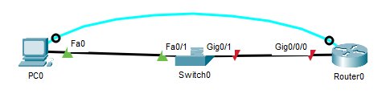

<p class="figure-caption"><b>Figure 1</b> · Topologie Cible</p>

## Procédure de Configuration

Connectez-vous au routeur via un câble console et ouvrez le terminal sur le PC.

### Accès et Modes de Configuration

1. Refusez l'assistant de configuration initiale en tapant `no`.
2. Passez en mode privilégié avec la commande `enable`.
3. Passez en mode de configuration globale avec la commande `configure terminal`.

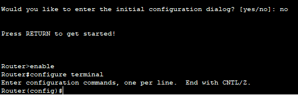

<p class="figure-caption"><b>Figure 2</b> · Accès et Modes de Configuration</p>

### Configuration de Base

1. Définissez le nom d'hôte du routeur avec la commande `hostname R1-Siege`.
2. Créez une bannière d'avertissement avec la commande `banner motd # ACCES RESERVE AU PERSONNEL AUTORISE #`.
3. Désactivez la recherche DNS automatique pour éviter les délais sur les commandes incorrectes avec `no ip domain-lookup`.

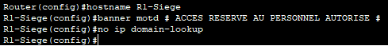

<p class="figure-caption"><b>Figure 3</b> · Configuration de Base</p>

### Configuration de l'Horloge

**Justification** : Des horodatages précis sont essentiels pour analyser les journaux système (syslog), suivre les événements de sécurité et dépanner les pannes réseau.

1. Revenez en mode privilégié en tapant `exit`.
2. Réglez l'heure et la date avec la commande `clock set HH:MM:SS Jour Mois Année`.
3. Vérifiez avec la commande `show clock`.

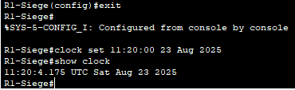

<p class="figure-caption"><b>Figure 4</b> · Configuration de l'Horloge</p>

### Sécurisation des Accès (Mots de Passe)

1. Passez (ou retournez) en mode de configuration globale avec la commande `configure terminal`.
2. Définissez un mot de passe chiffré pour l'accès au mode privilégié avec la commande `enable secret btsnathan`.
3. Entrez dans la configuration de la ligne console physique avec la commande `line console 0`.
4. Définissez son mot de passe avec `password consolepass`.
5. Activez la vérification du mot de passe à la connexion avec `login`, puis quittez le mode de configuration de ligne avec `exit`.
6. Entrez dans la configuration des lignes d'accès virtuelles avec la commande `line vty 0 4`.
7. Définissez leur mot de passe avec `password vtypass`.
8. Activez la vérification du mot de passe à la connexion avec `login`, puis quittez le mode de configuration de ligne avec `exit`.
9. Chiffrez les mots de passe en clair dans la configuration (comme consolepass) avec la commande `service password-encryption`.

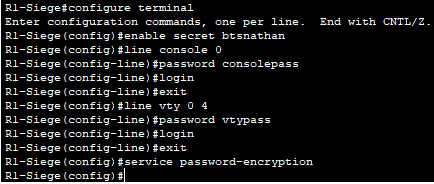

<p class="figure-caption"><b>Figure 5</b> · Sécurisation des Accès (Mots de Passe)</p>

### Mise en Place de l'Accès à Distance Sécurisé (SSH)

1. Définissez un nom de domaine local avec `ip domain-name bts-sio.lan`.
2. Générez les clés de chiffrement RSA avec `crypto key generate rsa` (taille **1024** minimum, 2048 recommandé).
3. Forcez l'utilisation de SSHv2, plus sécurisé, avec `ip ssh version 2`.
4. Créez un utilisateur local pour la connexion SSH avec `username admin secret sshpass`.
5. Configurez les lignes virtuelles pour n'accepter que SSH en utilisant la base d'utilisateurs locale :

```text
line vty 0 4
 login local
 transport input ssh
 exit
```

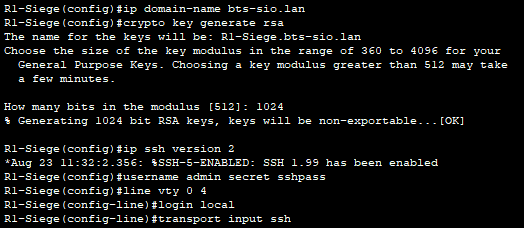

<p class="figure-caption"><b>Figure 6</b> · Mise en Place de l'Accès à Distance Sécurisé (SSH)</p>

### Configuration de l'Interface LAN

C'est l'étape clé spécifique au routeur. Nous configurons une interface physique pour servir de passerelle au réseau local.

1. Entrez dans la configuration de l'interface connectée au switch avec la commande `interface GigabitEthernet0/0/0` (adaptez le numéro si besoin).
2. Donnez une description à l'interface (bonne pratique) : `description Liaison vers le LAN`.
3. Assignez une adresse IP et un masque de sous-réseau. Cette adresse sera la **passerelle par défaut** pour les appareils du LAN : `ip address 192.168.1.1 255.255.255.0`.
4. Activez l'interface, désactivée par défaut sur un routeur, avec la commande `no shutdown`.
5. Quittez le mode de configuration d'interface avec `exit`.

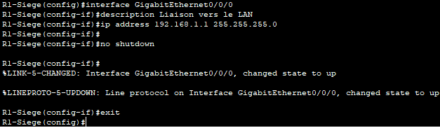

<p class="figure-caption"><b>Figure 7</b> · Configuration de l'Interface LAN</p>

### Sauvegarde de la Configuration

1. Revenez au mode privilégié avec la commande `end`.
2. Sauvegardez la configuration avec la commande `copy running-config startup-config`.

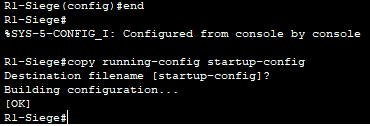

<p class="figure-caption"><b>Figure 8</b> · Sauvegarde de la Configuration</p>

## Vérifications

1. **Vérifier les interfaces :** En mode privilégié sur le routeur, tapez `show ip interface brief`. Vous devriez voir votre interface GigabitEthernet0/0/0 avec son adresse IP et un statut « up / up ».
2. **Configurer le PC :** Sur le PC, configurez une adresse IP (192.168.1.10), un masque (255.255.255.0) et, surtout, la **Passerelle par défaut** (Default Gateway) qui doit être l'adresse IP de l'interface du routeur (192.168.1.1).

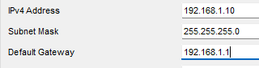

<p class="figure-caption"><b>Figure 9</b> · Configuration IP du PC</p>

3. **Tester la connectivité :** Sur le PC, ouvrez « Command Prompt » et tapez `ping 192.168.1.1`. Vous devez obtenir une réponse du routeur.

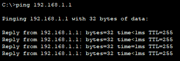

<p class="figure-caption"><b>Figure 10</b> · Ping de la passerelle</p>

4. **Tester la connexion SSH :** Dans le même « Command Prompt », lancez la connexion SSH avec `ssh -l admin 192.168.1.1`. La connexion doit s'établir après avoir entré le mot de passe.

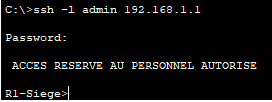

<p class="figure-caption"><b>Figure 11</b> · Connexion SSH au routeur</p>

## Procédures Liées

- [Configuration Initiale et Sécurisation d'un Switch Cisco](/procedures/cisco/configuration-initiale-et-securisation-dun-switch-cisco) *(Même démarche côté commutation)*
- [ACLs (Standard et Étendues)](/procedures/cisco/acls-standard-et-etendues) *(Restreindre l'accès d'administration)*
- [Routage Statique](/procedures/cisco/routage-statique) *(Premier routage après la configuration initiale)*
- [DHCP sur un Routeur Cisco](/procedures/cisco/dhcp-sur-un-routeur-cisco) *(Service DHCP hébergé sur le routeur)*
