## Objectif

L'objectif de cette procédure est de réaliser la configuration initiale d'un switch Cisco sorti d'usine. Nous allons le nommer, le sécuriser avec des mots de passe, configurer un accès pour l'administration à distance via SSH, et sauvegarder la configuration pour qu'elle persiste après un redémarrage.

## Contexte et Justification

Un équipement réseau non configuré est une porte ouverte sur le réseau. Il est anonyme, accessible par n'importe qui via une simple connexion console, et ne peut pas être géré à distance. Cette procédure est le strict minimum à appliquer à **tout nouvel équipement** pour garantir son intégrité, sa traçabilité et permettre son administration efficace au quotidien.

## Topologie Cible

Pour cette procédure dans Packet Tracer, nous utiliserons une topologie très simple :

- **1x Switch Cisco 2960** (ou modèle similaire).
- **1x PC** qui servira de console d'administration.

Le PC est connecté de deux manières au switch :

- Avec un **câble console** (bleu clair) pour réaliser la configuration initiale.
- Avec un **câble Ethernet** (droit) du PC vers un port du switch (ex : FastEthernet0/1) pour tester la connexion à distance à la fin.

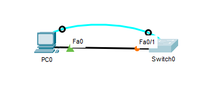

<b>Figure 1</b> · Topologie Cible

## Procédure de Configuration

Connectez-vous au switch via le câble console et ouvrez le terminal sur le PC.

### Accès et Modes de Configuration

1. Passez en mode privilégié, qui permet de voir la configuration, avec la commande `enable`.
2. Passez en mode de configuration globale, qui permet de modifier la configuration, avec la commande `configure terminal`.

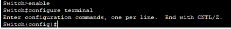

<b>Figure 2</b> · Accès et Modes de Configuration

### Configurations de Base

1. Définissez le nom d'hôte du switch avec la commande `hostname <nom>` (ex : `hostname SW1-Siege`).
2. Créez une bannière d'avertissement qui s'affichera à chaque connexion avec la commande `banner motd # ACCES RESERVE AU PERSONNEL AUTORISE #`.
3. Pour désactiver la recherche DNS automatique lorsque vous tapez une commande incorrecte (ce qui peut « geler » le terminal pendant de longues secondes), utilisez la commande `no ip domain-lookup`.

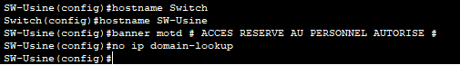

<b>Figure 3</b> · Configurations de Base

### Configuration de l'Horloge

**Justification :** Des horodatages précis sont essentiels pour analyser les journaux système (syslog), suivre les événements de sécurité et dépanner les pannes réseau.

1. Assurez-vous d'être en mode privilégié (l'invite doit se terminer par #). Si vous êtes en mode de configuration, tapez `exit`.
2. Réglez l'heure, la date et l'année avec la commande `clock set HH:MM:SS Jour Mois Année`. Le mois doit être en anglais (les 3 premières lettres).
3. Par exemple, pour le 23 août 2025 à 10:15:00, la commande serait : `clock set 10:15:00 23 Aug 2025`.
4. Vérifiez que l'heure a été correctement enregistrée avec la commande `show clock`.

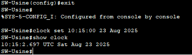

<b>Figure 4</b> · Configuration de l'Horloge

### Sécurisation des Accès (Mots de Passe)

1. Passez (ou retournez) en mode de configuration globale avec la commande `configure terminal`.
2. Définissez un mot de passe chiffré pour l'accès au mode privilégié avec la commande `enable secret btsnathan`.
3. Entrez dans la configuration de la ligne console physique avec la commande `line console 0`.
4. Définissez son mot de passe avec `password consolepass`.
5. Activez la vérification du mot de passe à la connexion avec `login`, puis quittez le mode de configuration de ligne avec `exit`.
6. Entrez dans la configuration des lignes d'accès virtuelles avec la commande `line vty 0 4`.
7. Définissez leur mot de passe avec `password vtypass`.
8. Activez la vérification du mot de passe à la connexion avec `login`, puis quittez le mode de configuration de ligne avec `exit`.
9. Chiffrez les mots de passe en clair dans la configuration (comme consolepass) avec la commande `service password-encryption`.

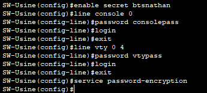

<b>Figure 5</b> · Sécurisation des Accès (Mots de Passe)

### Mise en Place de l'Accès à Distance Sécurisé (SSH)

1. Définissez un nom de domaine local (obligatoire pour générer les clés de chiffrement) avec la commande `ip domain-name bts-sio.lan`.
2. Générez les clés de chiffrement RSA avec la commande `crypto key generate rsa`. Quand le switch demande la taille, entrez **1024** (2048 recommandé si l'IOS le permet) et validez.
3. **Forcez l'utilisation de la version 2 de SSH**, qui est beaucoup plus sécurisée que la version 1, avec la commande `ip ssh version 2`.
4. Créez un utilisateur local pour la connexion SSH avec la commande `username admin secret sshpass`.
5. Entrez dans la configuration des lignes d'accès virtuelles (pour SSH/Telnet) avec la commande `line vty 0 15`.
6. Indiquez au switch d'utiliser la base de données locale des utilisateurs pour l'authentification avec la commande `login local`.
7. N'autorisez que les connexions SSH (bloquant ainsi Telnet, non sécurisé) avec la commande `transport input ssh`, puis quittez ce mode avec `exit`.

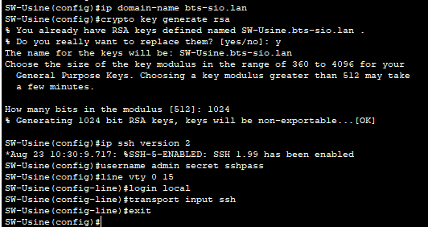

<b>Figure 6</b> · Mise en Place de l'Accès à Distance Sécurisé (SSH)

### Configuration de l'Interface de Gestion (SVI)

1. Entrez dans la configuration de l'interface virtuelle du VLAN 1 avec la commande `interface Vlan1`.
2. Assignez une adresse IP et un masque de sous-réseau à cette interface avec la commande `ip address 192.168.1.254 255.255.255.0`.
3. Activez l'interface avec la commande `no shutdown`, puis quittez ce mode avec `exit`.

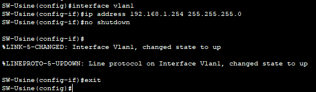

<b>Figure 7</b> · Configuration de l'Interface de Gestion (SVI)

### Sauvegarde de la Configuration

1. Revenez au mode privilégié avec la commande `end`.
2. Copiez la configuration actuelle (en mémoire vive) vers la configuration de démarrage (qui persistera après un redémarrage) avec la commande `copy running-config startup-config`. Validez en appuyant sur **Entrée**.

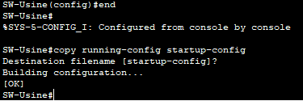

<b>Figure 8</b> · Sauvegarde de la Configuration

## Vérifications

1. **Vérifier la configuration :** Dans la console, tapez `show running-config` pour voir toutes les commandes que vous avez appliquées.
2. **Configurer le PC :** Allez sur le bureau du PC dans Packet Tracer, ouvrez « IP Configuration » et donnez-lui une adresse IP dans le même réseau (ex : 192.168.1.10, masque 255.255.255.0).

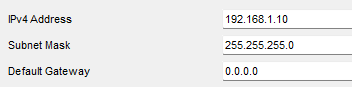

<b>Figure 9</b> · Configuration IP du PC

3. **Tester la connectivité réseau :** Sur le PC, ouvrez « Command Prompt » et tapez la commande `ping 192.168.1.254`. Vous devez obtenir une réponse.

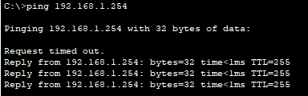

<b>Figure 10</b> · Ping de l'interface de gestion

4. **Tester la connexion SSH :** Dans le même « Command Prompt », lancez la connexion SSH avec la commande `ssh -l admin 192.168.1.254`. Le switch doit vous demander le mot de passe (sshpass). Une fois connecté, la bannière MOTD s'affiche.

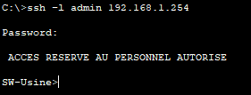

<b>Figure 11</b> · Connexion SSH au switch

## Procédures Liées

- [Configuration Initiale et Sécurisation d'un Routeur Cisco](/procedures/cisco/configuration-initiale-et-securisation-dun-routeur-cisco) *(Même démarche côté routage)*
- [Prévention des Boucles Réseau avec Spanning Tree Protocol (STP)](/procedures/cisco/prevention-des-boucles-reseau-avec-spanning-tree-protocol-stp) *(Protection contre les boucles)*
- [Agrégation de Liens avec EtherChannel (LACP)](/procedures/cisco/agregation-de-liens-avec-etherchannel-lacp) *(Agrégation des liens montants)*
- [Routage Inter-VLANs avec un Routeur (Router-on-a-Stick)](/procedures/cisco/routage-inter-vlans-avec-un-routeur-router-on-a-stick) *(Trunk 802.1Q vers le routeur)*
