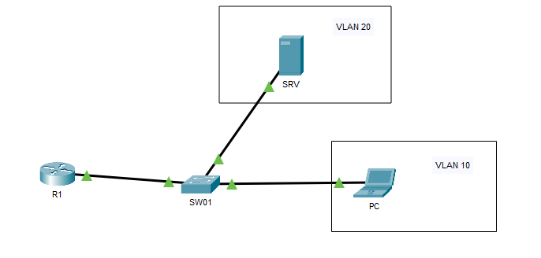
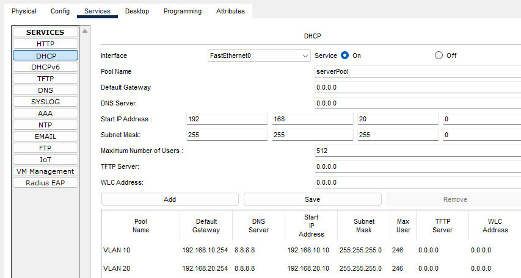
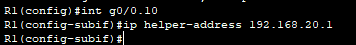
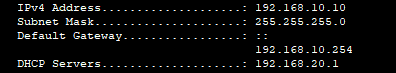

## Objectif

L'objectif est de permettre à des clients situés dans un VLAN de recevoir une adresse IP d'un serveur DHCP situé dans un **autre** VLAN ou un réseau distant.

## Contexte et Justification

- **Le Problème :** Lorsqu'un PC démarre, il crie « J'ai besoin d'une IP ! » (DHCP DISCOVER). Ce cri est un **Broadcast** (255.255.255.255). Par sécurité et performance, les routeurs arrêtent net les broadcasts. Ils ne traversent jamais les interfaces.
- **La Conséquence :** Si votre serveur DHCP est dans le VLAN « Serveurs » et votre PC dans le VLAN « Compta », le serveur n'entendra jamais le PC.
- **La Solution :** Le « DHCP Relay » (ou IP Helper). Le routeur intercepte le cri du PC, le transforme en message direct (Unicast) et l'envoie lui-même au serveur DHCP.

## Concepts Clés : IP Helper-Address

**Commande `ip helper-address` :** C'est la commande magique. Elle dit au routeur : « Si tu entends un broadcast sur cette interface, ne le jette pas. Envoie-le à cette adresse IP précise. »

**Emplacement :** On configure toujours le relais sur l'interface **du côté des Clients** (celle qui reçoit le cri), pas du côté du serveur.

## Topologie et Plan d'Adressage

**Scénario :** Centralisation des services.

- **R1** : Fait le lien entre les VLANs.
- **SRV** : Un serveur dédié qui gère les adresses IP, situé dans le VLAN 20.
- **PC** : Un ordinateur dans le VLAN 10 qui a besoin d'une IP.

| Équipement | Interface | IP / Masque | Description |
|------------|-----------|-------------|-------------|
| **R1** | G0/0.10 | 192.168.10.254 /24 | Passerelle VLAN 10 |
|  | G0/0.20 | 192.168.20.254 /24 | Passerelle VLAN 20 |
| **SRV** | NIC | 192.168.20.1 /24 | Serveur DHCP |
| **SW01** | / | / | Switch |
| **PC** | NIC | DHCP | PC Client |



<p class="figure-caption"><b>Figure 1</b> · Topologie et Plan d'Adressage</p>

## Configuration

### Configuration du Serveur DHCP

<div class="callout callout-note">

Même si le serveur est physiquement dans le réseau 20, il doit avoir une configuration (pool) pour le réseau 10 !

</div>



<p class="figure-caption"><b>Figure 2</b> · Pools DHCP du serveur (VLAN 10 et VLAN 20)</p>

### Relais sur R1

**Justification :** On va sur l'interface du VLAN 10 (là où sont les clients) et on leur indique où est le serveur.

1. Entrez dans la sous-interface des clients (VLAN 10).
2. Ajoutez l'adresse du serveur DHCP cible.

```text
R1(config)# interface g0/0.10
R1(config-subif)# ip helper-address 192.168.20.1
```



<p class="figure-caption"><b>Figure 3</b> · Relais sur R1</p>

## Vérifications

**Sur le PC Client :**

1. Ouvrez l'invite de commande.
2. Tapez `ipconfig /release` puis `ipconfig /renew`.
3. Si ça marche, vous recevez une IP en 192.168.10.x.
4. Tapez `ipconfig /all` pour vérifier que le serveur DHCP indiqué est bien 192.168.20.1.



<p class="figure-caption"><b>Figure 4</b> · Adresse obtenue par le PC client</p>

**Sur R1 :** Tapez `show ip interface GigabitEthernet0/0.10`. Cherchez la ligne `Helper address is 192.168.20.1`.

**Sur SRV :** Consultez la liste des baux attribués : vous devez y voir l'adresse MAC du PC (sur un routeur Cisco faisant office de serveur DHCP, la commande est `show ip dhcp binding`).

## Dépannage

**Le PC ne reçoit rien (APIPA 169.254.x.x) :**

- **Ping :** R1 arrive-t-il à pinger le serveur (192.168.20.1) ? Si le routeur ne peut pas joindre le serveur, il ne peut pas relayer la demande.
- **Emplacement du Helper :** Avez-vous mis la commande sur l'interface .20 ? C'est une erreur. Elle doit être sur l'interface .10 (celle qui est dans le même réseau que le PC).

**Le Serveur reçoit la demande mais ne répond pas :**

- Avez-vous créé le pool correspondant au réseau 192.168.10.0 sur le serveur ? Si le serveur ne connaît pas ce réseau, il ignore la demande.

## Conseils et Bonnes Pratiques

**Redondance DHCP :**

- Vous pouvez mettre plusieurs commandes `ip helper-address` sur la même interface si vous avez plusieurs serveurs DHCP (un principal et un secours).

```text
ip helper-address 192.168.20.1
ip helper-address 192.168.20.2
```

**Autres protocoles relayés :**

- Par défaut, `ip helper-address` ne relaye pas que le DHCP (Port 67/68). Il relaye aussi le DNS (53), le NTP (Time, 37), le TFTP (69), etc.
- Si vous voulez limiter cela (par sécurité), vous pouvez utiliser la commande `ip forward-protocol` pour choisir finement.

**DHCP Snooping (Sécurité Switch) :**

- Attention, si vous activez le *DHCP Snooping* sur vos switchs (pour empêcher les faux serveurs DHCP), n'oubliez pas de configurer le port vers le routeur/serveur en mode « Trust », sinon les offres DHCP légitimes seront bloquées par le switch.

## Procédures Liées

- [DHCP sur un Routeur Cisco](/procedures/cisco/dhcp-sur-un-routeur-cisco) *(Serveur DHCP hébergé sur le routeur)*
- [DHCP pour Multiples VLANs](/procedures/cisco/dhcp-pour-multiples-vlans) *(Pools DHCP par VLAN)*
- [Installation et Configuration d'un Serveur DHCP](/procedures/windows/installation-et-configuration-dun-serveur-dhcp) *(Serveur DHCP Windows ciblé par le relais)*
- [Routage Inter-VLANs avec un Routeur (Router-on-a-Stick)](/procedures/cisco/routage-inter-vlans-avec-un-routeur-router-on-a-stick) *(Interfaces passerelles des VLANs)*
