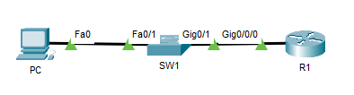
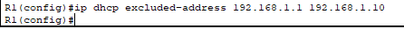
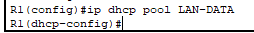
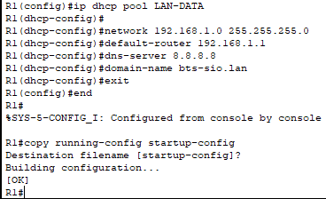
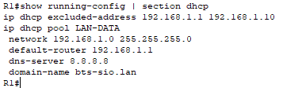
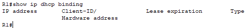
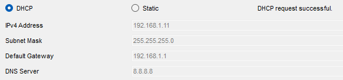
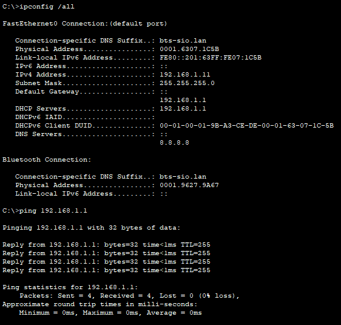
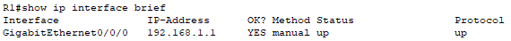

## Objectif

L'objectif est de configurer un routeur Cisco pour qu'il agisse en tant que **serveur DHCP** pour le réseau local (LAN). Le routeur sera responsable de l'attribution dynamique des adresses IP, des masques de sous-réseau, des passerelles par défaut et des serveurs DNS à tous les appareils clients.

## Contexte et Justification

Configurer manuellement une adresse IP sur chaque appareil est fastidieux et source d'erreurs (doublons, mauvais masque, etc.). Le protocole DHCP (Dynamic Host Configuration Protocol) **automatise** ce processus. Un serveur DHCP centralisé simplifie l'administration du réseau, assure une configuration IP cohérente et facilite l'ajout ou le déplacement d'appareils.

## Prérequis

- **Topologie :** Nous utilisons exactement la même topologie que dans la procédure *Configuration Initiale et Sécurisation d'un Routeur Cisco* : 1 routeur, 1 switch, 1 PC.
- **Prérequis :** Le routeur doit déjà être configuré avec une **adresse IP statique** sur son interface LAN (ex : `192.168.1.1` sur `GigabitEthernet0/0/0`). Cette adresse servira de passerelle pour les clients.

<b>Figure 1</b> · Topologie : routeur, switch et PC

## Procédure de Configuration

Toutes les commandes suivantes sont à taper sur le routeur, en mode de configuration globale (`(config)#`).

### Exclusion des Adresses Statiques

**Justification :** Avant de définir la plage d'adresses à distribuer, il est crucial de **réserver** les adresses déjà utilisées ou que vous souhaitez attribuer manuellement (ex : au routeur lui-même, aux serveurs, aux imprimantes). Cela évite les conflits d'adresses IP.

1. Définissez la plage d'adresses à exclure de la distribution. Ici, nous réservons les 10 premières adresses. La commande est `ip dhcp excluded-address 192.168.1.1 192.168.1.10`.

<b>Figure 2</b> · Exclusion des Adresses Statiques

### Création du Pool DHCP

**Justification :** Le « pool » est le nom que nous donnons à notre ensemble de configuration DHCP pour ce réseau.

1. Créez un pool DHCP avec un nom explicite (en majuscules par convention) avec la commande `ip dhcp pool LAN-DATA`. Vous entrez alors dans un nouveau mode de configuration (`(dhcp-config)#`).

<b>Figure 3</b> · Création du Pool DHCP

### Configuration des Options du Pool

**Justification :** Nous allons maintenant définir les informations que le serveur enverra aux clients.

1. Définissez le réseau et le masque de sous-réseau pour lesquels ce pool distribuera des adresses avec la commande `network 192.168.1.0 255.255.255.0`.
2. Indiquez l'adresse IP de la passerelle par défaut, qui est l'adresse du routeur lui-même, avec la commande `default-router 192.168.1.1`.
3. Indiquez l'adresse du serveur DNS que les clients utiliseront. Nous pouvons utiliser un DNS public comme celui de Google. La commande est `dns-server 8.8.8.8`.
4. (Optionnel) Vous pouvez aussi définir le nom de domaine pour les clients avec la commande `domain-name bts-sio.lan`.
5. Quittez le mode de configuration DHCP et le mode de configuration globale avec `exit` puis `end`.
6. N'oubliez pas de sauvegarder votre configuration avec `copy running-config startup-config`.

<b>Figure 4</b> · Configuration des Options du Pool

## Vérifications

C'est l'étape la plus importante pour valider le bon fonctionnement du service.

### Côté Routeur (Serveur)

1. Vérifiez que la configuration DHCP apparaît bien dans la configuration globale avec la commande `show running-config | section dhcp`.

<b>Figure 5</b> · Côté Routeur (Serveur)

2. Consultez la liste des adresses IP qui ont été attribuées aux clients avec la commande `show ip dhcp binding`. Au début, cette liste sera vide.

<b>Figure 6</b> · Baux DHCP attribués

### Côté PC (Client)

1. Sur le PC dans Packet Tracer, allez dans **Desktop \> IP Configuration**.
2. Cochez la case **DHCP.**
3. Patientez quelques secondes. Si tout fonctionne, les champs se rempliront automatiquement avec une adresse IP valide (supérieure à .10), le bon masque, la passerelle (192.168.1.1) et le serveur DNS (8.8.8.8). Le message « **DHCP request successful.** » s'affichera.

<b>Figure 7</b> · Côté PC (Client)

4. Ouvrez le « Command Prompt » sur le PC et vérifiez la configuration obtenue avec la commande `ipconfig /all`.
5. Enfin, testez la connectivité en pingant votre passerelle : `ping 192.168.1.1`. Le ping doit réussir.

<b>Figure 8</b> · Vérification ipconfig et ping de la passerelle

## Dépannage

Si votre PC affiche une adresse IP commençant par **169.254.x.x** (adresse APIPA), cela signifie qu'il n'a pas réussi à contacter le serveur DHCP. Voici une checklist pour résoudre le problème :

1. **Vérifier l'interface du routeur :** L'interface du routeur connectée au LAN doit être active.
   - Sur le routeur, tapez `show ip interface brief`.
   - Assurez-vous que l'interface (ex : GigabitEthernet0/0/0) a bien le statut **up / up**. Si ce n'est pas le cas, allez dans sa configuration et utilisez la commande `no shutdown`.

<b>Figure 9</b> · Statut des interfaces du routeur

2. **Vérifier la connectivité physique :** Assurez-vous que les câbles sont bien branchés et que les voyants des ports du switch et du routeur sont allumés.
3. **Vérifier la cohérence du réseau :** C'est l'erreur la plus fréquente. L'adresse IP de l'interface du routeur (192.168.1.1) **doit** faire partie du réseau que vous avez défini dans le pool DHCP (`network 192.168.1.0 ...`). Une faute de frappe est vite arrivée.
4. **Vérifier la configuration du pool :** Avez-vous bien défini un réseau avec la commande `network` ? La plage d'exclusion ne couvre-t-elle pas toutes les adresses disponibles ?
5. Utilisez `show running-config | section dhcp` pour relire attentivement votre configuration.

## Conseils et Bonnes Pratiques

- **Documentation :** Documentez toujours les adresses et les plages que vous excluez. Les exclusions DHCP ne supportent pas de commentaire : tenez votre plan d'adressage à jour (tableur, IPAM) et nommez vos pools explicitement.
- **Conflits d'IP :** Si vous suspectez un conflit d'adresse sur le réseau, la commande `show ip dhcp conflict` vous montrera si le routeur en a détecté.
- **Sécurité (avancé) :** Dans une entreprise, pour empêcher un utilisateur malveillant de brancher son propre routeur qui distribuerait de fausses adresses (Rogue DHCP), on active la fonctionnalité de **DHCP Snooping** sur les switchs.
- **Libérer un bail :** Pour supprimer un bail côté routeur (et rendre l'adresse de nouveau disponible), utilisez la commande `clear ip dhcp binding <adresse_ip>`. Côté client, forcez ensuite un renouvellement avec `ipconfig /renew`.

## Procédures Liées

- [DHCP pour Multiples VLANs](/procedures/cisco/dhcp-pour-multiples-vlans) *(Extension à plusieurs VLANs)*
- [DHCP Relay](/procedures/cisco/dhcp-relay) *(Centraliser le DHCP sur un serveur)*
- [Configuration Initiale et Sécurisation d'un Routeur Cisco](/procedures/cisco/configuration-initiale-et-securisation-dun-routeur-cisco) *(Configuration initiale du routeur)*
- [Installation et Configuration d'un Serveur DHCP](/procedures/windows/installation-et-configuration-dun-serveur-dhcp) *(Alternative sur Windows Server)*
