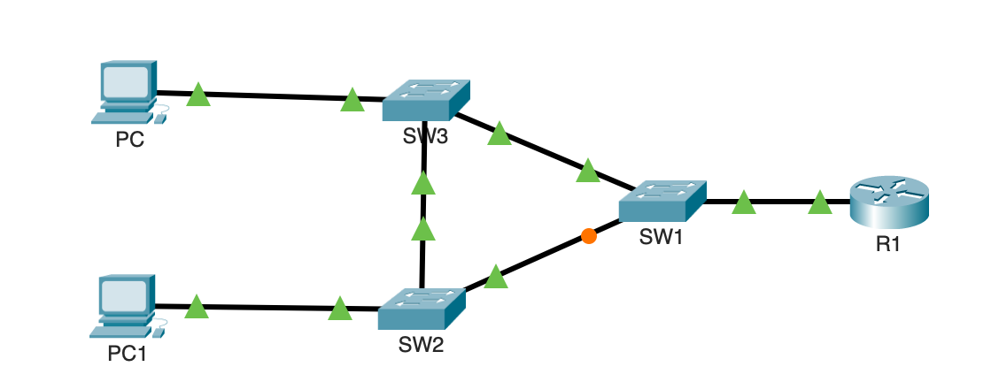
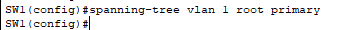
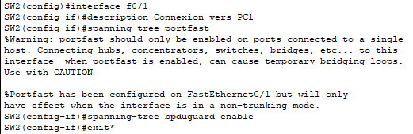
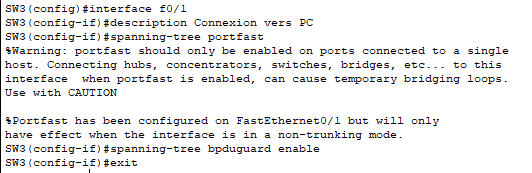

## Introduction

L'objectif est de mettre en œuvre et d'optimiser le protocole Spanning Tree sur une topologie de switchs redondante pour garantir la prévention des boucles réseau, tout en assurant une convergence rapide et une sécurité accrue des ports d'accès.

## Contexte : Le Problème des Boucles de Niveau 2

Dans un réseau, la redondance est essentielle : si un câble ou un switch tombe en panne, le trafic doit pouvoir passer par un autre chemin. Cependant, créer des liens redondants entre des switchs crée un **cercle (une boucle)**.

Sans un protocole comme STP, une trame de diffusion (broadcast) envoyée sur le réseau serait prise dans cette boucle, dupliquée à l'infini par les switchs, créant une **tempête de diffusion (broadcast storm)** qui sature toute la bande passante et paralyse le réseau en quelques secondes.

**Analogie :** STP est le **contrôleur de trafic intelligent** du réseau. Voyant plusieurs routes possibles, il en bloque une préventivement pour éviter les « embouteillages » sans fin (les boucles), tout en la gardant en réserve si la route principale tombe en panne.

## Concepts Clés de STP

STP organise le réseau en élisant des « rôles » pour chaque switch et chaque port :

- **Pont Racine (Root Bridge) :** Le switch « chef d'orchestre ». Il est élu automatiquement (celui qui a la plus basse priorité, puis la plus basse adresse MAC en cas d'égalité). Tout le trafic essaie de converger vers lui par le chemin le plus court.
- **Port Racine (Root Port) :** Sur un switch non racine, c'est l'unique port qui offre le chemin le plus direct vers le Pont Racine.
- **Port Désigné (Designated Port) :** C'est un port autorisé à transférer le trafic sur un segment réseau.
- **Port Bloqué (Blocking Port) :** Pour éviter une boucle, STP bloque tous les autres ports. Ce port écoute le réseau mais ne transfère pas de données. C'est le **chemin de secours.**

## Topologie et Prérequis

**Topologie :** Nous allons utiliser une topologie en triangle, le cas d'école parfait pour une boucle.

- **3x Switchs Cisco** (SW1, SW2, SW3) connectés en triangle pour créer une boucle physique.
- **1x Routeur** (R1) connecté à SW1, servant de passerelle.
- **2x PC** (PC et PC1) connectés respectivement à SW3 et SW2.



<p class="figure-caption"><b>Figure 1</b> · Topologie en triangle</p>

**Prérequis :** Les switchs disposent d'une configuration initiale (nom d'hôte, mots de passe, SSH).

## Procédure de Configuration

**Justification :** Par défaut, STP fonctionne automatiquement mais de manière non optimale. Ces étapes permettent de prendre le contrôle de son comportement pour l'aligner avec la logique de notre réseau.

### Configuration du Pont Racine

Dans cette topologie, SW1 est le switch de distribution connectant le réseau au routeur. Il est donc le candidat logique pour devenir le Pont Racine (Root Bridge) afin d'optimiser les chemins du trafic vers la sortie du réseau.

1. Sur SW1, passez en mode de configuration globale et définissez-le comme racine principale pour le VLAN 1 :

```text
SW1(config)# spanning-tree vlan 1 root primary
```



<p class="figure-caption"><b>Figure 2</b> · SW1 désigné comme pont racine</p>

### Optimisation des Ports d'Accès

Nous activons **PortFast** pour une connexion instantanée des PC et **BPDU Guard** pour bloquer les ports si un switch non autorisé y est connecté.

1. **Action sur SW2 :** Configurez le port connecté à PC1.

```text
SW2(config)# interface f0/1
SW2(config-if)# description Connexion vers PC1
SW2(config-if)# spanning-tree portfast
SW2(config-if)# spanning-tree bpduguard enable
SW2(config-if)# exit
```



<p class="figure-caption"><b>Figure 3</b> · PortFast et BPDU Guard sur SW2</p>

2. **Action sur SW3 :** Configurez le port connecté à PC, avec les mêmes commandes (description « Connexion vers PC »).



<p class="figure-caption"><b>Figure 4</b> · PortFast et BPDU Guard sur SW3</p>

## Vérifications

**Analyse de l'arbre Spanning Tree :** sur chaque switch, exécutez la commande `show spanning-tree`.

- Sur **SW1**, vérifiez la ligne « This bridge is the root ».
- Sur **SW2** et **SW3**, identifiez le port dont le rôle est **Root**. C'est leur meilleur chemin vers SW1.
- Repérez le port dont l'état est **BLK** (Blocking). C'est le lien redondant mis en veille par STP.

**Test de basculement :**

1. Depuis PC, lancez un ping en continu vers PC1.
2. Identifiez un lien principal actif (ex : entre SW1 et SW2) et supprimez le câble.
3. Les pings échouent pendant quelques secondes, puis le port qui était bloqué devient actif et les pings recommencent à fonctionner, prouvant que STP a fait basculer le trafic sur le chemin de secours.

## Conseils et Bonnes Pratiques

- **Passer à RSTP :** Le STP classique est lent. Le standard moderne **RSTP (Rapid Spanning Tree Protocol)** converge en quelques secondes. Pour l'activer, utilisez la commande `spanning-tree mode rapid-pvst` en configuration globale sur tous les switchs.
- **Protéger le Pont Racine (Root Guard) :** Pour empêcher un autre switch de devenir racine, activez Root Guard sur les ports de votre vrai Pont Racine avec la commande `spanning-tree guard root` sur l'interface.
- **Sécuriser le VLAN Natif :** Sur les liens trunk, changez le VLAN natif (par défaut 1) pour un VLAN inutilisé pour des raisons de sécurité, avec la commande `switchport trunk native vlan <id_vlan>`.

## Dépannage

**Symptôme :** Le réseau est paralysé, les voyants des switchs clignotent frénétiquement.

- **Cause :** Une tempête de diffusion due à une boucle.
- **Solution :** Vérifiez que STP est activé (`show spanning-tree`). Vérifiez qu'aucun port reliant des switchs n'a PortFast activé.

**Symptôme :** Un port est en état `err-disabled`.

- **Cause : BPDU Guard** a été déclenché par la réception d'un paquet STP sur ce port.
- **Solution :** Débranchez l'appareil non autorisé (probablement un switch) et réactivez le port avec les commandes `shutdown` puis `no shutdown`.

## Procédures Liées

- [Agrégation de Liens avec EtherChannel (LACP)](/procedures/cisco/agregation-de-liens-avec-etherchannel-lacp) *(Agrégation sans boucle)*
- [Configuration Initiale et Sécurisation d'un Switch Cisco](/procedures/cisco/configuration-initiale-et-securisation-dun-switch-cisco) *(Configuration de base des switchs)*
- [Redondance Routeur avec HSRP](/procedures/cisco/redondance-routeur-avec-hsrp) *(Aligner root bridge et passerelle active)*
- [Routage Inter-VLANs avec un Routeur (Router-on-a-Stick)](/procedures/cisco/routage-inter-vlans-avec-un-routeur-router-on-a-stick) *(Trunks transportant les VLANs)*
