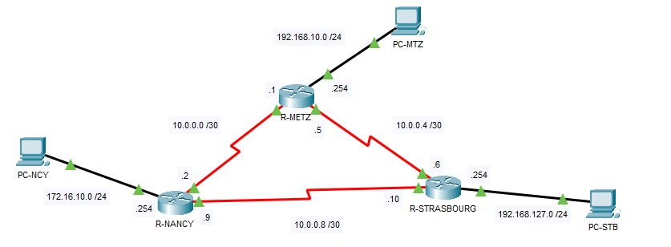
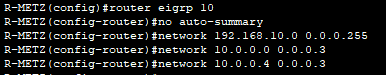
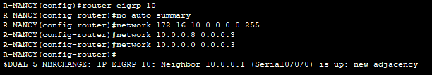
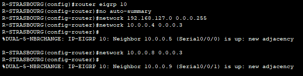

## Objectif

L'objectif est de configurer le protocole EIGRP pour permettre l'échange de routes dynamique entre plusieurs routeurs au sein d'un même Système Autonome (AS).

## Contexte et Justification

EIGRP est un protocole hybride avancé (propriétaire Cisco à l'origine, maintenant ouvert).

- **Analogie :** Si OSPF est un GPS qui télécharge toute la carte de la ville (Link-State), EIGRP fonctionne par « bouche-à-oreille » de confiance (Distance Vector avancé). Chaque routeur dit à son voisin : « Je sais aller là-bas, suis-moi. »
- **Avantage :** Il est plus facile à configurer qu'OSPF et calcule instantanément des itinéraires de secours (Feasible Successors) grâce à son algorithme **DUAL**.

## Concepts Clés : AS et Métrique

- **Autonomous System (AS)** : C'est le numéro d'identification de votre réseau EIGRP. Tous les routeurs doivent avoir le même numéro d'AS (ex : 10) pour communiquer.
- **Wildcard Mask :** Comme OSPF, EIGRP préfère les masques inversés (ex : 0.0.0.255 pour un /24).
- **Métrique (K-Values) :** EIGRP calcule la meilleure route en se basant sur la **Bande Passante** (vitesse du lien) et le **Délai.**

## Topologie et Plan d'Adressage

**Scénario :** Trois agences doivent être reliées en boucle pour la tolérance aux pannes.

| Équipement | Interface | IP / Masque | Description |
|------------|-----------|-------------|-------------|
| **R-METZ** | G0/0 | 192.168.10.254 /24 | LAN Metz |
|  | S0/0/0 | 10.0.0.1 /30 | Vers Nancy |
|  | S0/0/1 | 10.0.0.5 /30 | Vers Strasbourg |
| **R-NANCY** | G0/0 | 172.16.10.254 /24 | LAN Nancy |
|  | S0/0/0 | 10.0.0.2 /30 | Vers Metz |
|  | S0/0/1 | 10.0.0.9 /30 | Vers Strasbourg |
| **R-STRASBOURG** | G0/0 | 192.168.127.254 /24 | LAN Strasbourg |
|  | S0/0/0 | 10.0.0.6 /30 | Vers Metz |
|  | S0/0/1 | 10.0.0.10 /30 | Vers Nancy |
| **PC-MTZ** | NIC | DHCP | PC |
| **PC-NCY** | NIC | DHCP | PC |
| **PC-STB** | NIC | DHCP | PC |



<p class="figure-caption"><b>Figure 1</b> · Topologie et Plan d'Adressage</p>

## Procédure de Configuration

### Règle d'Or

**`no auto-summary` :** Par défaut (sur les anciens IOS), EIGRP résume les réseaux à leur classe naturelle (ex : les liaisons 10.0.0.0/30, 10.0.0.4/30 et 10.0.0.8/30 sont annoncées comme un seul 10.0.0.0/8), ce qui pose problème avec des réseaux découpés. Il faut **toujours** désactiver cette fonction.

### Configuration de R-METZ

1. Activez EIGRP avec le numéro d'AS (ici 10).
2. Désactivez le résumé automatique (`no auto-summary`).
3. Déclarez les réseaux (LAN + WANs).

```text
R-METZ(config)# router eigrp 10
R-METZ(config-router)# no auto-summary
R-METZ(config-router)# network 192.168.10.0 0.0.0.255
R-METZ(config-router)# network 10.0.0.0 0.0.0.3
R-METZ(config-router)# network 10.0.0.4 0.0.0.3
```



<p class="figure-caption"><b>Figure 2</b> · EIGRP sur R-METZ</p>

### Configuration de R-NANCY

1. Activez EIGRP avec le numéro d'AS (ici 10).
2. Désactivez le résumé automatique (`no auto-summary`).
3. Déclarez les réseaux (LAN + WANs).

```text
R-NANCY(config)# router eigrp 10
R-NANCY(config-router)# no auto-summary
R-NANCY(config-router)# network 172.16.10.0 0.0.0.255
R-NANCY(config-router)# network 10.0.0.8 0.0.0.3
R-NANCY(config-router)# network 10.0.0.0 0.0.0.3
```



<p class="figure-caption"><b>Figure 3</b> · EIGRP sur R-NANCY</p>

### Configuration de R-STRASBOURG

1. Activez EIGRP avec le numéro d'AS (ici 10).
2. Désactivez le résumé automatique (`no auto-summary`).
3. Déclarez les réseaux (LAN + WANs).

```text
R-STRASBOURG(config)# router eigrp 10
R-STRASBOURG(config-router)# no auto-summary
R-STRASBOURG(config-router)# network 192.168.127.0 0.0.0.255
R-STRASBOURG(config-router)# network 10.0.0.4 0.0.0.3
R-STRASBOURG(config-router)# network 10.0.0.8 0.0.0.3
```



<p class="figure-caption"><b>Figure 4</b> · EIGRP sur R-STRASBOURG</p>

## Vérifications

**Vérifier le voisinage :** Tapez `show ip eigrp neighbors`.

- Vous devez voir **2 voisins** sur chaque routeur.
- La colonne **Hold** (temps avant déclaration de mort) doit être positive.
- La colonne **Q Cnt** (Queue Count) doit être à **0**. Si elle est supérieure à 0, le routeur n'arrive pas à envoyer ses paquets (congestion).

**Vérifier la table de routage :** Tapez `show ip route`.

- Recherchez les lignes commençant par la lettre **D** (pour DUAL, l'algorithme d'EIGRP).
- Notez la distance administrative par défaut : **90**.

**Vérifier les protocoles :** Tapez `show ip protocols`.

- Vérifiez la ligne « Autonomous System 10 ».
- Vérifiez que « Automatic network summarization is not in effect ».

## Dépannage

**Erreur « Not on common subnet » :**

- Vérifiez les adresses IP WAN. Si R1 est en 10.0.0.1/30 et R2 en 10.0.0.5/30, ils ne peuvent pas se parler.

**Erreur « K-value mismatch » :**

- Très rare en labo, mais cela arrive si on modifie les poids de calcul de la métrique sur un routeur et pas l'autre. Les paramètres doivent être identiques.

**Pas de voisinage (AS Mismatch) :**

- Vérifiez `show ip protocols` sur chaque routeur. Si l'un est en `router eigrp 10` et l'autre en `router eigrp 11`, ils s'ignorent.

## Conseils et Bonnes Pratiques

**Sécuriser avec Passive-Interface :**

- Comme pour OSPF, ne laissez pas EIGRP envoyer des messages « Hello » vers vos PC ou commutateurs.
- **Commande :** `passive-interface GigabitEthernet0/0`.

**La commande Bandwidth :**

- EIGRP utilise la bande passante configurée sur l'interface pour calculer le meilleur chemin. Sur les liens série (Serial), la valeur par défaut (1,544 Mbit/s) est souvent fausse par rapport à la réalité.
- **Bonne pratique :** Toujours configurer la vitesse réelle.
- **Commande sur l'interface :** `bandwidth 64` (pour une liaison à 64 kbit/s).

**Redondance et équilibrage de charge :**

- Si deux liens ont la même métrique, EIGRP utilise les deux (Load Balancing).
- C'est un excellent moyen de doubler votre vitesse entre deux sites.

## Procédures Liées

- [Routage Dynamique avec OSPF](/procedures/cisco/routage-dynamique-avec-ospf) *(Alternative standard multi-constructeur)*
- [Routage Statique](/procedures/cisco/routage-statique) *(Routes statiques flottantes en secours)*
- [Redondance Routeur avec HSRP](/procedures/cisco/redondance-routeur-avec-hsrp) *(Redondance de la passerelle)*
- [Configuration Initiale et Sécurisation d'un Routeur Cisco](/procedures/cisco/configuration-initiale-et-securisation-dun-routeur-cisco) *(Configuration initiale du routeur)*
