## Objectif

L'objectif est de permettre la communication entre des appareils situés dans des **VLANs différents** en utilisant une seule interface physique sur un routeur.

## Contexte et Justification

Les VLANs segmentent le réseau en domaines de diffusion distincts, ce qui améliore la sécurité et les performances. Par défaut, les appareils d'un VLAN ne peuvent pas communiquer avec ceux d'un autre VLAN. Pour permettre cette communication, il faut un appareil de niveau 3 : un routeur.

La méthode « Router-on-a-Stick » est une solution économique qui utilise un seul port de routeur et un lien **trunk** pour acheminer et router le trafic de plusieurs VLANs. Le routeur agit comme le couloir d'un immeuble qui relie des appartements séparés (les VLANs).

## Concepts Clés : VLAN, Access et Trunk

- **VLAN (Virtual LAN) :** Un VLAN est un réseau local virtuel. Il permet de diviser un switch physique en plusieurs switchs virtuels complètement isolés les uns des autres. C'est comme prendre un grand hangar (le switch) et y construire des murs pour créer des bureaux séparés (les VLANs).
- **Port en Mode Access :** C'est un port de switch configuré pour appartenir à **un seul VLAN**. On y connecte les appareils finaux comme les PC, les imprimantes ou les serveurs. C'est la porte d'entrée qui ne mène qu'à un seul bureau (VLAN).
- **Port en Mode Trunk :** C'est un port spécial capable de transporter le trafic de **plusieurs VLANs en même temps**. Il est utilisé pour connecter le switch à un autre switch ou, comme ici, à un routeur. Pour différencier le trafic, il utilise un système d'étiquetage (le protocole **802.1Q**). C'est le couloir principal de l'immeuble : il dessert tous les bureaux, et chaque personne (trame) porte un badge (étiquette) indiquant à quel bureau (VLAN) elle appartient.

## Topologie et Plan d'Adressage

**Topologie :** 1 routeur, 1 switch, 2 PC.

- **PC** est dans le VLAN 10 (ADMIN).
- **PC1** est dans le VLAN 20 (COMMERCE).
- Le lien entre le switch et le routeur est un **trunk.**

<b>Figure 1</b> · Topologie et Plan d'Adressage

**Plan d'Adressage :**

| ID VLAN | Nom | Réseau | Passerelle |
|---------|-----|--------|------------|
| 10 | Admin | 192.168.10.0 /24 | 192.168.10.1 |
| 20 | Commerce | 192.168.20.0 /24 | 192.168.20.1 |

## Procédure de Configuration

Cette procédure se déroule en deux temps : d'abord le switch, puis le routeur.

### Configuration du Switch (Création des VLANs)

**Justification :** Nous allons créer les VLANs, assigner les PC à leurs VLANs respectifs et configurer le port connecté au routeur pour qu'il transporte le trafic de tous les VLANs (trunk).

1. Passez en mode de configuration globale (`configure terminal`).
2. Créez et nommez le VLAN 10 avec les commandes `vlan 10` et `name ADMIN`.
3. Créez et nommez le VLAN 20 avec les commandes `vlan 20` et `name COMMERCE`. Quittez le mode de configuration VLAN avec `exit`.

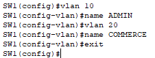

<b>Figure 2</b> · Création des VLANs 10 et 20

4. Entrez dans la configuration du port du PC (ex : FastEthernet0/1) avec la commande `interface FastEthernet0/1`.
5. Ajoutez une description pour identifier facilement à quoi ce port est connecté avec `description Connexion PC (ADMIN)`.
6. Configurez le port en mode access dans le VLAN 10 avec `switchport mode access` et `switchport access vlan 10`.

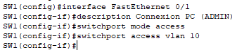

<b>Figure 3</b> · Port d'accès du PC (VLAN 10)

7. Entrez dans la configuration du port du PC1 (ex : FastEthernet0/2) avec la commande `interface FastEthernet0/2`.
8. Ajoutez une description avec `description Connexion PC1 (COMMERCE)`.
9. Configurez le port en mode access dans le VLAN 20 avec `switchport mode access` et `switchport access vlan 20`.

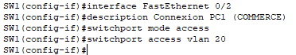

<b>Figure 4</b> · Port d'accès du PC1 (VLAN 20)

10. Entrez dans la configuration du port connecté au routeur (ex : GigabitEthernet0/1) avec la commande `interface GigabitEthernet0/1`.
11. Ajoutez une description claire pour le lien trunk avec `description TRUNK vers R1`.
12. Configurez le port en mode trunk avec la commande `switchport mode trunk`.
13. **Autorisez explicitement** uniquement les VLANs nécessaires sur le trunk avec la commande `switchport trunk allowed vlan 10,20`.

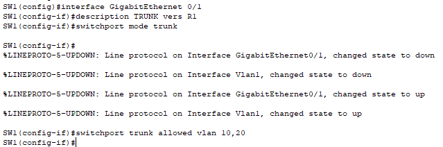

<b>Figure 5</b> · Port trunk vers le routeur

14. Sauvegardez votre configuration avec `end` puis `copy running-config startup-config`.

### Configuration du Routeur

**Justification :** Nous allons créer des sous-interfaces virtuelles, une pour chaque VLAN. Chaque sous-interface aura une adresse IP et servira de passerelle pour son VLAN. En ajoutant une description, nous rendons la configuration auto-documentée.

1. Passez en mode de configuration globale (`configure terminal`).
2. Entrez dans la configuration de l'interface physique connectée au switch (ex : GigabitEthernet0/0/0) avec la commande `interface GigabitEthernet0/0/0`.
3. Ajoutez une description pour le lien physique avec `description TRUNK vers SW1`.
4. Allumez l'interface, qui est éteinte par défaut, avec `no shutdown`.

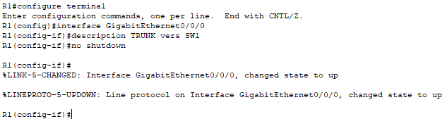

<b>Figure 6</b> · Interface physique du routeur

5. Créez la première sous-interface pour le VLAN 10 avec la commande `interface GigabitEthernet0/0/0.10`.
6. Ajoutez une description pour identifier son rôle avec `description Passerelle VLAN 10 ADMIN`.
7. Activez le protocole de trunking 802.1Q et associez cette sous-interface au VLAN 10 avec la commande `encapsulation dot1q 10`.
8. Assignez l'adresse IP de la passerelle pour le VLAN 10 avec `ip address 192.168.10.1 255.255.255.0`.

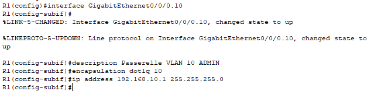

<b>Figure 7</b> · Sous-interface du VLAN 10

9. Créez la seconde sous-interface pour le VLAN 20 avec `interface GigabitEthernet0/0/0.20`.
10. Ajoutez une description avec `description Passerelle VLAN 20 COMMERCE`.
11. Associez-la au VLAN 20 avec `encapsulation dot1q 20`.
12. Assignez l'adresse IP de la passerelle pour le VLAN 20 avec `ip address 192.168.20.1 255.255.255.0`.

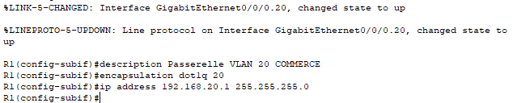

<b>Figure 8</b> · Sous-interface du VLAN 20

13. Sauvegardez votre configuration avec `end` puis `copy running-config startup-config`.

## Configuration des Hôtes et Vérifications

**Configuration des PC :**

- PC : IP 192.168.10.10, Masque 255.255.255.0, Passerelle 192.168.10.1.
- PC1 : IP 192.168.20.10, Masque 255.255.255.0, Passerelle 192.168.20.1.

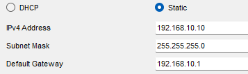

<b>Figure 9</b> · Configuration IP du PC (VLAN 10)

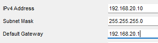

<b>Figure 10</b> · Configuration IP du PC1 (VLAN 20)

**Vérification sur le Switch :**

- Tapez `show vlan brief` pour voir vos VLANs et les ports qui y sont assignés.
- Tapez `show interfaces trunk` pour confirmer que le port vers le routeur est bien en mode trunking.

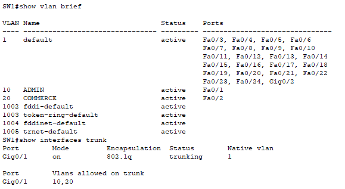

<b>Figure 11</b> · Vérification des VLANs et du trunk

**Vérification sur le Routeur :**

- Tapez `show ip interface brief` pour voir que vos deux sous-interfaces sont actives (**up / up**).
- Tapez `show ip route` pour voir que le routeur connaît les deux réseaux (192.168.10.0/24 et 192.168.20.0/24).

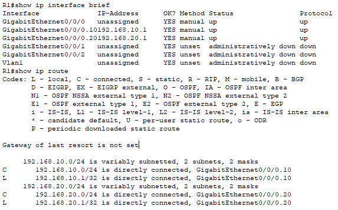

<b>Figure 12</b> · Sous-interfaces et table de routage

**Test Final :**

- Depuis le PC, ouvrez le « Command Prompt » et tapez `ping 192.168.20.10`. Le ping doit réussir ! Il se peut que la première requête échoue (le temps que le protocole ARP fasse son travail), mais les suivantes doivent fonctionner.

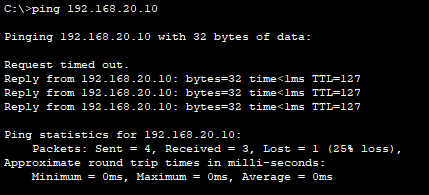

<b>Figure 13</b> · Ping inter-VLAN réussi

## Dépannage

Voici la checklist à suivre méthodiquement pour trouver la cause du problème.

**Vérifier le PC Client :**

- L'adresse IP est-elle correcte et dans le bon sous-réseau ?
- La **passerelle par défaut** est-elle bien l'adresse IP de la sous-interface du routeur correspondant à son VLAN ? C'est l'erreur la plus fréquente.

**Vérifier le Switch (Niveau 2) :**

- Les VLANs sont-ils bien créés ? (commande : `show vlan brief`).
- Les ports des PC sont-ils bien en mode access et assignés au bon VLAN ? (commande : `show vlan brief`).
- Le port connecté au routeur est-il bien en mode trunk ? (commande : `show interfaces trunk`).

**Vérifier le Routeur (Niveau 3) :**

- L'interface physique est-elle bien allumée (`no shutdown`) ? (commande : `show ip interface brief`).
- Les sous-interfaces sont-elles actives (up / up) ? (commande : `show ip interface brief`).
- La commande `encapsulation dot1q [vlan-id]` sur chaque sous-interface correspond-elle bien au bon numéro de VLAN ? Une faute de frappe ici est une erreur classique. (commande : `show running-config`).
- Les adresses IP des sous-interfaces sont-elles correctes et uniques ?

## Conseils et Bonnes Pratiques

- **Convention de nommage :** Faites correspondre le numéro de la sous-interface au numéro du VLAN (ex : `GigabitEthernet0/0/0.10` pour le VLAN 10). C'est plus clair pour tout le monde.
- **VLAN Natif :** Par défaut, un trunk a un « VLAN natif » (le VLAN 1) qui n'est pas étiqueté. Pour des raisons de sécurité, il est recommandé de le changer pour un VLAN inutilisé et de ne jamais utiliser le VLAN 1 pour des appareils.
- **Sécurité des ports :** Sur un switch en production, tous les ports inutilisés devraient être désactivés (`shutdown`) et assignés à un VLAN « parking » non utilisé pour empêcher les connexions non autorisées.

## Procédures Liées

- [Configuration Initiale et Sécurisation d'un Switch Cisco](/procedures/cisco/configuration-initiale-et-securisation-dun-switch-cisco) *(Trunk et VLANs côté switch)*
- [DHCP pour Multiples VLANs](/procedures/cisco/dhcp-pour-multiples-vlans) *(Adressage DHCP de chaque VLAN)*
- [ACLs (Standard et Étendues)](/procedures/cisco/acls-standard-et-etendues) *(Filtrage entre VLANs)*
- [Segmentation Réseau (VLANs) sur pfSense](/procedures/pare-feu/segmentation-reseau-vlans-sur-pfsense) *(Alternative avec un pare-feu pfSense)*
