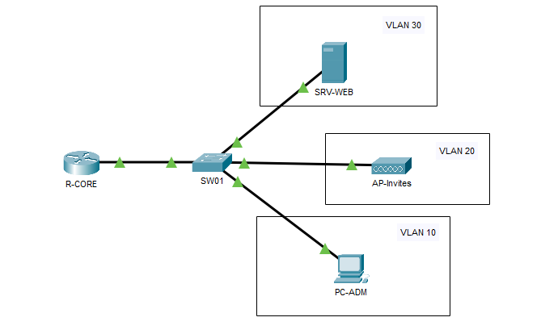
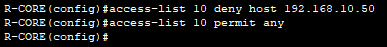
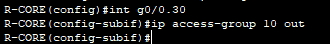
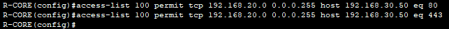
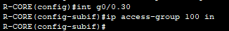

## Objectif

L'objectif est de sécuriser le réseau en filtrant le trafic. Nous allons définir quelles communications sont autorisées et quelles communications sont interdites entre les VLANs.

## Contexte et Justification

Sans ACL, un routeur laisse tout passer (c'est son métier de router). Or, en entreprise, le service Comptabilité ne doit pas être accessible par le Wi-Fi Invité, et les étudiants ne doivent pas accéder à l'interface d'administration des serveurs.

- **Analogie :** Le routeur sans ACL est un simple carrefour routier. Le routeur avec ACL devient un **poste de douane**. Le douanier (l'ACL) inspecte chaque véhicule (paquet) et décide : « Toi tu passes », « Toi tu fais demi-tour ».

## Concepts Clés : Standard vs Étendues

| Type | Numéros | Filtrage basé sur | Placement |
|------|---------|-------------------|-----------|
| **Standard** | 1 – 99 | Adresse IP source uniquement | Le plus près possible de la **destination** |
| **Étendue** | 100 – 199 | Source, destination, protocole et port | Le plus près possible de la **source** |

: ACL standard et étendue

**Refus implicite :** À la fin de chaque liste, il y a une règle invisible qui dit « interdire tout le reste ». Si vous n'autorisez pas explicitement le trafic, il sera bloqué.

## Topologie et Plan d'Adressage

**Scénario :** Un routeur central (R-CORE) gère trois zones :

- **VLAN 10 (ADMIN)** : Les employés de confiance.
- **VLAN 20 (INVITES)** : Le Wi-Fi visiteurs (ne doit accéder qu'au serveur web en interne).
- **VLAN 30 (SERVEURS)** : Contient un serveur web et un serveur de fichiers.

| Équipement | Interface | IP / Masque | Description |
|------------|-----------|-------------|-------------|
| **R-CORE** | G0/0.10 | 192.168.10.254 /24 | Passerelle ADMIN |
|  | G0/0.20 | 192.168.20.254 /24 | Passerelle INVITES |
|  | G0/0.30 | 192.168.30.254 /24 | Passerelle SERVEURS |
| **PC-STA** | NIC | 192.168.10.50 /24 | PC stagiaire |
| **SW01** | NIC | / | Switch |
| **SRV-WEB** | NIC | 192.168.30.50 /24 | Serveur Web |
| **AP-Invites** | NIC | / | Wi-Fi Invités |



<p class="figure-caption"><b>Figure 1</b> · Topologie et Plan d'Adressage</p>

## Procédure de Configuration

### ACL Standard (Protection Simple)

**Objectif :** Empêcher totalement le PC d'un stagiaire (192.168.10.50) d'accéder au réseau des serveurs (VLAN 30).

**Placement :** Standard = près de la destination, donc sur l'interface du VLAN 30.

1. Créez la règle (refuser le PC, autoriser les autres) :

```text
R-CORE(config)# access-list 10 deny host 192.168.10.50
R-CORE(config)# access-list 10 permit any
```



<p class="figure-caption"><b>Figure 2</b> · ACL standard 10</p>

2. Appliquez la règle sur l'interface de destination (en **sortie** vers le VLAN 30) :

```text
R-CORE(config)# interface g0/0.30
R-CORE(config-subif)# ip access-group 10 out
```



<p class="figure-caption"><b>Figure 3</b> · ACL 10 appliquée en sortie sur g0/0.30</p>

### ACL Étendue (Filtrage Précis)

**Objectif :** Les INVITES (VLAN 20) peuvent consulter le serveur web (HTTP/HTTPS), mais n'ont pas le droit de faire de ping ni de se connecter en SSH/FTP.

**Placement :** Étendue = près de la source, donc sur l'interface du VLAN 20, pour bloquer le trafic indésirable avant qu'il ne traverse le routeur.

1. Créez la règle 100 :

```text
R-CORE(config)# access-list 100 permit tcp 192.168.20.0 0.0.0.255 host 192.168.30.50 eq 80
R-CORE(config)# access-list 100 permit tcp 192.168.20.0 0.0.0.255 host 192.168.30.50 eq 443
```



<p class="figure-caption"><b>Figure 4</b> · ACL étendue 100</p>

<div class="callout callout-note">

On autorise les ports 80 et 443. Tout le reste, y compris le ping, est bloqué par le refus implicite en fin de liste.

</div>

2. Appliquez la règle sur l'interface source (en **entrée** depuis le VLAN 20) :

```text
R-CORE(config)# interface g0/0.20
R-CORE(config-subif)# ip access-group 100 in
```



<p class="figure-caption"><b>Figure 5</b> · Application de l'ACL 100 en entrée</p>

<div class="callout callout-note">

La capture montre l'interface g0/0.30 : appliquez bien l'ACL 100 sur la sous-interface des invités, g0/0.20, comme l'impose la règle de placement d'une ACL étendue.

</div>

## Vérifications

**Vérifier la configuration :**

- `show access-lists` : Affiche les règles et le nombre de fois qu'elles ont été déclenchées (« matches »).
- `show ip interface [interface]` : Confirme si une ACL est appliquée en In ou Out.

**Test de l'ACL Standard (Stagiaire) :**

- Depuis le PC stagiaire (192.168.10.50) : `ping 192.168.30.50` -> **Échec** (Destination unreachable).
- Depuis un autre PC Admin (ex : .51) : `ping 192.168.30.50` -> **Succès**.

**Test de l'ACL Étendue (Invités) :**

- Depuis le Wi-Fi invité : ouvrir le navigateur web vers 192.168.30.50 -> **Succès** (la page s'affiche).
- Depuis le Wi-Fi invité : `ping 192.168.30.50` -> **Échec** (Request timed out).

## Dépannage

**L'ordre des lignes est vital :** Le routeur lit l'ACL de haut en bas. Dès qu'une condition est remplie, il s'arrête.

- **Erreur classique :** Mettre un `permit any` au début. Résultat : tout passe, les lignes « deny » en dessous sont ignorées.

**Problème de sens (In/Out) :**

- **IN** : Trafic qui *entre* dans le routeur (venant du câble).
- **OUT** : Trafic qui *sort* du routeur (allant vers le câble).
- Visualisez-vous à l'intérieur du routeur pour décider.

## Conseils et Bonnes Pratiques

**Utiliser des ACL nommées :**

- Plutôt que des numéros (10, 100), utilisez des noms. C'est plus facile à modifier (on peut supprimer une ligne spécifique sans tout réécrire).
- **Syntaxe :** `ip access-list extended <NOM>`.

**Utiliser la commande `remark` :**

- Ajoutez des commentaires dans vos ACL pour vous souvenir de leur but 6 mois plus tard.
- **Commande :** `access-list 100 remark <commentaire>`.

**Ne jamais s'enfermer dehors :**

- Si vous appliquez une ACL sur la ligne VTY (Telnet/SSH) pour l'administration à distance, assurez-vous d'autoriser votre propre IP en premier, sinon vous perdrez la main sur le routeur !

## Procédures Liées

- [Configuration Initiale et Sécurisation d'un Routeur Cisco](/procedures/cisco/configuration-initiale-et-securisation-dun-routeur-cisco) *(Protéger l'accès d'administration par une ACL)*
- [NAT Dynamique et PAT](/procedures/cisco/nat-dynamique-et-pat) *(Définir le trafic à traduire avec une ACL)*
- [Routage Inter-VLANs avec un Routeur (Router-on-a-Stick)](/procedures/cisco/routage-inter-vlans-avec-un-routeur-router-on-a-stick) *(Filtrer le trafic entre VLANs)*
- [Configuration Initiale et Sécurisation d'un Switch Cisco](/procedures/cisco/configuration-initiale-et-securisation-dun-switch-cisco) *(Sécurisation complémentaire côté commutation)*
