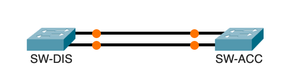
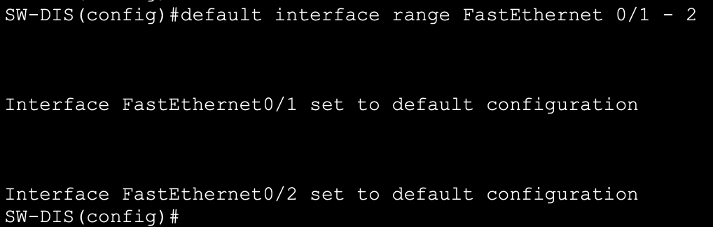
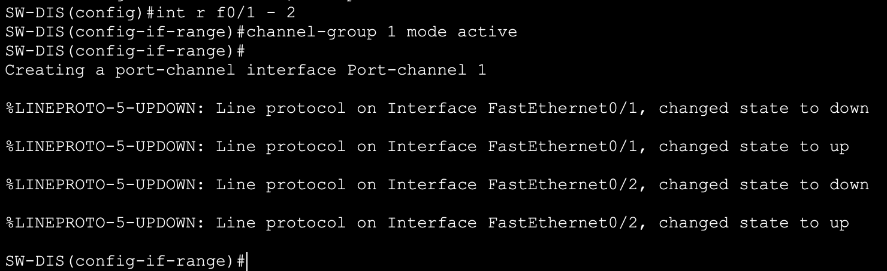
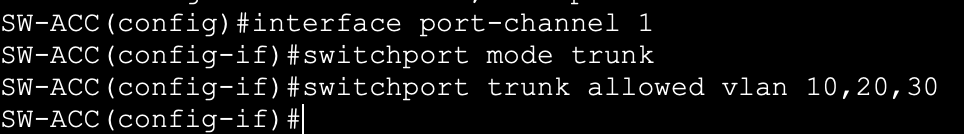
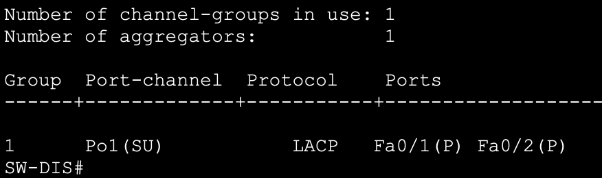

## Objectif

L'objectif est de combiner plusieurs câbles physiques (liens) en un seul lien logique pour multiplier la bande passante et assurer la redondance entre deux switchs.

## Contexte et Justification

Si vous reliez deux switchs avec un seul câble 1 Gbit/s, c'est bien. Si vous en mettez deux pour aller plus vite, le protocole STP (Spanning Tree) va en bloquer un pour éviter les boucles. Résultat : vous avez payé deux câbles, mais vous n'avez toujours qu'1 Gbit/s.

**Analogie :** Imaginez une autoroute à une seule voie. Si elle est bouchée, tout s'arrête. L'EtherChannel transforme cette route en autoroute à 2, 4 ou 8 voies. Les voitures (paquets) empruntent toutes les voies simultanément. Si une voie ferme pour travaux (panne de câble), le trafic se reporte automatiquement sur les autres.

**LACP (Link Aggregation Control Protocol) :** C'est le standard industriel (IEEE 802.3ad) compatible avec tous les constructeurs (Cisco, Aruba…).

## Concepts Clés : Channel-Group et Modes

**Port-Channel :** C'est le nom de l'interface virtuelle créée. On configure le trunk sur cette interface, et non plus sur les ports physiques.

**Modes LACP :**

- **Active** : Le switch propose activement de former un canal.
- **Passive** : Le switch attend qu'on le lui propose.
- **Règle** : Mettre **Active** des deux côtés est la meilleure pratique.

## Topologie et Plan d'Adressage

**Scénario :** Nous devons relier le Switch de Distribution (SW-DIS) au Switch d'Accès (SW-ACC) avec une forte bande passante.

- **Lien physique** : 2 câbles Ethernet.
- **Ports utilisés** : FastEthernet 0/1 et 0/2 sur les deux switchs.



<p class="figure-caption"><b>Figure 1</b> · Topologie et Plan d'Adressage</p>

## Configuration

### Préparation des ports

**Justification :** Avant de grouper des ports, ils doivent être **identiques** (même vitesse, même duplex, pas de configuration parasite). Le mieux est de les remettre à zéro, sur les deux switchs.

```text
SW-DIS(config)# default interface range FastEthernet 0/1 - 2
```



<p class="figure-caption"><b>Figure 2</b> · Réinitialisation des ports</p>

### Création de l'EtherChannel

**Justification :** On groupe les ports physiques dans le groupe logique n°1 en mode « Active », sur les deux switchs.

```text
SW-DIS(config)# interface range f0/1 - 2
SW-DIS(config-if-range)# channel-group 1 mode active
```



<p class="figure-caption"><b>Figure 3</b> · Création du Port-channel 1</p>

<div class="callout callout-note">

Message console attendu : « Creating a port-channel interface Port-channel 1 ».

</div>

### Configuration du Lien Logique (Trunk)

**Justification :** Maintenant, on ne touche plus aux ports physiques. On configure le trunk directement sur l'interface virtuelle `port-channel 1`, sur les deux switchs.

```text
SW-ACC(config)# interface port-channel 1
SW-ACC(config-if)# switchport mode trunk
SW-ACC(config-if)# switchport trunk allowed vlan 10,20,30
```



<p class="figure-caption"><b>Figure 4</b> · Trunk sur le Port-channel 1</p>

## Vérifications

**La commande reine :** `show etherchannel summary`. C'est la seule commande qui vous donne une vue d'ensemble claire.



<p class="figure-caption"><b>Figure 5</b> · Résultat de show etherchannel summary</p>

**Légende à connaître par cœur :**

- **SU** : S = Layer 2 (Switching) ; U = In Use (Fonctionnel).
- **P** : Bundled in Port-Channel (port bien intégré).
- Si vous voyez **D** (Down) ou **I** (Stand-alone / indépendant), ça ne marche pas.

**Test de Redondance :**

1. Lancez un ping continu à travers le réseau.
2. Débranchez le câble Fa0/1.
3. Le ping ne doit pas couper (ou perdre au maximum 1 paquet).
4. Vérifiez `show etherchannel summary` : Fa0/1 aura disparu ou sera marqué « D », mais Po1 restera « SU ».

## Dépannage

**Erreur « Config Mismatch » :**

- L'EtherChannel refuse de monter si les paramètres ne sont pas strictement identiques sur tous les ports (ex : un port en VLAN 10, l'autre en VLAN 20).
- **Solution :** Toujours configurer via `interface range` ou réinitialiser les interfaces avec `default interface` avant de commencer.

**Les ports restent en « I » (Stand-alone) :**

- L'un des côtés est peut-être en mode « On » (EtherChannel statique) et l'autre en « Active » (LACP). Ils ne se comprennent pas. Forcez « Active » des deux côtés.

**STP bloque tout :**

- Si l'EtherChannel est mal formé, le Spanning-Tree verra deux liens séparés et en bloquera un pour éviter la boucle. C'est le signe que votre agrégation a échoué.

## Conseils et Bonnes Pratiques

**Puissance de 2 :**

- Pour que l'équilibrage de charge (Load Balancing) soit mathématiquement parfait, utilisez de préférence 2, 4 ou 8 liens. Avec 3 liens, la répartition du trafic est inégale.

**Algorithme de Load Balancing :**

- Par défaut, le switch répartit selon l'adresse MAC source. Si un seul serveur envoie beaucoup de données à plein de clients, tout passera par le même câble.
- Vous pouvez changer l'algorithme : `port-channel load-balance src-dst-ip`.

**LACP vs PAgP :**

- PAgP est le vieux protocole propriétaire Cisco (`mode desirable`). Oubliez-le. Utilisez toujours LACP (`mode active`), c'est le standard universel.

## Procédures Liées

- [Prévention des Boucles Réseau avec Spanning Tree Protocol (STP)](/procedures/cisco/prevention-des-boucles-reseau-avec-spanning-tree-protocol-stp) *(Comportement de STP sur un lien agrégé)*
- [Configuration Initiale et Sécurisation d'un Switch Cisco](/procedures/cisco/configuration-initiale-et-securisation-dun-switch-cisco) *(Configuration de base des switchs)*
- [Routage Inter-VLANs avec un Routeur (Router-on-a-Stick)](/procedures/cisco/routage-inter-vlans-avec-un-routeur-router-on-a-stick) *(Trunk agrégé vers le routeur)*
- [Redondance Routeur avec HSRP](/procedures/cisco/redondance-routeur-avec-hsrp) *(Redondance complémentaire côté passerelle)*
