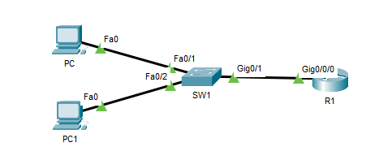
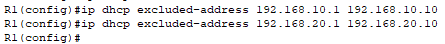
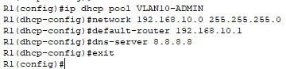
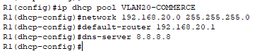
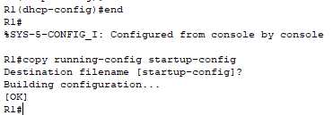
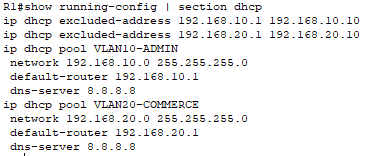
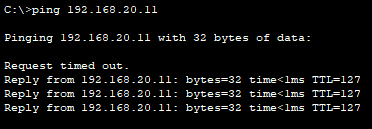

## Objectif

L'objectif est de configurer un routeur Cisco pour qu'il agisse en tant que serveur DHCP pour plusieurs VLANs. Le routeur devra distribuer automatiquement des configurations IP correctes et distinctes aux appareils clients, en fonction du VLAN auquel ils appartiennent.

## Contexte et Justification

Après avoir segmenté un réseau en VLANs et configuré le routage entre eux, la dernière étape pour une administration efficace est d'automatiser l'adressage IP. Comme le routeur possède une « porte d'entrée » dans chaque VLAN (via les sous-interfaces), il est parfaitement positionné pour écouter les demandes DHCP de chaque segment et y répondre avec les bonnes informations.

Le routeur agit comme le réceptionniste d'un immeuble : quand un nouvel arrivant se présente à un étage (VLAN), le réceptionniste (routeur) lui donne une clé (adresse IP) qui ne fonctionne que pour cet étage.

## Prérequis et Topologie

**Prérequis :** La procédure commence avec une configuration « Router-on-a-Stick » entièrement fonctionnelle.

- Le switch est configuré avec les VLANs 10 et 20, les ports d'accès et un port trunk vers le routeur.
- Le routeur est configuré avec des sous-interfaces pour les VLANs 10 et 20, chacune avec une adresse IP statique servant de passerelle.
- La communication entre les VLANs avec des adresses IP statiques sur les PC est validée.

**Topologie :** La topologie est exactement la même que celle de la procédure *Routage Inter-VLANs avec un Routeur (Router-on-a-Stick)*.

<b>Figure 1</b> · Topologie Router-on-a-Stick

## Procédure de Configuration

Toutes les commandes se tapent sur le routeur (R1), en mode de configuration globale.

1. **Exclure les adresses pour le VLAN 10 (ADMIN) :** Nous réservons les 10 premières adresses IP pour les équipements statiques (serveurs, etc.) et la passerelle.
   - Tapez la commande `ip dhcp excluded-address 192.168.10.1 192.168.10.10`.
2. **Exclure les adresses pour le VLAN 20 (COMMERCE) :** Nous faisons de même pour le second VLAN.
   - Tapez la commande `ip dhcp excluded-address 192.168.20.1 192.168.20.10`.

<b>Figure 2</b> · Exclusions d'adresses

3. **Créer le pool DHCP pour le VLAN 10 :**
   - Créez le pool avec un nom clair : `ip dhcp pool VLAN10-ADMIN`
   - Définissez le réseau et le masque : `network 192.168.10.0 255.255.255.0`
   - Définissez la passerelle par défaut : `default-router 192.168.10.1`
   - Définissez le serveur DNS : `dns-server 8.8.8.8`
   - Quittez le mode de configuration DHCP avec `exit`.

<b>Figure 3</b> · Pool DHCP du VLAN 10

4. **Créer le pool DHCP pour le VLAN 20 :**
   - Créez le second pool : `ip dhcp pool VLAN20-COMMERCE`
   - Définissez le réseau et le masque : `network 192.168.20.0 255.255.255.0`
   - Définissez la passerelle par défaut : `default-router 192.168.20.1`
   - Définissez le serveur DNS : `dns-server 8.8.8.8`

<b>Figure 4</b> · Pool DHCP du VLAN 20

5. **Sauvegarder la configuration :**
   - Revenez en mode privilégié avec `end`.
   - Sauvegardez avec `copy running-config startup-config`.

<b>Figure 5</b> · Sauvegarde de la configuration

## Vérifications

**Sur le Routeur :**

- Affichez la configuration DHCP avec `show running-config | section dhcp`. Vous devez voir vos deux pools et vos deux lignes d'exclusion.

<b>Figure 6</b> · Configuration DHCP du routeur

- Consultez les baux DHCP attribués avec `show ip dhcp binding`.

**Sur les PC Clients** :

- Allez sur **PC** (VLAN 10), dans **Desktop \> IP Configuration** et cochez **DHCP**. Il doit recevoir une adresse en 192.168.10.x et la passerelle 192.168.10.1.
- Allez sur **PC1** (VLAN 20), et faites de même. Il doit recevoir une adresse en 192.168.20.x et la passerelle 192.168.20.1.
- Depuis PC, lancez un ping vers l'adresse de PC1 : `ping 192.168.20.x`. Le ping doit réussir, validant à la fois le DHCP et le routage inter-VLANs.

<b>Figure 7</b> · Ping inter-VLAN depuis le PC

## Dépannage

**Un PC reçoit une adresse APIPA (169.254.x.x) :**

- **Le routage fonctionne-t-il ?** Configurez le PC en IP statique et vérifiez qu'il peut pinger sa passerelle. Si ce n'est pas le cas, le problème vient du routage, pas du DHCP.
- **Existe-t-il un pool pour ce VLAN ?** Vérifiez qu'un pool DHCP a bien été créé pour le réseau sur lequel le PC se trouve.
- **L'adresse de la sous-interface est-elle correcte ?** L'adresse IP de la sous-interface du routeur (ex : `192.168.10.1`) doit appartenir au même réseau que celui défini dans la commande `network` du pool DHCP correspondant.

## Conseils et Bonnes Pratiques

- **`ip helper-address` (Concept avancé) :** Dans notre cas, le routeur est lui-même le serveur DHCP. Si le serveur DHCP était une machine dédiée (ex : un Windows Server), la configuration serait différente. Il faudrait alors ajouter la commande `ip helper-address <IP_du_serveur_DHCP>` sur les sous-interfaces du routeur. Cette commande intercepte les requêtes DHCP des clients et les relaie vers le serveur DHCP central.
- **Documentation :** Utilisez des noms de pools clairs et documentez toujours vos plages d'adresses, vos exclusions et vos réservations.

## Procédures Liées

- [DHCP sur un Routeur Cisco](/procedures/cisco/dhcp-sur-un-routeur-cisco) *(Configuration DHCP de base)*
- [Routage Inter-VLANs avec un Routeur (Router-on-a-Stick)](/procedures/cisco/routage-inter-vlans-avec-un-routeur-router-on-a-stick) *(Sous-interfaces passerelles de chaque VLAN)*
- [DHCP Relay](/procedures/cisco/dhcp-relay) *(Alternative avec un serveur DHCP central)*
- [Segmentation Réseau (VLANs) sur pfSense](/procedures/pare-feu/segmentation-reseau-vlans-sur-pfsense) *(Même segmentation sur pfSense)*
