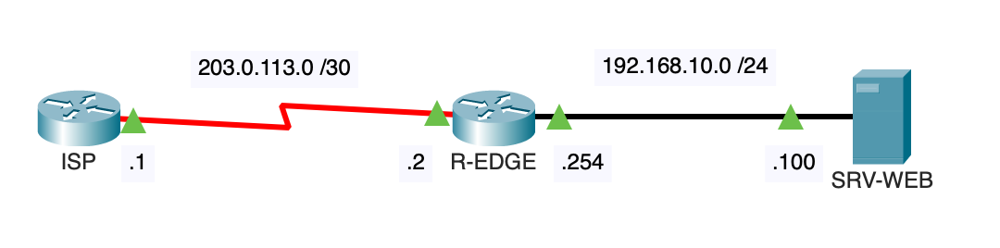
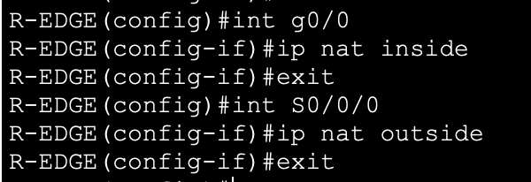
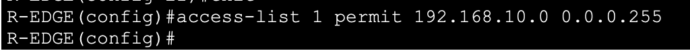
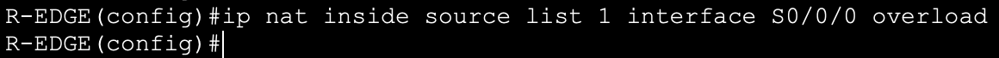
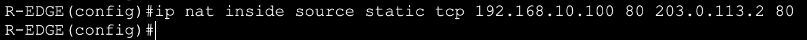
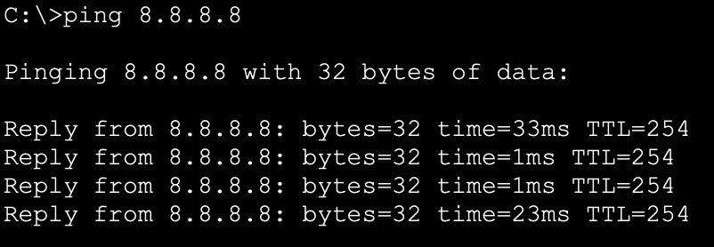

## Objectif

L'objectif est de permettre à des centaines d'appareils privés (LAN) d'accéder à Internet en utilisant une seule adresse IP publique fournie par le FAI. Nous verrons aussi comment rendre un serveur interne accessible depuis l'extérieur (Port Forwarding).

## Contexte et Justification

Les adresses IP privées (192.168.x.x, 10.x.x.x) sont « non routables » sur Internet. Si un paquet avec une adresse source 192.168.1.10 arrive sur Internet, il est immédiatement détruit.

**Analogie :** Le NAT fonctionne comme le standard d'une grande entreprise.

- Les employés (PC) ont des numéros internes (101, 102…).
- Quand ils appellent un client externe, le client voit s'afficher le numéro unique de l'accueil de l'entreprise (01.00.00.00.00).
- Quand le client rappelle, le standardiste (le routeur) regarde son carnet pour savoir à qui passer l'appel.

## Concepts Clés : Inside, Outside et Overload

**Inside / Outside :** Il faut définir physiquement « qui est dedans » (réseau de confiance) et « qui est dehors » (Internet).

**PAT (Port Address Translation) ou « Overload » :** C'est la méthode la plus utilisée. Le routeur utilise son adresse IP publique unique et différencie les PC internes en leur attribuant un **numéro de port** unique (ex : PC1 sort avec le port 1025, PC2 avec le port 1026).

**Static NAT (Network Address Translation) :** Une traduction fixe « un pour un ». Utilisée pour publier un serveur web.

## Topologie et Plan d'Adressage

**Scénario :** Sortie Internet d'un campus.

- **R-EDGE** : Le routeur qui fait le NAT.
- **ISP (FAI)** : Un routeur simulant Internet.
- **LAN** : Réseau interne (192.168.10.0 /24).
- **SRV-WEB** : Un serveur interne (192.168.10.100) qui doit être accessible depuis Internet.

| Équipement | Interface | IP / Masque | Description |
|------------|-----------|-------------|-------------|
| **R-EDGE** | G0/0 | 192.168.10.254 /24 | Passerelle LAN |
|  | S0/0/0 | 203.0.113.2 /30 | IP Publique (WAN) |
| **ISP** | S0/0/0 | 203.0.113.1 /30 | FAI |
|  | Loopback0 | 8.8.8.8 /32 | Simule Google |
| **SRV-WEB** | / | 192.168.10.100 /24 | Serveur Web |



<p class="figure-caption"><b>Figure 1</b> · Topologie et Plan d'Adressage</p>

## Configuration

### Définition des Interfaces

**Justification :** Le routeur doit savoir dans quel sens faire la traduction. Si vous oubliez ça, rien ne marche.

1. Passez en mode de configuration globale.
2. Sur l'interface d'entrée (ici, GigabitEthernet0/0), entrez la commande `ip nat inside`.
3. Sur l'interface de sortie (ici, Serial0/0/0), entrez la commande `ip nat outside`.

```text
R-EDGE(config)# interface g0/0
R-EDGE(config-if)# ip nat inside
R-EDGE(config-if)# exit
R-EDGE(config)# interface S0/0/0
R-EDGE(config-if)# ip nat outside
R-EDGE(config-if)# exit
```



<p class="figure-caption"><b>Figure 2</b> · Interfaces inside et outside</p>

### Création de l'ACL

**Justification :** On crée une ACL pour dire « seuls les hôtes du réseau 192.168.10.0 ont le droit d'être traduits ».

```text
R-EDGE(config)# access-list 1 permit 192.168.10.0 0.0.0.255
```



<p class="figure-caption"><b>Figure 3</b> · ACL des adresses à traduire</p>

### Configuration du PAT (Overload)

**Justification :** On lie l'ACL 1 à l'interface de sortie (Serial0/0/0) avec l'option `overload` (surcharge).

```text
R-EDGE(config)# ip nat inside source list 1 interface S0/0/0 overload
```



<p class="figure-caption"><b>Figure 4</b> · Règle PAT</p>

### Configuration du NAT Statique

**Justification :** On veut que si quelqu'un sur Internet tape l'IP publique 203.0.113.2 sur le port 80, cela arrive sur le serveur interne 192.168.10.100.

```text
R-EDGE(config)# ip nat inside source static tcp 192.168.10.100 80 203.0.113.2 80
```



<p class="figure-caption"><b>Figure 5</b> · Redirection de port vers SRV-WEB</p>

## Vérifications

**Test de Sortie :**

1. Depuis un PC, faites un `ping 8.8.8.8`.
2. Le ping doit réussir.



<p class="figure-caption"><b>Figure 6</b> · Ping vers Internet depuis le LAN</p>

**Sur le routeur :** tapez `show ip nat translations`.

- **Inside Local :** La vraie IP privée du PC (192.168.10.10).
- **Inside Global :** L'IP publique utilisée pour sortir (203.0.113.2).

**Statistiques :** `show ip nat statistics` vous montre combien de paquets ont été traduits.

## Dépannage

**Rien ne sort :**

- Avez-vous bien mis `ip nat inside` sur le LAN et `ip nat outside` sur le WAN ?
- Le routeur a-t-il une route par défaut (`ip route 0.0.0.0 0.0.0.0 S0/0/0`) ? Le NAT traduit l'adresse mais ne fournit pas le chemin : il faut les deux.

**L'ACL est fausse :**

- Vérifiez `show access-lists`. Si le compteur « matches » reste à 0, c'est que l'ACL ne capture pas le trafic (mauvaise IP source ou mauvais masque).

**Conflit de ports :**

- Si vous faites du NAT Statique port 80, assurez-vous que le routeur lui-même n'utilise pas le port 80 pour sa propre administration web (`ip http server`).

## Conseils et Bonnes Pratiques

**Sécurité implicite :**

- Le NAT agit comme un pare-feu basique « stateful ». Une machine sur Internet ne peut pas initier une connexion vers votre PC interne (car il n'y a pas d'entrée dans la table de traduction). Seul le trafic « retour » d'une demande interne est accepté (hors NAT statique).

**Logging (Debug) :**

- Pour voir le NAT en action en temps réel : `debug ip nat`.
- **Attention :** À n'utiliser qu'en laboratoire. Sur un gros réseau, cette commande peut crasher le routeur (trop de logs).

**NAT Timeout :**

- Les traductions dynamiques expirent après un certain temps d'inactivité (souvent 24h pour TCP, quelques minutes pour UDP). Cela permet de nettoyer la table en mémoire.

## Procédures Liées

- [ACLs (Standard et Étendues)](/procedures/cisco/acls-standard-et-etendues) *(Sélection du trafic à traduire)*
- [Routage Statique](/procedures/cisco/routage-statique) *(Route par défaut vers le fournisseur d'accès)*
- [Configuration Initiale et Sécurisation d'un Routeur Cisco](/procedures/cisco/configuration-initiale-et-securisation-dun-routeur-cisco) *(Configuration initiale du routeur)*
- [Configuration d'un Serveur Passerelle Internet](/procedures/windows/configuration-dun-serveur-passerelle-internet) *(Même besoin assuré par Windows Server)*
