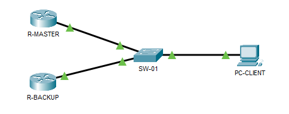
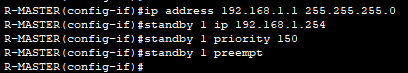
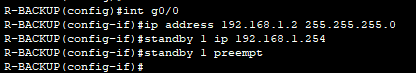
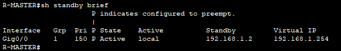
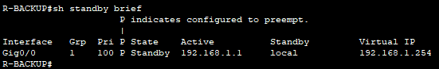
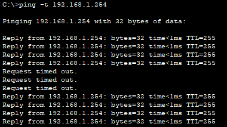

## Objectif

L'objectif est de configurer deux routeurs pour qu'ils fonctionnent comme une seule **passerelle virtuelle**. Si le routeur principal tombe en panne, le routeur de secours prend le relais instantanément, sans que les utilisateurs ne s'en rendent compte.

## Contexte et Justification

Dans une architecture classique, la passerelle par défaut est un point unique de défaillance (SPOF). Si elle meurt, tout le réseau est coupé d'Internet.

- **Analogie** : C'est comme un avion avec un pilote et un copilote. Les passagers (les paquets) parlent au « cockpit » (adresse virtuelle). Si le pilote s'évanouit, le copilote prend les commandes immédiatement. Les passagers ne savent pas qui pilote, tant que l'avion vole.
- **Fonctionnement :** Les routeurs s'envoient des « Hello » toutes les 3 secondes. Si le secours ne reçoit plus de nouvelles du principal (après 10s), il devient actif.

## Concepts Clés : VIP, Priorité et Préemption

**IP Virtuelle (VIP) :** C'est une adresse IP « fantôme » partagée par les deux routeurs. C'est **cette** adresse que l'on configure comme passerelle sur les PC.

**Priorité :** La valeur par défaut est **100**. Celui qui a la plus haute priorité devient le routeur **Active**. L'autre devient **Standby**.

**Préemption :** C'est l'option « retour du roi ». Si le routeur principal redémarre après une panne, il doit reprendre son rôle de chef. Sans préemption, il reste en secours.

## Topologie et Plan d'Adressage

**Scénario :** Deux routeurs (R-MASTER et R-BACKUP) sont connectés au même switch LAN. Le réseau LAN est 192.168.1.0 /24.

| Équipement | Interface | IP Physique | IP Virtuelle |
|------------|-----------|-------------|--------------|
| **R-MASTER** | G0/0 | 192.168.1.1 /24 | 192.168.1.254 /24 |
| **R-BACKUP** | G0/0 | 192.168.1.2 /24 |  |
| **SW-01** | / | / |  |
| **PC-CLIENT** | NIC | DHCP (passerelle 192.168.1.254) |  |



<p class="figure-caption"><b>Figure 1</b> · Topologie et Plan d'Adressage</p>

## Configuration

### Configuration de R-MASTER

**Justification :** On configure l'IP virtuelle, on augmente la priorité pour forcer l'élection, et on active la préemption.

1. Entrez dans l'interface connectée au LAN.
2. Définissez l'IP virtuelle (`standby 1 ip`).
3. Augmentez la priorité à 150.
4. Activez la préemption.

```text
R-MASTER(config)# interface g0/0
R-MASTER(config-if)# ip address 192.168.1.1 255.255.255.0
R-MASTER(config-if)# standby 1 ip 192.168.1.254
R-MASTER(config-if)# standby 1 priority 150
R-MASTER(config-if)# standby 1 preempt
```



<p class="figure-caption"><b>Figure 2</b> · Configuration HSRP de R-MASTER</p>

### Configuration de R-BACKUP

**Justification :** On configure la même IP virtuelle. On laisse la priorité par défaut (100).

1. Entrez dans l'interface connectée au LAN.
2. Définissez l'IP virtuelle (`standby 1 ip`).
3. Activez la préemption.

```text
R-BACKUP(config)# interface g0/0
R-BACKUP(config-if)# ip address 192.168.1.2 255.255.255.0
R-BACKUP(config-if)# standby 1 ip 192.168.1.254
R-BACKUP(config-if)# standby 1 preempt
```



<p class="figure-caption"><b>Figure 3</b> · Configuration HSRP de R-BACKUP</p>

<div class="callout callout-note">

On met aussi `preempt` sur le backup pour fluidifier les bascules futures, même si c'est moins critique que sur le master.

</div>

## Vérifications

**La commande reine :** Tapez `show standby brief` sur les deux routeurs.

Résultat attendu sur R-MASTER :



<p class="figure-caption"><b>Figure 4</b> · R-MASTER en état Active</p>

Résultat attendu sur R-BACKUP :



<p class="figure-caption"><b>Figure 5</b> · R-BACKUP en état Standby</p>

**Test de panne :**

1. Lancez un `ping -t 192.168.1.254` depuis le PC.
2. Débranchez le câble ou éteignez l'interface de R-MASTER.
3. Observez : quelques paquets peuvent être perdus pendant la bascule, puis le ping reprend.



<p class="figure-caption"><b>Figure 6</b> · Ping continu pendant la bascule</p>

4. Rallumez l'interface de R-MASTER (`no shutdown`). Grâce à la *préemption*, il doit reprendre la main (vérifiez avec `show standby brief`).

## Dépannage

**Les deux routeurs sont « Active » (split-brain) :**

- C'est le pire scénario (conflit d'IP). Cela arrive si les routeurs ne reçoivent pas les « Hello » de l'autre.
- Vérifiez la connectivité switch entre les deux routeurs.
- Vérifiez qu'aucune ACL ne bloque le trafic Multicast (HSRP version 1 utilise 224.0.0.2, la version 2 utilise 224.0.0.102).

**L'IP virtuelle ne répond pas :**

- Vérifiez que l'IP virtuelle est bien dans le même sous-réseau que les IP physiques.

**Pas de retour sur le master après une panne :**

- Avez-vous oublié la commande `standby 1 preempt` sur le master ? Sans elle, il ne reprendra jamais sa place après un redémarrage.

## Conseils et Bonnes Pratiques

**HSRP Interface Tracking (niveau avancé mais vital) :**

- **Problème :** Si le câble LAN du master fonctionne mais que son câble WAN (Internet) est coupé, HSRP pense que tout va bien et continue d'envoyer le trafic au master… qui le jette.
- **Solution :** Configurer le « tracking » : « si mon interface WAN tombe, baisse ma priorité de 60 points ».
- **Commande (sur le master) :** `standby 1 track Serial0/0/0 60`.

**Version HSRP :**

- Par défaut, c'est la version 1. Si vous utilisez de l'IPv6, il faut passer en version 2 (`standby version 2`).

## Procédures Liées

- [Routage Dynamique avec OSPF](/procedures/cisco/routage-dynamique-avec-ospf) *(Routage dynamique entre les routeurs redondants)*
- [Routage Inter-VLANs avec un Routeur (Router-on-a-Stick)](/procedures/cisco/routage-inter-vlans-avec-un-routeur-router-on-a-stick) *(Passerelles virtuelles par VLAN)*
- [Prévention des Boucles Réseau avec Spanning Tree Protocol (STP)](/procedures/cisco/prevention-des-boucles-reseau-avec-spanning-tree-protocol-stp) *(Cohérence entre root bridge et routeur actif)*
- [Configuration Initiale et Sécurisation d'un Routeur Cisco](/procedures/cisco/configuration-initiale-et-securisation-dun-routeur-cisco) *(Configuration initiale des routeurs)*
