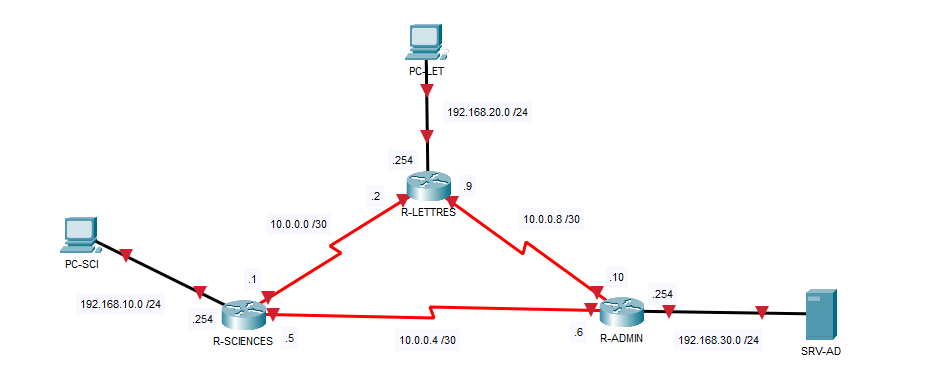
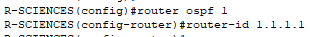
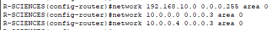
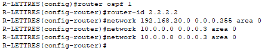
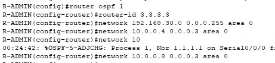
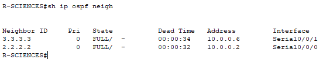
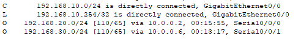
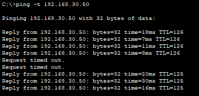

## Objectif

L'objectif est de configurer le protocole OSPF (Open Shortest Path First) pour que les routeurs échangent automatiquement leurs réseaux et calculent le chemin le plus rapide.

## Contexte et Justification

Dans un grand réseau, ajouter des routes statiques pour chaque nouveau sous-réseau devient ingérable.

- **Analogie :** Le routage statique, c'est comme une carte papier : si une route est fermée pour travaux, la carte ne se met pas à jour et vous restez bloqué. OSPF, c'est comme **Waze ou Google Maps** : si un lien tombe, les routeurs recalculent immédiatement un itinéraire alternatif sans intervention humaine.
- **Usage :** Utilisé dans les réseaux d'entreprise (Campus) car il est rapide (convergence) et standard (fonctionne sur Cisco, HP, Juniper, etc.).

## Concepts Clés : Area 0, Wildcard et Hello

**Area 0 (Backbone) :** OSPF est hiérarchique. Pour commencer, tous les routeurs doivent être dans la « Zone 0 ».

**Wildcard Mask (Masque Générique) :** C'est l'inverse du masque de sous-réseau.

- Masque : 255.255.255.0 -> Wildcard : 0.0.0.255.
- **Astuce de calcul :** 255.255.255.255 MOINS votre masque.

**Router-ID :** C'est le « nom » unique du routeur dans le processus OSPF (format IPv4, ex : 1.1.1.1).

## Topologie et Plan d'Adressage

**Scénario :** Trois bâtiments (Sciences, Lettres, Administration) sont reliés en triangle par de la fibre optique pour assurer la redondance. Si un lien casse (par exemple Sciences-Administration), le trafic doit passer par le troisième bâtiment.

| Équipement | Interface | IP / Masque | Description |
|------------|-----------|-------------|-------------|
| **R-SCIENCES** | G0/0 | 192.168.10.254 /24 | LAN Étudiants (VLAN 10) |
|  | S0/0/0 | 10.0.0.1 /30 | Vers R-LETTRES |
|  | S0/0/1 | 10.0.0.5 /30 | Vers R-ADMIN |
| **R-LETTRES** | G0/0 | 192.168.20.254 /24 | LAN Profs (VLAN 20) |
|  | S0/0/0 | 10.0.0.2 /30 | Vers R-SCIENCES |
|  | S0/0/1 | 10.0.0.9 /30 | Vers R-ADMIN |
| **R-ADMIN** | G0/0 | 192.168.30.254 /24 | LAN Serveurs (VLAN 30) |
|  | S0/0/0 | 10.0.0.6 /30 | Vers R-SCIENCES |
|  | S0/0/1 | 10.0.0.10 /30 | Vers R-LETTRES |
| **PC-SCI** | NIC | DHCP | PC |
| **PC-LET** | NIC | DHCP | PC |
| **SRV-AD** | NIC | 192.168.30.50 /24 | Serveur |



<p class="figure-caption"><b>Figure 1</b> · Topologie et Plan d'Adressage</p>

## Procédure de Configuration

### Configuration de R-SCIENCES

1. Passez en mode de configuration globale.
2. Activez OSPF avec `router ospf 1`.
3. Définissez l'ID : `router-id 1.1.1.1`.



<p class="figure-caption"><b>Figure 2</b> · Router-ID de R-SCIENCES</p>

4. Déclarez les réseaux connectés (LAN + 2 WANs) avec le wildcard mask.

```text
R-SCIENCES(config)# router ospf 1
R-SCIENCES(config-router)# router-id 1.1.1.1
R-SCIENCES(config-router)# network 192.168.10.0 0.0.0.255 area 0
R-SCIENCES(config-router)# network 10.0.0.0 0.0.0.3 area 0
R-SCIENCES(config-router)# network 10.0.0.4 0.0.0.3 area 0
```



<p class="figure-caption"><b>Figure 3</b> · Réseaux OSPF de R-SCIENCES</p>

### Configuration de R-LETTRES

1. Passez en mode de configuration globale.
2. Activez OSPF avec `router ospf 1`.
3. Définissez l'ID : `router-id 2.2.2.2`.
4. Déclarez les réseaux connectés (LAN + 2 WANs) avec le wildcard mask.

```text
R-LETTRES(config)# router ospf 1
R-LETTRES(config-router)# router-id 2.2.2.2
R-LETTRES(config-router)# network 192.168.20.0 0.0.0.255 area 0
R-LETTRES(config-router)# network 10.0.0.0 0.0.0.3 area 0
R-LETTRES(config-router)# network 10.0.0.8 0.0.0.3 area 0
```



<p class="figure-caption"><b>Figure 4</b> · OSPF sur R-LETTRES</p>

### Configuration de R-ADMIN

1. Passez en mode de configuration globale.
2. Activez OSPF avec `router ospf 1`.
3. Définissez l'ID : `router-id 3.3.3.3`.
4. Déclarez les réseaux connectés (LAN + 2 WANs) avec le wildcard mask.

```text
R-ADMIN(config)# router ospf 1
R-ADMIN(config-router)# router-id 3.3.3.3
R-ADMIN(config-router)# network 192.168.30.0 0.0.0.255 area 0
R-ADMIN(config-router)# network 10.0.0.4 0.0.0.3 area 0
R-ADMIN(config-router)# network 10.0.0.8 0.0.0.3 area 0
```



<p class="figure-caption"><b>Figure 5</b> · OSPF sur R-ADMIN</p>

## Vérifications

**Vérifier les voisins (LA commande la plus importante) :** Sur n'importe quel routeur, tapez `show ip ospf neighbor` :

- Vous devez voir **2 voisins** (puisque c'est un triangle).
- L'état doit être **FULL** (ou 2WAY). Si vous voyez **INIT** ou **EXSTART**, il y a un problème.



<p class="figure-caption"><b>Figure 6</b> · Voisins OSPF en état FULL</p>

**Vérifier la table de routage :** Tapez `show ip route`.

- Recherchez les lignes commençant par **O** (OSPF).
- Exemple sur R-SCIENCES : il doit voir le réseau 192.168.20.0 (Lettres) et 192.168.30.0 (Admin) via OSPF.



<p class="figure-caption"><b>Figure 7</b> · Routes OSPF sur R-SCIENCES</p>

**Test de redondance (ping continu) :**

1. Depuis un PC Sciences, lancez un `ping -t 192.168.30.50` (serveur Admin).
2. Débranchez le câble direct entre Sciences et Admin.
3. Observez : le ping va couper quelques secondes (« Request timed out »), puis reprendre. Le trafic passe maintenant par R-LETTRES.



<p class="figure-caption"><b>Figure 8</b> · Reprise du ping après la coupure</p>

## Dépannage

**Problème de voisinage (neighbor introuvable) :**

- Les deux routeurs sont-ils dans la même **Area** ?
- Les masques de sous-réseau sont-ils identiques des deux côtés du lien WAN ?
- Les timers Hello sont-ils identiques des deux côtés (10 secondes par défaut) ?

**Problème de Wildcard :**

- Vérifiez vos commandes `network`. Avez-vous mis 0.0.0.255 au lieu de 255.255.255.0 ?
- **Commande pour vérifier :** `show running-config | section ospf`.

## Conseils et Bonnes Pratiques

**Toujours définir un Router-ID manuellement :**

- Si vous ne le faites pas, le routeur prend l'adresse IP la plus élevée (loopback en priorité). Si l'adressage évolue, l'ID peut changer au prochain redémarrage du processus OSPF, ce qui provoque une reconvergence. Fixez-le (ex : 1.1.1.1) pour la stabilité.

**Sécuriser avec « passive-interface » :**

- Par défaut, OSPF envoie des messages « Hello » sur toutes les interfaces déclarées, y compris vers le LAN (les PC). C'est un risque de sécurité (un pirate peut s'annoncer comme routeur) et du gaspillage de bande passante.
- **Configuration :** `passive-interface g0/0`.
- Cela maintient le réseau annoncé, mais arrête l'envoi de paquets OSPF vers les PC.

**Ajuster la bande passante de référence (auto-cost) :**

- Par défaut, OSPF calcule le coût sur une base de 100 Mbit/s. Pour lui, un lien 1 Gbit/s et un lien 100 Mbit/s ont le même coût (1).
- Pour corriger cela sur des réseaux modernes (Gigabit), utilisez sur **tous** les routeurs : `auto-cost reference-bandwidth 1000`.

## Procédures Liées

- [Routage Dynamique avec EIGRP](/procedures/cisco/routage-dynamique-avec-eigrp) *(Alternative propriétaire Cisco)*
- [Routage Statique](/procedures/cisco/routage-statique) *(Routage statique en complément)*
- [Redondance Routeur avec HSRP](/procedures/cisco/redondance-routeur-avec-hsrp) *(Redondance de la passerelle)*
- [NAT Dynamique et PAT](/procedures/cisco/nat-dynamique-et-pat) *(Sortie Internet et route par défaut)*
