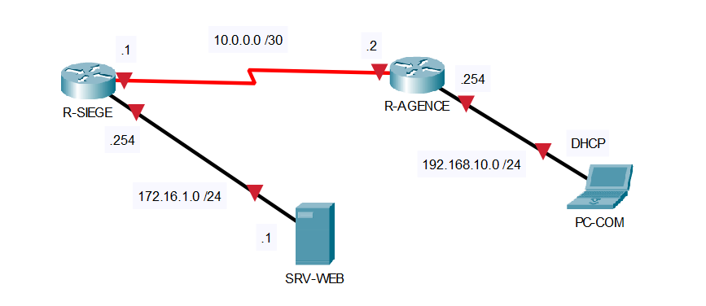
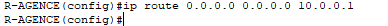
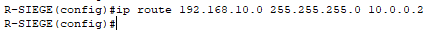
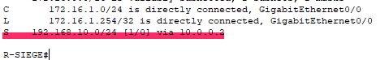
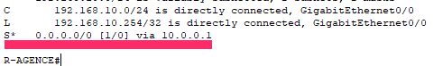

## Objectif

L'objectif est de configurer manuellement les chemins que les paquets doivent emprunter pour atteindre un réseau distant, et de configurer une « route par défaut » pour tout le trafic inconnu (vers Internet).

## Contexte et Justification

Contrairement au routage dynamique où les routeurs « discutent » entre eux pour trouver le chemin, le routage statique est manuel.

- **Analogie :** C'est comme placer des panneaux de signalisation fixes. Si vous voulez aller à Paris, le panneau indique « Tout droit ». Si la route est coupée, le panneau reste là et vous envoie dans le mur, sauf si l'administrateur vient le changer.
- **Usage :** Idéal pour les petits réseaux (Stub networks) ou pour relier une agence (Branch) au siège (HQ) via un lien unique, car cela ne consomme pas de ressources CPU/RAM sur le routeur.

## Concepts Clés : Next-Hop et Distance Administrative

**Commande `ip route` :** La syntaxe est toujours : `ip route [Réseau Destination] [Masque] [Adresse du saut suivant]`.

**Distance Administrative (AD) :** C'est la « confiance » accordée à la route. Une route statique a une AD de **1**. Elle est prioritaire sur l'OSPF (110) ou le RIP (120).

**Gateway of Last Resort (Route par défaut) :** Une route « attrape-tout » (0.0.0.0/0) utilisée quand le routeur ne sait pas où envoyer le paquet (généralement vers le FAI).

## Topologie et Plan d'Adressage

**Scénario :** Une entreprise possède un **Siège (Paris)** hébergeant des serveurs et ouvre une **Agence Commerciale (Lyon)**. Les deux sites sont reliés par une ligne spécialisée (Liaison WAN).

- **R-SIEGE :** Doit connaître la route pour joindre les commerciaux à Lyon.
- **R-AGENCE :** Doit tout envoyer vers le siège (Route par défaut), car c'est sa seule sortie.

| Équipement | Interface | IP / Masque | Description |
|------------|-----------|-------------|-------------|
| **R-SIEGE** | G0/0/0 | 172.16.1.254 /24 | LAN Serveurs (VLAN 100) |
|  | S0/1/0 | 10.0.0.1 /30 | WAN vers Agence |
| **R-AGENCE** | G0/0/0 | 192.168.10.254 /24 | LAN Commerciaux (VLAN 20) |
|  | S0/1/0 | 10.0.0.2 /30 | WAN vers Siège |
| **SRV-WEB** | NIC | 172.16.1.10 /24 | Serveur WEB |
| **PC-COM** | NIC | 192.168.10.10 /24 | PC Portable |



<p class="figure-caption"><b>Figure 1</b> · Topologie et Plan d'Adressage</p>

## Procédure de Configuration

### Configuration de base

On part du principe que les adresses IP des interfaces sont déjà configurées et actives (`no shutdown`) sur les deux routeurs.

### Configuration de R-AGENCE

**Justification :** L'agence n'a qu'un seul chemin pour sortir : vers le siège. Au lieu de lister tous les réseaux du siège, on utilise une **route par défaut**.

1. Passez en mode configuration globale.
2. Configurez la route par défaut vers l'IP WAN du siège (10.0.0.1) :

```text
R-AGENCE(config)# ip route 0.0.0.0 0.0.0.0 10.0.0.1
```



<p class="figure-caption"><b>Figure 2</b> · Route par défaut sur R-AGENCE</p>

### Configuration de R-SIEGE

**Justification :** Le siège ne sait pas où se trouve le réseau 192.168.10.0 (LAN Agence). Il faut lui indiquer explicitement.

1. Passez en mode configuration globale.
2. Configurez la route statique vers le réseau de l'agence via l'IP WAN de l'agence (10.0.0.2) :

```text
R-SIEGE(config)# ip route 192.168.10.0 255.255.255.0 10.0.0.2
```



<p class="figure-caption"><b>Figure 3</b> · Route statique sur R-SIEGE</p>

## Vérifications

**Vérification sur R-SIEGE :** Tapez `show ip route`. Vous devez voir une ligne avec le code **S** (Static).



<p class="figure-caption"><b>Figure 4</b> · Route statique dans la table de R-SIEGE</p>

**Vérification sur R-AGENCE :** Tapez `show ip route`. Vous devez voir le code **S\*** (Static Candidate Default).



<p class="figure-caption"><b>Figure 5</b> · Route par défaut dans la table de R-AGENCE</p>

## Dépannage

Si le ping échoue entre le PC et le serveur, utilisez cette checklist :

- **Vérifier le « Next Hop » :** Sur R-SIEGE, est-ce que l'adresse 10.0.0.2 est joignable ? Faites un `ping 10.0.0.2` depuis R-SIEGE. Si ça ne marche pas, le problème est sur le lien WAN (Layer 1/2).
- **Vérifier le sens retour :** Le paquet arrive peut-être au serveur, mais le serveur ne sait pas comment répondre. Vérifiez que R-AGENCE a bien sa route par défaut.
- **Vérifier les équipements :** Les passerelles par défaut sont-elles correctes (.254) ?

## Conseils et Bonnes Pratiques

**Interface de sortie vs « next-hop » (saut suivant) :**

- Sur les liaisons **Série (Point-à-Point)**, il est préférable d'indiquer l'interface de sortie (ex : `ip route ... Serial0/0/0`). C'est plus efficace car le routeur n'a pas besoin de chercher l'adresse MAC du voisin.
- Sur les liaisons **Ethernet (Broadcast)**, il est impératif d'utiliser l'adresse IP du saut suivant (ex : `ip route ... 10.0.0.2`). Si vous mettez l'interface de sortie sur de l'Ethernet, le routeur va lancer des requêtes ARP pour *toutes* les destinations, ce qui va saturer sa table ARP.

**Mise en place de « routes flottantes » (backup) :**

- C'est une technique de redondance essentielle. Vous pouvez configurer une deuxième route vers la même destination mais avec une **Distance Administrative (AD)** plus élevée (ex : 5 au lieu de 1).
- **Commande :** `ip route 192.168.10.0 255.255.255.0 10.0.0.6 5`.
- **Résultat :** Cette route restera cachée tant que la route principale fonctionne. Si la route principale tombe, la route flottante apparaît automatiquement dans la table de routage.

**Résumé de routes (CIDR) :**

- Plutôt que d'écrire 4 lignes pour router les réseaux 192.168.0.0/24, 1.0/24, 2.0/24 et 3.0/24, utilisez une seule route résumée si les sous-réseaux sont contigus (ex : 192.168.0.0 255.255.252.0). Cela réduit la taille de la table de routage et économise la mémoire du routeur.

**Documentation « nommée » (Cisco IOS récents) :**

- Sur les équipements récents, vous pouvez nommer une route statique pour savoir à quoi elle sert sans regarder un schéma externe.
- **Commande :** `ip route 10.0.0.0 255.0.0.0 192.168.1.1 name VERS_SIEGE`.

## Procédures Liées

- [Routage Dynamique avec OSPF](/procedures/cisco/routage-dynamique-avec-ospf) *(Passage au routage dynamique)*
- [Routage Dynamique avec EIGRP](/procedures/cisco/routage-dynamique-avec-eigrp) *(Autre protocole de routage dynamique)*
- [NAT Dynamique et PAT](/procedures/cisco/nat-dynamique-et-pat) *(Route par défaut et sortie Internet)*
- [Configuration Initiale et Sécurisation d'un Routeur Cisco](/procedures/cisco/configuration-initiale-et-securisation-dun-routeur-cisco) *(Configuration initiale du routeur)*
