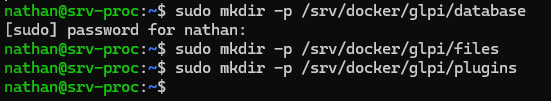
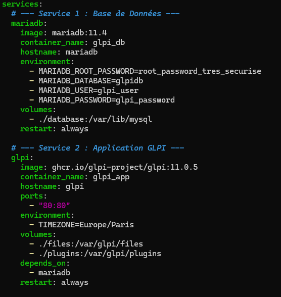
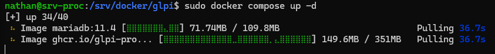
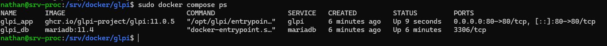
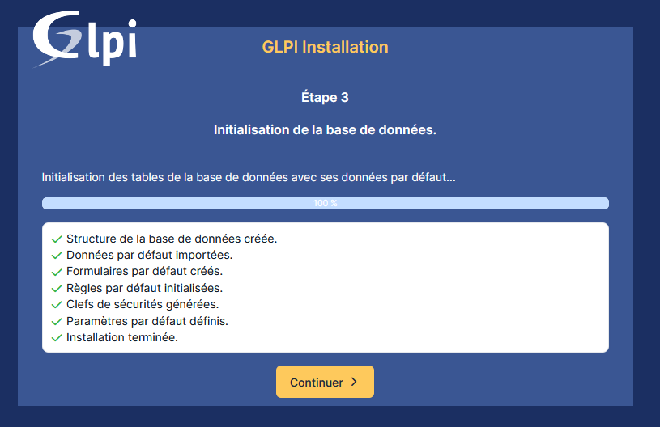

## Introduction

Cette procédure décrit le déploiement de l'application **GLPI** (version 11.0.5) et de sa base de données **MariaDB** en utilisant la technologie de conteneurs Docker.

## Contexte et Justification

Contrairement à l'installation manuelle (« LAMP traditionnel »), cette méthode déploie GLPI sous forme de « services » isolés.

- **Avantages :** Installation très rapide (moins de 5 minutes), mise à jour simplifiée (il suffit de changer le numéro de version), et propreté du système (pas de pollution des bibliothèques du serveur).
- **Version :** Nous utilisons la version **11.0.5**, sortie le 28/01/2026, pour bénéficier des derniers correctifs de sécurité.

## Concepts Clés

Avant de manipuler, il est essentiel de comprendre trois mécanismes spécifiques à Docker qui diffèrent d'une installation classique :

- **Persistance (Volumes) :** Un conteneur est éphémère : si on le supprime, ses données internes disparaissent. Pour ne pas perdre la base de données ou les documents joints, nous utilisons des **Volumes**. Ce sont des dossiers du serveur hôte « montés » à l'intérieur du conteneur.
- **Orchestration (Docker Compose) :** GLPI ne fonctionne pas seul, il lui faut une base de données. **Docker Compose** est l'outil qui permet de décrire ces deux services (App + DB) dans un seul fichier texte (`docker-compose.yml`) et de les démarrer ensemble.
- **Réseau Interne & Nom d'Hôte :** Dans Docker, les conteneurs communiquent via un réseau privé virtuel. Ils ne s'appellent pas par adresse IP, mais par leur **nom de service**. GLPI devra donc contacter le serveur SQL via le nom `mariadb`, et surtout pas `localhost` (pour le conteneur GLPI, `localhost`, c'est lui-même).

## Prérequis

- Serveur Linux avec **Docker Engine** et le plugin **Compose** actifs (cf. procédure *Installation de Docker et Portainer sur Ubuntu*).
- Accès Internet (pour le téléchargement des images).
- Port 80 (HTTP) libre sur le serveur.

## Configuration

### Préparation de l'Environnement (Volumes)

**Justification :** Nous créons l'arborescence sur le serveur physique pour stocker durablement les données.

1. Connectez-vous au terminal et créez les dossiers nécessaires :

```bash
sudo mkdir -p /srv/docker/glpi/database
sudo mkdir -p /srv/docker/glpi/files
sudo mkdir -p /srv/docker/glpi/plugins
```



<p class="figure-caption"><b>Figure 1</b> · Création des dossiers de volumes</p>

2. Appliquez les permissions correctes (ID 33 = www-data) : `sudo chown -R 33:33 /srv/docker/glpi`

### Création de la Recette (Docker Compose)

**Justification :** Ce fichier fige la configuration. Nous imposons la version 11.0.5 (sortie le 28/01/2026) pour garantir la stabilité.

1. Placez-vous dans le dossier de travail : `cd /srv/docker/glpi`
2. Créez le fichier de configuration : `sudo nano docker-compose.yml`
3. Insérez le contenu suivant (l'indentation YAML est stricte) :

```yaml
services:
  # --- Service 1 : Base de données ---
  mariadb:
    image: mariadb:11.4
    container_name: glpi_db
    hostname: mariadb
    environment:
      - MARIADB_ROOT_PASSWORD=root_password_tres_securise
      - MARIADB_DATABASE=glpidb
      - MARIADB_USER=glpi_user
      - MARIADB_PASSWORD=glpi_password
    volumes:
      - ./database:/var/lib/mysql
    restart: always

  # --- Service 2 : Application GLPI ---
  glpi:
    image: ghcr.io/glpi-project/glpi:11.0.5
    container_name: glpi_app
    hostname: glpi
    ports:
      - "80:80"
    environment:
      - TIMEZONE=Europe/Paris
    volumes:
      - ./files:/var/glpi/files
      - ./plugins:/var/glpi/plugins
    depends_on:
      - mariadb
    restart: always
```



<p class="figure-caption"><b>Figure 2</b> · Fichier docker-compose.yml</p>

4. Sauvegardez (CTRL+O) et quittez (CTRL+X).

### Lancement du Déploiement

1. Exécutez la commande pour télécharger et lancer les services en arrière-plan : `sudo docker compose up -d`



<p class="figure-caption"><b>Figure 3</b> · Téléchargement et démarrage des services</p>

2. Vérifiez que les services sont opérationnels (État « Up ») : `sudo docker compose ps`



<p class="figure-caption"><b>Figure 4</b> · Services à l'état Up</p>

### Finalisation via l'Interface Web

1. Ouvrez un navigateur : `http://IP_DU_SERVEUR`.
2. Suivez l'assistant (Langue \> Licence \> Installer).
3. **Connexion SQL :**
   - **Serveur SQL :** `mariadb`.
   - **Utilisateur :** `glpi_user`.
   - **Mot de passe :** `glpi_password`.
4. Sélectionnez la base `glpidb` et terminez.



<p class="figure-caption"><b>Figure 5</b> · Assistant d'installation de GLPI</p>

## Sécurité Post-Installation

1. Connectez-vous (identifiant : **glpi** / mot de passe : **glpi**).
2. Changez le mot de passe administrateur, ainsi que ceux des comptes par défaut `tech`, `normal` et `post-only`.
3. Supprimez le fichier d'installation via Docker : `sudo docker exec -it glpi_app rm /var/www/html/glpi/install/install.php`

## Dépannage et Conseils

**Erreur « Connection Refused » (SQL) :** Vérifiez que le nom d'hôte saisi est bien `mariadb`, et non `localhost`.

**Mise à jour :** Changez la version dans `docker-compose.yml` et relancez `sudo docker compose up -d`.

**Cron :** Pour les actions automatiques, ajoutez au crontab du serveur hôte : `* * * * * docker exec glpi_app php /var/www/html/glpi/front/cron.php &>/dev/null`

**Sauvegarde :** Arrêtez le service (`docker compose stop`) et copiez tout le dossier `/srv/docker/glpi`.

## Procédures Liées

- [Installation de GLPI](/procedures/linux/installation-de-glpi) *(Installation classique sans conteneur)*
- [Installation de Docker et Portainer sur Ubuntu](/procedures/linux/installation-de-docker-et-portainer-sur-ubuntu) *(Socle Docker et Portainer)*
- [Déploiement Automatique de l'Agent GLPI via GPO](/procedures/windows/deploiement-automatique-de-lagent-glpi-via-gpo) *(Inventaire automatique des postes Windows)*
- [Sauvegarde de Serveurs Linux avec rsync et BorgBackup](/procedures/linux/sauvegarde-de-serveurs-linux-avec-rsync-et-borgbackup) *(Sauvegarde des volumes et de la base)*
