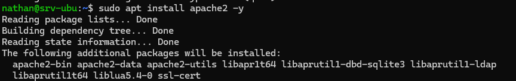
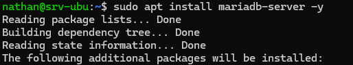
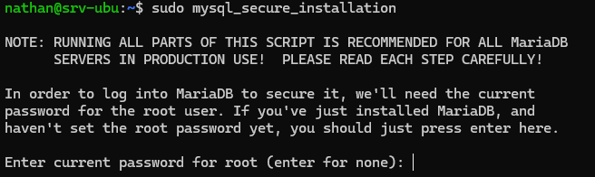
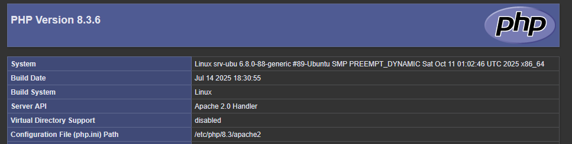

## Introduction

L'objectif est de mettre en place un serveur capable d'héberger des sites web dynamiques (comme WordPress ou GLPI). Nous utiliserons la pile « LAMP », le standard du marché open source.

## Contexte et Justification

Un serveur web seul (Apache) ne peut servir que des pages statiques (HTML). Pour des applications modernes, nous avons besoin d'une base de données pour stocker l'information et d'un langage de script pour générer les pages.

- **Linux :** Le système d'exploitation.
- **Apache :** Le serveur web.
- **MariaDB :** Le serveur de base de données (fork libre et compatible de MySQL).
- **PHP :** Le langage de programmation.

## Concepts Clés

**Daemon (Service) :** Programme qui tourne en tâche de fond (ex : `apache2`).

**DocumentRoot :** Le dossier où sont stockés les fichiers du site (par défaut `/var/www/html`).

**Bind Address :** L'adresse IP sur laquelle le service « écoute ». `0.0.0.0` signifie « toutes les interfaces ».

## Prérequis

**Scénario :** Un serveur Linux doit héberger un site intranet accessible par les clients du LAN.

Avant de commencer la configuration, assurez-vous de :

1. Avoir une machine Linux (Ubuntu LTS ou Debian 12/13) installée.
2. Avoir un accès **root** ou un utilisateur avec les droits `sudo`.
3. Avoir une connexion Internet active pour télécharger les paquets.
4. Avoir mis à jour les dépôts : `sudo apt update`.

## Configuration

### Installation du Serveur Web (Apache)

**Justification :** Apache est le logiciel qui écoute sur le port 80 (HTTP) et répond aux requêtes des navigateurs.

1. Installez le paquet Apache2 : `sudo apt install apache2 -y`

<b>Figure 1</b> · Installation d'Apache

### Installation du Serveur de Base de Données (MariaDB)

**Justification :** Indispensable pour stocker les données utilisateurs, les configurations de GLPI ou les articles d'un blog.

1. Installez le serveur MariaDB : `sudo apt install mariadb-server -y`

<b>Figure 2</b> · Installation de MariaDB

2. Sécurisez l'installation (définition du mot de passe root SQL, suppression des bases tests) : `sudo mysql_secure_installation`. Répondez « Y » à toutes les questions de sécurité.

<b>Figure 3</b> · Sécurisation de MariaDB

### Installation de PHP et des Connecteurs

**Justification :** PHP fait le lien entre Apache et la base de données. Sans le module `php-mysql`, votre site ne pourra pas discuter avec la base de données.

1. Installez PHP et le module d'intégration Apache : `sudo apt install php libapache2-mod-php php-mysql -y`
2. Redémarrez Apache pour prendre en compte PHP : `sudo systemctl restart apache2`

## Vérifications

**Test du service web :**

1. Depuis le PC-Client, ouvrez un navigateur web.
2. Entrez l'adresse IP du serveur : `http://XX.XX.XX.XX`.
3. Vous devez voir la page « Apache2 Default Page ».

<b>Figure 4</b> · Page par défaut d'Apache

**Test du traitement PHP :**

1. Créez un fichier de test sur le serveur : `echo "<?php phpinfo(); ?>" | sudo tee /var/www/html/info.php`
2. Depuis le navigateur du client, allez sur `http://XX.XX.XX.XX/info.php`.
3. Un tableau violet/gris affichant la version de PHP doit apparaître.

<b>Figure 5</b> · Page phpinfo()

## Dépannage

**Le site ne charge pas (timeout) :**

- Vérifiez si le pare-feu est actif. Sur Ubuntu, autorisez le trafic : `sudo ufw allow 80/tcp`
- Vérifiez la connectivité avec un ping depuis le client.

**Page blanche ou code PHP affiché en texte brut :**

- Cela signifie que le module PHP n'est pas activé dans Apache.
- Tapez `sudo a2enmod php8.3` (adaptez à votre version de PHP, visible avec `php -v`), puis redémarrez Apache : `sudo systemctl restart apache2`.

**Erreur « Connection refused » :**

- Vérifiez que le service tourne : `systemctl status apache2`.
- Si non, tapez : `sudo systemctl start apache2`.

## Conseils et Bonnes Pratiques

**Sécurité (Suppression du fichier test) :** Ne laissez jamais le fichier `info.php` en production. Il donne trop d'informations aux pirates sur votre version de PHP et de vos modules.

- Commande : `sudo rm /var/www/html/info.php`

**Permissions :** Par défaut, `/var/www/html` appartient à **root**. Pour modifier les fichiers sans `sudo`, changez le propriétaire pour `www-data` (l'utilisateur Apache) ou votre utilisateur courant, mais attention aux droits d'écriture publics (777 à bannir).

**HTTPS :** En production, le port 80 n'est plus suffisant. Il faudra activer le module SSL (`a2enmod ssl`) et installer un certificat (Let's Encrypt).

## Procédures Liées

- [Installation d'un Serveur Web LEMP (Nginx)](/procedures/linux/installation-dun-serveur-web-lemp-nginx) *(Alternative avec Nginx)*
- [Installation de GLPI](/procedures/linux/installation-de-glpi) *(Application qui s'appuie sur LAMP)*
- [Configuration du Pare-feu avec UFW et nftables](/procedures/linux/configuration-du-pare-feu-avec-ufw-et-nftables) *(N'ouvrir que HTTP et HTTPS)*
- [Installation d'un Serveur Ubuntu en Ligne de Commande (CLI)](/procedures/linux/installation-dun-serveur-ubuntu-en-ligne-de-commande-cli) *(Installation du serveur de base)*
