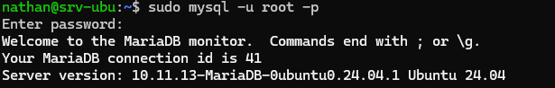
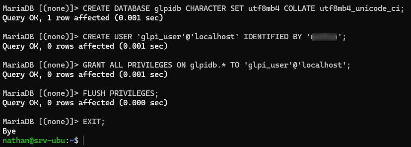
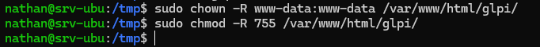
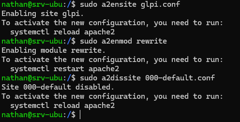
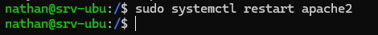
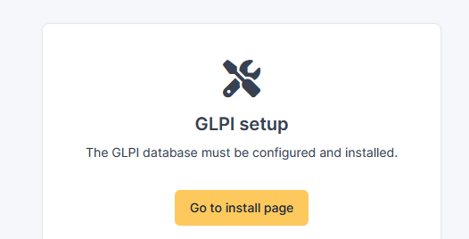

## Introduction

L'objectif est de déployer **GLPI** (Gestionnaire Libre de Parc Informatique), une solution open source permettant la gestion de parc (inventaire matériel/logiciel) et le helpdesk (gestion des tickets d'incidents).

## Contexte et Justification

Dans une entreprise, gérer les demandes utilisateurs par e-mail ou téléphone devient vite ingérable. De même, maintenir un fichier Excel pour l'inventaire des PC est source d'erreurs. GLPI centralise ces deux aspects. C'est une application web qui s'installe sur notre serveur LAMP existant.

## Concepts Clés

**ITSM (IT Service Management) :** Gestion des services informatiques (incidents, demandes, changements).

**Ticketing :** Processus de création, d'attribution et de résolution d'un incident.

**SGBD (Base de données) :** GLPI stocke toutes ses configurations et tickets dans une base dédiée.

## Prérequis

**Scénario :** Le serveur web existant va maintenant héberger l'application GLPI.

Avant de commencer la configuration, assurez-vous de :

1. Disposer d'un serveur Linux installé avec la pile LAMP (cf. procédure *Installation d'un Serveur Web LAMP*).
2. Avoir un accès **root** ou `sudo`.
3. Avoir une connexion Internet active (pour télécharger l'archive GLPI).

## Configuration

### Installation des Dépendances PHP

**Justification :** GLPI est une application complexe qui nécessite des fonctions PHP avancées non incluses dans l'installation de base (traitement d'images, XML, curl pour les API, etc.).

1. Installez les bibliothèques requises :

```bash
sudo apt install php-curl php-gd php-intl php-mbstring php-xml php-zip php-bz2 php-ldap -y
```
2. Redémarrez Apache pour charger ces nouveaux modules : `sudo systemctl restart apache2`.

### Préparation de la Base de Données

**Justification :** Nous devons créer une « boîte » vide (base de données) pour que GLPI puisse y ranger ses données, et un utilisateur SQL spécifique pour la sécurité.

1. Connectez-vous à MariaDB : `sudo mysql -u root -p`



<p class="figure-caption"><b>Figure 1</b> · Connexion à MariaDB</p>

2. Lancez les commandes SQL suivantes (remplacez `motdepasse` par votre mot de passe fort) :

```sql
CREATE DATABASE glpidb CHARACTER SET utf8mb4 COLLATE utf8mb4_unicode_ci;
CREATE USER 'glpi_user'@'localhost' IDENTIFIED BY 'motdepasse';
GRANT ALL PRIVILEGES ON glpidb.* TO 'glpi_user'@'localhost';
FLUSH PRIVILEGES;
EXIT;
```



<p class="figure-caption"><b>Figure 2</b> · Création de la base et de l'utilisateur</p>

### Téléchargement et Installation de GLPI

**Justification :** Nous récupérons le code source officiel, le plaçons dans le dossier web, et donnons les clés à Apache pour qu'il puisse écrire dedans.

1. Placez-vous dans le dossier temporaire (`cd /tmp`) et téléchargez la [dernière version stable](https://github.com/glpi-project/glpi/releases) :

```bash
wget https://github.com/glpi-project/glpi/releases/download/11.0.5/glpi-11.0.5.tgz
```


<p class="figure-caption"><b>Figure 3</b> · Téléchargement de l'archive GLPI</p>

2. Décompressez l'archive : `tar -xzvf glpi-11.0.5.tgz`
3. Déplacez le dossier vers le répertoire web : `sudo mv glpi /var/www/html/`


<p class="figure-caption"><b>Figure 4</b> · Extraction et déplacement de GLPI</p>

4. Modifiez les permissions (Apache doit être propriétaire pour gérer les fichiers) :

```bash
sudo chown -R www-data:www-data /var/www/html/glpi
sudo chmod -R 755 /var/www/html/glpi
```



<p class="figure-caption"><b>Figure 5</b> · Permissions du dossier GLPI</p>

### Configuration Apache (VirtualHost)

**Justification :** Avec GLPI 11, il est impératif de dire à Apache de viser le dossier `/public`. Nous allons créer un fichier de configuration.

1. Créez un nouveau fichier de configuration : `sudo nano /etc/apache2/sites-available/glpi.conf`
2. Collez le texte suivant dans le fichier :

```text
<VirtualHost *:80>
    ServerName localhost
    DocumentRoot /var/www/html/glpi/public

    <Directory /var/www/html/glpi/public>
        Require all granted
        RewriteEngine On
        RewriteCond %{REQUEST_FILENAME} !-f
        RewriteCond %{REQUEST_FILENAME} !-d
        RewriteRule ^(.*)$ index.php [QSA,L]
    </Directory>

    ErrorLog ${APACHE_LOG_DIR}/glpi_error.log
    CustomLog ${APACHE_LOG_DIR}/glpi_access.log combined
</VirtualHost>
```

3. Activez le nouveau site et le module de réécriture d'URL, puis désactivez le site par défaut :

```bash
sudo a2ensite glpi.conf
sudo a2enmod rewrite
sudo a2dissite 000-default.conf
```



<p class="figure-caption"><b>Figure 6</b> · Activation du site GLPI</p>

4. Redémarrez Apache pour appliquer la nouvelle configuration : `sudo systemctl restart apache2`



<p class="figure-caption"><b>Figure 7</b> · Redémarrage d'Apache</p>

### Finalisation via l'Installateur Web

**Justification :** L'installation en ligne de commande a déposé les fichiers, mais l'application n'est pas encore liée à la base de données. L'assistant web va générer le fichier de configuration `config_db.php` et créer les tables nécessaires dans MariaDB.

1. Ouvrez un navigateur web depuis le **PC client** (ou votre machine hôte).
2. Entrez l'URL de votre serveur : `http://XX.XX.XX.XX` (le VirtualHost pointe directement sur `/var/www/html/glpi/public`, il n'y a donc pas de `/glpi` à ajouter).



<p class="figure-caption"><b>Figure 8</b> · Choix de la langue</p>

3. Choisissez votre langue et acceptez les termes de la licence.
4. Cliquez sur le bouton « Installer » (et non « Mise à jour »).
5. **Vérification de l'environnement :**
   - Une liste de prérequis s'affiche.
   - Si vous avez bien installé les dépendances, tout doit être coché en vert.
   - Installez les extensions manquantes avec la commande `sudo apt install php-<extension> -y` et cliquez sur « Rafraîchir ».
6. **Configuration de la connexion à la base de données :**
   - **Serveur SQL :** `localhost`.
   - **Utilisateur SQL :** `glpi_user`.
   - **Mot de passe SQL :** celui que vous avez choisi.
7. Sélectionnez la base de données `glpidb`.


<p class="figure-caption"><b>Figure 9</b> · Connexion à la base de données</p>

8. Connectez-vous à GLPI (par défaut, utilisateur : glpi et mot de passe : glpi).

## Dépannage

**Erreur « Droit d'écriture requis » lors de l'installation :**

- La commande `chown` n'a pas fonctionné ou a été oubliée. Vérifiez avec `ls -l /var/www/html/glpi` (doit afficher `www-data`).

**Page blanche après l'installation :**

- Vérifiez les logs d'erreurs Apache : `tail -f /var/log/apache2/error.log`. Souvent dû à une extension PHP manquante (ex : `php-dom` ou `php-xml`).

**Erreur de connexion à la base de données :**

- Vérifiez que le service MariaDB tourne (`systemctl status mariadb`).
- Vérifiez que vous n'avez pas fait de faute de frappe dans le mot de passe SQL lors de l'assistant web.

## Conseils et Bonnes Pratiques

**Sécurité post-installation :** Dès la première connexion, GLPI affichera des alertes de sécurité en orange.

1. Supprimez le fichier d'installation : `sudo rm /var/www/html/glpi/install/install.php`.
2. Changez les mots de passe par défaut :
   - Changez le mot de passe du compte `glpi`.
   - Supprimez ou changez les mots de passe des comptes `tech`, `normal` et `post-only`.

**Tâche planifiée (Cron) :** GLPI a besoin d'exécuter des scripts régulièrement (envoi de mails, nettoyage des logs).

- Ajoutez cette ligne dans le crontab de `www-data` (`sudo crontab -e -u www-data`) :

```text
* * * * * /usr/bin/php /var/www/html/glpi/front/cron.php
```

## Procédures Liées

- [Installation d'un Serveur Web LAMP](/procedures/linux/installation-dun-serveur-web-lamp) *(Pile web requise)*
- [Déploiement de GLPI (Conteneurisé)](/procedures/linux/deploiement-de-glpi-conteneurise) *(Alternative conteneurisée)*
- [Déploiement Automatique de l'Agent GLPI via GPO](/procedures/windows/deploiement-automatique-de-lagent-glpi-via-gpo) *(Déploiement de l'agent sur les postes)*
- Sauvegarde de Serveurs Linux avec rsync et BorgBackup *(Sauvegarde de l'application et de la base)*
