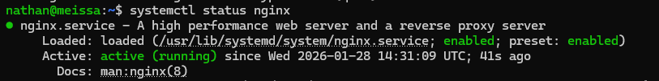
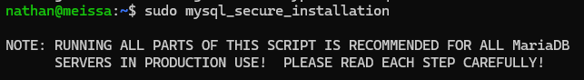
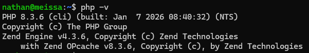
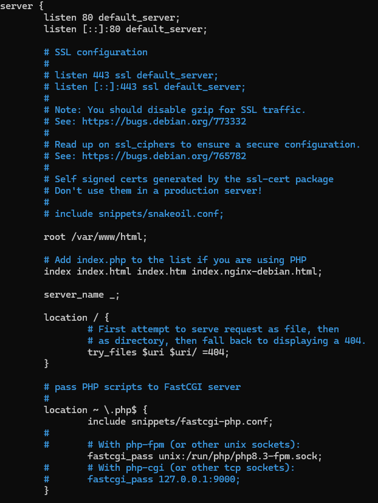
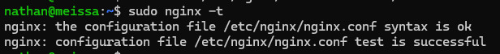
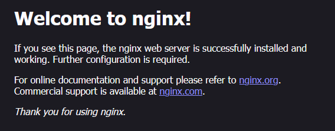
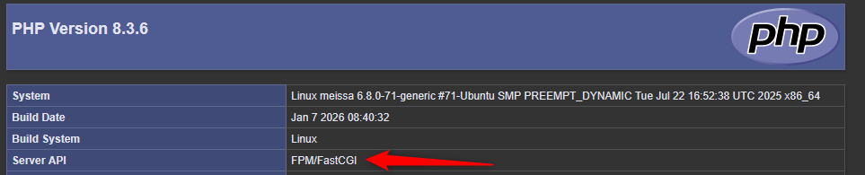

## Introduction

L'objectif est de mettre en place un serveur web capable d'héberger des sites dynamiques en utilisant la pile LEMP (Linux, Nginx, MariaDB, PHP). C'est une alternative moderne et performante à la pile LAMP classique.

## Contexte et Justification

Contrairement à Apache qui crée un processus pour chaque connexion (gourmand en mémoire), **Nginx** fonctionne de manière événementielle et asynchrone. Il est capable de gérer beaucoup plus de connexions simultanées avec moins de ressources RAM. C'est le choix privilégié pour les serveurs à fort trafic ou les microservices.

## Concepts Clés

- **Reverse Proxy :** Nginx excelle à s'intercaler entre Internet et vos applications internes.
- **PHP-FPM (FastCGI Process Manager) :** Nginx ne sait pas traiter le PHP nativement. Il délègue cette tâche à un service tiers (FPM) qui exécute le code et renvoie le résultat HTML à Nginx.
- **Server Block :** L'équivalent du « VirtualHost » chez Apache. C'est la configuration d'un site web spécifique.

## Prérequis

**Scénario :** Un serveur Linux vierge doit héberger une application web performante.

Avant de commencer la configuration, assurez-vous de :

1. Avoir une machine Linux (Ubuntu LTS ou Debian) installée.
2. Avoir un accès root ou un utilisateur avec les droits `sudo`.
3. Avoir une connexion Internet active pour télécharger les paquets.
4. Avoir mis à jour les dépôts : `sudo apt update`.
5. **Important :** S'assurer qu'Apache n'est pas installé ou est arrêté (conflit sur le port 80).

## Configuration

### Installation du Serveur Web (Nginx)

**Justification :** Nginx est le logiciel qui écoute sur le port 80 (HTTP). Il servira les fichiers statiques (images, CSS) très rapidement et passera le relais à PHP pour le dynamique.

1. Installez le paquet Nginx : `sudo apt install nginx -y`
2. Vérifiez que le service a démarré : `systemctl status nginx`



<p class="figure-caption"><b>Figure 1</b> · Service Nginx actif</p>

### Installation du Serveur de Base de Données

**Justification :** Indispensable pour stocker les données utilisateurs. C'est le même composant que dans une pile LAMP.

1. Installez le serveur MariaDB : `sudo apt install mariadb-server -y`
2. Sécurisez l'installation et définissez un mot de passe root SQL (répondez Y à toutes les questions sauf pour `unix_socket`) : `sudo mysql_secure_installation`



<p class="figure-caption"><b>Figure 2</b> · Sécurisation de MariaDB</p>

### Installation de PHP et du Gestionnaire FPM

**Justification :** C'est la différence majeure avec LAMP. Ici, nous n'installons pas un module Apache, mais un service PHP indépendant (`php-fpm`) qui va « dialoguer » avec Nginx.

1. Installez PHP, le gestionnaire FPM et le module MySQL : `sudo apt install php-fpm php-mysql -y`
2. Vérifiez la version installée pour connaître le nom du service (ex : `php8.3-fpm`) : `php -v`



<p class="figure-caption"><b>Figure 3</b> · Version de PHP installée</p>

### Configuration du Server Block (VirtualHost)

**Justification :** Par défaut, Nginx ne traite pas les fichiers `.php`. Il faut modifier la configuration pour lui dire : « si un utilisateur demande un fichier `.php`, envoie-le au service php-fpm ».

1. Éditez le fichier de configuration du site par défaut : `sudo nano /etc/nginx/sites-available/default`
2. Modifiez le fichier pour qu'il ressemble à ceci (décommentez et adaptez le bloc `location ~ \.php$`, et ajoutez `index.php` à la directive `index`) :

```text
server {
    listen 80 default_server;
    listen [::]:80 default_server;

    root /var/www/html;
    index index.php index.html index.htm index.nginx-debian.html;

    server_name _;

    location / {
        try_files $uri $uri/ =404;
    }

    # Envoi des scripts PHP à PHP-FPM
    location ~ \.php$ {
        include snippets/fastcgi-php.conf;
        fastcgi_pass unix:/run/php/php8.3-fpm.sock;
    }
}
```



<p class="figure-caption"><b>Figure 4</b> · Bloc location PHP dans le server block</p>

3. Testez la configuration pour éviter les erreurs de syntaxe : `sudo nginx -t`



<p class="figure-caption"><b>Figure 5</b> · Test de syntaxe nginx -t</p>

4. Rechargez Nginx : `sudo systemctl reload nginx`.

## Vérifications

**Test du service web :**

1. Ouvrez le navigateur de votre PC Client.
2. Entrez l'IP du serveur : `http://XX.XX.XX.XX`.
3. Vous devez voir la page **« Welcome to nginx! »**.



<p class="figure-caption"><b>Figure 6</b> · Page Welcome to nginx</p>

**Test du traitement PHP :**

1. Créez un fichier de test : `echo "<?php phpinfo(); ?>" | sudo tee /var/www/html/info.php`
2. Depuis le navigateur, allez sur `http://XX.XX.XX.XX/info.php`.
3. Un tableau violet/gris affichant la version de PHP doit apparaître.
4. Vérifiez la ligne « Server API » : elle doit indiquer FPM/FastCGI (et non « Apache 2.0 Handler »).



<p class="figure-caption"><b>Figure 7</b> · Server API FPM/FastCGI</p>

5. Supprimez le fichier : `sudo rm /var/www/html/info.php`.

## Dépannage

**Erreur « 502 Bad Gateway » :**

- C'est l'erreur classique Nginx. Cela signifie que Nginx n'arrive pas à parler à PHP-FPM.
- Vérifiez que le service PHP tourne : `sudo systemctl status php8.3-fpm`
- Vérifiez dans le fichier de configuration (`/etc/nginx/sites-available/default`) que le chemin vers le socket (`/run/php/phpX.X-fpm.sock`) correspond bien à la version installée.

**Le fichier PHP se télécharge au lieu de s'afficher :**

- Vous avez oublié de vider le cache du navigateur ou de redémarrer Nginx après la modification du fichier de configuration.
- Le bloc `location ~ \.php$` est mal configuré ou commenté.

**Erreur « Address already in use » :**

- Apache tourne probablement encore. Arrêtez-le : `sudo systemctl stop apache2` et `sudo systemctl disable apache2`

## Conseils et Bonnes Pratiques

**Permissions :** Sous Nginx (Ubuntu/Debian), l'utilisateur par défaut est aussi `www-data`. Assurez-vous que vos fichiers appartiennent à cet utilisateur : `sudo chown -R www-data:www-data /var/www/html`

**HTTPS :** Nginx est très performant pour gérer le SSL. Utilisez Certbot (`sudo apt install certbot python3-certbot-nginx`, puis `sudo certbot --nginx`) pour passer en HTTPS gratuitement via Let's Encrypt.

## Procédures Liées

- [Installation d'un Serveur Web LAMP](/procedures/linux/installation-dun-serveur-web-lamp) *(Alternative avec Apache)*
- [Configuration du Pare-feu avec UFW et nftables](/procedures/linux/configuration-du-pare-feu-avec-ufw-et-nftables) *(N'ouvrir que HTTP et HTTPS)*
- [Installation d'un Serveur Debian en Ligne de Commande (CLI)](/procedures/linux/installation-dun-serveur-debian-en-ligne-de-commande-cli) *(Installation du serveur de base)*
- Sécurisation d'OpenSSH (Clés, Durcissement, Fail2ban) *(Administration sécurisée du serveur)*
