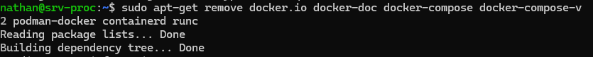
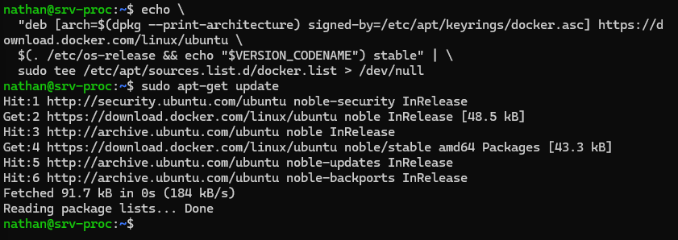
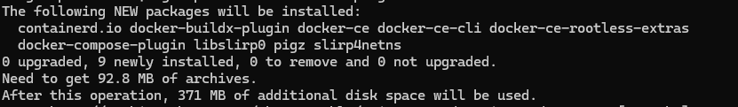
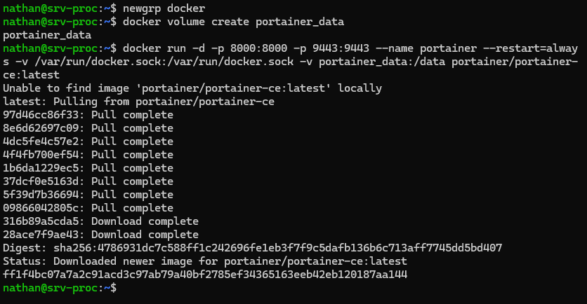
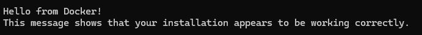
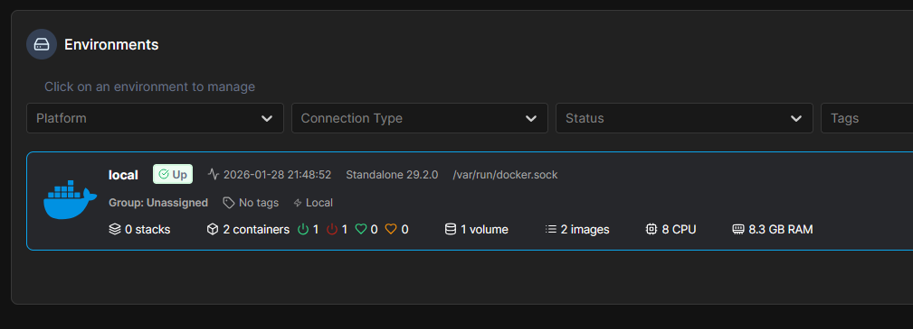

## Introduction

L'objectif est d'installer **Docker Engine** (le moteur de conteneurisation) et **Portainer** (une interface web de gestion) sur un serveur Linux.

Contrairement à la virtualisation classique qui simule une machine complète (OS inclus), Docker permet d'isoler les applications dans des « conteneurs » légers qui partagent le noyau du système hôte.

## Contexte et Justification

Actuellement, pour installer GLPI ou Zabbix, nous avons dû installer manuellement PHP, Apache et les bibliothèques, ce qui crée des conflits de versions (ex : GLPI veut PHP 8.2, mais une autre app veut PHP 7.4). **Docker résout ce problème :**

- **Isolation :** Chaque application contient ses propres bibliothèques.
- **Portabilité :** « Si ça marche sur ma machine, ça marche sur le serveur ».
- **Portainer :** Offre une interface graphique pour gérer les conteneurs sans tout faire en ligne de commande.

## Concepts Clés

- **Image :** Le « modèle » ou le CD d'installation (ex : l'image officielle MySQL). Elle est en lecture seule.
- **Conteneur :** Une instance vivante de l'image (l'application qui tourne).
- **Volume :** Espace de stockage persistant. Si on supprime le conteneur, les données (base de données) restent dans le volume.
- **Docker Compose :** Outil permettant de définir et lancer plusieurs conteneurs liés (ex : GLPI + MariaDB) via un seul fichier texte.

## Prérequis

- Un serveur Linux (Ubuntu 24.04 recommandé, comme pour Zabbix).
- Un accès `root` ou `sudo`.
- Une connexion Internet active (pour télécharger les images depuis le Docker Hub).
- Les anciens paquets Docker conflictuels (si présents) doivent être supprimés.

## Installation de Docker Engine

### Nettoyage des Anciennes Versions

**Justification :** Les dépôts Ubuntu fournissent parfois des versions nommées `docker.io` ou `docker-compose` qui sont obsolètes et incompatibles avec les standards actuels.

1. Lancez la commande de nettoyage :

```bash
sudo apt-get remove docker.io docker-doc docker-compose docker-compose-v2 podman-docker containerd runc
```



<p class="figure-caption"><b>Figure 1</b> · Suppression des paquets obsolètes</p>

### Configuration du Dépôt Officiel Docker

**Justification :** Comme pour Zabbix, nous utilisons le dépôt officiel de l'éditeur pour garantir la sécurité et l'accès aux dernières fonctionnalités.

1. Mettez à jour l'index et installez les outils nécessaires :

```bash
sudo apt-get update
sudo apt-get install ca-certificates curl
```

2. Créez le dossier pour les clés de sécurité : `sudo install -m 0755 -d /etc/apt/keyrings`
3. Téléchargez la clé GPG officielle de Docker :

```bash
sudo curl -fsSL https://download.docker.com/linux/ubuntu/gpg -o /etc/apt/keyrings/docker.asc
sudo chmod a+r /etc/apt/keyrings/docker.asc
```

4. Ajoutez le dépôt à vos sources :

```bash
echo \
  "deb [arch=$(dpkg --print-architecture) signed-by=/etc/apt/keyrings/docker.asc] https://download.docker.com/linux/ubuntu \
  $(. /etc/os-release && echo "$VERSION_CODENAME") stable" | \
  sudo tee /etc/apt/sources.list.d/docker.list > /dev/null
```

5. Mettez à jour la liste des paquets une nouvelle fois : `sudo apt-get update`



<p class="figure-caption"><b>Figure 2</b> · Ajout du dépôt officiel Docker</p>

### Installation du Moteur

1. Installez les paquets Docker (Engine, CLI, Containerd et le plugin Compose) :

```bash
sudo apt-get install docker-ce docker-ce-cli containerd.io docker-buildx-plugin docker-compose-plugin -y
```



<p class="figure-caption"><b>Figure 3</b> · Installation de Docker Engine</p>

### Configuration des Droits Utilisateur

**Justification :** Par défaut, seul `root` peut lancer des conteneurs. Pour éviter de taper `sudo` devant chaque commande, nous ajoutons l'utilisateur courant au groupe `docker`.

1. Ajoutez votre utilisateur au groupe : `sudo usermod -aG docker $USER`.
2. **Important :** Pour que cela prenne effet, déconnectez-vous de la session (`exit`) et reconnectez-vous, ou tapez `newgrp docker`.

### Installation de Portainer (Interface Web)

**Justification :** Portainer permet de voir l'état des conteneurs, les logs et les réseaux via une page web, ce qui simplifie grandement l'administration au quotidien.

1. Créez un volume pour stocker les données de configuration de Portainer : `docker volume create portainer_data`.
2. Lancez le conteneur Portainer Server (version Community) :

```bash
docker run -d -p 8000:8000 -p 9443:9443 --name portainer --restart=always \
  -v /var/run/docker.sock:/var/run/docker.sock \
  -v portainer_data:/data \
  portainer/portainer-ce:latest
```



<p class="figure-caption"><b>Figure 4</b> · Démarrage du conteneur Portainer</p>

**Explication de la commande :**

- `-d` : Détaché (tourne en arrière-plan).
- `-p 9443:9443` : Ouvre le port web HTTPS.
- `--restart=always` : Redémarre automatiquement si le serveur redémarre.
- `-v /var/run/docker.sock...` : Donne à Portainer le droit de piloter le Docker du serveur.

## Vérifications et Premier Lancement

### Test en Ligne de Commande

1. Lancez l'image de test universelle : `docker run hello-world`.
2. Si le message « Hello from Docker! » s'affiche, l'installation est réussie.



<p class="figure-caption"><b>Figure 5</b> · Message Hello from Docker</p>

### Accès à Portainer

1. Ouvrez votre navigateur sur le poste client.
2. Accédez à l'URL : `https://IP_DU_SERVEUR:9443`.
3. Acceptez le risque de sécurité (certificat auto-signé).
4. Créez le compte administrateur (utilisateur : admin, mot de passe : 12 caractères minimum).
5. Cliquez sur **Get Started** et sélectionnez votre environnement **local**.



<p class="figure-caption"><b>Figure 6</b> · Tableau de bord Portainer</p>

## Dépannage

**Erreur « permission denied while trying to connect to the Docker daemon socket » :**

- Vous avez oublié l'étape « Configuration des Droits Utilisateur » ou ne vous êtes pas reconnecté. Vérifiez l'appartenance au groupe avec `groups`, puis rouvrez une session ou lancez `newgrp docker`. N'ouvrez pas les droits du socket (`chmod 666`) : cela donne un accès root à tous les utilisateurs.

**Portainer inaccessible :**

- Vérifiez si le pare-feu (UFW) est actif. Si oui, autorisez le port : `sudo ufw allow 9443/tcp`.

**Conflit de ports :**

- Si vous aviez déjà un service sur le port 9443, changez le mapping dans la commande `docker run` (ex : `-p 9444:9443`).

## Conseils et Bonnes Pratiques

**Figer les versions :** n'utilisez jamais le tag `:latest` en production pour vos applications métiers (GLPI, Zabbix). Préférez figer une version (ex : `glpi:11.0.5`) pour éviter qu'une mise à jour automatique ne casse tout lors d'un redémarrage.

**Sauvegardes :** avec Docker, il suffit de sauvegarder le dossier des volumes (`/var/lib/docker/volumes`, ou vos dossiers montés comme `/srv/docker`) pour sauvegarder toutes vos données.

**Nettoyage :** les images prennent de la place. Lancez régulièrement `docker system prune` pour supprimer ce qui est inutilisé.

## Procédures Liées

- [Déploiement de GLPI (Conteneurisé)](/procedures/linux/deploiement-de-glpi-conteneurise) *(Exemple de service conteneurisé)*
- [Déploiement de Zabbix (Conteneurisé)](/procedures/linux/deploiement-de-zabbix-conteneurise) *(Supervision conteneurisée)*
- [Déploiement Serveur DNS Local Bind9 (Conteneurisé)](/procedures/linux/deploiement-serveur-dns-local-bind9-conteneurise) *(DNS conteneurisé)*
- [Installation d'un Serveur Ubuntu en Ligne de Commande (CLI)](/procedures/linux/installation-dun-serveur-ubuntu-en-ligne-de-commande-cli) *(Système hôte)*
- [Configuration du Pare-feu avec UFW et nftables](/procedures/linux/configuration-du-pare-feu-avec-ufw-et-nftables) *(Interaction entre Docker et le pare-feu)*
