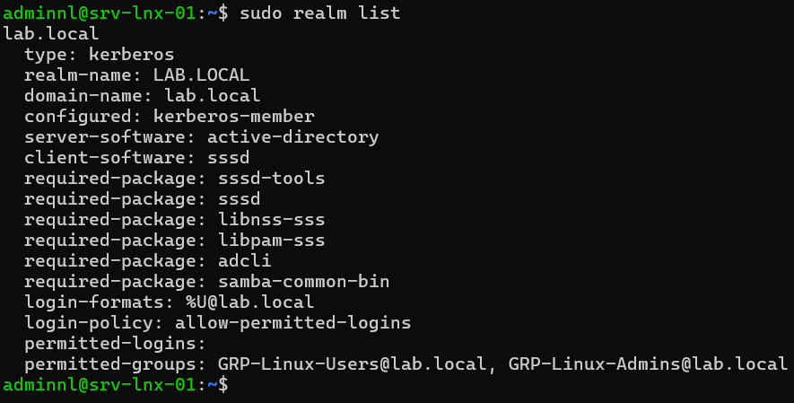
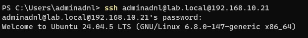

## Introduction

Cette procédure décrit la jonction d'un serveur Linux Debian 13 (trixie) ou Ubuntu 24.04 LTS au domaine Active Directory `lab.local`, avec **realmd** pour la découverte et la jonction, et **SSSD** pour l'authentification et la résolution des identités.

Le périmètre couvre les prérequis DNS et horaires, la découverte et la jonction du domaine, l'ajustement de `/etc/sssd/sssd.conf`, la création automatique des dossiers personnels avec `pam_mkhomedir`, la restriction des connexions à des groupes AD avec `realm permit`, et l'attribution des droits sudo à un groupe AD. Samba Winbind est présenté comme alternative. L'application des stratégies de groupe (GPO) aux serveurs Linux et le partage de fichiers Samba sortent du périmètre. L'exemple porte sur srv-lnx-01 (192.168.10.21).

## Contexte et Justification

Des comptes locaux créés sur chaque serveur Linux posent plusieurs problèmes dans un environnement Windows :

- **Cycle de vie non maîtrisé :** le départ d'un collaborateur impose de supprimer son compte sur chaque serveur, et les oublis laissent des accès ouverts.
- **Mots de passe multiples :** chaque serveur a ses propres mots de passe, sans politique de complexité ni d'expiration commune.
- **Pas de traçabilité centrale :** les connexions ne sont pas rattachées à une identité unique de l'annuaire.

La jonction au domaine permet de se connecter aux serveurs Linux avec son compte `lab.local`, de piloter les accès par les groupes AD existants, et d'appliquer la politique de mots de passe du domaine. La désactivation d'un compte AD coupe immédiatement l'accès à tous les serveurs.

## Concepts Clés

**realmd :** Service qui découvre un domaine par DNS, installe ou signale les paquets nécessaires, joint la machine et génère la configuration de SSSD, de Kerberos et de PAM. Il s'utilise avec la commande `realm`.

**adcli :** Outil utilisé par realmd pour créer le compte d'ordinateur dans AD et générer le fichier `/etc/krb5.keytab`.

**SSSD (System Security Services Daemon) :** Démon qui interroge AD en LDAP et Kerberos, met en cache les identités et les authentifications, et les fournit au système via NSS (résolution des utilisateurs et groupes) et PAM (authentification).

**Kerberos :** Protocole d'authentification d'AD. Le royaume Kerberos est le nom du domaine en majuscules, ici `LAB.LOCAL`. Il exige une heure synchronisée à moins de 5 minutes du contrôleur de domaine.

**Correspondance des identifiants (ID mapping) :** Avec `ldap_id_mapping = True`, SSSD calcule les UID et GID Linux à partir du SID des objets AD. Le résultat est identique sur tous les serveurs qui utilisent SSSD avec la même configuration, sans modifier le schéma AD.

**Noms pleinement qualifiés :** Avec `use_fully_qualified_names = True`, les utilisateurs se connectent sous la forme `utilisateur@lab.local`.

**Contrôle d'accès :** Le paramètre `access_provider` détermine qui peut se connecter. `ad` applique les règles d'AD et éventuellement les GPO, `simple` restreint à une liste d'utilisateurs et de groupes, ce que fait `realm permit`.

## Prérequis

- Un serveur Debian 13 ou Ubuntu 24.04 LTS (srv-lnx-01) avec un compte membre de `sudo`.
- Un nom d'hôte de 15 caractères maximum (limite NetBIOS du compte d'ordinateur), défini avec `sudo hostnamectl set-hostname srv-lnx-01`.
- La résolution DNS vers SRV-DC-01 (192.168.10.10) et SRV-DC-02 (192.168.10.11) : le serveur doit les utiliser comme serveurs DNS (voir « Configuration Réseau avec Netplan »).
- Une heure synchronisée sur les contrôleurs de domaine (voir « Synchronisation de l'Heure avec chrony »).
- Un compte AD autorisé à joindre des ordinateurs au domaine, idéalement un compte délégué sur une OU dédiée, par exemple `OU=Serveurs-Linux,DC=lab,DC=local`.
- Les groupes AD `GRP-Linux-Users` (accès SSH) et `GRP-Linux-Admins` (accès sudo).
- Les flux vers les contrôleurs de domaine : DNS (53), Kerberos (88 TCP et UDP), LDAP (389), kpasswd (464), Global Catalog (3268) et NTP (123 UDP).

## Points de Vigilance

**Le suffixe .local et le mDNS.** Le suffixe `.local` est réservé au multicast DNS (RFC 6762). Si le paquet `libnss-mdns` (Avahi) est installé, la ligne `hosts` de `/etc/nsswitch.conf` contient `mdns4_minimal [NOTFOUND=return]` et les noms en `.local` ne sont jamais envoyés au DNS. Sur un serveur, n'installez pas `libnss-mdns`, ou retirez cette entrée de `nsswitch.conf`.

**DNS et heure avant tout.** La quasi-totalité des échecs de jonction vient d'un DNS qui ne pointe pas vers les contrôleurs de domaine ou d'un écart d'horloge supérieur à 5 minutes.

**access_provider = ad et les GPO.** Par défaut, SSSD évalue certaines GPO d'AD (droits d'ouverture de session) lorsque `access_provider = ad`. Une GPO de durcissement appliquée à l'OU du serveur peut alors refuser toute connexion. Placez les serveurs Linux dans une OU dédiée ou ajustez `ad_gpo_access_control` (`enforcing`, `permissive` ou `disabled`).

**realm permit change le fournisseur d'accès.** `realm permit` passe `access_provider` à `simple`. Les GPO ne sont alors plus évaluées pour l'accès.

**Permissions de sssd.conf.** Le fichier `/etc/sssd/sssd.conf` doit appartenir à `root:root` avec les droits `0600`, sinon SSSD refuse de démarrer.

**sudo sur Ubuntu 26.04 LTS.** Ubuntu 26.04 LTS utilise par défaut `sudo-rs`, réimplémentation de sudo. Les règles par groupe dans `/etc/sudoers.d/` sont prises en charge, mais testez la syntaxe des noms de groupe AD sur cette version avant le déploiement.

**Windows Server 2025 et chiffrement.** Les contrôleurs de domaine Windows Server 2025 privilégient AES pour Kerberos. Les versions de SSSD et MIT Kerberos de Debian 13 et Ubuntu 24.04 utilisent AES par défaut. Ne réactivez pas RC4 dans `/etc/krb5.conf`.

**Windows Server 2025 et changement de mot de passe Kerberos (kpasswd).** Face à des contrôleurs Windows Server 2025, le changement de mot de passe par le protocole kpasswd échoue avec l'erreur `Message stream modified`. Cela affecte la jonction par défaut (adcli) et le renouvellement automatique du mot de passe machine par SSSD, qui appelle lui aussi adcli tous les 30 jours. Le mot de passe peut alors être modifié dans AD sans que `/etc/krb5.keytab` soit mis à jour, et le serveur perd sa relation avec le domaine. Joignez le domaine avec Samba comme logiciel d'adhésion et désactivez le renouvellement automatique tant que les contrôleurs ne sont pas corrigés (voir « Joindre le domaine » et « Ajuster sssd.conf »).

## Choix Architecturaux & Alternatives

### Quand choisir realmd et SSSD

realmd et SSSD constituent la méthode recommandée par Debian, Ubuntu et Red Hat pour joindre un serveur Linux à AD lorsqu'il s'agit d'authentifier des utilisateurs (SSH, console, sudo). La jonction tient en une commande, le cache permet les connexions hors ligne et la configuration est identique sur toutes les distributions.

### Alternatives et comparatif

| Option | Cas d'usage typique | Force principale | Faiblesse principale | Coût relatif |
|--------|---------------------|------------------|----------------------|--------------|
| **realmd et SSSD** | Authentification SSH et sudo par comptes AD | Jonction simple, cache hors ligne, standard des distributions | Ne fournit pas de partage de fichiers Samba | Gratuit |
| **Samba Winbind** | Serveur de fichiers Samba membre du domaine | Intégration complète avec Samba (ACL, partages SMB) | Configuration plus lourde, ID mapping à concevoir | Gratuit |
| **Comptes locaux et clés SSH** | Serveurs isolés, DMZ, peu d'administrateurs | Aucune dépendance à AD | Cycle de vie manuel, pas de politique centrale | Gratuit |
| **FreeIPA avec approbation AD** | Parc Linux important, sudo et HBAC centralisés | Règles sudo et d'accès centralisées pour Linux | Infrastructure supplémentaire à exploiter | Moyen |
| **Solution commerciale (Centrify, One Identity)** | Grands comptes, audit renforcé | Gestion par GPO, audit des sessions | Licences | Élevé |

### Impact des choix

- **Sécurité.** Les comptes sont gérés en un point, la désactivation est immédiate et la politique de mots de passe du domaine s'applique. `realm permit` ou `access_provider = ad` restreignent l'accès aux seuls groupes autorisés.
- **Disponibilité.** SSSD interroge SRV-DC-01 puis SRV-DC-02 et met en cache les identifiants (`cache_credentials`). Un utilisateur déjà connecté une fois peut se reconnecter si les contrôleurs sont injoignables.
- **Exploitation.** L'ajout d'un administrateur se résume à l'ajouter au groupe AD. Les changements de groupe peuvent toutefois mettre plusieurs minutes à apparaître en raison du cache.
- **Coût.** Gratuit. Seule la charge d'administration des groupes AD s'ajoute.

## Configuration

### Vérifier le DNS et l'heure

```bash
resolvectl status
host -t SRV _ldap._tcp.lab.local
host -t SRV _kerberos._tcp.lab.local
host srv-dc-01.lab.local
timedatectl
```

Les requêtes SRV doivent renvoyer srv-dc-01.lab.local et srv-dc-02.lab.local, et `timedatectl` doit indiquer une horloge synchronisée.

### Installer les paquets

```bash
sudo apt update
sudo apt install realmd sssd sssd-tools sssd-ad libnss-sss libpam-sss adcli samba-common-bin krb5-user packagekit
```

Pendant l'installation de `krb5-user`, saisissez `LAB.LOCAL` comme royaume par défaut si la question est posée.

<div class="callout callout-note">

`packagekit` permet à realmd d'installer lui-même les paquets manquants. Il n'est pas indispensable si tous les paquets sont installés au préalable.

</div>

### Découvrir le domaine

```bash
sudo realm discover lab.local
```

La sortie doit indiquer `type: kerberos`, `realm-name: LAB.LOCAL`, `server-software: active-directory`, `client-software: sssd`, et la liste des paquets requis marqués comme installés.

### Joindre le domaine

```bash
sudo realm join --user=adminadnl --computer-ou="OU=Serveurs-Linux,DC=lab,DC=local" lab.local
```

Saisissez le mot de passe du compte AD. La commande crée le compte d'ordinateur `SRV-LNX-01` dans l'OU indiquée, génère `/etc/krb5.keytab` et `/etc/sssd/sssd.conf`, et configure NSS et PAM.

#### Contrôleurs Windows Server 2025

Si la jonction échoue avec `Couldn't set password for computer account: SRV-LNX-01$: Message stream modified`, le compte d'ordinateur a été créé dans AD mais sans mot de passe valide. Supprimez l'objet `SRV-LNX-01` de `OU=Serveurs-Linux` dans « Utilisateurs et ordinateurs Active Directory », puis relancez la jonction avec Samba comme logiciel d'adhésion. SSSD reste le logiciel client pour l'authentification.

```bash
sudo apt install samba-common-bin
sudo realm join -v --membership-software=samba --user=adminadnl --computer-ou="OU=Serveurs-Linux,DC=lab,DC=local" lab.local
```

<div class="callout callout-note">

Avec `--membership-software=samba`, realmd utilise `net ads join` au lieu d'adcli pour créer le compte d'ordinateur et la keytab. Le reste de la procédure est inchangé.

</div>

### Ajuster sssd.conf

```bash
sudo nano /etc/sssd/sssd.conf
```

Configuration de référence :

```ini
[sssd]
domains = lab.local
config_file_version = 2
services = nss, pam

[domain/lab.local]
default_shell = /bin/bash
krb5_store_password_if_offline = True
cache_credentials = True
krb5_realm = LAB.LOCAL
realmd_tags = manages-system joined-with-adcli
id_provider = ad
fallback_homedir = /home/%u@%d
ad_domain = lab.local
use_fully_qualified_names = True
ldap_id_mapping = True
access_provider = ad
ad_server = srv-dc-01.lab.local, srv-dc-02.lab.local
```

- `fallback_homedir = /home/%u@%d` crée des dossiers personnels du type `/home/nlallier@lab.local`. La valeur `/home/%u` donne des chemins plus courts, à condition qu'aucun nom AD n'entre en conflit avec un compte local.
- `use_fully_qualified_names = True` est recommandé dès qu'une approbation ou un second domaine peut apparaître dans la forêt.
- `ad_server` fixe l'ordre des contrôleurs. Sans ce paramètre, SSSD les découvre par DNS.

Avec des contrôleurs Windows Server 2025 non corrigés, ajoutez dans la section `[domain/lab.local]` la ligne suivante, qui désactive le renouvellement automatique du mot de passe machine.

```ini
ad_maximum_machine_account_password_age = 0
```

Ce paramètre évite la perte de la relation avec le domaine au bout de 30 jours. Il laisse en revanche le mot de passe machine inchangé dans la durée. Retirez-le dès que les contrôleurs acceptent de nouveau kpasswd, ce que confirme une jonction de test réussie avec adcli.

Appliquez les permissions et redémarrez SSSD :

```bash
sudo chown root:root /etc/sssd/sssd.conf
sudo chmod 600 /etc/sssd/sssd.conf
sudo systemctl restart sssd
```

<div class="callout callout-note">

Si SSSD signale un conflit avec les sockets `sssd-nss.socket` ou `sssd-pam.socket`, supprimez la ligne `services = nss, pam` : les services sont alors démarrés par activation de socket.

</div>

### Créer automatiquement les dossiers personnels

realmd ne configure pas toujours `pam_mkhomedir`. Activez-le :

```bash
sudo pam-auth-update --enable mkhomedir
```

### Restreindre les connexions à des groupes AD

Refusez toutes les connexions de comptes AD, puis autorisez les deux groupes :

```bash
sudo realm deny --all
sudo realm permit -g GRP-Linux-Users@lab.local
sudo realm permit -g GRP-Linux-Admins@lab.local
```

La commande ajoute `access_provider = simple` et `simple_allow_groups` dans `sssd.conf`. Vérifiez le résultat avec `sudo realm list`.

### Accorder sudo à un groupe AD

Créez un fichier dédié avec `visudo`, qui vérifie la syntaxe avant d'enregistrer :

```bash
sudo visudo -f /etc/sudoers.d/ad-admins
```

```text
%grp-linux-admins@lab.local ALL=(ALL:ALL) ALL
```

SSSD renvoie par défaut les noms de groupe en minuscules. Si le nom du groupe contient des espaces, échappez-les par une barre oblique inverse (`%grp\ linux\ admins@lab.local`).

```bash
sudo chmod 440 /etc/sudoers.d/ad-admins
```

### Alternative : Samba Winbind (aperçu)

Pour un serveur de fichiers Samba membre du domaine, Winbind remplace SSSD :

```bash
sudo apt install samba winbind libnss-winbind libpam-winbind krb5-user
sudo realm join --client-software=winbind --user=adminadnl lab.local
```

La configuration de l'ID mapping (`idmap config` dans `/etc/samba/smb.conf`) doit alors être conçue avec soin. Reportez-vous à la procédure « Installation d'un Serveur de Fichiers Samba ».

## Vérifications

**État de la jonction :** `sudo realm list` affiche `lab.local` avec `configured: kerberos-member`, le logiciel client `sssd` et la politique de connexion (`login-policy: allow-permitted-logins`).



<p class="figure-caption"><b>Figure 1</b> · Résultat de la commande.</p>

**Compte d'ordinateur :** `sudo adcli testjoin` affiche `Successfully validated join to domain lab.local`. Après une jonction avec Samba, `sudo net ads testjoin` donne une confirmation équivalente (`Join is OK`).

**Keytab :** `sudo klist -k` affiche les principaux `SRV-LNX-01$@LAB.LOCAL` et `host/srv-lnx-01.lab.local@LAB.LOCAL`. `sudo kinit -k 'SRV-LNX-01$@LAB.LOCAL'` obtient un ticket sans demander de mot de passe.

**Résolution des identités :**

```bash
id adminadnl@lab.local
getent passwd adminadnl@lab.local
getent group grp-linux-admins@lab.local
```

`id` affiche l'UID, le GID et les groupes AD de l'utilisateur.

**Kerberos :** `kinit adminadnl@LAB.LOCAL` puis `klist` affiche un ticket valide.

**Connexion SSH :** depuis un poste du réseau, `ssh adminadnl@lab.local@srv-lnx-01.lab.local` ouvre une session et crée `/home/adminadnl@lab.local`.



<p class="figure-caption"><b>Figure 2</b> · Résultat de la commande.</p>

**Restriction :** un utilisateur AD hors des groupes autorisés reçoit un refus, visible dans `sudo journalctl -u sssd` et `/var/log/auth.log` (ou `journalctl -t sshd` sur Debian sans rsyslog).

**sudo :** un membre de `GRP-Linux-Admins` exécute `sudo -l` et voit la règle `(ALL : ALL) ALL`.

## Dépannage

**« realm: No such realm found » lors de la découverte :** le DNS ne renvoie pas les enregistrements SRV du domaine. Vérifiez que le serveur utilise SRV-DC-01 et SRV-DC-02 comme serveurs DNS et que le suffixe `.local` n'est pas intercepté par le mDNS.

**« Clock skew too great » ou échec Kerberos à la jonction :** l'écart d'horloge dépasse 5 minutes. Synchronisez avec chrony sur les contrôleurs de domaine, puis relancez la jonction.

**« Couldn't set password for computer account: Message stream modified » :** les contrôleurs Windows Server 2025 rejettent le changement de mot de passe par kpasswd utilisé par adcli. Supprimez l'objet ordinateur créé dans AD, puis joignez avec `--membership-software=samba` (voir « Contrôleurs Windows Server 2025 »).

**« Le serveur perd la relation avec le domaine après environ 30 jours » :** le renouvellement automatique du mot de passe machine par SSSD a échoué sur des contrôleurs Windows Server 2025. `sudo adcli testjoin` échoue. Supprimez l'objet ordinateur, quittez le domaine avec `sudo realm leave lab.local`, rejoignez avec Samba et ajoutez `ad_maximum_machine_account_password_age = 0` dans `sssd.conf`.

**« Insufficient permissions to join the domain » :** le compte utilisé n'a pas le droit de créer un objet ordinateur dans l'OU indiquée. Vérifiez la délégation sur l'OU ou utilisez un compte autorisé.

**« id utilisateur@lab.local renvoie no such user » :** SSSD n'est pas démarré ou n'atteint pas AD. Consultez `sudo journalctl -u sssd`, augmentez la journalisation avec `debug_level = 6` dans la section du domaine, puis videz le cache avec `sudo sss_cache -E`.

**« Access denied » à la connexion SSH alors que le mot de passe est correct :** l'utilisateur n'est pas dans un groupe autorisé par `realm permit`, ou une GPO bloque l'accès avec `access_provider = ad`. Consultez `/var/log/sssd/sssd_lab.local.log` et ajustez `simple_allow_groups` ou `ad_gpo_access_control`.

**« Les changements de groupe AD ne sont pas pris en compte » :** le cache SSSD conserve l'ancienne appartenance. Exécutez `sudo sss_cache -E` puis reconnectez l'utilisateur.

**« Could not chdir to home directory » :** `pam_mkhomedir` n'est pas activé. Exécutez `sudo pam-auth-update --enable mkhomedir`.

## Conseils et Bonnes Pratiques

**OU dédiée et délégation.** Placez les comptes d'ordinateur Linux dans une OU dédiée, et déléguez la jonction à un compte de service limité à cette OU plutôt que d'utiliser un administrateur du domaine.

**Groupes AD pour tous les accès.** Pilotez l'accès SSH et sudo uniquement par des groupes AD. Aucun compte AD ne doit figurer nominativement dans `sudoers`.

**Garder un compte local de secours.** Conservez un compte local membre de `sudo`, avec un mot de passe fort stocké dans le coffre, pour intervenir si AD est injoignable.

**Ne pas désactiver la vérification des noms qualifiés sans raison.** `use_fully_qualified_names = False` simplifie la saisie mais crée des collisions dès qu'une approbation entre forêts est ajoutée.

**Superviser SSSD.** Une alerte sur l'état du service `sssd` et sur la validité de la keytab évite de découvrir la panne lors d'une intervention urgente. Une vérification périodique avec `sudo adcli testjoin` détecte une relation rompue avec le domaine.

**Maintenir les contrôleurs à jour.** Le défaut kpasswd de Windows Server 2025 dépend du niveau de mise à jour des contrôleurs. Après chaque mise à jour cumulative, testez une jonction adcli sur un serveur de test pour savoir si le contournement Samba et la désactivation du renouvellement restent nécessaires.

**Combiner avec le durcissement SSH.** Restreignez SSH aux groupes autorisés avec `AllowGroups` dans `sshd_config` en complément de `realm permit`, et désactivez la connexion directe de root.

## Procédures Liées

- [Synchronisation de l'Heure avec chrony](/procedures/linux/synchronisation-de-lheure-avec-chrony) *(Heure synchronisée exigée par Kerberos)*
- [Configuration Réseau avec Netplan](/procedures/linux/configuration-reseau-avec-netplan) *(DNS des contrôleurs de domaine sur le serveur Linux)*
- [Gestion des Utilisateurs, Groupes et de sudo](/procedures/linux/gestion-des-utilisateurs-groupes-et-de-sudo) *(Gestion des droits sudo et des comptes locaux de secours)*
- [Sécurisation d'OpenSSH (Clés, Durcissement, Fail2ban)](/procedures/linux/securisation-dopenssh-cles-durcissement-fail2ban) *(Restriction SSH par groupe)*
- [Délégation de l'Administration Active Directory](/procedures/windows/delegation-de-ladministration-active-directory) *(Délégation de la jonction sur l'OU des serveurs Linux)*
- [Installation d'un Serveur de Fichiers Samba](/procedures/linux/installation-dun-serveur-de-fichiers-samba) *(Alternative Winbind pour un serveur de fichiers)*