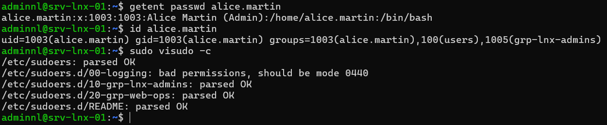

## Introduction

Cette procédure décrit la gestion des comptes locaux sur un serveur Linux Debian 13 ou Ubuntu Server 24.04 LTS : création et modification des utilisateurs, gestion des groupes, politique d'expiration des mots de passe avec `chage`, délégation des droits d'administration par `sudo` avec des fichiers dédiés dans `/etc/sudoers.d`, et journalisation des commandes privilégiées.

Les exemples portent sur le serveur srv-lnx-01 (192.168.10.21) du lab. Les différences avec Ubuntu 26.04 LTS, sortie le 23 avril 2026, sont signalées quand elles concernent ce périmètre. Les comptes Active Directory (domaine `lab.local`) sortent du périmètre et relèvent de l'intégration par SSSD.

## Contexte et Justification

Un serveur Linux installé par défaut ne compte souvent qu'un compte administrateur créé à l'installation. Dès que plusieurs personnes interviennent, trois risques apparaissent :

- Le partage d'un compte unique supprime toute traçabilité nominative.
- L'usage direct de `root` ou d'un `sudo` sans restriction donne à chaque intervenant tous les droits, y compris ceux dont il n'a pas besoin.
- Les comptes de prestataires ou de stagiaires restent actifs après leur départ faute d'expiration programmée.

Une gestion structurée des comptes répond à ces risques :

- **Traçabilité :** chaque action privilégiée est associée à un compte nominatif et journalisée.
- **Moindre privilège :** les droits `sudo` sont accordés par groupe et limités aux commandes nécessaires.
- **Cycle de vie :** les dates d'expiration et le verrouillage ferment automatiquement les accès temporaires.

## Concepts Clés

**UID et GID.** Chaque utilisateur possède un identifiant numérique (UID) et un groupe principal (GID). Sur Debian et Ubuntu, les comptes humains commencent à l'UID 1000, les comptes système sont en dessous. Les plages sont définies dans `/etc/login.defs` (`UID_MIN`, `SYS_UID_MIN`).

**Fichiers de comptes.** `/etc/passwd` décrit les comptes (nom, UID, GID, répertoire personnel, shell), `/etc/shadow` stocke les empreintes de mots de passe et les données d'expiration, `/etc/group` et `/etc/gshadow` décrivent les groupes. Ces fichiers ne s'éditent jamais à la main en production ; `vipw` et `vigr` existent pour les cas d'urgence.

**adduser et useradd.** `useradd`, `usermod` et `userdel` sont les outils bas niveau du paquet shadow, présents sur toutes les distributions. `adduser` et `deluser` sont des surcouches propres à Debian et Ubuntu, interactives, qui créent le répertoire personnel, copient `/etc/skel` et appliquent `/etc/adduser.conf`. `adduser` convient à la saisie manuelle, `useradd` aux scripts.

**Groupe principal et groupes secondaires.** Avec `USERGROUPS_ENAB yes`, chaque utilisateur reçoit un groupe privé portant son nom. Les groupes secondaires donnent des droits supplémentaires (accès à un répertoire partagé, droit `sudo`, lecture des journaux avec `adm`).

**Vieillissement des mots de passe.** `chage` lit et modifie les champs d'expiration de `/etc/shadow` : durée maximale et minimale du mot de passe, période d'avertissement, période d'inactivité après expiration et date d'expiration du compte.

**sudo et sudoers.** `sudo` exécute une commande avec l'identité d'un autre utilisateur, `root` par défaut, selon les règles de `/etc/sudoers` et des fichiers inclus depuis `/etc/sudoers.d`. Une règle suit la forme `qui hôte=(identité) commandes`. Sur Debian et Ubuntu, le groupe `sudo` dispose de tous les droits par la ligne `%sudo ALL=(ALL:ALL) ALL`.

**visudo.** `visudo` édite les fichiers sudoers avec un verrou et vérifie la syntaxe avant l'enregistrement. Un fichier sudoers invalide peut bloquer tout usage de `sudo` sur le serveur.

**sudo-rs.** Réécriture de `sudo` en Rust. Ubuntu l'a adopté comme implémentation par défaut à partir de la 25.10, et Ubuntu 26.04 LTS le conserve : l'outil historique y est renommé `sudo.ws`. Ubuntu 24.04 LTS et Debian 13 utilisent toujours le `sudo` classique (Debian propose `sudo-rs` comme paquet optionnel).

## Prérequis

- Un serveur Debian 13 (13.7 au 16/10/2026) ou Ubuntu Server 24.04 LTS, ici srv-lnx-01.
- Un compte disposant des droits `root` ou appartenant au groupe `sudo`.
- Une deuxième session ouverte en `root` (console ou SSH) pendant toute modification de sudoers, pour pouvoir corriger une erreur.
- Une convention de nommage des comptes et des groupes, par exemple `prenom.nom` pour les personnes et `grp-` pour les groupes.
- Sur Debian, le paquet `sudo` installé (voir « Points de Vigilance »).

## Points de Vigilance

**Debian n'installe pas toujours sudo.** Si un mot de passe `root` a été défini pendant l'installation, l'installateur Debian n'installe pas `sudo` et n'ajoute pas le premier utilisateur au groupe `sudo`. Installez-le avec `apt install sudo` depuis une session `root`. Si le mot de passe `root` a été laissé vide, `sudo` est installé et le premier compte est membre du groupe `sudo`.

**Ne modifiez jamais /etc/sudoers directement.** Les mises à jour du paquet peuvent proposer une nouvelle version du fichier. Placez vos règles dans `/etc/sudoers.d/`, toujours avec `visudo -f`. Les fichiers de ce répertoire dont le nom contient un point ou se termine par `~` sont ignorés : `admins.conf` n'est jamais lu, `10-admins` l'est.

**L'ajout à un groupe sans -a remplace les groupes.** `usermod -G sudo alice` retire alice de tous ses autres groupes secondaires. Utilisez toujours `usermod -aG`.

**Les changements de groupe exigent une nouvelle session.** Un utilisateur ajouté à un groupe n'en obtient les droits qu'à sa prochaine connexion.

**Ubuntu 26.04 utilise sudo-rs.** sudo-rs n'implémente qu'un sous-ensemble de la syntaxe sudoers. Ne sont pas pris en charge, notamment, la journalisation des entrées et sorties (`log_output`, `sudoreplay`), `requiretty`, `mailto` et les sudoers stockés dans LDAP (le paquet `sudo-ldap` est retiré). Le retour visuel de la saisie du mot de passe (`pwfeedback`) y est activé par défaut. Un retour au sudo classique reste possible avec `update-alternatives --set sudo /usr/bin/sudo.ws`, mais Canonical ne le recommande pas.

**sudo-ldap est abandonné.** Debian annonce la fin de `sudo-ldap` après Debian 13. Les règles sudo centralisées doivent migrer vers SSSD (`libsss-sudo`).

**Les politiques de login.defs ne sont pas rétroactives.** `PASS_MAX_DAYS`, `PASS_MIN_DAYS` et `PASS_WARN_AGE` s'appliquent aux comptes créés après leur modification. Les comptes existants se mettent à jour avec `chage`.

**lastlog disparaît de Debian 13.** Le fichier `/var/log/lastlog` n'est plus alimenté. Utilisez `lastlog2` (paquet du même nom) ou `lslogins`, et `last` qui lit désormais la base `wtmpdb`.

## Choix Architecturaux & Alternatives

### Quand choisir des comptes locaux et sudo

Les comptes locaux avec `sudo` conviennent aux serveurs isolés, aux équipements en DMZ, aux petits parcs sans annuaire et aux comptes de secours qui doivent fonctionner même quand l'annuaire est indisponible. Ils restent le socle de toute installation, même sur un serveur joint à Active Directory : au moins un compte local d'administration doit exister.

Dès que le parc dépasse quelques serveurs ou que les équipes changent souvent, la gestion locale devient coûteuse et source d'oubli. Un annuaire centralisé (Active Directory via SSSD, FreeIPA) est alors préférable pour les comptes humains, avec des règles sudo pilotées par groupe d'annuaire.

### Alternatives et comparatif

| Option | Cas d'usage typique | Force principale | Faiblesse principale | Coût relatif |
|--------|---------------------|------------------|----------------------|--------------|
| **Comptes locaux et sudo** | Serveurs isolés, petits parcs, comptes de secours | Aucune dépendance, simple à auditer sur un serveur | Ne passe pas à l'échelle, comptes orphelins | Gratuit |
| **Active Directory via SSSD** | Parc mixte Windows et Linux avec AD existant | Cycle de vie centralisé, groupes AD dans sudoers | Dépendance au réseau et aux DC, mise en œuvre plus lourde | Faible si AD existe |
| **FreeIPA (IdM)** | Parc Linux important sans AD | Règles sudo, HBAC et clés SSH centralisées | Infrastructure dédiée à maintenir | Moyen |
| **run0 (systemd)** | Élévation ponctuelle sans sudo | Pas de binaire SUID, s'appuie sur polkit | Pas de fichier de règles équivalent à sudoers, usage encore marginal | Gratuit |
| **Bastion à privilèges (PAM, ex. Teleport, CyberArk)** | Environnements réglementés | Enregistrement de session, approbation | Coût de licence et d'exploitation | Élevé |

### Impact des choix

- **Sécurité.** Des règles sudo par groupe et par commande limitent l'impact d'un compte compromis. Une règle `ALL` sur un éditeur ou un shell équivaut à un accès `root` complet.
- **Disponibilité.** Un compte local de secours garantit l'accès quand l'annuaire ou le réseau tombe. À l'inverse, un fichier sudoers invalide bloque toute élévation : `visudo -c` doit précéder toute mise en production.
- **Exploitation.** La gestion locale impose de répéter les opérations sur chaque serveur. Un outil d'automatisation (Ansible, scripts Bash) devient nécessaire au delà de quelques machines.
- **Coût.** Les comptes locaux et sudo sont gratuits. Le coût réel tient au temps de revue des comptes et à la gestion des départs.

## Configuration

### Créer un utilisateur

Avec `adduser`, interactif, sur Debian et Ubuntu :

```bash
sudo adduser --comment "Alice Martin" alice.martin
```

<div class="callout callout-note">

L'option `--comment` remplace `--gecos`, dépréciée dans les versions récentes d'adduser. Sur Debian 12 et suivantes, les répertoires personnels sont créés en `0700` ; sur Ubuntu, ils le sont en `0750`. La valeur se règle par `DIR_MODE` dans `/etc/adduser.conf`.

</div>

Avec `useradd`, non interactif, pour un script :

```bash
sudo useradd -m -s /bin/bash -c "Bruno Petit" bruno.petit
sudo passwd bruno.petit
```

Pour un compte de service sans connexion interactive :

```bash
sudo useradd --system --no-create-home --shell /usr/sbin/nologin svc-backup
```

### Gérer les groupes

Créez les groupes fonctionnels, puis ajoutez les membres :

```bash
sudo groupadd grp-lnx-admins
sudo groupadd grp-web-ops
sudo usermod -aG grp-lnx-admins alice.martin
sudo gpasswd -a bruno.petit grp-web-ops
```

Retirez un membre d'un groupe :

```bash
sudo gpasswd -d bruno.petit grp-web-ops
```

Consultez l'appartenance :

```bash
id alice.martin
getent group grp-lnx-admins
```

### Modifier, verrouiller et supprimer un compte

```bash
# Changer le shell et le commentaire
sudo usermod -s /bin/bash -c "Alice Martin (Admin)" alice.martin

# Verrouiller le mot de passe et expirer le compte
sudo usermod -L -e 1 bruno.petit

# Déverrouiller
sudo usermod -U -e "" bruno.petit

# Supprimer le compte et son répertoire personnel (Debian et Ubuntu)
sudo deluser --remove-home bruno.petit
```

<div class="callout callout-note">

`usermod -L` bloque uniquement l'authentification par mot de passe. Une clé SSH présente dans `~/.ssh/authorized_keys` permet encore la connexion. L'expiration du compte (`-e 1`) bloque toutes les méthodes passant par PAM, y compris les clés SSH.

</div>

### Définir la politique d'expiration avec chage

Appliquez une politique à un compte existant :

```bash
sudo chage -M 90 -m 1 -W 14 -I 30 alice.martin
```

| Option | Effet |
|--------|-------|
| `-M 90` | Mot de passe valable 90 jours au maximum |
| `-m 1` | Un jour minimum entre deux changements |
| `-W 14` | Avertissement 14 jours avant l'expiration |
| `-I 30` | Compte désactivé 30 jours après l'expiration du mot de passe |
| `-E 2027-03-31` | Date d'expiration du compte |
| `-d 0` | Force le changement du mot de passe à la prochaine connexion |

Pour un prestataire dont la mission se termine le 31 mars 2027 :

```bash
sudo chage -E 2027-03-31 -d 0 bruno.petit
sudo chage -l bruno.petit
```

Pour les futurs comptes, ajustez `/etc/login.defs` :

```bash
sudo sed -i 's/^PASS_MAX_DAYS.*/PASS_MAX_DAYS\t90/; s/^PASS_MIN_DAYS.*/PASS_MIN_DAYS\t1/; s/^PASS_WARN_AGE.*/PASS_WARN_AGE\t14/' /etc/login.defs
```

### Déléguer les droits avec /etc/sudoers.d

Créez un fichier de règles avec `visudo`, qui vérifie la syntaxe à l'enregistrement :

```bash
sudo visudo -f /etc/sudoers.d/10-grp-lnx-admins
```

Contenu pour les administrateurs complets :

```text
# Administrateurs Linux : tous les droits, mot de passe exigé
%grp-lnx-admins ALL=(ALL:ALL) ALL
```

Créez une délégation restreinte pour l'équipe web :

```bash
sudo visudo -f /etc/sudoers.d/20-grp-web-ops
```

```text
# Équipe web : gestion de nginx uniquement
Cmnd_Alias WEB_SVC = /usr/bin/systemctl restart nginx, \
                     /usr/bin/systemctl reload nginx, \
                     /usr/bin/systemctl status nginx, \
                     /usr/bin/journalctl -u nginx
%grp-web-ops ALL=(root) WEB_SVC
```

Appliquez des droits stricts et validez l'ensemble :

```bash
sudo chmod 0440 /etc/sudoers.d/10-grp-lnx-admins /etc/sudoers.d/20-grp-web-ops
sudo visudo -c
```

<div class="callout callout-note">

Indiquez toujours des chemins absolus dans les règles. N'autorisez jamais un éditeur (`vi`, `nano`), un pager (`less`) ou un interpréteur (`bash`, `python3`) : ils permettent d'ouvrir un shell `root`. Pour l'édition de fichiers, utilisez `sudoedit` avec une règle du type `%grp-web-ops ALL=(root) sudoedit /etc/nginx/sites-available/*`.

</div>

### Journaliser l'usage de sudo

Par défaut, `sudo` envoie chaque commande au journal système avec la facilité `auth`. Consultez-les avec journald, sur Debian comme sur Ubuntu :

```bash
sudo journalctl -t sudo --since today
```

Sur Ubuntu 24.04, où `rsyslog` est installé, les mêmes lignes figurent aussi dans `/var/log/auth.log`. Debian 13 n'installe pas `rsyslog` par défaut : seul journald les conserve.

Avec le `sudo` classique (Debian 13, Ubuntu 24.04), ajoutez un fichier journal dédié et l'enregistrement des sessions :

```bash
sudo visudo -f /etc/sudoers.d/00-logging
```

```text
Defaults logfile="/var/log/sudo.log"
Defaults log_output
Defaults!/usr/bin/sudoreplay !log_output
Defaults iolog_dir="/var/log/sudo-io/%{user}"
```

Relisez une session enregistrée :

```bash
sudo sudoreplay -l
sudo sudoreplay <ID-de-session>
```

<div class="callout callout-note">

`log_output` enregistre tout ce qui s'affiche, y compris des secrets éventuels, et consomme de l'espace disque. Réservez-le aux serveurs sensibles et prévoyez une rotation de `/var/log/sudo-io`. Ces directives ne fonctionnent pas avec sudo-rs (Ubuntu 26.04) : sur ce système, appuyez-vous sur journald et sur une centralisation des journaux.

</div>

## Vérifications

**Compte créé :** `getent passwd alice.martin` renvoie la ligne du compte avec le bon shell et le bon répertoire personnel.

**Groupes :** `id alice.martin` affiche `grp-lnx-admins` parmi les groupes secondaires.

**Expiration :** `sudo chage -l bruno.petit` affiche la date d'expiration du compte et les durées attendues.

**Syntaxe sudoers :** `sudo visudo -c` répond `parsed OK` pour chaque fichier.



<p class="figure-caption"><b>Figure 1</b> · Récapitulatif des 3 commandes ci-dessus.</p>

**Droits effectifs :** `sudo -l -U bruno.petit` liste uniquement les commandes du `Cmnd_Alias` WEB_SVC.

**Test réel :** depuis une session de bruno.petit, `sudo systemctl status nginx` fonctionne et `sudo -i` est refusé.

**Journalisation :** `sudo journalctl -t sudo -n 20` affiche les commandes exécutées avec le compte, le terminal et le répertoire courant.

## Dépannage

**« user is not in the sudoers file » :** le compte n'appartient à aucun groupe autorisé, ou il n'a pas ouvert de nouvelle session depuis l'ajout. Vérifiez avec `id`, puis reconnectez l'utilisateur.

**« parse error in /etc/sudoers.d/... » et sudo inutilisable :** un fichier invalide a été déposé sans `visudo`. Depuis la session `root` conservée, ou avec `pkexec visudo` si polkit est disponible, corrigez le fichier. À défaut, redémarrez en mode de secours (`systemd.unit=rescue.target`) et supprimez le fichier fautif.

**Une règle de /etc/sudoers.d n'est pas appliquée :** le nom du fichier contient un point ou se termine par `~`, ou une règle plus générale placée après l'écrase. sudo applique la dernière règle correspondante ; vérifiez l'ordre avec `sudo -l -U <compte>`.

**« Your account has expired; please contact your system administrator » :** la date d'expiration est atteinte. Prolongez avec `sudo chage -E 2027-06-30 <compte>` ou supprimez-la avec `sudo chage -E -1 <compte>`.

**Une directive sudoers est refusée sur Ubuntu 26.04 :** sudo-rs ne la prend pas en charge. Retirez-la ou vérifiez la page de manuel `sudoers` fournie par sudo-rs.

## Conseils et Bonnes Pratiques

**Un fichier sudoers par fonction.** Préfixez les fichiers par un numéro (`10-`, `20-`) pour maîtriser l'ordre de lecture et nommez-les d'après le groupe concerné. La revue et la suppression deviennent triviales.

**Accordez les droits à des groupes, jamais à des comptes.** Les arrivées et départs se gèrent alors par appartenance au groupe, sans toucher aux sudoers.

**Conservez un compte local de secours.** Un compte d'urgence au mot de passe long, stocké dans un coffre, permet d'intervenir quand l'annuaire est indisponible. Testez-le à chaque revue.

**Évitez NOPASSWD.** Le mot de passe à l'élévation limite l'exploitation d'une session laissée ouverte. Réservez `NOPASSWD` aux comptes d'automatisation, limités à des commandes précises.

**Revue trimestrielle des comptes.** Listez les comptes humains avec `awk -F: '$3 >= 1000 && $3 < 65534 {print $1}' /etc/passwd`, croisez avec la liste des intervenants, et verrouillez les comptes inutilisés.

**Centralisez les journaux.** Les journaux sudo d'un serveur compromis peuvent être effacés. Transférez-les vers un serveur de journaux dès leur émission.

## Procédures Liées

- Intégration d'un Serveur Linux à Active Directory (realmd et SSSD) *(Comptes et groupes sudo pilotés par AD)*
- Sécurisation d'OpenSSH (Clés, Durcissement, Fail2ban) *(Restriction des connexions par groupe)*
- [Gestion des Permissions, ACL et Droits Spéciaux](/procedures/linux/gestion-des-permissions-acl-et-droits-speciaux) *(Droits des groupes sur les fichiers)*
- [Centralisation des Journaux avec rsyslog](/procedures/linux/centralisation-des-journaux-avec-rsyslog) *(Conservation des traces sudo hors du serveur)*
- [Automatisation de l'Administration avec des Scripts Bash](/procedures/linux/automatisation-de-ladministration-avec-des-scripts-bash) *(Création de comptes en masse)*
